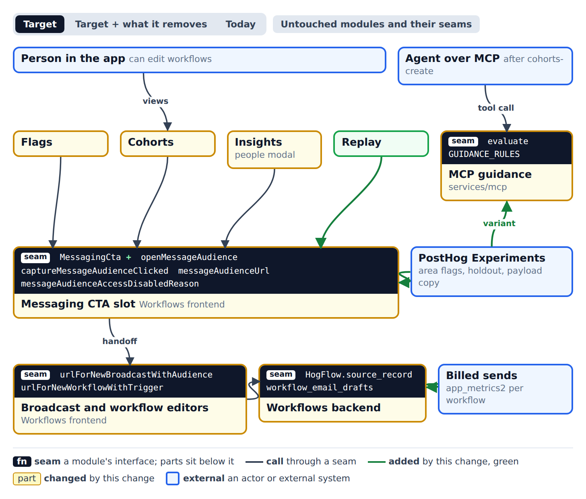
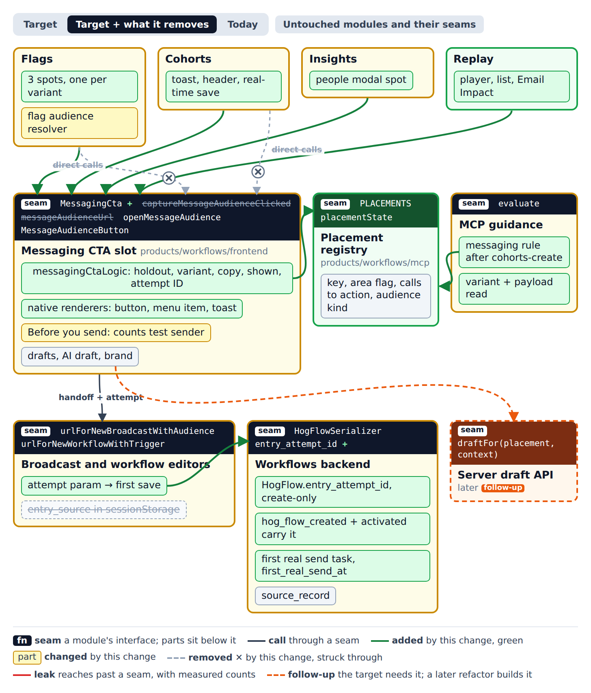
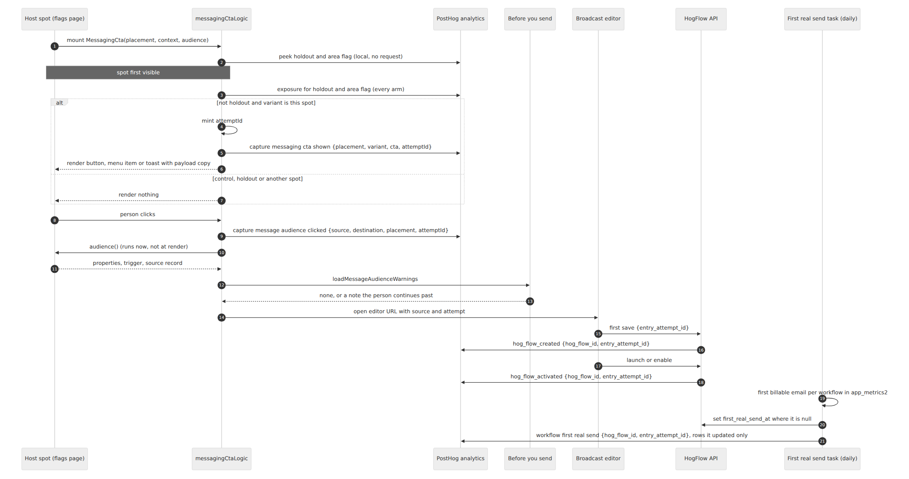
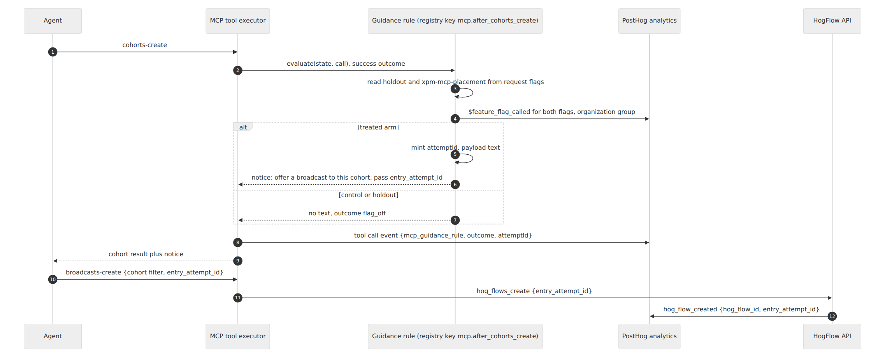
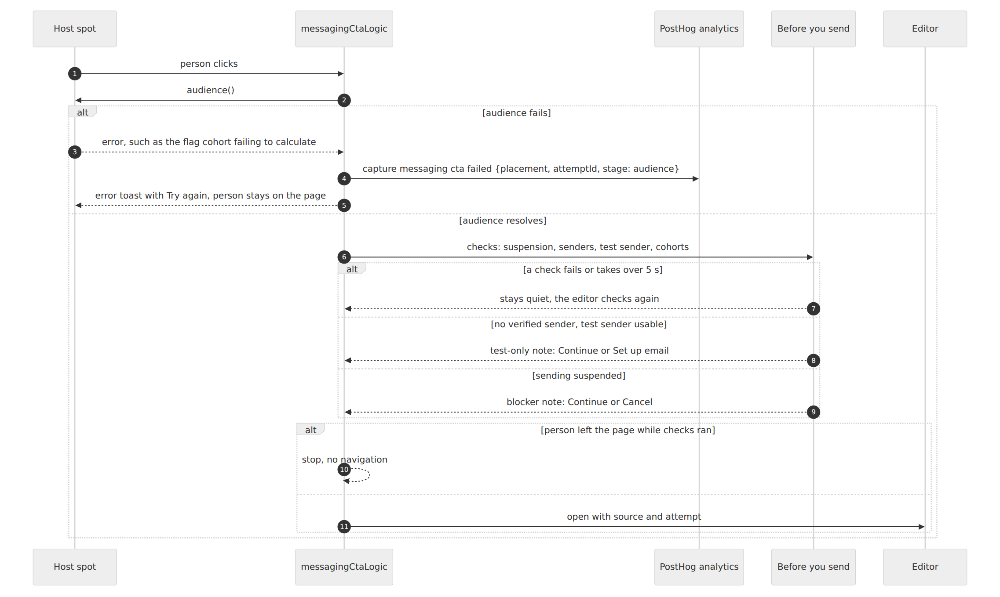
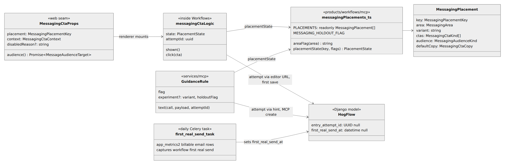

# Messaging CTA slot

## Context

Product areas send people to Workflows from many places: flags, cohorts, insights, session replay and the MCP.
Each host wires the click event, the access check, the "Before you send" dialog and the editor URL on its own.
So no one can test which spot works, and no saved workflow remembers where it came from.

This design gives Workflows one call-to-action slot that every host plugs a placement into.
The slot runs a per-organization experiment and carries one attempt ID from the first impression to the saved workflow, and from there to its first real send.

**Question:** how does every product area offer "message these people" through one Workflows-owned seam, with an experiment on placement and a join from the impression to a billed send?

**Decision:** a `MessagingCta` slot grown from `MessageAudience`, a shared placement registry, a create-only `HogFlow.entry_attempt_id`, a daily first-real-send task, and an experiment block in the MCP guidance engine.

## Rung 1: context



Two actors: a person in the app who can edit workflows, and an agent over the MCP.
PostHog AI reaches the same MCP tools, so it gets the MCP path later at no extra cost.
Surveys, Error tracking and Early access stay outside the slot.
They keep their entry points, which serve as the benchmark, and get the `shown` event and the attempt ID through the module's existing functions.
Billing is an outside system the change only reads: billed emails are `app_metrics2` rows with `app_source='hog_flow'`, `metric_name='billable_invocation'` and `metric_kind='email'`, per workflow (`posthog/tasks/usage_report.py`).

[Page with every view](messaging-cta-slot/context.html), [spec](messaging-cta-slot/context.json)

## Rung 2: modules and seams



Hosts call `MessagingCta` only.
Flags and cohorts drop their direct calls to `captureMessageAudienceClicked` and `messageAudienceUrl`, so the flag page gets the "Before you send" dialog and the draft source it skips today.
The two functions stay exported until the benchmark hosts move.
The registry lives in `products/workflows/mcp/`, which the frontend and `services/mcp` both import from already.

[Page with every view](messaging-cta-slot/modules.html), [spec](messaging-cta-slot/modules.json)

## Rung 3: key paths

The person in the app, from mount to first real send:



The agent over the MCP:



What fails, and what the person sees:



Sources: [main.mmd](messaging-cta-slot/main.mmd), [mcp.mmd](messaging-cta-slot/mcp.mmd), [failure.mmd](messaging-cta-slot/failure.mmd)

- Exposure fires for the holdout and the area flag when the spot first becomes visible, in every arm, including control and the holdout, where nothing renders.
- Every click from one shown spot reuses its attempt ID. The analysis credits the first workflow saved with it. A reload or a new session gets a new attempt.
- A sender check that fails or takes over 5 seconds stays quiet, and the editor checks again.
- A team with no verified sender that can use the PostHog test sender gets a test-only note in "Before you send", not a blocker.

## Rung 4: contracts



### Placement registry, `products/workflows/mcp/messagingPlacements.ts`

```ts
export type MessagingArea = 'flags' | 'cohorts' | 'insights' | 'replay' | 'mcp'
export type MessagingCtaKind = 'broadcast' | 'workflow' | 'code_sending'
export type MessagingAudienceKind = 'snapshot_cohort' | 'cohort' | 'event_trigger' | 'none'

export const messagingCtaCopySchema = z.object({
  label: z.string().min(1).max(60),
  description: z.string().max(200).optional(),
})
export type MessagingCtaCopy = z.infer<typeof messagingCtaCopySchema>

export interface MessagingPlacement {
  readonly key: `${MessagingArea}.${string}` // frozen once shipped
  readonly area: MessagingArea
  readonly variant: string // the area flag's variant that shows this spot
  readonly ctas: readonly MessagingCtaKind[] // first is primary
  readonly audience: MessagingAudienceKind
  readonly defaultCopy: MessagingCtaCopy
}

export const MESSAGING_HOLDOUT_FLAG = 'xpm-messaging-holdout'
export const areaFlag = (area: MessagingArea): string => `xpm-${area}-placement`

export const PLACEMENTS = [
  /* one entry per spot */
] as const satisfies readonly MessagingPlacement[]
export type MessagingPlacementKey = (typeof PLACEMENTS)[number]['key']

export interface FlagReader {
  value(flag: string): boolean | string | undefined // no exposure
  payload(flag: string): unknown
}
export type PlacementState =
  | { active: true; placement: MessagingPlacement; copy: MessagingCtaCopy; copySource: 'payload' | 'default' }
  | { active: false; reason: 'holdout' | 'other_variant' | 'flag_off' | 'flags_not_loaded' }

export function placementState(key: MessagingPlacementKey, flags: FlagReader): PlacementState
```

- **Invariants.** Pure and synchronous. It sends nothing and reads only the holdout and one area flag. A holdout value of `'holdout'` wins over every area variant. Each area flag has one variant per spot, so an organization sees at most one spot per area.
- **Error modes.** A missing or invalid payload falls back to `defaultCopy` with `copySource: 'default'`, and nothing throws. An unknown key is a compile error.
- **Performance.** Two map reads and one zod parse per call.

### Web slot, `products/workflows/frontend/MessagingCta/`

```ts
export interface MessagingCtaContext {
  kind: 'feature_flag' | 'cohort' | 'insight' | 'session_recording' | 'email_impact'
  id: string | number
  name?: string
}
export interface MessagingCtaProps {
  placement: MessagingPlacementKey
  context: MessagingCtaContext
  audience: () => Promise<MessageAudienceTarget> // MessageAudience minus source and draftSource
  disabledReason?: string // host-owned, such as "Save the cohort first"
}

export function MessagingCtaButton(props: MessagingCtaProps & { size?: LemonButtonProps['size'] }): JSX.Element | null
export function messagingCtaMenuItem(props: MessagingCtaProps): LemonMenuItem | null
export function showMessagingCtaToast(props: MessagingCtaProps): void
```

- **Invariants.**
  - It renders nothing for the holdout, an inactive spot, or a person without workflow edit access.
  - Mounting makes no network request. `peekFeatureFlag` reads the variant, and `reportFeatureFlagExposure` sends the exposure for the holdout and the area flag on first mount, in every arm.
  - `messaging cta shown` fires once per placement per browser session and mints the attempt ID.
  - `audience()` runs only on click.
  - The host never sees the attempt ID, the copy, the events or the editor URL.
- **Error modes.** If `audience()` rejects or takes over 10 seconds, the slot fires `messaging cta failed` with `stage: 'audience'` and shows an error toast with Try again. Nothing throws to the host.
- **Performance.** One `messagingCtaLogic` per mounted placement, keyed by placement. The menu item and the toast share it.

The broadcast and workflow editors read `?attempt=<uuid>` and send it as `entry_attempt_id` on the first save only, next to `source_record`.

### Workflows backend

```python
# products/workflows/backend/models/hog_flow/hog_flow.py
entry_attempt_id = models.UUIDField(null=True, blank=True)
first_real_send_at = models.DateTimeField(null=True, blank=True)

# products/workflows/backend/presentation/views/hog_flow.py, create-only like source_record
entry_attempt_id = serializers.UUIDField(
    required=False,
    allow_null=True,
    write_only=True,
    help_text="The call-to-action impression this workflow started from. Set only when creating a workflow.",
)
# _report_workflow_action adds entry_attempt_id to hog_flow_created and hog_flow_activated.

# products/workflows/backend/tasks/workflow_first_real_send.py
@shared_task(ignore_result=True, queue=CeleryQueue.LONG_RUNNING.value)
def capture_workflow_first_real_sends() -> None: ...
```

- **Invariants.**
  - `entry_attempt_id` is never written after create.
  - The task covers every workflow created after it ships, with or without an attempt, so Experiments can compare first sends across all arms, the holdout included.
  - It sets `first_real_send_at` with `UPDATE ... WHERE first_real_send_at IS NULL`. Then it captures `workflow first real send` with the organization group, only for the rows it updated, so a rerun never captures twice.
- **Error modes.** A ClickHouse failure ends the run with nothing updated, and the next run picks up the same rows. A capture failure after the update loses that one event, and the column still holds the date for analysis.
- **Performance.** Each run makes one ClickHouse query over the last two days of billable email rows in `app_metrics2`, grouped by workflow, with an explicit workload, plus one indexed Postgres update per batch.
- **Open.** Do sends from the PostHog test sender write billable rows? `isBillable` in `nodejs/src/cdp` counts every accepted email. If they do, the task skips workflows whose email steps all use the test sender.

### MCP guidance engine, `services/mcp/src/hono/guidance/`

```ts
// rule-schema.ts
experiment: z.object({ variant: z.string().min(1), holdoutFlag: z.string().min(1).optional() }).optional(),
text: z.union([
    z.string().min(1).max(2000),
    z.custom<(input: { call: GuidanceCall; payload: unknown; attemptId: string }) => string>(),
]),

// engine.ts: with an experiment block, firedOutcome compares toolFeatureFlags[rule.flag]
// to experiment.variant and returns 'holdout' when the holdout flag says so.
// guidanceAnalyticsProperties adds mcp_guidance_attempt_id for experiment rules.

// rules/messaging.ts
{
    id: 'cohorts-create-messaging',
    flag: areaFlag('mcp'),
    experiment: { variant: placementFor('mcp.after_cohorts_create').variant, holdoutFlag: MESSAGING_HOLDOUT_FLAG },
    trigger: { tool: 'cohorts-create', outcome: 'success', presets: [/* ... */] },
    requiresTool: ['broadcasts-create'],
    text: ({ payload, attemptId }) => '...', // tells the agent to pass entry_attempt_id
}
```

- **Invariants.**
  - Rules without `experiment` behave as they do today.
  - The request state carries the payloads of guidance flags next to their values.
  - An experiment rule captures `$feature_flag_called` for its flag and the holdout, with the organization group, every time its trigger matches, in every arm.
- **Error modes.** A missing payload uses the placement's `defaultCopy`. A capture failure never fails the tool call.
- **Performance.** No new flag call, because the payloads come from the same `getAllFlagsAndPayloads` response.

### Events

| Event                                    | Properties                                                       | Fired by                                                             |
| ---------------------------------------- | ---------------------------------------------------------------- | -------------------------------------------------------------------- |
| `messaging cta shown`                    | placement, area, variant, cta, attempt_id                        | slot, once per placement per session                                 |
| `message audience clicked`               | source, destination, placement, attempt_id                       | slot sets `source` to the placement key; benchmark hosts keep theirs |
| `messaging cta failed`                   | placement, attempt_id, stage                                     | slot                                                                 |
| `hog_flow_created`, `hog_flow_activated` | existing properties, plus entry_attempt_id                       | Workflows API                                                        |
| `workflow first real send`               | hog_flow_id, entry_attempt_id, organization group                | daily task                                                           |
| MCP tool-call event                      | mcp_guidance_rule, mcp_guidance_outcome, mcp_guidance_attempt_id | guidance engine                                                      |

## The cut

Nine pull requests.
Each stays under 400 production lines.
The first four form the base stack, and the area PRs build on the slot.

| PR                    | Seam                                 | Files it owns                                                                                                                                    |
| --------------------- | ------------------------------------ | ------------------------------------------------------------------------------------------------------------------------------------------------ |
| A1 backend            | `HogFlowSerializer.entry_attempt_id` | `HogFlow` fields and migration, serializer and events in `presentation/views/hog_flow.py`, `tasks/workflow_first_real_send.py` and its schedule  |
| A2 benchmark baseline | existing `MessageAudience` functions | `MessageAudience/*` (attempt ID and `shown`), `broadcastWizardLogic.ts`, `workflowLogic.ts` and the prefill files reading `?attempt`             |
| A3 slot               | `MessagingCta`, `placementState`     | `products/workflows/mcp/messagingPlacements.ts`, `MessagingCta/` (renderers, `messagingCtaLogic`), flag keys in `frontend/src/lib/constants.tsx` |
| A4 dialog             | `loadMessageAudienceWarnings`        | `messageAudienceWarnings.tsx` test-only note                                                                                                     |
| Flags                 | host                                 | `featureFlagLogic.ts`, `FeatureFlag.tsx`                                                                                                         |
| Cohorts               | host                                 | `CohortEdit.tsx`, `CohortSceneMenuBar.tsx`, `cohortSavedToast.ts`, `cohortEditLogic.ts`                                                          |
| Insights              | host                                 | `PersonsModal.tsx`, `personsModalLogic.ts`                                                                                                       |
| Replay                | host                                 | `session-recordings/player/` meta, `session-recordings/playlist/`, `Transactional/impact/EmailImpactTab.tsx`                                     |
| MCP                   | guidance engine                      | `guidance/rule-schema.ts`, `engine.ts`, `request-state-resolver.ts`, `rules/messaging.ts`, `rules/index.ts`                                      |

## Decisions

ADRs, in `products/workflows/adr/`:

- [0001: the attempt ID is a create-only column on `HogFlow`](../../products/workflows/adr/0001-attempt-id-on-hog-flow.md)
- [0002: one placement registry in `products/workflows/mcp/`, shared by the web slot and the MCP](../../products/workflows/adr/0002-shared-placement-registry.md)
- [0003: the success event comes from a daily task over billable rows](../../products/workflows/adr/0003-first-real-send-from-billable-rows.md)

These seams miss the ADR bar:

- Three native renderers, not an exported hook. It is easy to reverse: a new shape adds a renderer.
- The generic `experiment` block in the guidance engine. Easy to reverse, and rules without it don't change.
- One area flag per area plus a global holdout. These are experiment settings, changed per flag.
- Keeping `message audience clicked`. Event names are frozen API, so there was no real alternative.
- The test-only note in "Before you send". Easy to reverse.

## Follow-ups

- **Benchmark hosts onto the slot** (Strong). Move Surveys, Error tracking, Early access and the other direct callers onto `MessagingCta`, then drop the `captureMessageAudienceClicked` and `messageAudienceUrl` exports.
- **Server draft API** (Worth exploring). `draftFor(placement, context)` behind `messagingCtaLogic` replaces the browser draft path with one call.
- **Retire `entry_source`** (Worth exploring). Once every entry point carries an attempt, the `sessionStorage` key in `broadcastUsage.ts` has no reader left.
- **PostHog AI in the app** (Speculative). It reaches the same MCP tools, so the guidance rule may cover it once its tool calls go through the engine.
- **Glossary.** A3 adds Placement and Attempt to `products/workflows/CONTEXT.md`.
