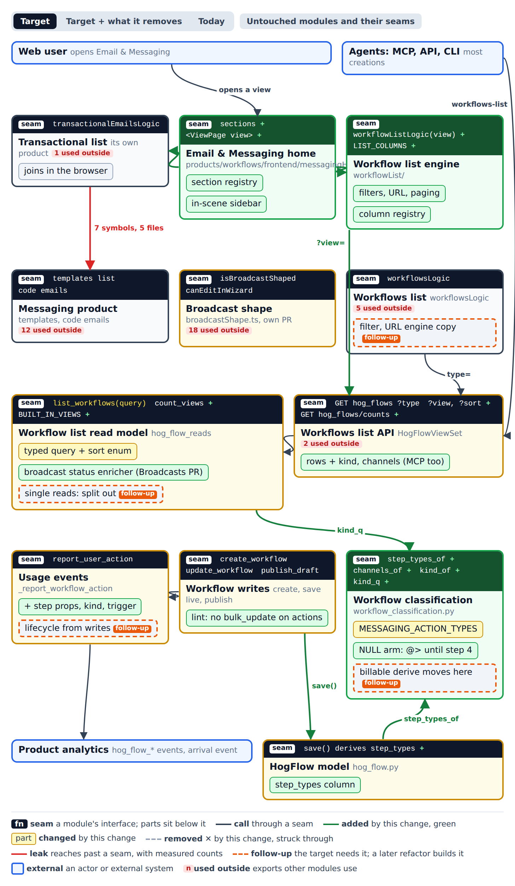
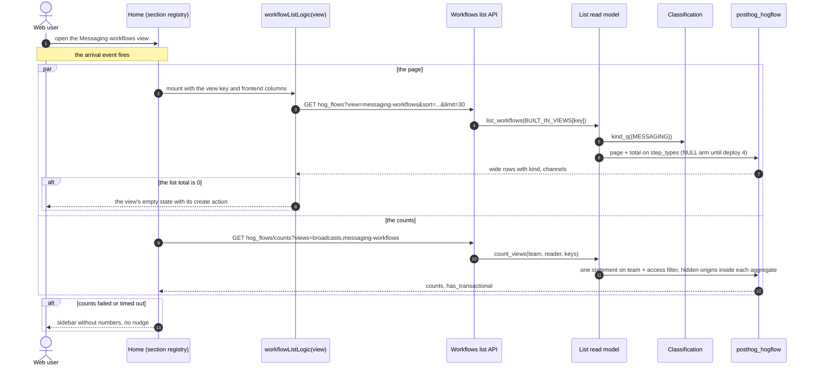
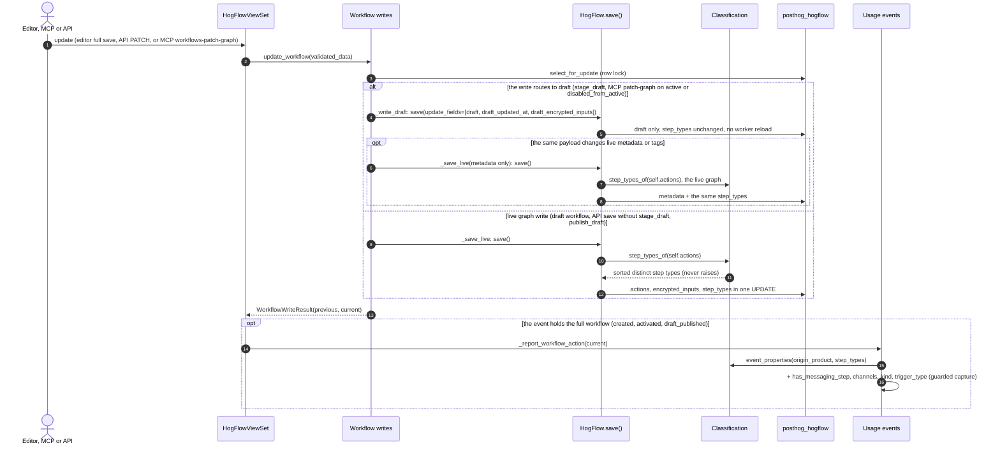
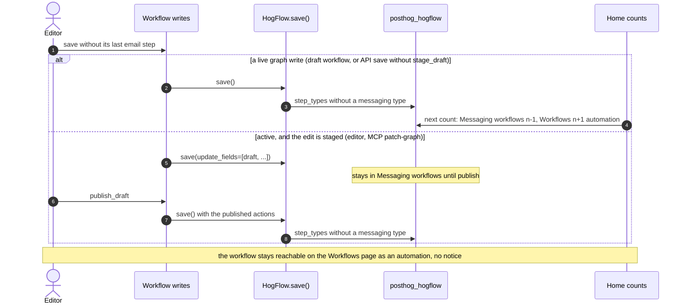

# Email & Messaging home: one view model, the messaging classification, and the events that measure it

## The question

The Email & Messaging home gathers broadcasts, transactional emails and messaging workflows behind one in-scene sidebar.
It needs:

- one answer to "is this a messaging workflow?" that the list, the setup status, the events and agents share;
- a list read model that built-in views use now and saved views can join later without a rewrite;
- events that show whether people arrive at and use the home.

A messaging workflow is a workflow with an email, SMS or push step.
A Slack step does not count.

## Rung 2: modules and seams



[The module page](messaging-home/modules.html) holds four views: target, target with what it removes, today, and the untouched modules.
The target view shows the stored `step_types` column on the `HogFlow` model.
That column ships with the counts and saved-views slice, not slice 1 (see [What ships when](#what-ships-when)).

## What ships when

1. **Instrumentation (first, not behind a flag).**
   - The `workflow_classification` module, reading `actions`.
   - `has_messaging_step`, `channels`, `kind` and `trigger_type` on three `hog_flow_*` events.
   - The arrival event.
   - `kind` and `channels` on the wide list rows.
2. **Slice 1 (behind the `email-messaging-home` organization flag, together with the overview).**
   - The home's section registry hosts today's lists unchanged:
     - Messaging workflows is today's Workflows list with `type=messaging`;
     - Broadcasts is today's Broadcasts list;
     - Transactional emails is today's Transactional emails list with its own tabs.
   - Each reused list gets a small route adapter, because today's lists restore their filters only on their old routes.
   - `setup_status` moves onto `kind_q` and gains `sends_something`.
   - `recent_drafts` serves the overview's drafts rail.
   - Classification stays on today's `actions @>` test. Slice 1 adds no schema change.
3. **Counts and saved views (later).**
   - The stored `step_types` column, derived in `HogFlow.save()`, with its backfill and read switch.
   - `kind` and `channels` on the MCP summary row.
   - The `WorkflowListQuery` sort, `BUILT_IN_VIEWS`, `?view=`, `?sort=`, `count_views` and the frontend list engine.

With the flag off, the app shows exactly what it shows today.
Instrumentation adds event properties and row fields only.

## Rung 3: call paths

### Target read: a user opens the Messaging workflows view

Slice 1 hosts today's lists, so this diagram is the read the counts and saved-views slice builds.



Each participant knows only its part:

- The home knows sections and view keys. It never builds a query.
- The engine knows the view key and the user's filters on top of it. It never knows step types.
- The read model knows the SQL and the built-in queries.
- Only classification knows which step type means which channel.
- Enrichers are per view. Messaging workflows runs none, and broadcast status runs only on the Broadcasts view.

What can fail:

- **A row whose `step_types` is NULL**, before the backfill reaches it. `kind_q`'s NULL arm falls back to today's `@>` test for that row, so the row stays in its view.
- **Counts time out.** Every consumer reads "unknown", so there are no sidebar numbers and no set-up nudge. The list never waits on counts.
- **A team with only code emails.** The list hides code-email rows, but the counts aggregate includes them, so the nudge stays away.

### Write: save a workflow from the editor, MCP or the API (counts slice)



The instrumentation slice runs the same event step with `step_types_of(workflow.actions)`, before the column exists.

What can fail:

- **Two saves race.** `save()` derives from `self.actions` after the row lock, so the stored value matches the actions written.
- **A draft-routed update.** The draft's graph never reaches `step_types`. The draft save does not name `actions`, and the metadata save derives from the live `self.actions`.
- **A malformed or unknown step.** `step_types_of` keeps every string type, skips non-string entries and never raises.
- **A writer that skips `save()`.** A lint rule flags `bulk_update` or `.update()` on `actions`. An outcome test checks every write entry point.
- **The backfill races a save.** Each batch locks the rows that are still NULL, derives and writes in one transaction.
- **The event capture fails.** The properties sit inside the existing guarded capture, so a failed capture never fails a save.

### The last message step is removed



The class follows the live steps.
It changes on save, or on publish for an active workflow.
Draft writes never change it.
The broadcast conversion path changes `origin_product` with a queryset `.update()`.
Because `kind` is computed from `origin_product` and the step types rather than stored, it changes on the next read.

## Rung 4: contracts

### Classification

`products/workflows/backend/services/workflow_classification.py` is a leaf module.
It owns the step-type and channel constants and imports nothing from the workflows product.
The model and reads import from it and re-export the constants.

```python
class Channel(StrEnum):
    EMAIL = "email"
    SMS = "sms"
    PUSH = "push"

class WorkflowKind(StrEnum):  # the same five values as ?type= (WORKFLOW_TYPES)
    MESSAGING = "messaging"
    AUTOMATION = "automation"
    LOOP = "loop"
    BROADCAST = "broadcast"
    TRANSACTIONAL_EMAIL = "transactional_email"

def step_types_of(actions: Sequence[Mapping[str, Any]] | Mapping[str, Any] | None) -> list[str]: ...
def effective_step_types(stored: list[str] | None, actions: Any) -> list[str]: ...  # stored, else step_types_of(actions)
def channels_of(step_types: Collection[str]) -> frozenset[Channel]: ...
def kind_of(origin_product: str | None, step_types: Collection[str]) -> WorkflowKind: ...
def kind_q(kinds: Collection[WorkflowKind]) -> Q: ...
def event_properties(origin_product: str | None, step_types: Collection[str]) -> dict[str, object]: ...
```

Invariants:

- **`step_types_of`** is pure and total.
  - It returns the sorted, distinct `type` of each step.
  - It keeps string types it does not know and skips non-string entries.
  - It never raises. A missing or malformed `actions` value gives `[]`.
- **`channels_of`** maps steps to channels:
  - `function_email` and `email_sandbox` map to `EMAIL`;
  - `function_sms` maps to `SMS`;
  - `function_push` maps to `PUSH`;
  - Slack is a `function` step and maps to none.

  A rule change is a deploy, never a backfill.

- **`kind_of`** lets an owned `origin_product` win:
  - `loops` gives LOOP;
  - `broadcasts` gives BROADCAST;
  - `transactional_emails` and `transactional_email_keys` give TRANSACTIONAL_EMAIL.

  Otherwise, a non-empty `channels_of` gives MESSAGING, else AUTOMATION. "Unowned" means `origin_product` is not in the owned or hidden set, so NULL and unknown origins count, as they do today.

- **`kind_q`** is `kind_of` in SQL.
  - In slice 1 it uses today's `actions @>` test.
  - The counts slice switches it to `step_types ?| array[...]`, with a fallback to `@>` for NULL rows until deploy 4.
  - One parametrized test runs `kind_of` and `kind_q` over the same table of cases, including the `{messaging, automation}` shortcut the default Workflows page relies on.
- **`effective_step_types`** is the one rule for reading step types: the stored value, or `step_types_of(actions)` when it is NULL. The facade `Workflow`, the rows, the MCP summary and the events all use it.
- **`has_active_workflows`** stays outside this module. It means "active and not sandbox-only", which is not a kind.

### Stored column (counts slice)

```python
step_types = models.JSONField(null=True, default=None)  # like billable_action_types; small, never TOASTed

def save(self, *args, update_fields=None, **kwargs):
    if update_fields is None or "actions" in update_fields:
        self.step_types = step_types_of(self.actions)
        if update_fields is not None:
            update_fields = [*update_fields, "step_types"]
    super().save(*args, update_fields=update_fields, **kwargs)
```

- Every write through `save()` or `objects.create` derives the column from the live graph it writes.
- A draft-only save leaves the column alone, so the row keeps its view until publish. The `post_save` reload behaviour is unchanged.
- A lint rule flags `bulk_update` or queryset `.update()` that names `actions`. The one existing command that does this recomputes `step_types` in the same `bulk_update`.
- An outcome test runs every write entry point and asserts `step_types == step_types_of(actions)`. Each command that rewrites step config keeps the set of step types.

The rollout goes by deploy, not by flag, and each step deploys and reverts on its own:

1. Add the nullable column, and `save()` writes it.
2. Run the backfill as a data migration, only after step 1 is live on every pod in US and EU. Then the backfill also reaches dev, local and self-hosted databases. The migration:
   - sets `atomic = False` and opens one `transaction.atomic()` per batch;
   - uses a frozen copy of `step_types_of`, because the historical model has no `save()`;
   - pages by id;
   - in each batch, runs `select_for_update` on the rows still NULL, derives, then runs `bulk_update(["step_types"])`, so it never overwrites a newer save and leaves `updated_at` alone.
3. Reads use `kind_q` with the NULL arm.
4. Remove the NULL arm.
5. Make the column NOT NULL. This migration first fills any NULL left, and the Node test fixture that inserts raw rows writes the column.

A check compares two things per row:

- the stored value against `step_types_of(actions)`;
- the raw column predicate against the `@>` oracle, in both directions, counting NULL as a disagreement.

It must read 0:

- before step 3;
- again right before step 4;
- after any revert of step 1.

To revert step 1 after step 3, restore the legacy reads first, then repair every mismatch from locked live rows.
The proof for step 3 is a plain `EXPLAIN` plus a bounded timing of the legacy and candidate statements, with the access clause.
It covers today's real page, with its `pending_suggestions` annotation, and the combined-type query.

### List read model (target contract, counts and saved-views slice)

```python
class WorkflowSort(StrEnum):
    RECENTLY_UPDATED = "recently_updated"
    SUGGESTIONS_FIRST = "suggestions_first"
    LATEST_SEND_FIRST = "latest_send_first"
    # NAME joins with saved views: lower(name), NULLs last, then id

# Extends the live facade WorkflowListQuery, which keeps trigger, broadcast_statuses,
# broadcast_eligible, origin_product, field_filters and include_all_if_admin.
@frozen
class WorkflowListQuery:
    kinds: frozenset[WorkflowKind] = frozenset()
    statuses: frozenset[str] = frozenset()
    tags: frozenset[str] = frozenset()
    created_by: UUID | None = None
    search: str = ""
    sort: WorkflowSort = WorkflowSort.RECENTLY_UPDATED

BUILT_IN_VIEWS: Mapping[str, WorkflowListQuery]  # "broadcasts", "messaging-workflows"

@frozen
class ViewCounts:
    counts: Mapping[str, int]  # per requested built-in view key
    has_transactional: bool    # any transactional workflow, code emails included

def list_workflows(team_id: int, query: WorkflowListQuery, reader: Reader, page: PageRequest) -> Page[Workflow]: ...
def count_views(team_id: int, reader: Reader, keys: Collection[str]) -> ViewCounts: ...
```

Invariants:

- **A view is a value.** It supplies the base filters and the default sort. User filters narrow that set, and an explicit `sort` replaces the default. Counts describe the view before user filters. A saved view later stores its own type, mapped into the same `WorkflowListQuery`.
- **`count_views` is one statement on a stripped base**: the team plus the reader's access filter, with no `pending_suggestions` annotation and no tag prefetch.
  - It runs one `COUNT(*) FILTER (WHERE …)` per view, with each view's origin and status rules inside its own aggregate.
  - `has_transactional` is computed before the hidden-origin exclusion.
- **Page enrichers** run one query per page, bounded to the page's ids, and never filter or count.
- **The existing params** keep their meaning. Two combinations are a 400:
  - `view` together with `type`;
  - `sort` together with `suggestions_first` or `latest_send_first`.

  The legacy `broadcast_status=` keeps its path.

- **The page size** stays capped at the current maximum.

Error modes:

- An unknown view key is a 400 that lists the known keys.
- A failed or slow count is "unknown" for every consumer, never zero.

### HTTP

```text
GET /api/projects/:id/hog_flows                       # instrumentation: wide rows gain kind, channels
GET /api/projects/:id/hog_flows?view=<key>&sort=<WorkflowSort>                  # target contract
GET /api/projects/:id/hog_flows/counts?views=broadcasts,messaging-workflows     # target contract
    -> {counts: {<key>: n}, has_transactional: bool}
```

- `kind` and `channels` are computed on the server, so no frontend code maps step types.
- The MCP summary row has no `actions`. It gains `kind` and `channels` with the stored column, so the summary list never reads `actions` per row.

### Overview presence (slice 1)

`setup_status` has two facts, one per nudge:

- **`first_workflow`**, now on `kind_q({MESSAGING})`, drives the Messaging workflows nudge.
- **`sends_something`** is new and drives the Overview nudge. It is true when any non-archived messaging workflow, broadcast or transactional email exists, code emails included, and it is computed before the hidden-origin exclusion.

A failed `setup_status` call is "unknown" for both nudges, never "nothing set up".

### Drafts rail (slice 1)

```python
@frozen
class WorkflowDraftRef:
    id: UUID
    name: str
    kind: WorkflowKind
    status: str
    has_pending_draft: bool
    disabled_from_active: bool
    last_edited_at: datetime
    created_by: UserRef | None

def recent_drafts(team_id: int, reader: Reader, limit: int = 10) -> list[WorkflowDraftRef]: ...
```

- **Selection:** `status = 'draft' OR (status = 'active' AND draft IS NOT NULL)`, kinds broadcast and messaging, over the access-scoped rows.
- **Sort:** `COALESCE(draft_updated_at, updated_at)`.
- **Turned-off workflows:** `status = 'draft'` already includes workflows turned off after going live. The ref carries that flag, and the overview spec decides whether to exclude them or label them.
- **Classification:** in slice 1, `kind` comes from the bounded page's `actions`.

### Frontend

```ts
export interface WorkflowListView {
  key: 'broadcasts' | 'messaging-workflows'
  label: string
  columns: WorkflowListColumnKey[]
}

export const workflowListLogic = kea<workflowListLogicType>([
  props({} as { view: WorkflowListView }),
  key((props) => props.view.key),
  // user filters on top of ?view=, URL <-> state, persistence, paging; generated client only
])
```

- In slice 1, the home's section registry maps each section to a route, a component and a preset.
- The list engine above is the target. It replaces the filter, URL and persistence code in `workflowsLogic` and the list half of `broadcastsLogic`.
- Columns read `kind`, `channels` and metadata only, never `actions`.

### Events (instrumentation slice)

- `_report_workflow_action` adds the classification properties to exactly three events: `hog_flow_created`, `hog_flow_activated` and `hog_flow_draft_published`.
  - The properties come from `event_properties(origin_product, step_types_of(workflow.actions))`: `has_messaging_step`, `channels` (a sorted list) and `kind`.
  - `trigger_type` is added too, with the same rule as `hog_flow_run_now`: `(trigger or {}).get("type")`, or null.
  - Existing names and properties stay.
  - A call site without the full workflow sends none.
- **The arrival event** fires once per visit, when a user enters a messaging surface, in-scene tab switches included. It fires on:
  - the legacy surfaces: the Workflows messaging tabs, `/broadcasts` and `/transactional`;
  - `/messaging/*`.

  It does not fire on the all-workflows `/workflows` list. Its properties:
  - `surface`: `overview`, `calendar`, `broadcasts`, `transactional`, `messaging_workflows`, `templates` or `setup`;
  - `via`: `home` or `legacy`;
  - `flag_enabled`.

- **The impact metric** keeps the frozen `$pageview` pathname set, so its baseline survives the launch. The arrival event supplements it.

## Follow-ups

| Follow-up                                                                                    | Strength                                   | Source            |
| -------------------------------------------------------------------------------------------- | ------------------------------------------ | ----------------- |
| Stored `step_types` column, backfill and read switch (five deploys)                          | strong, once counts or saved views need it | moved by decision |
| `kind` and `channels` on the MCP summary row                                                 | strong, with the column                    | moved by decision |
| List engine (`workflowListLogic(view)`), `BUILT_IN_VIEWS`, `?view=`, `?sort=`, `count_views` | strong, with saved views                   | moved by decision |
| Move the Workflows page onto the engine and delete its filter and persistence code           | strong                                     | moved by decision |
| Broadcast status as a page-batched enricher                                                  | medium, with the Broadcasts engine view    | moved by decision |
| `NAME` sort, pinned as `lower(name)`, NULLs last, then `id`                                  | medium, with saved views                   | moved by decision |
| Slim list row for the home                                                                   | medium                                     | moved by decision |
| Billable action types derived in the classification module                                   | medium                                     | not asked         |
| Event gaps: Canvas activation and transactional creates send no `hog_flow_*` event           | medium                                     | moved by decision |
| The Workflows page's "All" filter omits broadcasts and transactional emails                  | for the home spec's copy                   | not asked         |
| A bolder module map for the workflows product                                                | weak until the home ships                  | moved by decision |

## Decisions

### Where the decisions are recorded

- [ADR 0001](../adr/0001-classify-workflows-from-step-types-in-code.md) covers classifying workflows from their step types, in code.
- [ADR 0002](../adr/0002-derive-step-types-in-hogflow-save.md) covers deriving `step_types` in `HogFlow.save()`.

### Seams without an ADR

These seams miss the ADR bar:

- **Built-in views as server values.** The first stored view is the point of no return, so this decision is reversible until saved views ship.
- **Events gated by name.** One list, easy to change.
- **The arrival event and the `$pageview` metric.** A measurement choice, not a code seam.
- **Overview presence as a `setup_status` fact.** One added field.
- **The column rollout by deploy, not by flag.** This follows from the flag's scope, which is the UI. It is recorded in the rollout above.
