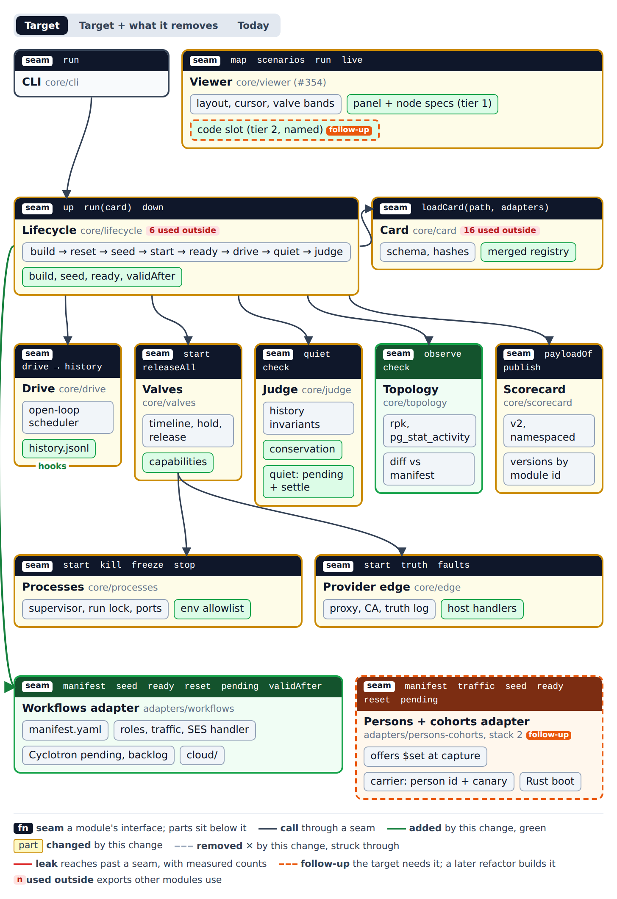
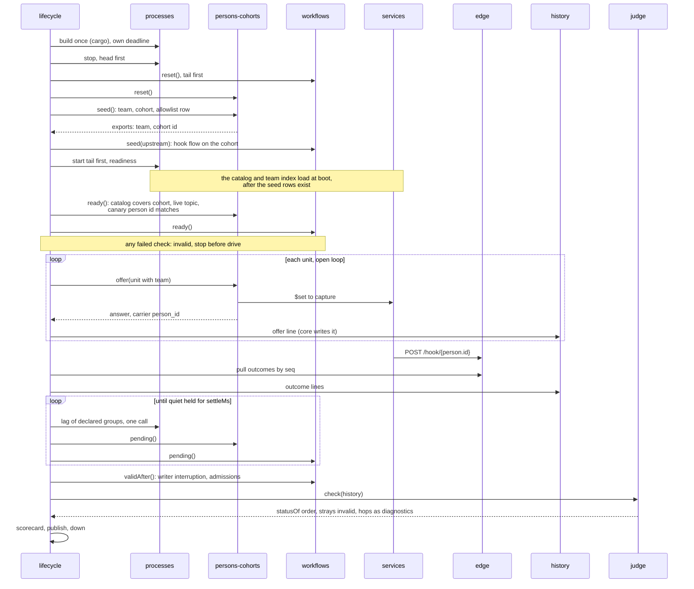
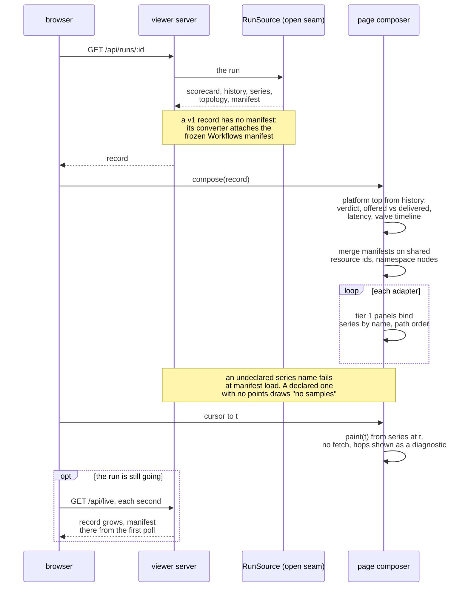
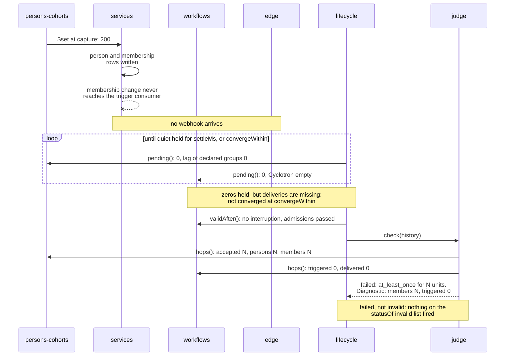

# Scenario platform: primitives, adapter contract, composition and placement

**The question.** The Workflows scenario runner in `nodejs/tests/scenarios/` boots the CDP services and drives open-loop traffic from YAML cards. It injects faults, judges delivery against a fake provider edge, and publishes a scorecard. What shape lets other PostHog teams plug their own services into it, and judge a path that crosses team boundaries end to end?

**The answer, in one paragraph.** The runner splits into a `core/` and one `adapters/<name>/` directory per team.

- **Core** owns the lifecycle, card loading, drive, valves, the judge, topology, the scorecard, processes, the provider edge and the viewer.
- **An adapter** is one TypeScript value. It holds:
  - a manifest that declares its processes;
  - `reset` and `pending`;
  - at the head of a path, one traffic definition.
- **Composition** is one history. Core journals offers at the head and records truth at the tail. Middle adapters add probes, series and diagnostics, never verdicts on units.
- **Order of work.** Workflows is extracted first. Persons and cohorts is built second, so the contract is frozen only after it has two real adapters.

This is a throwaway prototype. The branch `prototype/scenario-platform` is never merged. This file is the interface section of the spec that follows.

- [Final module page](scenario-platform/final/modules.html) and its spec, [`modules.json`](scenario-platform/final/modules.json)
- [Final contracts](scenario-platform/final/contracts.ts): type-check under `tsc --strict` with the repo's zod 4, never imported
- [ADRs](scenario-platform/adr/)
- The rounds that led here: [`rounds/1`](scenario-platform/rounds/1) to [`rounds/5`](scenario-platform/rounds/5)

## Modules and seams (rungs 1 and 2)



The page's other views show more:

- **Target + what it removes:** the Workflows wiring inside `run()`, `DEFINITIONS` and `CdpRole` with their three import cycles, the single `tsx` command used for every process, and the viewer's Workflows tables.
- **Today:** the directories as they are on `master`.

| Module        | Seam                              | Owns                                                                                                                                      |
| ------------- | --------------------------------- | ----------------------------------------------------------------------------------------------------------------------------------------- |
| Lifecycle     | `up`, `run(card)`, `down`         | The phase order below; calls adapter hooks; never imports an adapter's code                                                               |
| Card          | `loadCard(path, adapters)`        | Schema, hashes, and the merged registry. Short names resolve against the card's `adapters:` plus `core`, and an ambiguous name is refused |
| Drive         | drive → history                   | The open-loop scheduler. Calls `offer`, and writes every history line itself                                                              |
| Valves        | `start`, `releaseAll`             | Timeline, hold and release. Acts through capability handles, never an `Action` union                                                      |
| Judge         | `quiet`, `check`                  | History invariants, conservation, the quiet rule, and joining correlation keys to units                                                   |
| Topology      | `observe`, `check`                | Diffs the declared manifest against what the run observed                                                                                 |
| Scorecard     | `payloadOf`, `publish`            | The v2 payload; versions by explicit inclusion                                                                                            |
| Processes     | `start`, `kill`, `freeze`, `stop` | Supervisor, run lock, ports, and an env allowlist per process                                                                             |
| Provider edge | `start`, `truth`, `faults`        | Proxy, CA, the truth log with `seq`, and host handlers                                                                                    |
| Viewer        | `map`, `scenarios`, `run`, `live` | Tiers 0 and 1, and every default an adapter gets with no UI code                                                                          |

**Placement.** The tree is `nodejs/tests/scenarios/{core,adapters/<name>}`, with an import rule: core imports no adapter, and no adapter imports another. `adapters/workflows/cloud/` holds today's cloud slice, which breaks the `environment` ↔ `cloud` cycle. ([ADR 0002](scenario-platform/adr/0002-in-tree-core-and-adapters.md))

## Call paths (rung 3)

### The write: run a composed card



**Why seed comes before start.** The cohort stream processor and the cohort event shuffler load their catalog and team index at boot, then refresh them every 300 s plus jitter (`rust/cohort-stream-processor/src/config.rs:70-79`, `rust/cohort-event-shuffler/src/config.rs:76-80`). If seed ran after start, the first card would wait out a refresh. The trigger skips any change that carries an `origin` (`nodejs/src/cdp/consumers/cdp-cohort-membership-trigger.consumer.ts:206-211`), so that wait would read as lost deliveries. ([ADR 0005](scenario-platform/adr/0005-seed-before-start.md))

### The read: draw a run



`RunSource`, the thing that delivers runs to the viewer, is an open seam held for the map's checkpoint. The design depends only on the run record that any run source must yield.

### The failure that matters most: a unit lost between adapters



**The status rule.** Core decides the status, in today's `statusOf` order (`nodejs/tests/scenarios/runner/status.ts:186-234`). Adapter checks join its invalid list. No adapter returns a status. ([ADR 0004](scenario-platform/adr/0004-status-decided-in-core.md))

- **`invalid`** means the harness could not test:
  - a dependency went down;
  - a `ready` or `validAfter` check failed;
  - a process was declared but not observed;
  - the generator offered too little;
  - a valve was not observed;
  - pending was unknown at the end;
  - any outcome was stray.
- **`failed`** means units were lost, duplicated or late, or a bar broke.

## Contracts (rung 4)

The full file is [`final/contracts.ts`](scenario-platform/final/contracts.ts). These are the seams a caller must know.

### The adapter

```ts
export interface Adapter {
  id: AdapterId
  owners: { team: string; reviewers?: string[] }
  manifest: Manifest // only `processes` is required
  traffic?: TrafficDefinition[] // the head adapter has one
  reset(signal: AbortSignal): Promise<void> // called tail first
  pending(signal: AbortSignal): Promise<Pending> // throw = unknown, never 0

  // Everything below defaults.
  seed?(run: { runId: string; upstream: Record<AdapterId, Seeded> }, signal: AbortSignal): Promise<Seeded>
  ready?(run: SeededRun, signal: AbortSignal): Promise<Check[]>
  validAfter?(run: SeededRun, history: readonly HistoryLine[], signal: AbortSignal): Promise<Check[]>
  terminal?(outcomes: Outcome[]): boolean // default: 2xx, or 4xx outside 408/429
  definitions?: { valves?; invariants?; measurements?; predicates? }
  profileSchema?: z.ZodType
  checkCard?(card: unknown, profile: unknown): void
  hops?(run: SeededRun, signal: AbortSignal): Promise<{ hop: string; units: number }[]> // diagnostic only
}
```

- **Invariants:**
  - `seed` runs head first, before any process starts, and writes rows only.
  - `ready` runs after readiness and before drive.
  - `validAfter` runs after quiet.
  - An adapter never writes history and never returns a status.
- **Error modes:**
  - A hook that cannot do its job throws.
  - Core wraps the throw as `AdapterError(adapter, hook)`, and the run becomes `invalid` with that adapter and hook named in `status_reason`.
  - A hook past its deadline is aborted through its signal and counts as a throw.
  - Core retries nothing except the `pending` poll.
- **Deadlines:** core constants, not adapter settings.

  | Hook                | Deadline |
  | ------------------- | -------- |
  | `build`             | 20 min   |
  | `seed`              | 120 s    |
  | `ready`             | 120 s    |
  | `reset`             | 120 s    |
  | each `pending` call | 5 s      |

  The Rust `cargo` build is its own step, outside `reset`.

- **Smallest adapter:** a manifest with processes, plus `reset` and `pending`, plus one traffic definition at the head.

### Quiet

- A run is quiet when three things hold together for the card's `settleMs`:
  - every adapter's `pending()` is 0;
  - the lag of every declared consumer group is 0, read by core in one call;
  - every expected delivery is recorded.
- The default `settleMs` is twice the longest declared commit interval.
- **Unknown is a third state.** A `pending()` that throws or times out is unknown, never 0, and a run that ends on unknown is `invalid`.
- **How each process is observed.** It declares `observe: group | client | metric | none`. A consumer that assigns its own partitions, such as the cohort stream processor, reports its backlog as a `metric`.

### History

`history.jsonl` holds two record kinds, `Offer` and `Outcome`. `v: 1` is on every line, because the live tail and a store read lines one at a time.

- **Single writer:** only core writes the file.
- **Ordering:** lines are not in clock order. Readers sort by `at`.
- **Stamps:**
  - offers carry `team`, `at`, `answeredAt`, `expect`, `carrier` and an optional `followUp`;
  - outcomes carry a per-source `seq` and the raw correlation `key`.
- **Joining outcomes to units:** the judge joins each outcome's key to a unit through the offers' carriers. Any stray outcome makes the run `invalid`.
- **Truth sources** are read with an opaque cursor, never with a foreign clock.
- **Writes:**
  - Lines are buffered in memory and flushed every second and at each phase end.
  - A slow disk backs up rather than throwing, and a failed flush makes the run `invalid`.
- **Clock:** every `at` is on the runner host's clock. Adapter samples are only plotted. A truth source that runs off the host measures its clock offset at `up`.

**The carrier for persons and cohorts.** The cohort membership change carries no distinct_id and no person properties (`cdp-cohort-membership-trigger.consumer.ts:46-47`). Only `person.id` reaches the workflow (`nodejs/src/cdp/utils.ts:122-124`). The person id is `uuidv5(team:distinct_id)` (`nodejs/src/ingestion/common/persons/person-uuid.ts:10-13`), so:

- the adapter sets `distinct_id` to the unit id and predicts `person_id` at offer time;
- the webhook path templates `{person.id}`;
- `ready` sends one canary unit and checks the prediction against the row capture wrote.

([ADR 0001](scenario-platform/adr/0001-one-history-head-to-tail.md))

### Manifest

One YAML file per adapter, parsed by core with zod.

- **Required:** `processes`. Each process has a `cmd`, an optional `build`, `env` and `passEnv`, `ports`, a typed `ready` probe, `observe`, and optional `metrics`.
- **Optional:** `resources` (stable ids; a shared id merges across adapters), `links`, `targets` (valve aliases), `series` and `view`.
- **Env:** each process gets the platform's env, the env its manifest declares, and the keys it passes through by name. Nothing else comes from the shell. The Workflows pass-through list is built from the keys today's processes read. The extraction PR proves it with one card run before and after on the same commit, and the two verdicts must match.
- **One file, four readers:** it feeds boot, the topology check, valve target validation and the viewer map. ([ADR 0003](scenario-platform/adr/0003-declared-manifest-not-discovery.md))

### Valves

A valve's `apply(caps, target, dose, holdMs, signal)` gets typed capability handles: `processes`, `postgres(resource)` and `edge(host)`.

- **Platform valves:** `process.kill`, `process.freeze`, `pg.drop_connections`, `pg.failover` and `edge.status`.
- **Adapter valves:** `ses.reject` and `ses.throttle` stay with Workflows.
- **Run-host check:** `runHostOnly` is checked at load, so a card that cannot run on the host is refused before reset.
- **Label:** each valve carries the node state it draws while it holds, with `{dose.*}` slots.

### Scorecard v2 and versions

- **Fields:** v2 adds `adapters`, `owners`, `versions` and `head_dirty`. It renames no existing key, so `inv_at_least_once_passed` stays as it is. Only a new adapter's own invariants and measurements carry `<adapter>__`, with `-` mapped to `_`.
- **Versions:**
  - `runner_version` hashes only what shapes a run's outcome, through an explicit include list in core.
  - A test fails on any directory that is neither included nor listed as not-outcome.
  - An adapter's version hashes its directory minus `manifest.yaml`'s `view` key.
  - A dirty tree hashes HEAD and sets `head_dirty`, as today.
- **Timing:** v2 lands after 2026-11-25, together with the file moves, as one re-baseline. ([ADR 0006](scenario-platform/adr/0006-scorecard-v2-renames-nothing.md))

### Viewer contributions

- **Tier 0:** named series `{ adapter, name, labels, unit, points }`.
- **Tier 1:** panel specs and node looks in the manifest's `view`, in a closed form with no expressions. Node states are the enum `busy`, `down` and `faulted`, styled by core CSS.
- **Tier 2:** a sentence in this spec, `render(root, ctx, t)`. It has no published type, and the viewer serves no adapter code. ([ADR 0007](scenario-platform/adr/0007-closed-viewer-tier-1.md))

**What core draws for an adapter with no UI code:**

- the verdict;
- the end-to-end panels from history: offered against delivered, and latency;
- the valve timeline and its node states;
- stale and stopped rendering;
- per-process CPU, RSS, restarts and group lag, sampled by pid, with a default look and panel;
- the findings list;
- `hops()` diagnostics.

**Composition:**

- The card's adapter order sets the map columns and panel groups.
- Two looks for one shared resource are a load error.
- Adapters upstream of the tail start collapsed.

**Tier 1 extensions, each beside the Workflows page element in slice 0 that needs it.** An extension that no element uses is cut. Elements are in `nodejs/tests/scenarios/viewer/static/app.js` on the viewer stack.

| Extension                       | Workflows page element that needs it                                                        |
| ------------------------------- | ------------------------------------------------------------------------------------------- |
| `labels` on `Series`            | Per-role node lines and the per-role CPU chart (`viewAt`, `runCharts`)                      |
| Series-to-series compare        | A failing link: faulted webhooks above delivered ones (`viewAt`, link `bad`)                |
| `any` / `all` predicates        | The Cyclotron node's `BACKING UP` state: oldest due over 5 s or more than 50 due (`viewAt`) |
| Typed line parts with `when`    | Role lines that show processed/s only when above zero (`viewAt`)                            |
| Summed link series              | The webhook and email links: ok plus faulted (`viewAt`)                                     |
| Valve `label` with `{dose.*}`   | `REJECTING`, `THROTTLED` and `ANSWERING` node states (`valveState`)                         |
| `findings` sentences            | The plain-language findings list (`findingOf`, `findingsList`)                              |
| Display series in `view.series` | Derived per-second rates and the email and webhook flow lines (`runCharts`)                 |

## Build plan

1. **Slice 0: the Workflows manifest.**
   - **What moves:** the viewer's Workflows tables, the per-node code in `viewAt` and `valveState`, and the `postgres` and `cyclotron` aliases in `nodesOf` move into `viewer/manifests/workflows.yaml`.
   - **Where it lands:** stacked on the viewer stack (#136526 → #136527 → #136528), built after the map's checkpoint. The lane coordinates with the viewer stack's owners before any restack.
   - **Guard:** it changes no `runner_version` and no baseline band, because #136526 excludes `viewer/` from the hash. The PR shows one recorded run with the same hash and the same drawing, before and after.
   - **Acceptance:** the Workflows run page is rebuilt from tiers 0 and 1 only.
2. **The extraction stack**, after 2026-11-25. It brings:
   - `core/` and `adapters/workflows/`, with the adapter value, capabilities and lifecycle hooks;
   - the manifest driving boot;
   - `history.jsonl`;
   - the env allowlist with its before-and-after proof;
   - versions by inclusion;
   - scorecard v2, with its one re-baseline;
   - `RunManifest` taken out of the valve context, and `writerCpu` as an injected evidence source.
3. **Stack 2: the persons-and-cohorts adapter.**
   - It boots capture, ingestion, the cohort shuffler and the cohort stream processor (Rust, through `cargo build` and `cargo run --bin`), plus the CDP membership mode.
   - It offers `$set` at capture over HTTP.
   - It sets the stream processor's live membership topic, not the `_shadow` default (`rust/cohort-stream-processor/src/config.rs:1324`), and the team allowlist. `ready` checks both.
   - Its `owners.yaml` names the persons team as reviewer. The Workflows team builds it and owns the card at the tail.
4. **The adapter skill.** It is written from two real adapters. It scaffolds the adapter directory, the manifest and a smoke card, and asks about the unit, carrier, truth, quiet predicate and faults.

## Follow-ups

| Follow-up                                                                | Strength        | Trigger or reason it waits                                                             |
| ------------------------------------------------------------------------ | --------------- | -------------------------------------------------------------------------------------- |
| `scenarios publish <file>` publisher                                     | Worth exploring | A named harness with a named card; the one payload builder keeps the door cheap        |
| Exec adapter (`up/reset/drive/fault/quiet/down` over a process boundary) | Speculative     | A team whose harness is not TypeScript                                                 |
| Tier 2 code slot `render(root, ctx, t)`                                  | Worth exploring | A named widget that tiers 0 and 1 cannot draw; the checkpoint card can pull it forward |
| `targets/cloud/`                                                         | Speculative     | A second adapter that needs a cloud run                                                |
| Generate phrocs and mprocs entries from manifests                        | Worth exploring | One boot format for local dev, CI and the runner                                       |
| Cloud admission for other teams                                          | Speculative     | Fog until a second team asks for cloud runs                                            |
| Manifest `cmd.ci` and `cmd.host`, `copies`, link `carries`, `text`       | Speculative     | A second runner or a carrier check that compares values                                |
| Per-adapter deadlines                                                    | Speculative     | An adapter whose hooks cannot meet the core constants                                  |
| Other teams' adapters                                                    | Worth exploring | A named person with a named card                                                       |

## Ownership and the checkpoint

- **Ownership:** the Workflows team owns the core until a second team's adapter lands.
- **The checkpoint card carries:**
  - the ownership split;
  - the loss of the auto-merge grant for a path outside the Workflows tree;
  - whether to pull tier 2 forward;
  - the `RunSource` seam.

## Bar notes for locked seams without an ADR

Each of these is easy to reverse, or obvious, so it gets a note instead of an ADR.

- **Capability handles for valves:** easy to reverse, local to `core/valves`.
- **Env allowlist per process:** the obvious safe default; no real alternative.
- **History I/O buffering:** easy to reverse.
- **Core deadlines and the build step:** constants, easy to change.
- **Carrier canary at `ready`:** one check, easy to replace.
- **Hop ledger as a diagnostic:** easy to promote later if the counts prove conserved.
- **Load-time capability check:** easy to reverse, and obvious.
- **Every file carries its version:** the obvious rule for stored files.
- **`__` in adapter-owned scorecard keys:** covered by ADR 0006.
