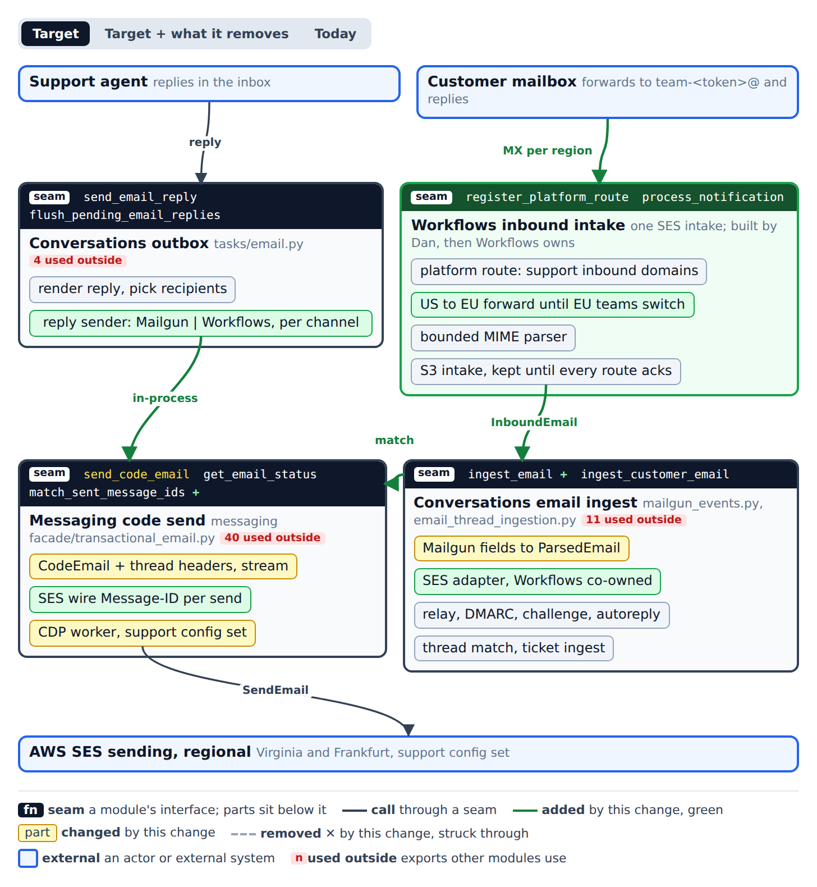
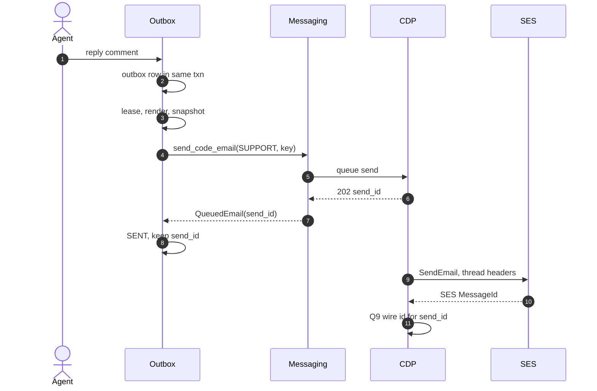
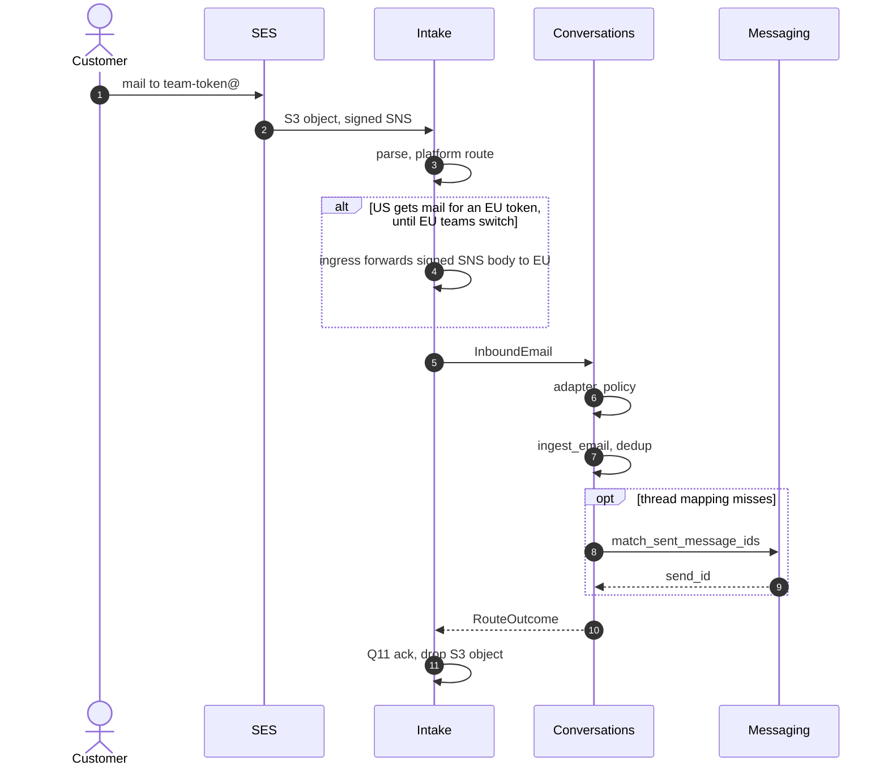
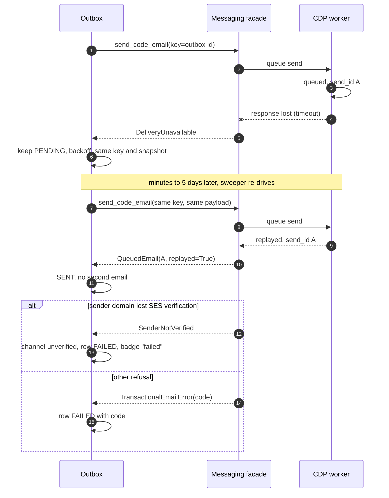

# Support email contract: Conversations and Workflows

## Question

Where do the two seams go that move the support inbox's email off Mailgun and onto Workflows on SES?

1. The send contract between the Conversations outbox and the Workflows code send: threading and challenge headers, idempotency, regional routing, the send ID that comes back, and failure semantics.
2. Where the SES inbound pipeline ends and Conversations ingest begins: what replaces Mailgun's parsed fields, and who owns the adapter.

## Module map



[Interactive page](support-email-contract/modules.html), with Target, "Target + what it removes" and Today views. The spec is [modules.json](support-email-contract/modules.json).

Conversations keeps the outbox and everything after a message is parsed. Messaging owns sending and the SES wire Message-ID. Workflows owns receiving, up to a parsed message.

- The outbox calls Messaging in-process, so each region sends from its own SES.
- Inbound runs through one Workflows SES intake. The support inbound domains are a platform route on it. That route hands parsed mail and signed verdicts to Conversations' existing ingest through one provider-neutral `ingest_email`, which the Mailgun, SES and Gmail adapters all feed. It skips `ReceivedEmail` rows, `$email_received` and 30-day retention.
- Each region receives its own inbound domain, and the EU domain is received in Frankfurt. Until existing EU teams switch their forwarding address, US SES receives the shared address and ingress forwards EU mail to EU, as it does for Mailgun today.
- Dan Marchuk builds stack C from his closed SES stack, and Conversations reviews the route and adapter. Afterwards Workflows owns the inbound layer: intake, platform route, parser and adapter.
- The cutover picks an adapter per channel, and no ticket logic changes.

## Call paths

### Send



### Inbound



### Failure: lost response, then replay



## Contracts

```python
# --- Seam 1: send -----------------------------------------------------------------------------


@dataclass(frozen=True, kw_only=True)
class ReplyHeaders:
    # Bounded by Workflows to SES header limits: keeps the first and the newest ids when References is long.
    in_reply_to: str | None
    references: tuple[str, ...]
    # Only the forwarding verification email sets this. Its body carries the same token.
    forwarding_challenge: str | None = None


class EmailStream(StrEnum):
    # Picks the SES configuration set. SUPPORT forces tracking off, sensitive on and no sandbox fallback.
    DEFAULT = "default"
    SUPPORT = "support"


# Added to messaging's existing CodeEmail (facade/contracts.py:232):
#   headers: ReplyHeaders | None = None
#   stream: EmailStream = EmailStream.DEFAULT
#
# Existing entry point, unchanged signature (services/transactional_email.py:681):
#   send_code_email(team, email: CodeEmail, *, to, distinct_id, idempotency_key) -> QueuedEmail
#
# Invariants
# - idempotency_key = f"conversations-outbox:{outbox.id}". Same key and same payload replay the first
#   QueuedEmail, so the outbox snapshots the rendered payload on its first attempt.
# - Workflows keeps idempotency records for SUPPORT longer than the outbox max age (5 days).
# - headers are part of the idempotency fingerprint.
# - QueuedEmail.message_id is the Workflows send id. It is not the RFC Message-ID; SES sets that.
#
# Error modes, and what the outbox does
# - DeliveryUnavailable, IdempotencyKeyInFlight  -> retry with the same key (backoff as today)
# - SenderNotVerified (new, code "sender_not_verified") -> mark the channel unverified, fail the row
# - IdempotencyKeyReused                         -> a send already queued under this key: mark sent
# - other TransactionalEmailError                -> fail the row permanently


@dataclass(frozen=True, kw_only=True)
class SentMessageMatch:
    wire_message_id: str  # the RFC Message-ID SES put on the wire
    send_id: str  # QueuedEmail.message_id


def match_sent_message_ids(team_id: int, message_ids: tuple[str, ...]) -> tuple[SentMessageMatch, ...]:
    """Messaging facade. Which of these RFC Message-IDs are sends of this team.

    Conversations calls it when its own EmailMessageMapping misses, then maps send_id -> outbox -> ticket.
    Empty for ids Workflows never sent. Team-scoped. One indexed read per inbound message.
    """
    raise NotImplementedError


# --- Seam 2: receive --------------------------------------------------------------------------


@dataclass(frozen=True, kw_only=True)
class ReceiptVerdicts:
    # From the SNS-signed SES receipt, never from MIME headers.
    spf: str
    dkim: str
    dmarc: str
    spam: str
    virus: str
    sender_verified: bool  # DMARC pass, or SPF pass aligned with From


@dataclass(frozen=True, kw_only=True)
class InboundAttachment:
    filename: str
    content_type: str
    content: bytes
    content_id: str
    inline: bool


@dataclass(frozen=True, kw_only=True)
class InboundEmail:
    """Workflows-owned. Handed to a registered mailbox route before Workflows' own filters and persistence."""

    ses_message_id: str  # delivery identity; the route must be idempotent on it
    envelope_to: str  # the matched recipient, which carries the team-<token>@ local part
    envelope_from: str
    received_at: datetime
    verdicts: ReceiptVerdicts
    message_id: str
    in_reply_to: str
    references: tuple[str, ...]
    from_address: str
    from_name: str
    to_addresses: tuple[str, ...]
    cc_addresses: tuple[str, ...]
    subject: str
    text: str
    html: str
    reply_text: str  # quoted history removed; signatures kept
    headers: tuple[tuple[str, str], ...]  # all headers, bounded, for challenge tokens and DKIM signer tags
    attachments: tuple[InboundAttachment, ...]
    auto_submitted: bool


class RouteOutcome(StrEnum):
    INGESTED = "ingested"
    DUPLICATE = "duplicate"
    IGNORED = "ignored"  # no channel, disabled, self-addressed autoreply


class TransientRouteError(Exception):
    """Workflows keeps the S3 intake object and redelivers."""


def register_platform_route(domain_setting: str, local_part_pattern: str, handler: str) -> None:
    """Workflows facade. Declares a platform route on the one SES intake, outside team InboundEmailDomain routing."""
    raise NotImplementedError


# Conversations side: one provider-neutral entry, fed by the Mailgun, SES and Gmail adapters.
#   ingest_email(team_id: int, channel_id: UUID, envelope_to: str, email: ParsedEmail) -> RouteOutcome
# where ParsedEmail is products/conversations/backend/services/email_thread_ingestion.py:45 with
# attachments as bounded byte values instead of Django UploadedFile.
```

### Invariants

- The idempotency key is `conversations-outbox:<outbox id>`. The outbox snapshots the rendered payload on its first attempt, so every retry matches the first byte for byte.
- Workflows keeps idempotency records for `SUPPORT` sends longer than the outbox's 5-day maximum age. The public API promises 24 hours, so this is a support-only extension.
- `ReplyHeaders` are part of the idempotency fingerprint. Workflows bounds References to SES header limits.
- `stream=SUPPORT` uses the support configuration set. It forces tracking off and sensitive on, with no sandbox fallback.
- `QueuedEmail.message_id` is the Workflows send ID, stored on the outbox as `workflows_send_id`. The RFC Message-ID on the wire is set by SES.
- A message counts as "sent" once Workflows queues it. Delivered and bounced statuses are not part of this contract.
- Workflows dispatches `InboundEmail` before its own auto-submitted filter and `ReceivedEmail` persistence. Its own sends carry `Auto-Submitted: auto-generated`, so the forwarding challenge would otherwise be dropped.
- Workflows never imports Conversations. The platform route for the support inbound domains (`team-<token>` and the outbound-capture address) is registered through the Workflows facade with a lazily resolved handler path. The adapter into `ParsedEmail` sits at Conversations' edge so the import points the right way, and Workflows co-owns that file, because Workflows owns the inbound layer.
- Ingest skips `ReceivedEmail` rows, `$email_received` and 30-day retention for the support domains.
- While the shared address still receives EU mail, the US Conversations route answers ownership from the recipient token, as `mailgun_inbound_delivery_ownership` does today. Ingress forwards the signed SNS body to EU once, and EU reads the intake object from the US bucket. EU mail rests in US storage only until EU acks, which matches Mailgun today.
- `ingest_email` is idempotent on (team, Message-ID) through the `EmailMessageMapping` unique constraint. The same message arriving through Mailgun and SES during the MX move settles as `DUPLICATE`.
- Sender trust comes from the SNS-signed receipt, never from MIME headers. The adapter reads DKIM signer tags from the raw headers for relay and Google confirmation checks. Stack C proves this matches what Mailgun gives today.

### Error modes

| Seam    | Error                                                           | Caller does                                                                                                 |
| ------- | --------------------------------------------------------------- | ----------------------------------------------------------------------------------------------------------- |
| Send    | `DeliveryUnavailable`, `IdempotencyKeyInFlight`                 | Keep the row pending and retry with the same key and snapshot                                               |
| Send    | `SenderNotVerified` (new code `sender_not_verified`)            | Mark the channel unverified and fail the row                                                                |
| Send    | `IdempotencyKeyReused`                                          | Mark the row sent                                                                                           |
| Send    | Any other `TransactionalEmailError`                             | Fail the row with its code                                                                                  |
| Receive | Ownership lookup or US to EU forward fails                      | Ingress asks SNS to redeliver, so the forward is decided again                                              |
| Receive | `TransientRouteError` (database or lock errors)                 | Workflows keeps the S3 object and redelivers with backoff. The DLQ and replay from stack C are the backstop |
| Receive | Misconfigured channel, email disabled, self-addressed autoreply | Return `IGNORED` and log, as the Mailgun handler acks them today                                            |

### Performance

- `send_code_email`: one CDP call with a 10-second timeout, on the outbox Celery worker, never on a request path.
- `match_sent_message_ids`: one team-scoped ClickHouse read of email status events, only when `EmailMessageMapping` misses. Each hit is cached as a mapping row, so later replies in the thread stay in Postgres. Status rows live 31 days. After that, a first reply to an agent-started thread opens a new ticket, while customer-started threads still match through References.
- `ingest_email`: one transaction per message, the same as today's Mailgun path.

## Where each piece lands

| Piece                                                                                                                             | Stack                                      |
| --------------------------------------------------------------------------------------------------------------------------------- | ------------------------------------------ |
| `ReplyHeaders` and `stream` on `CodeEmail`, the support config set, `SenderNotVerified`, longer idempotency retention for support | A (Workflows)                              |
| Reply-sender seam with Mailgun and Workflows adapters, `workflows_send_id`, payload snapshot                                      | A (Conversations)                          |
| `match_sent_message_ids` over the recorded SES message ID                                                                         | A (Workflows), reusing #130635 and #130643 |
| Per-channel adapter flip on SES readiness                                                                                         | B                                          |
| Split `mailgun_events.py` into a Mailgun adapter plus `ingest_email`, with attachments as bounded bytes                           | C, base PR                                 |
| `InboundEmail`, platform route, dispatch before Workflows filters, US to EU forward                                               | C (Workflows)                              |
| SES adapter into `ParsedEmail` (built by Dan, reviewed by Conversations, then owned by Workflows)                                 | C                                          |
| Delete the Mailgun adapters, client and ingress routes                                                                            | D                                          |

## Follow-ups

- **One email platform module** (Speculative, moved to a follow-up): one Workflows module would own sending, receiving and sender identity for every product, and Conversations would keep only tickets and channels. Revisit after stack D and the move of Django mail onto Workflows.
- **Delivery status on the reply badge** (Worth exploring, moved to a follow-up): show delivered and bounced from `get_email_status` keyed by `workflows_send_id`.
- **Delete the US to EU forward** (Strong, stack D): once the 8-week window ends and EU teams use the EU domain, the US route's ownership callback, `_sender_is_active_in_other_region` and the cross-account bucket read can go, if outbound capture also moves to regional addresses.

## Decisions recorded

- [ADR 0001](support-email-contract/adr/0001-conversations-sends-in-process-through-messaging.md): Conversations sends through the Messaging facade in-process, not over HTTP.
- [ADR 0002](support-email-contract/adr/0002-inbound-routes-before-workflows-filters.md): One Workflows SES intake hands support mail to Conversations ingest on a platform route, before its own filters and storage.
- [ADR 0003](support-email-contract/adr/0003-reply-matching-reads-the-wire-id-at-reply-time.md): reply matching reads the SES wire Message-ID from Workflows when a reply arrives.
- [ADR 0004](support-email-contract/adr/0004-support-idempotency-outlives-the-outbox.md): support send idempotency outlives the outbox's retry age.
- [ADR 0005](support-email-contract/adr/0005-us-forwards-eu-mail-until-eu-teams-switch.md): US receives the shared address and forwards EU mail to EU until EU teams switch to the EU domain.
- Below the ADR bar, each easy to reverse or the obvious choice: typed `ReplyHeaders` over a header map (Q2), the error mapping (Q4), the two deepening refactors (Q6, Q7), the badge meaning (Q10), platform route registration (Q12) and `workflows_send_id` (Q13).
