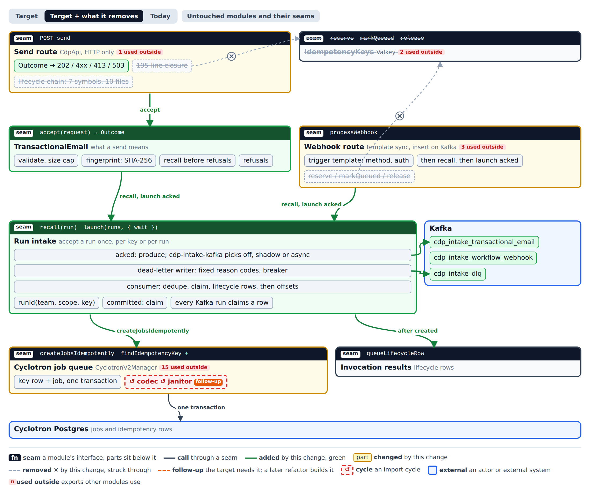
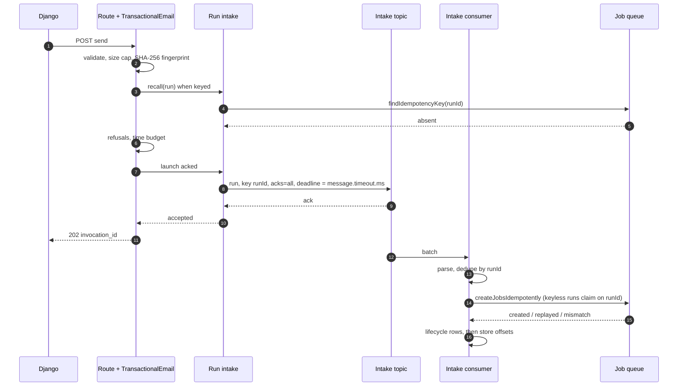
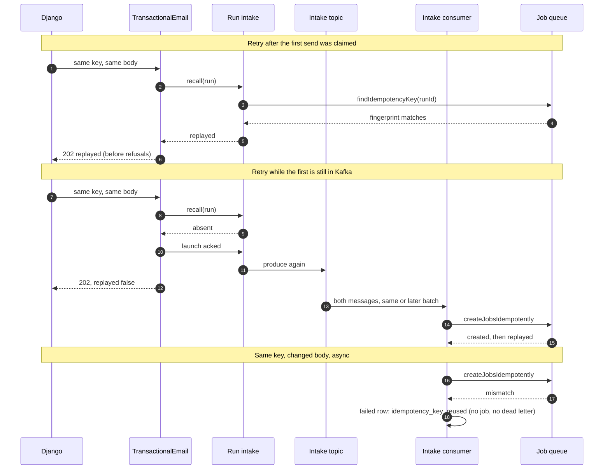
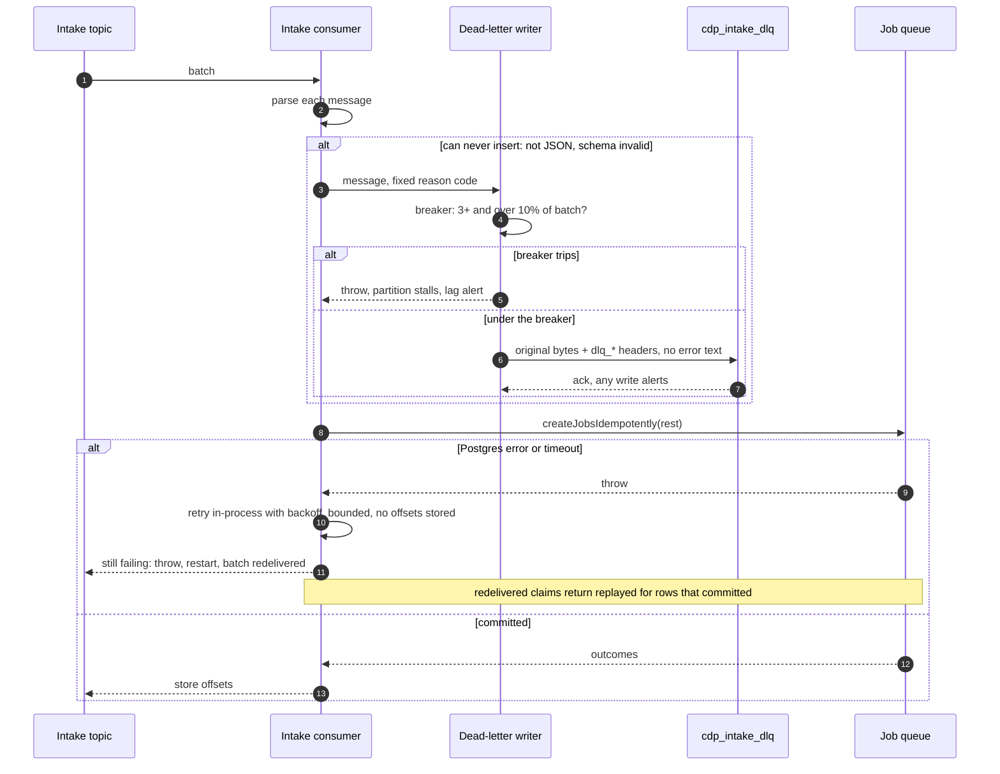
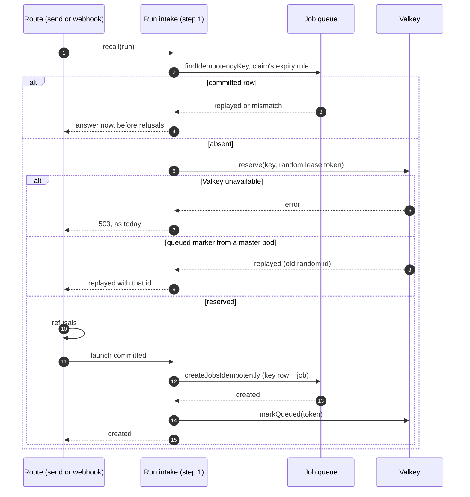
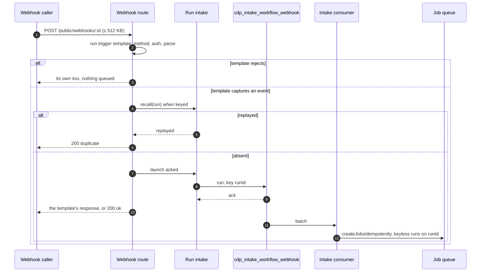

# Transactional intake architecture

Throwaway prototype output for [#132733](https://github.com/PostHog/posthog/issues/132733), shaped in architecture rounds. Tracking ticket: https://github.com/PostHog/harley-context/issues/3. This file is the interface section for the spec that follows.

## The question

What shape should the intake for transactional sends and workflow webhooks take, so that no rollout or rollback step can refuse a valid retry, send twice, or leak a send's contents?

## Decisions

### Idempotency cutover

- **Two code deploys, not a three-way store setting.** #133461's `CDP_TRANSACTIONAL_IDEMPOTENCY_STORE` is dropped, because a pairing check found unsafe mixes beyond `valkey`+`postgres` (see `transactional-intake/research/mixed-pods.md`).
  1. **Write both, read Postgres first.**
     - Every keyed run claims in Postgres, atomically with its job. It also keeps the Valkey lease, with a random lease token, and the `queued` marker.
     - The Postgres lookup runs before refusals and uses the claim's own retention rule.
     - Valkey down still answers `503`.
  2. **Postgres only.** Ships once step 1 has run everywhere for 24h.

  Never roll back two steps after step 2.

- **Both the send route and the webhook route take the two steps.** The webhook fingerprint stays the flow id.
- **#132891 merges as it is.**

### Modules

- **Run intake** (`nodejs/src/cdp/intake/`) owns accepting a run once:
  - the run id, `uuidv5(team, scope, key)`
  - the Postgres claim
  - the Kafka producer and consumer
  - the dead-letter writer
  - the lifecycle row, written only after `created`

  Its interface is `recall(run)` and `launch(runs, { wait: 'committed' | 'acked' })`.

- **TransactionalEmail** owns what a send means: validation, the size cap, the fingerprint, recall before refusals, and refusals. Its interface is `accept(request) → Outcome`. The send route keeps only the HTTP mapping.
- **The intake consumer** is a plain class on `createKafkaConsumer`, not a `CdpConsumerBase` subclass. It awaits its claim in the handler.
- **Refactors land as their own pure-move PRs** ahead of the feature PRs in each stack.

### Kafka

- **Both routes go to Kafka.** Sends, and workflow webhooks too: the webhook's trigger template runs synchronously before the ack, so its response never depended on the insert.
- **Topics.** `cdp_intake_transactional_email` and `cdp_intake_workflow_webhook`, each with its own consumer group and 18h retention. "Intake" is capture and ingestion for workflow runs; the other two names already belong to the event pipeline.
- **Key and ack.** The key is the run id. `acks=all` comes from the producer default `enable.idempotence` and must not be overridden.
- **Deadline.** The route waits for the ack up to a fixed deadline, and `message.timeout.ms` matches it, so a `503` means the message will never land.
- **Size.** Messages up to 2 MB, with snappy compression. The route's body caps stay the real limit.
- **Claims.** Every run on Kafka claims a row, keyless ones on their own run id, so a redelivered batch can't start a run twice.
- **The flag.** One per-team multivariate flag, `cdp-intake-kafka` (`shadow` | `async`), drives the steps for both routes. It's read synchronously from a 60s cache and fails to off, which is the synchronous claim. The last step deletes the flag and the off path together.
- **Order.** The Kafka steps start only once cutover step 1 runs everywhere.

### Consumer and dead letters

- **Batch order.**
  1. Parse each message, and dead-letter the ones that can never insert.
  2. Dedupe by run id.
  3. One `createJobsIdempotently` call.
  4. Lifecycle rows: `running` for `created`, `failed` with `idempotency_key_reused` for `mismatch`.
  5. Store offsets.
- **What counts as a dead letter.** Only a message that isn't JSON or fails the schema. The rest are handled elsewhere:
  - Postgres errors retry in-process with backoff, then throw.
  - A deleted team or a disabled flow still inserts, and the worker refuses the send.
  - A run past its send-by deadline, or a `mismatch`, becomes a `failed` row.
- **The dead-letter topic.**
  - `cdp_intake_dlq` keeps messages for 7 days, and any write alerts.
  - The value is the original bytes.
  - The headers use `CdpDeadLetterService`'s names, with a fixed reason code and never `error.message`.
  - A breaker stalls the partition when 3 or more messages, and over 10% of a batch, would be dead-lettered.

### Contents of a send

- **No `EncryptedFields` on topics, dead letters or job rows.** It stays for credentials only, as everywhere else in CDP. The fingerprint stays plain SHA-256.
- **The leak that is closed is error text.** Dead-letter headers carry fixed reason codes, and the consumer never logs a body or a variable.

### HTTP

| Send route outcome       | Response                     |
| ------------------------ | ---------------------------- |
| `accepted` or `replayed` | `202`                        |
| `mismatch`               | `422 idempotency_key_reused` |
| `refused`                | today's 4xx                  |
| `invalid`                | `400`                        |
| `too_large`              | `413`                        |
| `unavailable`            | `503 intake_unavailable`     |

- `409 idempotency_key_in_flight` and `503 idempotency_unavailable` go after step 2, and Django drops its `409` mapping then.
- Webhooks answer the template's response, `200 duplicate` on a keyed replay, and never `409`.

## Modules and seams

The interactive page is [`transactional-intake/final/modules.html`](transactional-intake/final/modules.html). It has Target, Target + what it removes, and Today views, and a toggle for the untouched modules.

## Call paths

### 1. Main write: an async send

### 2. Main read: retries and replays

### 3. Main failure: a batch the consumer can't fully insert

### 4. Cutover step 1: write both, read Postgres first

### 5. Webhooks on Kafka

## Contracts

[`transactional-intake/final/contracts.ts`](transactional-intake/final/contracts.ts) covers each locked seam: Run intake, the intake message, the consumer's batch, the dead-letter record, the claim, TransactionalEmail and the webhook route. For each it gives the invariants, the error modes and the cost.

## Rollout order

1. Refactor PRs: extract `TransactionalEmail`, and give the webhook handler Run intake's committed path.
2. Idempotency cutover step 1 for both routes.
3. After 24h everywhere: step 2. Valkey and the `409` go.
4. Intake topics, consumer and dead-letter topic, with no producer yet.
5. `cdp-intake-kafka`, team by team: shadow, then async.
6. Delete the flag and the synchronous path.
7. Later: the dead-letter replay consumer.

## Follow-ups

- **Move the job codec into `cyclotron-v2`, breaking the codec ↺ janitor import cycle.** Strong; dropped from this change once encryption left.
- **One cyclotron producer per process instead of 3 managers and pools.** Worth exploring.
- **The webhook handler as a plain module, off `CdpConsumerBase`.** Worth exploring.
- **One outcome vocabulary shared by TypeScript and Django**, which maps on error strings in 4 places. Worth exploring.
- **Split `transactional-email.ts` by audience**, route side and worker side. Worth exploring, and partly done by `TransactionalEmail`.
- **Reuse `CdpDeadLetterService` for intake.** Speculative; it's built for events.
- **Update `cyclotron-v2/README.md`'s "No DLQ" line** to mention the intake dead-letter topic beside rerun.

## ADRs

None, by decision. The repo barely uses ADRs, so this file's decision list carries the reasons.

## What did not work

- **#133461's three-way store setting.** Its claim that only `valkey`+`postgres` was unsafe didn't hold:
  - `valkey`+`dual` sends twice across a lease expiry.
  - `dual`+`postgres` refuses valid retries.
  - A code rollback past it sends twice with healthy stores.
- **Encrypting send bodies at rest** on the topics, the dead-letter topic and job rows, plus a keyed fingerprint. Dropped as over-engineered: Kafka and Postgres already hold CDP payloads in plaintext under access control, job rows live seconds, and the real leak was error text.
- **Keeping webhooks synchronous.** Overturned. The trigger template runs before the queue step, so Kafka changes nothing callers see.
