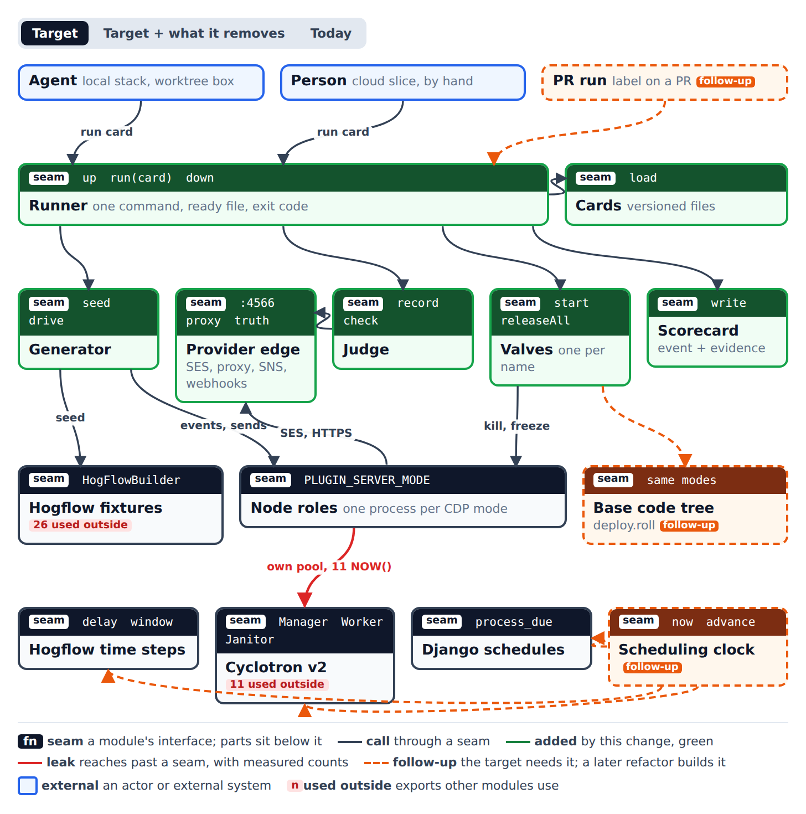
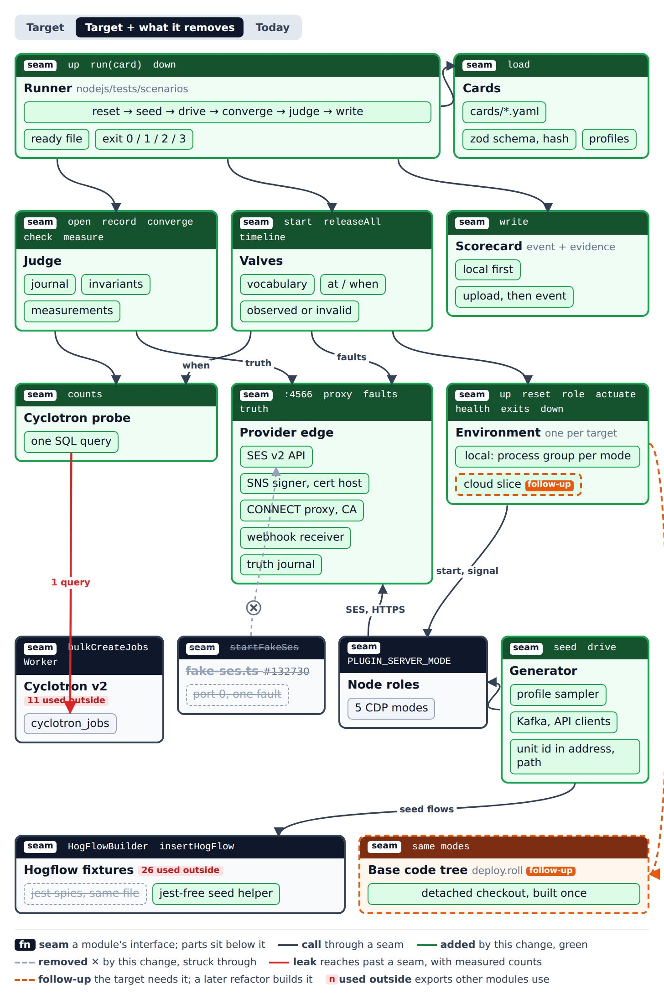
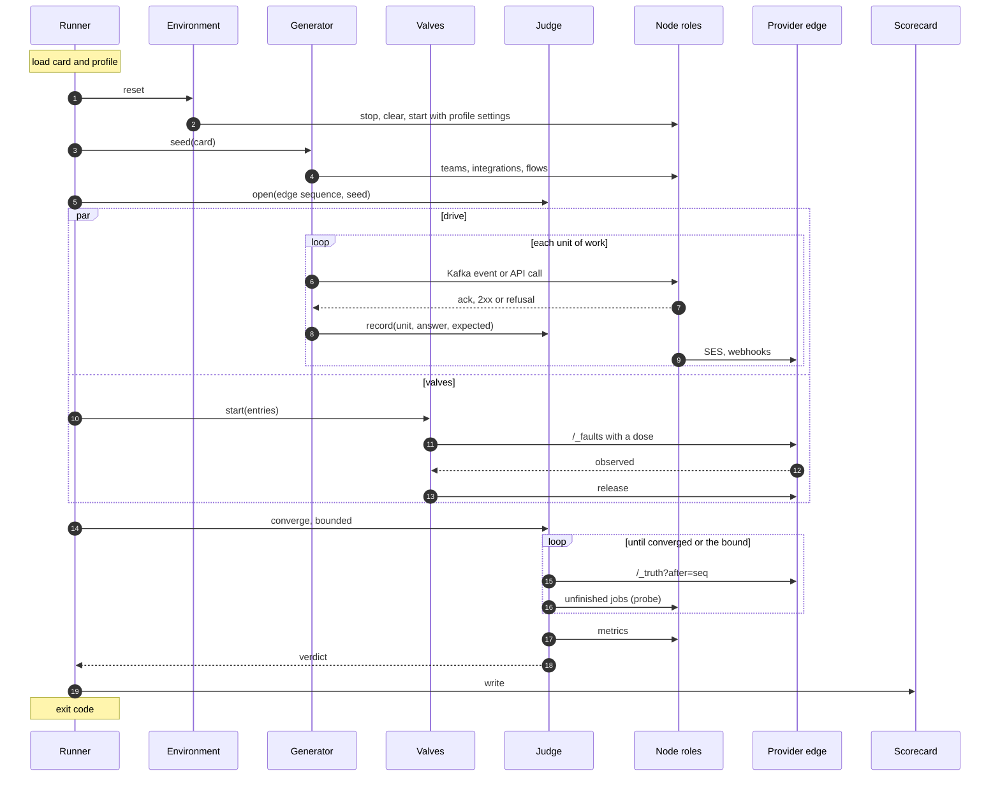
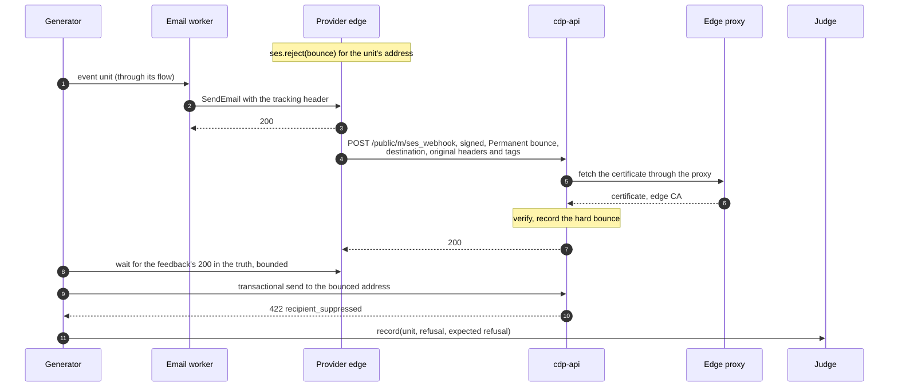
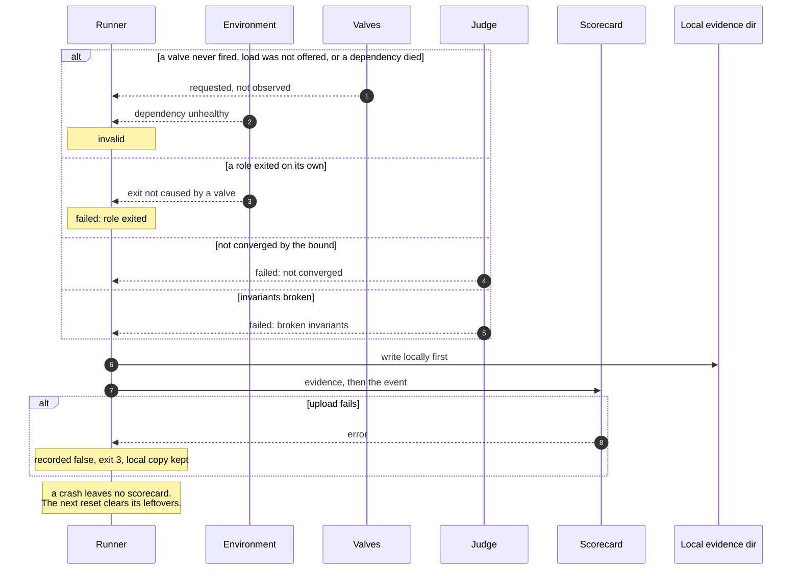

# Workflows scenario runner: the runner contract

The scenario runner tests the Workflows and CDP delivery path end to end, under failure and under load.
It drives the real roles from outside, breaks them on purpose with named valves, judges the outcome against what the providers actually received, and stores one scorecard per run so runs compare across commits.

This document is the accepted architecture of the runner: its modules and seams, the call path of one run, where cards live, how a card runs locally and in the cloud, and the contract at each seam.
It is the interface section the implementation spec builds on.

## Glossary

| Term              | Meaning                                                                                                                                                                                                                                                       |
| ----------------- | ------------------------------------------------------------------------------------------------------------------------------------------------------------------------------------------------------------------------------------------------------------- |
| **Card**          | One versioned scenario: seed state, load, a valve schedule, the invariants that fail the run and the measurements it records. A YAML file.                                                                                                                    |
| **Profile**       | The traffic shape and role settings a card runs with. The repository ships an invented `synthetic` profile; a measured prod-shape profile is kept outside this repository and passed by path.                                                                 |
| **Generator**     | The runner's traffic driver. It seeds state and drives load through production's intakes.                                                                                                                                                                     |
| **Valve**         | One named, dosed failure, such as `role.kill` or `ses.throttle`.                                                                                                                                                                                              |
| **Provider edge** | One process that stands in for every external provider: the SES API, a forward proxy, the SNS certificate host and a webhook receiver. It records everything it received as the **truth**.                                                                    |
| **Journal**       | The Judge's record of every intake call the generator made, how the intake answered, and what the call should lead to.                                                                                                                                        |
| **Unit**          | One piece of work the generator offered: an event produced to Kafka, or one intake API call. Its id carries the run id.                                                                                                                                       |
| **Delivery**      | One message the seeded flow should send for a unit, keyed by unit and action: one email or one webhook call.                                                                                                                                                  |
| **Converged**     | No job for the card's teams is unfinished in the hogflow and email queues, retries scheduled for later included, and every expected delivery has at least one record in the truth. Whether each delivery ended the right way is for the invariants to decide. |
| **Invariant**     | A check that fails the run.                                                                                                                                                                                                                                   |
| **Measurement**   | A recorded number. It never fails a run.                                                                                                                                                                                                                      |
| **Scorecard**     | One run's stored result: status, provenance and scalar measurements, written as one event, with evidence stored separately.                                                                                                                                   |
| **Status**        | `passed`; `failed`, an invariant broke; `invalid`, the run could not judge. Whether the scorecard was stored is reported separately.                                                                                                                          |
| **Slice**         | One prod-shaped unit in a cloud environment, not a shrunken copy of production.                                                                                                                                                                               |
| **Target**        | Where a run executes: `local` (a worktree box) now, `cloud` (a slice) later.                                                                                                                                                                                  |

## Context



- **Actors.** Agents run cards on a local stack on a worktree box. People run the same cards by hand on a cloud slice later. A PR trigger comes after that and is out of this document.
- **No production change in the first slice.** The runner reaches the stack only through seams that exist today:
  - every role boots by `PLUGIN_SERVER_MODE` (`nodejs/src/common/config.ts:33`), one process per mode;
  - SES goes to `SES_ENDPOINT` (the SDK client is built from it in `email.service.ts`), port 4566;
  - every other provider, the SNS certificate fetch included (`nodejs/src/cdp/services/messaging/helpers/ses.ts:9,591`), goes through `fetch` in `nodejs/src/common/utils/request.ts`, which sends every request through `HTTPS_PROXY` when `EXTERNAL_REQUEST_PROXY_TEAMS` is unset (`request.ts:385,415-421`). Roles run with `NODE_EXTRA_CA_CERTS` set to the edge's CA.
- **The clock stays real in the first slice.** Every card declares `clock: real`. A scheduling clock that can advance delays, time windows, schedules and Cyclotron's due predicates is a later stack (see Follow-ups); it is the first production change the runner needs.
- **Language.** TypeScript inside the `nodejs` package, reusing `HogFlowBuilder`. It borrows the personhog test harness's conventions (ready file, journal, bounded convergence, chaos as data, known defects as gates), not its code.

## Modules and seams



The interactive page with the Target, removed and Today views is [`workflows-scenario-runner/modules.html`](workflows-scenario-runner/modules.html).

The runner is six new modules behind one Runner seam, plus a small probe.
Cards say what a run does, the Generator and Valves do it, the Judge decides, and the Scorecard keeps the result.
The Environment holds everything that differs between a local box and a cloud slice, and the Provider edge runs the same in both places, so a card never knows where it runs.

| Module              | Seam                                                                                                   | Owns                                                                                                                                                                                                              | Depends on                                                                            |
| ------------------- | ------------------------------------------------------------------------------------------------------ | ----------------------------------------------------------------------------------------------------------------------------------------------------------------------------------------------------------------- | ------------------------------------------------------------------------------------- |
| **Runner**          | `up`, `run(card)`, `down`                                                                              | The run lifecycle: reset, seed, open the journal, drive with valves alongside, converge, judge, write. Watching dependency health and role exits during the run. The ready file and the exit code.                | Cards, Environment, Generator, Valves, Judge, Scorecard                               |
| **Cards**           | `load`                                                                                                 | The YAML schema (zod), the registries of valve, invariant, measurement and traffic names, profiles, and the card hash.                                                                                            | Nothing at run time                                                                   |
| **Environment**     | `up`, `reset`, `role`, `actuate`, `health`, `exits`, `down`                                            | Starting the stack for one target, applying profile settings, finding a role, every actuation (process signals, Postgres connection kills), restarting killed roles, dependency health, and recording role exits. | Node roles, the dev stack                                                             |
| **Provider edge**   | HTTP on 4566: SES v2 API, CONNECT proxy, SNS certificate host, webhook receiver, `/_faults`, `/_truth` | Faking providers, applying dosed faults, emitting signed SNS feedback, and the append-only truth.                                                                                                                 | Nothing in the runner                                                                 |
| **Valves**          | `start`, `releaseAll`, `timeline`                                                                      | The valve vocabulary, scheduling by `at` or `when`, translating to Environment actions or edge faults, and the timeline of requested, applied, observed and released.                                             | Environment, Provider edge, Cyclotron probe                                           |
| **Generator**       | `seed`, `drive`                                                                                        | Seeding teams, email integrations and flows; sampling the profile; producing events and calling intake APIs; reporting every call, its answer and its expected deliveries to the Judge.                           | Hogflow fixtures (seed helper), Kafka, cdp-api, Provider edge truth, Judge's `record` |
| **Judge**           | `open`, `record`, `converge`, `check`, `measure`                                                       | The journal, convergence, and the implementations behind the invariant and measurement registries.                                                                                                                | Provider edge truth, Cyclotron probe, role metrics                                    |
| **Cyclotron probe** | `counts`                                                                                               | One SQL query against `cyclotron_jobs`. It reaches past Cyclotron's seam on purpose and is the only place that does.                                                                                              | Cyclotron's database                                                                  |
| **Scorecard**       | `write`                                                                                                | Writing the scorecard and evidence locally, uploading evidence, then writing the scorecard event.                                                                                                                 | The scorecard store                                                                   |

What the change removes or moves:

- `nodejs/src/cdp/_tests/fake-ses.ts` (from PostHog/posthog#132730) grows into the Provider edge. Its fault names stay, and `startProviderEdge` starts the same server in process. Its existing Jest callers move over in a later PR; the first slice only needs the listener.
- `insertHogFlow` moves out of `nodejs/src/cdp/_tests/fixtures-hogflows.ts`, away from the `jest.spyOn` helper in the same file, into a seed helper the runner imports outside Jest.

### Where cards live

```text
nodejs/tests/scenarios/
  main.ts               the CLI: up | run <card> | down
  runner/               Runner
  cards/                *.yaml cards, schema.ts, registries
  profiles/             synthetic.yaml (invented numbers only)
  environment/          local/ now, cloud/ later
  provider-edge/        main.ts on 4566, startProviderEdge() for Jest
  valves/  generator/  judge/  probe/  scorecard/
```

`nodejs/tsconfig.json` already includes `tests`, and the `~/tests/*` path alias lets Jest suites in `src` import the edge.
The entry point is a `scenarios` script in `nodejs/package.json` that runs `tsx tests/scenarios/main.ts`, so `pnpm --filter=@posthog/nodejs scenarios run cards/<name>.yaml` runs one card.
Cards parse with the `yaml` package at the version the workspace already pins.

`Dockerfile.node` copies `nodejs/tests/` and `tsc` compiles it into `dist`, so the scenarios ship in the image as compiled code that nothing in `src` imports, as the rest of `nodejs/tests/` does today.
Nothing in the runner runs in production.

## First slice

The first slice is local only, on real time, and proves the judging loop on a small set of valves before anything else is built.

- **Roles.** `cdp-processed-events`, `cdp-cyclotron-worker-hogflow`, `cdp-cyclotron-worker-email`, `cdp-api`, `cdp-cyclotron-v2-janitor`.
- **Traffic.** Events into event-triggered flows with email and webhook steps, and transactional email sends. Every first-slice job lives in the hogflow and email queues of `cyclotron_jobs`: a flow's webhook step runs inside the hogflow worker and retries by rescheduling its own row (`nodejs/src/cdp/services/hog-executor-async.service.ts:141-164,572-574`). The flows read the recipient from event properties, so the first slice seeds no persons.
- **Valves.** `role.kill`, `role.freeze`, `pg.drop_connections`, `ses.reject(type)`, `ses.throttle(rate)`, `dest.status(code, share)`.
- **Settings.** `CDP_SES_WEBHOOKS_QUEUE_ENABLED` stays `false`, its default (`nodejs/src/cdp/config.ts:429`), so cdp-api handles SES feedback before it answers.
- **Origin.** `local-agent` only.

Later stacks add the rest of the vocabulary (`role.cpu`, `pg.latency` with Toxiproxy, `ses.drop_connection`, `dest.latency`, `deploy.roll` with its base code tree), hog function destinations on the Kafka job queue, a parked-job backlog for load cards, the queued SES feedback branch, batch workflows and schedules with a person seed, the cloud Environment, and the other origins.

## Call paths

### One run of a card



During drive and convergence the Runner polls `Environment.health()` and reads `Environment.exits()`. A dependency that goes away without a valve causing it makes the run `invalid`; a Node role that exits without a valve causing it makes the run `failed`, even if every delivery later arrives.

### An email worker killed mid-batch

```mermaid
sequenceDiagram
    autonumber
    participant V as Valves
    participant Q as Cyclotron probe
    participant E as Environment
    participant W as Email worker
    participant W2 as Restarted worker
    participant K as Janitor
    participant P as Provider edge
    participant J as Judge
    loop until "when" holds
        V->>Q: running on queue email
        Q-->>V: count
    end
    W->>P: SendEmail, part of a batch
    P-->>W: 200
    V->>E: actuate(role.kill, email worker)
    E->>W: SIGKILL the process group
    E-->>V: old PID gone (observed)
    E->>W2: restart after a backoff
    Note over W,K: unfinished jobs stay "running"<br/>with a stale heartbeat
    Note over K: waits out the stall timeout
    K->>Q: stalled jobs back to available, scheduled later
    W2->>P: SendEmail again
    P-->>W2: 200
    J->>Q: no unfinished jobs, scheduled ones included
    J->>P: /_truth: every delivery recorded
    Note over K,J: at least once; duplicates measured
```

The janitor puts a stalled job back as `available` with a future `scheduled` time (`janitor.ts:454-490`), so convergence waits for every unfinished job, not only the due ones.
The card schema rejects a kill or freeze card whose convergence bound does not cover the profile's stall timeout, the janitor's sweep interval, the first-retry spread and the role's restart backoff.

### SES feedback: a bounce reaches suppression



The first send goes through the event path, so cdp-api has never looked the address up; its suppression cache keeps misses per process (`email-suppression.service.ts:99-103`).
With the queue disabled, cdp-api finishes handling the feedback before it answers 200 (`email-tracking.service.ts:635-636,794`), so the follow-up can go out then; the follow-up's refusal is what proves the suppression was written.
Suppression needs the signed tracking code, which only the `X-PostHog-Tracking-Code` header carries (`ses.ts:947-952,1099-1109`), and only touches recipients listed in `mail.destination` (`ses.ts:294-296`), so the edge copies both from the send into the feedback.

### The runner's own failures



## Local and cloud

|                | Local (first slice)                                                                                                                                                                              | Cloud slice (later)                                                                                                         |
| -------------- | ------------------------------------------------------------------------------------------------------------------------------------------------------------------------------------------------ | --------------------------------------------------------------------------------------------------------------------------- |
| Who runs it    | Agents, on a worktree box                                                                                                                                                                        | People, by hand                                                                                                             |
| Infrastructure | The dev stack's `workflows` intent (`hogli up -d`, `devenv/intent-map.yaml`): Postgres, Kafka (Redpanda), Redis, ClickHouse, PersonHog, Django and its workers, without the combined CDP process | A per-run namespace in dev rendered from production's chart values at slice size, with its own Cyclotron database and Kafka |
| Node roles     | One child process group per CDP mode, in place of the dev stack's combined process                                                                                                               | One deployment per mode, as in production                                                                                   |
| Actuation      | `SIGKILL`, and `SIGSTOP` / `SIGCONT`, on a role's process group; `pg_terminate_backend` on role connections                                                                                      | The cloud Environment implementation: pod kills, freezes and network faults through the cloud chaos tooling                 |
| Provider edge  | `main.ts` on 4566                                                                                                                                                                                | The same image as a pod                                                                                                     |
| Profile        | `synthetic` by default; the measured profile by `--profile <file>`                                                                                                                               | The measured profile                                                                                                        |
| Measurements   | Each role's `/metrics`, its process CPU and memory included, and latency from the journal                                                                                                        | The same metrics; alert rules checked against a test Alertmanager                                                           |

Cards, Valves, the Generator, the Judge and the Scorecard are the same code on both targets.
Only `Environment` has two implementations, and only it knows how a role is found and how it is broken.

## Contracts

The card format and the scorecard event are the external contracts: other people and tools read them, so they change only with a schema version.
The other interfaces are the seams the implementation starts from; it may refine names and fields inside them as long as each module keeps the responsibilities in the module table.

### Cards

```ts
// nodejs/tests/scenarios/cards/schema.ts
export const CdpRole = z.enum([
  'cdp-processed-events',
  'cdp-cyclotron-worker-hogflow',
  'cdp-cyclotron-worker-email',
  'cdp-api',
  'cdp-cyclotron-v2-janitor',
])

const Duration = z.string().regex(/^\d+(ms|s|m)$/)
const Named = z.object({ name: z.string(), params: z.record(z.string(), z.unknown()).default({}) })

export const ValveEntry = z
  .object({
    valve: z.string(), // a name from the valve registry
    target: z.string(), // a role, 'postgres', or a provider host
    dose: z.record(z.string(), z.unknown()), // checked against the valve's own params schema
    at: Duration.optional(), // offset from the start of the drive
    when: Named.optional(), // the one predicate: running_on_queue {queue: email, atLeast: 5}
    for: Duration,
  })
  .refine((v) => (v.at === undefined) !== (v.when === undefined), 'exactly one of at, when')

export const Card = z.object({
  id: z.string(),
  version: z.number().int(),
  clock: z.literal('real'), // 'scheduled' arrives with the clock stack
  profile: z.string(), // 'synthetic' or the name of a measured profile
  seed: z.number().int(), // the generator's random seed
  setup: z.object({ teams: z.number().int().min(1) }), // flows come from the traffic kinds the card drives
  drive: z.object({ for: Duration, traffic: z.array(Named), minOffered: z.number().min(0).max(1).default(0.9) }),
  valves: z.array(ValveEntry).default([]),
  convergeWithin: Duration,
  invariants: z.array(Named),
  measure: z.array(Named).default([]),
  gates: z.record(z.string(), z.number()).default({}), // known-defect thresholds, outside the hash
})

export type LoadedCard = {
  card: z.infer<typeof Card>
  profile: Profile
  cardHash: string // sha256 of the normalized card without `gates`, plus the profile hash
  profileHash: string
}

export type Profile = {
  name: string
  traffic: Record<string, unknown> // rates, mixes and skew the generator samples
  settings: Record<string, string> // role environment that changes the path, such as janitor timings
}

export function load(cardPath: string, opts: { profilePath?: string }): LoadedCard
```

- **Checks.** `load` rejects:
  - unknown valve, invariant, measurement and traffic names, a dose that fails its valve's schema, and a `when` predicate other than `running_on_queue`;
  - a card with a `role.kill`, `role.freeze` or `pg.drop_connections` entry whose `convergeWithin` does not exceed the profile's janitor stall timeout, plus its sweep interval, its first-retry spread and the role's restart backoff;
  - a `pg.drop_connections` entry scheduled by `at`: the main pools close idle connections after 500 ms (`nodejs/src/common/utils/utils.ts:431`), so it must wait for running jobs with `when`;
  - `bounced_suppressed` on a card with no `ses.reject(bounce)` entry, because only a hard bounce blocks transactional email (`email-suppression.service.ts:52-54`);
  - a profile that enables `CDP_SES_WEBHOOKS_QUEUE_ENABLED`, until the queued feedback branch is built.
- **Traffic kinds own their flows and expectations.** Each traffic name in the registry knows the flow it drives, so the Generator seeds the flows of the card's traffic. Per unit it declares the deliveries the flow should make and whether the intake should refuse it. Cards never list flows or expectations by hand.
- **Roles.** Every card runs against the same five roles, which `up` starts before any card is loaded.
- **Errors.** A `CardError` lists every problem at once. The runner exits `invalid` (2) before `reset`, and writes no scorecard.
- **Hash.** Gates stay outside the hash, so tightening a known-defect gate keeps runs comparable. Anything else that changes what runs changes the hash.
- **Privacy.** A scorecard records `profileHash` and the profile's name, never its numbers.

### Runner

```ts
// nodejs/tests/scenarios/runner/runner.ts
export type Status = 'passed' | 'failed' | 'invalid'
export const EXIT_CODE = { passed: 0, failed: 1, invalid: 2, writeFailed: 3 } as const

export interface Runner {
  up(): Promise<void> // writes the ready file when every role and the edge are healthy
  run(cardPath: string, opts: { profilePath?: string }): Promise<RunResult>
  down(): Promise<void>
}

export type RunResult = {
  runId: string
  status: Status
  statusReason: string
  recorded: boolean
  cardId: string
  cardHash: string
  profileHash: string
  headSha: string
  origin: 'local-agent'
  fingerprint: string // target, runner, generator and valve versions, seed
  invariants: InvariantResult[]
  measurements: Measurement[]
  timeline: ValveTimelineEntry[]
  startedAt: string
  endedAt: string
  evidenceDir: string
}
```

- **Order.** `run` calls `reset`, `seed`, `Judge.open`, then `drive` and `Valves.start` together, then `Valves.releaseAll`, then `converge`, `check`, `measure`, and finally `Scorecard.write`. `Valves.releaseAll` also runs in a `finally`, so no valve outlives its card. Nothing else calls these.
- **Status rules.**
  - `invalid` when a valve was never observed, the generator offered less than `minOffered` of its target load or could not offer a unit its traffic kind requires, or a dependency the card did not break (Postgres, Kafka, Redis, PersonHog, the edge) went away. The run could not judge, so this outranks a failed invariant.
  - `failed` when any invariant fails, including `not converged`, or when a Node role exited without a `kill` causing it. When the exit falls while another valve on that role or on Postgres was applied, `statusReason` names that valve.
  - `passed` otherwise.
- **Exit code.** The status's code, except `writeFailed` (3) when scorecard credentials are configured and the write failed. A run without credentials exits with its status and reports `recorded: false`.
- **One stack, many cards.** `up` once, `run` many times, `down` once. Runs on one stack are sequential.

### Environment

```ts
// nodejs/tests/scenarios/environment/environment.ts
export interface Environment {
  up(): Promise<void>
  reset(settings: Profile['settings']): Promise<void>
  role(name: CdpRole): RoleHandle
  actuate(action: Action): Promise<Actuation>
  health(): Promise<{ healthy: boolean; down: string[] }>
  exits(): RoleExit[]
  down(): Promise<void>
}

export type RoleHandle = { name: CdpRole; metricsUrl: string }
export type RoleExit = { role: CdpRole; at: string; code: number | null; signal: string | null; byValve: boolean }

export type Action =
  | { kind: 'kill'; role: CdpRole }
  | { kind: 'freeze'; role: CdpRole }
  | { kind: 'pg.terminate'; share: number }

export type Actuation = { observed(): Promise<boolean>; release(): Promise<void> }
```

- **`up` owns the stack.** It starts the `workflows` intent's infrastructure, PersonHog and Django without the dev stack's combined CDP process (`nodejs_cdp_workflows`), which would share the events consumer group and the job rows. It refuses to write the ready file while the events consumer group has a member it did not start. Process ids stay inside the local Environment.
- **`reset` is idempotent and complete.** It stops every runner-owned Node role and waits for them to exit, clears the edge's faults, resumes stopped process groups, deletes unfinished jobs from `cyclotron_jobs`, moves the roles' consumer groups to the end of their topics, applies the profile's settings, and starts the roles again. Stopping first means no in-flight batch from an earlier run can recreate jobs after the clear. It runs at the start of every card, so a crashed run never poisons the next. Exits during `reset` are not recorded.
- **Killed roles come back.** After `kill`, the Environment restarts the role after a backoff, as Kubernetes would, and records the exit with `byValve: true`. Any other exit is recorded with `byValve: false`, and the role is restarted the same way.
- **Observation.** `kill` is observed when the old process is gone; `freeze` when `/proc/<pid>/stat` shows state `T`; `pg.terminate` when at least one role backend, a Cyclotron pool's included, was terminated.
- **Connection drops spare the runner.** Every role starts with `PGAPPNAME=scenario-<role>`, which node-postgres uses for pools that set no `application_name` (Cyclotron's pools set none, `cyclotron-v2/pg-pool.ts:15`). `pg.terminate` only terminates backends whose `application_name` is a role's mode or starts with `scenario-`; the runner's own connections use another name.
- **Health.** `health` checks Postgres, Kafka, Redis, PersonHog and the edge's `/_health`. The Runner polls it every few seconds during drive and convergence.
- **Roles' environment.** Every role starts with:
  - `SES_ENDPOINT` and `HTTPS_PROXY` pointing at the edge, `NODE_EXTRA_CA_CERTS` set to the edge CA, and `EXTERNAL_REQUEST_PROXY_TEAMS` unset;
  - `PERSONHOG_ENABLED=true` and `PERSONHOG_ADDR`, without which no CDP role boots (`nodejs/src/server.ts:546-551`);
  - `PGAPPNAME`, and its own `HTTP_SERVER_PORT`, since every role defaults to the same port (`nodejs/src/common/config.ts:424`);
  - `SES_REGION` and dummy `AWS_ACCESS_KEY_ID` and `AWS_SECRET_ACCESS_KEY`, with `AWS_PROFILE` unset, because the SES client takes its credentials from the SDK's default chain (`email.service.ts:449-454`);
  - `ENCRYPTION_SALT_KEYS`, which the email worker needs to sign tracking codes (`server.ts:358-363`), and `WORKFLOWS_TRANSACTIONAL_EMAIL_JWT_SECRET`, both shared with the runner.

### Provider edge

```ts
// nodejs/tests/scenarios/provider-edge/index.ts
export function startProviderEdge(opts: {
  port: number
  caDir: string
  trackingKeys: string
  feedbackUrl?: string // cdp-api's SES webhook
}): Promise<{
  url: string
  caCertPath: string
  close(): Promise<void>
}>
```

```text
POST   /_faults   { name, params?, match?: { host?, recipient? }, dose: { count? | share? }, for? }  -> { id }
DELETE /_faults/:id
DELETE /_faults                                        clears every fault
GET    /_truth?after=<seq>&limit=<n>                   -> { records: TruthRecord[], next: number }
GET    /_health
```

```ts
export type TruthRecord = {
  seq: number // strictly increasing, never reused, survives fault clears
  at: string
  kind: 'ses.send' | 'ses.feedback' | 'webhook'
  unitId?: string // parsed from the recipient or the webhook path
  actionId?: string // from the signed tracking code, or the webhook path
  status: number // what the edge answered; for ses.feedback, what cdp-api answered the edge
  fault?: string // the fault that shaped the answer, when one did
  detail: Record<string, unknown>
}
```

- **Fault names.** PostHog/posthog#132730's names, plus `ses.throttle` (its rate is a parameter) and `dest.status`. A dose is a count or a share of matching requests; `for` bounds it in time.
- **Correlation.** The generator puts the unit id where the delivery path carries it unchanged:
  - email: the recipient `<unitId>@www.example.com`. Event-triggered flows read it from `{event.properties.email}`; transactional flows read `{event.properties.to}`, which cdp-api sets from the request (`cdp-api.ts:1328`). The domain has an address record, so the pre-send MX check (`email-validation.service.ts`, which falls back to A and AAAA records) lets it through;
  - webhooks: the path `https://hooks.example.com/u/<unitId>/<actionId>`, with the action id written into each seeded webhook step.

  For email, the edge reads the action id from the `X-PostHog-Tracking-Code` header with the tracking code signer's `parse` (`ses.ts:952`) and the same `ENCRYPTION_SALT_KEYS` as the roles. The edge parses ids; the Judge never parses payloads.

- **Feedback.** On a `bounce` or `complaint` fault the edge answers the send, then posts a signed SNS notification to cdp-api's SES webhook. A bounce is `Permanent`, with the recipient in `bouncedRecipients`. The notification carries the original send's message id, destination, configuration set, tags and headers, so cdp-api finds the signed tracking code, the team and the recipient. The edge serves its own certificate at `https://sns.<region>.amazonaws.com/<name>.pem` through its proxy; certificate fetches go to the evidence file, not the truth.
- **Proxy.** The proxy fakes `hooks.example.com` and the SNS certificate host, and tunnels every other host unchanged.
- **Performance.** The truth is an in-memory append-only array with a file mirror for evidence. `/_truth` pages are capped at 1000 records.

### Valves

```ts
// nodejs/tests/scenarios/valves/valves.ts
export interface ValveDefinition<P> {
  name: string
  params: z.ZodType<P>
  apply(ctx: ValveContext, target: string, dose: P): Promise<Actuation>
}

export interface Valves {
  start(entries: ValveEntry[], ctx: ValveContext): Promise<void> // schedules each entry; returns at once
  releaseAll(): Promise<void> // cancels pending entries, awaits in-flight actuations, then releases; idempotent
  timeline(): ValveTimelineEntry[]
}

export type ValveTimelineEntry = {
  valve: string
  target: string
  requestedAt: string
  appliedAt?: string
  observedAt?: string
  releasedAt?: string
  error?: string
}
```

- **Scheduling.** `at` fires at an offset from the drive's start. `when` polls the probe once a second until `running_on_queue` holds, the only predicate the first slice needs; an entry whose predicate never holds before the drive ends is recorded as not observed.
- **Observation.** Each entry is observed within a valve-specific window, or the timeline records an error and the run is `invalid`.
- **Adding a valve** is one `ValveDefinition` in the registry. Cards name valves, never backends.

### Generator

```ts
// nodejs/tests/scenarios/generator/generator.ts
export interface Generator {
  seed(card: LoadedCard, ctx: GeneratorContext): Promise<SeedState>
  drive(card: LoadedCard, seed: SeedState, journal: Pick<Judge, 'record'>, signal: AbortSignal): Promise<DriveSummary>
}

export type SeedState = {
  teams: { teamId: number; emailIntegrationId: number }[]
  flows: { teamId: number; flowId: string; deliveryActions: string[] }[]
}
export type DriveSummary = { targetUnits: number; offeredUnits: number }
```

- **Intakes.** Events go to the topic the events consumer reads (`CDP_EVENTS_CONSUMER_TOPIC`), with the unit's address in the event properties. Transactional sends go to `/api/projects/:team_id/hog_flows/:id/transactional_email/send` on cdp-api, with a JWT the generator mints per team and flow from the shared secret; their flows are seeded active with an API trigger.
- **Seed.**
  - Each card seeds its own teams, so checks scope by team, and one verified email integration per team (kind `email`, with `verified`, `email` and `name` in its config), which every send needs (`email.service.ts:578-589`).
  - Flows are built with `HogFlowBuilder` and written with the jest-free seed helper, which skips Django's validation. Their email steps read the recipient from event properties, because the hogflow worker resolves the person again from storage and ignores the event's person (`cdp-cyclotron-worker-hogflow.consumer.ts:166-194`); a missing person does not stop the flow.
  - Seeding compiles each step's inputs with `compileHog` (`nodejs/src/cdp/templates/compiler.ts:27`), since the seed helper skips Django, which compiles them in production.
  - Flow steps load their templates from Postgres (`hogflow-functions.service.ts:29`), so `up` checks that the email and webhook templates exist.
- **Waits.** A traffic kind that needs an earlier delivery to land first reads the edge's truth with a bound. The bounce follow-up first reads its unit's `ses.send` record: only when the bounce fault answered it does it wait for the feedback's 200, send the follow-up and expect `recipient_suppressed`. A unit the dose missed expects nothing more. When a bound passes, the unit is recorded as not offered and the run is `invalid`.
- **Unit ids** are `<runId>-<n>`, so a late delivery from an earlier run never matches.
- **No retries.** Every call, its answer and its expected deliveries are recorded, refusals included. A call that gets no answer, because cdp-api was killed or frozen, is recorded as a transport error; it still counts as offered.
- **Load.** `offeredUnits / targetUnits` is the share the generator managed to send on schedule, whatever the intake answered. A broken intake does not make a run `invalid`; a generator that cannot keep up does.
- **Determinism.** Sampling uses the card's `seed`, so two runs of one card produce the same sequence of units.

### Judge

```ts
// nodejs/tests/scenarios/judge/judge.ts
export interface Judge {
  open(fromSeq: number, seed: SeedState): void
  record(unit: JournalEntry): void
  converge(within: number, signal: AbortSignal): Promise<Convergence>
  check(invariants: Named[], timeline: ValveTimelineEntry[]): Promise<InvariantResult[]>
  measure(measurements: Named[]): Promise<Measurement[]>
}

export type JournalEntry = {
  unitId: string
  kind: 'event' | 'transactional'
  teamId: number
  offeredAt: number
  answer:
    | { accepted: true }
    | { accepted: false; status: number; outcome?: string }
    | { accepted: false; transportError: string }
  expect: { deliveries: string[]; refusal?: string } // action ids; the outcome the intake should refuse with
}
export type Convergence = { converged: boolean; unfinishedJobs: number; unrecorded: string[]; tookMs: number }
export type InvariantResult = { name: string; passed: boolean; gate?: number; observed?: number; evidence: string[] }
export type Measurement = { name: string; value: number; unit: string }
```

- **`record` is synchronous** and appends to memory; it never blocks the generator.
- **Converged** means no job for the card's teams is unfinished in the hogflow and email queues of `cyclotron_jobs` (available, scheduled for later included, or running), and every expected delivery of every accepted unit has at least one record in the truth.
  - The record covers events still on their way to becoming jobs.
  - The job count covers every retry that has not happened yet: webhook steps reschedule their own hogflow row, and a throttled email reschedules with no limit until it is sent (`email.service.ts:835-844`), so neither needs an attempt count.
  - Past the bound the Judge still runs the invariants. Unfinished jobs make the run `failed: not converged`; a delivery with no record at all fails `at_least_once`.
- **First invariants.**
  - `at_least_once`: every expected delivery has a 2xx in the truth, unless a valve ended it on purpose: a terminal fault (`ses.reject`, or a `dest.status` code the fetch path does not retry) answered its last attempt, or a retried `dest.status` code answered all `CDP_FETCH_RETRIES` attempts, which is the total including the first (`hog-executor-async.service.ts:529,550-554`); the Judge reads the effective value from the settings the Environment applied. The implementation spec pins the retried codes from `isFetchResponseRetriable`.
  - `duplicate_sends`: 2xx acceptances per unit and action beyond one, gated by `gates.duplicate_sends`. Rejected attempts are evidence, not duplicates.
  - `bounced_suppressed`: the transactional follow-up to a bounced address is refused with `recipient_suppressed`, and the truth has no 2xx send to that address after the feedback.
  - `refused_at_intake`: refusals and transport errors the unit did not expect stay at or under `gates.refused_at_intake`.
- **First measurements.** Each role's process CPU and resident memory from its `/metrics`, the role metrics under production's names, and latency from offer to the edge's receipt.

### Cyclotron probe

```ts
// nodejs/tests/scenarios/probe/cyclotron-probe.ts
export interface CyclotronProbe {
  counts(q: {
    teams: number[]
    queues: ('hogflow' | 'email')[]
  }): Promise<{ running: number; available: number; scheduledLater: number }>
}
```

- It is the runner's only query against `cyclotron_jobs`. The clock stack's first PR adds the same read to Cyclotron's own seam and deletes this module.
- Valves call it at most once a second; the Judge calls it during convergence.

### Scorecard

```ts
// nodejs/tests/scenarios/scorecard/scorecard.ts
export interface Scorecard {
  write(result: RunResult): Promise<{ recorded: boolean; error?: string }>
}
```

- Order: the scorecard and evidence go to `evidenceDir` first, then the evidence upload, then one scorecard event per run. Invalid runs are recorded too.
- The event carries provenance, status, scalar measurements, invariant results and a `schema_version`; evidence (logs, the journal, the truth, the timeline, metric scrapes) is stored separately under a per-run prefix. Property names are fixed in the implementation spec.
- Without credentials, `write` keeps the local copy and returns `recorded: false`; a local agent run without a token is still useful.

## Decisions

These seams are hard to reverse, surprising without context, or a real trade-off.

### The SES double grows from `fake-ses.ts`, not a container

- **Decision.** PostHog/posthog#132730's in-process fake becomes one Provider edge server, run as a listener for the runner and in process for Jest.
- **Why.** One implementation and one set of fault names serves both unit-level suites and the runner. The fake already validates configuration sets, tags, headers and tenant. The container of PostHog/posthog#112316 was removed in review, and the image it used drops those semantics and emits no feedback events.
- **Cost.** The fake binds port 0, holds one global undosed fault and sets `AWS_*` in `process.env`; lifting it is real rework, and PostHog/posthog#132730 lands first.

### One infrastructure stack, two code trees, for `deploy.roll`

- **Decision.** A rolling deploy moves roles one at a time from a base code tree to the head tree on one infrastructure stack. Base-against-head comparisons run one after the other on the same stack. It is built after the first slice.
- **Why.** Two stacks on one box collide on fixed ports and the `kafka` hostname, and contend for CPU, which corrupts headroom numbers.
- **Cost.** `deploy.roll` cards run in real time until the base also carries the scheduling clock.

### SNS certificates from the edge, at the real host name

- **Decision.** The edge serves the SNS signing certificate at `sns.<region>.amazonaws.com` through its CONNECT proxy, and roles trust the edge's CA through `NODE_EXTRA_CA_CERTS`.
- **Why.** cdp-api only accepts a certificate URL on that host (`ses.ts:612-637`). The fetch already goes through `HTTPS_PROXY` (`ses.ts:9`, `request.ts:415-421`). Overriding the host would be a production change, and posting feedback without a signature would skip the path production runs.
- **Cost.** Every external request from the roles goes through the proxy, which production does only for the teams in its rollout.

### Public synthetic profile, private measured profile

- **Decision.** Cards name a profile. The repository ships an invented `synthetic` profile with the repository's default settings; the measured prod-shape profile, with production's settings, is kept outside this repository and passed by path.
- **Why.** This repository is public and the measured profile describes production.
- **Cost.** Capacity headroom numbers are only meaningful with the measured profile.

### One query past Cyclotron's seam, on purpose

- **Decision.** The Cyclotron probe reads `cyclotron_jobs` directly until the clock stack gives Cyclotron its own read.
- **Why.** Adding the read to Cyclotron now would be a production change in the first slice.
- **Cost.** A schema change to `cyclotron_jobs` can break the probe; it is one module with one query.

### Restart the roles on every reset

- **Decision.** `reset` stops the runner's Node roles before it clears jobs and moves offsets, then starts them again, for every card.
- **Why.** The events consumer queues jobs in a background task (`cdp-events.consumer.ts:158-166`), and Kafka refuses to move offsets for a group with live members, so a reset with the roles running is not a clean boundary.
- **Cost.** Every card pays the roles' boot time before its drive starts. Measurements start after the roles report ready, so boot time never enters them.

## Follow-ups

| Follow-up                                                                                                                                                                                                                                                                                                 | Strength        | Why it waits                                                               |
| --------------------------------------------------------------------------------------------------------------------------------------------------------------------------------------------------------------------------------------------------------------------------------------------------------- | --------------- | -------------------------------------------------------------------------- |
| **The scheduling clock**: one `SchedulingClock` passed through `ActionHandlerOptions` and Cyclotron's config, with delay and time-window steps as pure functions of `now`, Django schedules and the rate-limit Lua taking `now` as an argument, and an advance barrier. Unlocks `clock: scheduled` cards. | Strong          | It is the first production change; the first slice runs real time only.    |
| **Cyclotron owns "due"**: every due and wake predicate behind Cyclotron's seam with one `$now` parameter, including the subscription matcher's own pool and SQL. Its read export replaces the Cyclotron probe.                                                                                            | Strong          | First PR of the clock stack.                                               |
| **A role registry**: one module owning mode, capabilities and boot, replacing the four parallel lists in `config.ts`, `types.ts`, `capabilities.ts` and `server.ts`.                                                                                                                                      | Strong          | The runner only needs the modes that exist.                                |
| **The rest of the valve vocabulary**: `role.cpu`, `pg.latency` (Toxiproxy in front of Postgres), `ses.drop_connection`, `dest.latency`, and `deploy.roll` with its base code tree.                                                                                                                        | Needed          | No first-slice invariant needs them.                                       |
| **Hog function destinations** on the Kafka job queue, with the `cdp-cyclotron-worker` role; judged from the truth alone, because the probe cannot see that queue.                                                                                                                                         | Needed          | First-slice traffic is workflows only.                                     |
| **Load cards**: a parked-job backlog seeded with Cyclotron's `bulkCreateJobs` under separate backlog teams, and measurement bands from baseline runs.                                                                                                                                                     | Needed          | No first-slice invariant reads them.                                       |
| **The queued SES feedback branch**, with the `cdp-ses-webhooks` role and a wait for its consumer to drain before the suppression check.                                                                                                                                                                   | Needed          | The default keeps it off; the measured profile decides whether it matters. |
| **The cloud Environment** and the cloud slice it runs against, with the `cloud-manual` origin.                                                                                                                                                                                                            | Needed          | Built after local cards prove the contract.                                |
| **Batch workflows and schedules**, with a person seed for audience resolution, and the scheduler and subscription-matcher roles.                                                                                                                                                                          | Needed          | Pulls ClickHouse persons into the seed.                                    |
| **PR runs**, paired base and head runs, and the `pr` and `master` origins.                                                                                                                                                                                                                                | Needed          | Where they execute is not decided.                                         |
| **Twilio, FCM and APNs fakes** in the Provider edge.                                                                                                                                                                                                                                                      | Worth exploring | The first cards exercise SES and webhooks.                                 |
| **A `hogli` command** wrapping the `scenarios` script.                                                                                                                                                                                                                                                    | Worth exploring | The pnpm script is enough for agents now.                                  |
