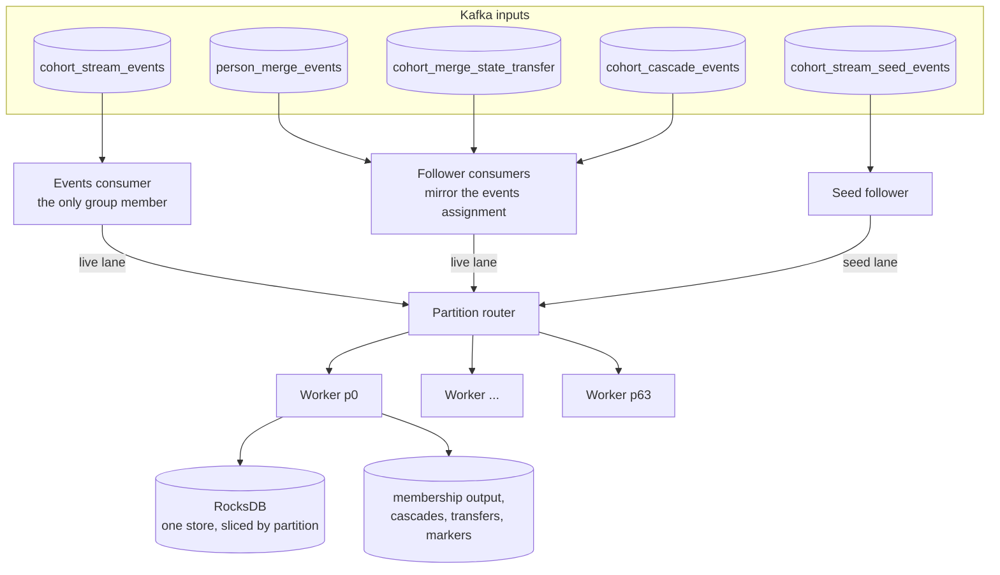

# Processor runtime

This page describes the skeleton of `cohort-stream-processor`: how it consumes its topics, how work reaches the per-partition workers, how offsets are tracked and committed, and what each path guarantees about delivery.
What a worker does with one event is in [live evaluation](live-evaluation.md).
How state is stored is in [state store and durability](state-store-and-durability.md).

## The shape of the process

The processor is deployed as one pod, which owns every partition, 64 by default.
Inside it, one worker task per partition owns that partition's slice of an embedded RocksDB store.
Everything that can change a person's state reaches that person's worker, in order, through two queues called lanes.

Timers feed the same workers.
The eviction sweep, the pending-transfer redrive, merge garbage collection and the reconcile drain all send messages through the router instead of touching the store themselves.
So while a worker runs, it is the only writer of its partition, and nothing needs a lock.
Boot recovery is the only code that touches a slice from outside its worker.
It finishes before any worker starts, as [startup](#startup) explains.

## Consumers and ownership

Each pod owns a fixed set of partitions for as long as it runs.
`COHORT_POD_COUNT` sets how many pods split the partitions, and the ordinal at the end of the StatefulSet pod name in `POD_NAME` says which pod this is.
Pod `i` owns every partition `p` with `p mod COHORT_POD_COUNT = i`.
The pod refuses to start unless `COHORT_POD_COUNT` divides `COHORT_PARTITION_COUNT` and the ordinal is below `COHORT_POD_COUNT`.
The default is one pod, which owns every partition.
Only a single pod may run without `POD_NAME`, and it counts as ordinal 0.

The **events consumer** reads `cohort_stream_events`.
**Follower consumers** read the other co-partitioned topics.
Merges and merge transfers always have one.
Cascades and seeds have one when those features are enabled.
No consumer subscribes to its group.
At startup each one is assigned the owned partitions, resuming at its group's committed offsets.
So the pod owns partition N on every input topic at once, which is what [partition affinity](event-routing.md#partition-affinity) needs, and no rebalance moves a partition while the pod runs.
The consumer groups have no members and only hold the committed offsets and their [stamps](#ownership-and-the-single-pod-deployment).
A broker can expire the offsets of a group without members, so every consumer resets to `earliest`: a partition that lost its offset replays instead of skipping to the tail.
A commit from a client outside the group is refused while the group has a live member, such as the static member an older build left behind until its session expires.
librdkafka logs each refused commit as a `COMMITFAIL` warning, and the next commit retries it.
`rebalances_total` counts rebalance callbacks on the events consumer, which fire only if the consumer subscribes.
`owned_partitions` and `partition_ownership_info`, labelled by `pods` and `ordinal`, show the pod's share.
No pod can see the StatefulSet's replica count, so fewer replicas than `COHORT_POD_COUNT` leave the partitions of the missing ordinals without a consumer.
Only their group lag and a `sum(owned_partitions)` below `COHORT_PARTITION_COUNT` show it, so alert on that sum.

The merge, transfer, cascade and seed followers start only after the first catalog load and the end of boot recovery.
The events consumer does not wait for the catalog.

The end of boot spawns a worker for every owned partition.
A **tenure** is the time a worker owns a partition, from boot to the next restart.

## From a Kafka batch to a worker

The events consumer reads batches of up to a thousand messages.
It splits each batch by partition and offers each sub-batch to that partition's live lane without waiting.

Each partition has an **intake budget**, a cap on events sitting in its live lane.
When a partition is over budget or its lane is full, the sub-batch goes into a holdover, and a separate task pauses fetching for that partition in the Kafka client.
Held sub-batches are retried first on every cycle, so a newer message never overtakes an older one.
When the holdover drains, the partition resumes.

The consume loop never waits on a worker.
A slow partition turns into lag on that partition only.
The consumer keeps polling and keeps reporting itself alive, other partitions keep flowing, and the pod does not look stalled to its liveness check.
A blocking send on a full lane would stop that liveness report and get the pod restarted in a loop.

Merge, transfer and cascade followers also use the live lane, but they do not count toward the intake budget, and their dispatch waits when the lane is full.
Their topics carry little traffic.
Waiting there cannot block the events consumer, but one full lane stalls that follower topic, and its commits, on every partition until the lane drains.

The seed follower uses the separate **seed lane** and never waits.
A full seed lane holds the seeds and pauses that partition, like the events consumer does.
[Seed apply and reconcile](seed-apply-and-reconcile.md) describes the seed follower's admission rules.

## The worker loop

Each worker drains two lanes:

- the **live lane**, carrying events, merges, transfers, cascades and timer messages in partition order,
- the **seed lane**, carrying backfill tiles, person seeds and reconcile requests.

On every turn the worker picks one unit of work in this priority order:

1. a batch of the eviction sweep, if a live batch ran since the last sweep batch,
2. the next live sub-batch,
3. a sweep batch, when there is no live work,
4. the next run of the current seed quantum,
5. a new seed quantum, only when no run is pending.

Seed runs wait behind live work, and live work waits at most one seed run.
Reconcile is the exception: a reconcile request only queues a job, and the job's page walks run as a timer message on the live lane, one bounded page per tick.
The sweep alternates with live batches, so a large wave of expirations at midnight cannot starve live events, and a flood of live events cannot starve expirations.
[Time and eviction](time-and-eviction.md) explains the sweep.

Each live sub-batch holds one topic's messages, or one timer tick, in offset order.
As a guard, before any merge, transfer, cascade, sweep or reconcile message, the worker first produces the membership changes it has buffered, so the order of output matches the order of state changes.
It yields to the async runtime every few milliseconds, so a CPU-heavy backlog cannot starve other tasks.

At the end of an events sub-batch the worker:

1. produces its membership changes and waits for every acknowledgment,
2. produces first-hop cascade messages, when cascades are enabled,
3. re-keys events for merged persons to their survivor's partition,
4. marks the events tracker at the highest event offset of the sub-batch,
5. advances the partition's live watermark to the newest broker timestamp it folded.

If any produce fails, the worker skips the mark.
Merge, transfer and cascade messages settle their own trackers as each one is handled.

## Offset tracking

Each input topic has its own offset tracker with five values per partition.

| Value      | Meaning                                                                                                                                                                              |
| ---------- | ------------------------------------------------------------------------------------------------------------------------------------------------------------------------------------ |
| dispatched | The ceiling: one past the highest offset handed to the worker. For events and seeds it counts only what landed in the lane                                                           |
| processed  | One past the highest offset a handler marked finished. It is a running maximum that never passes dispatched, so an earlier offset that failed without setting a floor is passed over |
| held       | A sticky floor at a failed message's own offset. Used by the merge, cascade and seed paths                                                                                           |
| deferred   | Releasable floors, used for reconcile requests, which finish long after they arrive                                                                                                  |
| committed  | The next offset to consume, as last sent to Kafka                                                                                                                                    |

The committable offset is the lowest of processed, held and every deferred floor.
A later success can never commit past an earlier failure that set a floor.

Every few seconds, each consumer snapshots its committable offsets, forces the RocksDB write-ahead log to disk, and commits the snapshot only if the flush succeeded.
The events consumer does this on its own task, and the followers do it in their consume loops.
This is the durability invariant: **a committed offset never runs ahead of state that is on disk**.
Hot-path writes do not wait for the disk, so this one flush per commit is what makes them durable.

## Delivery semantics

Different paths make different promises.
This table is worth knowing before you debug a missing or duplicated membership change.

| Path                                  | Guarantee                                                                                                                                                                                      | Why                                                                                                                                                                                |
| ------------------------------------- | ---------------------------------------------------------------------------------------------------------------------------------------------------------------------------------------------- | ---------------------------------------------------------------------------------------------------------------------------------------------------------------------------------- |
| Events into Stage 1 state             | At least once across restarts, applied once. Within a tenure, an event whose fold fails on a store error, or whose re-key to a survivor's partition fails, is skipped and later committed past | Offsets commit after the work. A redelivered event is recognized by its replay marks. Only the merge, cascade and seed paths hold a failed offset                                  |
| Event to membership change            | At most once                                                                                                                                                                                   | State commits inside the fold, before the produce. If the produce fails, the next clean sub-batch marks past it, and a replay finds no transition to emit                          |
| First-hop cascade messages            | At most once from the live, merge and sweep paths. At least once from seed apply and reconcile                                                                                                 | The live, merge and sweep paths produce them after the flip is committed. Seed apply and reconcile produce them before writing the flip, and retry on failure                      |
| Sweep expiry of a single-leaf cohort  | At least once while the worker runs                                                                                                                                                            | The sweep produces before it writes, and reschedules the keys on failure. The retry lives in the in-memory queue, so a restart keeps it only with durable restore on               |
| Sweep expiry that recomposes a cohort | At most once                                                                                                                                                                                   | The composed result is written before it is produced                                                                                                                               |
| Cascade messages consumed             | At least once                                                                                                                                                                                  | Produce before state, and a failure holds the offset                                                                                                                               |
| Merge state                           | At least once, applied once                                                                                                                                                                    | Drain and apply markers keyed by the original merge message                                                                                                                        |
| Merge state transfer                  | At least once while the slice survives                                                                                                                                                         | An outbox row survives until the transfer is acknowledged, and a timer redrives it. A wiped slice loses the row, and later merges may already have committed past its merge offset |
| Merge membership output               | At most once                                                                                                                                                                                   | State commits before the produce, and a failed produce is dropped                                                                                                                  |
| Backfill seed runs                    | At least once                                                                                                                                                                                  | A failure holds the run's first offset, and the seed replays on the next tenure. A redelivered seed re-emits a change that was lost                                                |
| Reconcile                             | At least once                                                                                                                                                                                  | A failed page retries on the next tick, and a deferred floor keeps the request uncommitted until the job completes                                                                 |

So live, merge, sweep-recompose and their first-hop cascade output can all lose a membership change, and nothing on those paths puts it back.
The pipeline accepts that and relies on reconcile, run as part of every backfill, to re-emit the full membership of a cohort.
Reconcile re-emits from stored state, so it repairs a lost change but not a lost Stage 1 write.
[Backfill overview](backfill-overview.md) covers reconcile, and [membership output and readers](membership-output-and-readers.md) explains how the consumer tolerates duplicates.

"At most once" here means the path never retries a failed produce.
It is not a promise against duplicates.
Writes reach the disk only at the next commit's flush, while output is acknowledged as soon as it is produced.
A host crash that loses unflushed writes rolls state back to the last flush, and the replayed inputs can emit the same changes again.
A wiped store does the same.

## Ownership and the single-pod deployment

A pod's store holds the slices of the partitions it owns, and only a reshard hands a slice to another pod.
The store records the split it was written under in `cf_meta[pod_partitions]`: the pod count, the ordinal and the partition count.
A store from before that record takes the configured split as its own the first time it opens.
A split covers another when it owns every partition the other owns.
A store opens when its recorded split covers the pod's split, and then records the pod's split.
Any other store refuses to open, so the pod crash-loops instead of reading slices that another pod may have changed since.
With durable restore enabled, boot deletes the slices of partitions the pod does not own, so a single pod deletes nothing.

The store record cannot stop a pod on an empty volume, so the **ownership fence** keeps a second record on the broker.
Every offset commit on every input group carries the committer's split as Kafka commit metadata, its stamp, for example `cohort-split/1:2:0:64` for pod 0 of 2 over 64 partitions.
The pod reads these stamps three times:

1. Before the store opens, it reads the last commit of every group on each partition it owns.
   A stamp from another split, or metadata it cannot read, holds the boot, because the pods of that split may still run.
   During [a reshard](#raising-the-pod-count), the parent's stamp passes too.
   On a follower group, the stamp of a split that covers the pod's also passes, because a pod of that split that still runs also commits the events group.
   The pod retries after 30 seconds, doubling the wait up to 5 minutes, and meanwhile `/_ready` reads not ready and `ownership_fence_blocked{reason}` is 1.
   A commit without a stamp passes, because older builds and standard Kafka tools, such as an offset reset, write none.
   A checkpoint restore waits for the same check again before it commits the follower positions.
2. After the store opens, it checks the stamps again, commits every owned partition on every group with its own stamp, and reads the stamps back.
   Another split's stamp, metadata it cannot read, or a stamp that reads back empty stops the pod with an error.
   An empty read-back means the broker does not keep commit metadata, so the fence cannot work on it.
3. Every 30 seconds, an audit reads the stamps on the owned partitions.
   Another split's stamp, or metadata it cannot read, increments `ownership_fence_violations_total{topic}`, makes every later commit of the pod fail, and stops the pod.
   So the final commits of that stop fail and leave the foreign stamp in place, and the next boot holds at step 1.

Two processes of the same split, such as two pods with the same ordinal, write the same stamp, so the fence cannot tell them apart.
Builds from before stamps commit without one, so the fence cannot see them either.
Change `COHORT_POD_COUNT` only after every pod runs a build with stamps.

### Raising the pod count

`COHORT_RESHARD_FROM_POD_COUNT` marks a reshard and names the old pod count.
`COHORT_POD_COUNT` must be a larger whole multiple of it, or the pod refuses to start.
With durable restore enabled, the pod also refuses to start without checkpoints, because each parent deletes the slices it gives away and its child would start without them.

- A pod whose ordinal is below the old count is a parent.
  It reopens its store, and boot deletes the slices it gave away.
- Every other pod is a child, and takes its partitions over from the parent at its ordinal modulo the old count.
  It waits, with the `parent_running` reason, until the parent has stamped a partition under the new split.
  It then deletes a live store that holds no pending restore, and restores the newest checkpoint in the parent's S3 lineage that covers it, counted in `checkpoint_restore_total{source="parent_s3"}`.
  With no usable checkpoint, it creates its store behind the coverage fence.
- Once one of a child's events partitions carries the child's stamp, the takeover is over, and later boots open its store as usual.

To reshard:

1. Scale the processor to 0, and wait until every pod has stopped after its final checkpoint.
2. Set `COHORT_POD_COUNT` to the new count, `COHORT_RESHARD_FROM_POD_COUNT` to the old count, and the replicas to the new count.
3. Check `owned_partitions` on each pod, `ownership_fence_blocked` at 0, and one `parent_s3` restore for each child.
4. Remove `COHORT_RESHARD_FROM_POD_COUNT` in a later change, and before any offset reset of the events group.
   While it is set, a reset that clears the stamp from every events partition of a child makes the child take its partitions over again and delete its store.

If step 1 is skipped, each child waits until its parent restarts, and the old split keeps every partition until then.
Deleting the parent pods moves the reshard on.
After its takeover, a child searches only its own lineage.
So a child that loses its volume before its first upload finishes creates its store behind the coverage fence, even though its parent's checkpoint still covers it.

### Lowering the pod count

Nothing merges two stores, so lowering `COHORT_POD_COUNT` requires wiping every store, including the volume of an ordinal that a scale-down removed.
That volume keeps its old record, so when a later change brings back that split or one it covers, it opens with slices another pod has moved past.
With checkpoints enabled, also delete every pod's checkpoints, local and in S3.
While no pod runs, reset every group's offsets to their current positions, because the stamps of the larger split hold every boot and a standard offset reset writes no stamp.
Each slice then begins again behind the coverage fence and holds no history until a backfill runs.

More than one pod needs chart changes that are not done yet, so one pod that owns every partition is the supported deployment.

## Startup

At boot the processor:

1. validates its configuration, refuses unsafe combinations, and works out the partitions it owns,
2. binds the health server, so `/_health` answers from here on and `/_ready` reads not ready,
3. loads the catalog once,
4. checks the partition counts of the co-partitioned topics against broker metadata,
5. waits until the [ownership fence](#ownership-and-the-single-pod-deployment) admits its split,
6. decides where the store comes from: with durable restore enabled, the live store on disk or a checkpoint, otherwise an empty store.
   A checkpoint restore that cannot finish blocks here and retries, as [a blocked restore](state-store-and-durability.md#a-blocked-restore) describes.
   A store written under a split that does not cover the pod's refuses to open, as [ownership](#ownership-and-the-single-pod-deployment) explains,
7. stamps every owned partition on every input group, and reads the stamps back,
8. starts the timer loops and the events consumer, and starts the followers and the checkpoint loop once the catalog has loaded and boot recovery has ended.

By default the store is wiped at boot, so there is nothing to recover, and the events consumer dispatches from its first poll.

With durable restore enabled, a restart reopens the same local store instead, and the events consumer runs boot recovery before it dispatches anything:

1. Before its first poll, it deletes the slices of partitions it does not own, and re-produces every transfer waiting in the merge outbox, clearing each outbox row from outside the worker.
2. After a checkpoint restore, it seeks every owned partition back to the position the restore kept for it, or to the first event it polled and did not dispatch if that is lower.
   It dispatches nothing it polls before that seek succeeds.
   It then commits those positions and deletes the restore marker.
   A failed seek, commit or delete is retried on the next poll, and nothing is dispatched until all of them succeed.
   The consumer reports no liveness while one of them fails, so a failure that persists restarts the process.
   A restored position the broker expired since the restore checked it stops the process instead, so the next boot resets that slice.
3. It spawns a worker for every owned partition.
   Each worker rebuilds its in-memory eviction queue by scanning its slice of behavioral state, so a dormant member on a partition with no traffic still leaves on time.

The followers start only after these steps, and the timers reach only partitions that have a worker.
So no worker runs while boot recovery writes to the store.
[State store and durability](state-store-and-durability.md) covers the restore order.

## Readiness

`/_ready` returns 200 only once the catalog has loaded, boot recovery has ended, and no worker is still rebuilding its eviction queue.
Until then it returns 503, and the body names the reason.
The startup and liveness probes use `/_health`, so a slow rebuild never restarts the pod.

## Shutdown

On shutdown every consumer stops polling at once, and the events consumer lets every worker finish what is already in its lanes.
When the last worker exits, the events consumer records the partitions it owned at that moment and commits its own offsets.

The merge, transfer, cascade and seed followers wait for that drain before their final commit.
So follower work that finishes during the drain is committed, not replayed on the next boot.
They commit only for the partitions recorded at the drain.
A follower that waits longer than 35 seconds commits for the partitions it owned when shutdown began.

With checkpoints enabled, a final checkpoint follows once every consumer and follower has finished.
It captures positions for the partitions recorded at the drain and uploads within `CHECKPOINT_FINAL_UPLOAD_TIMEOUT_SECS` of the drain, after shutdown cancels any periodic upload in flight.
A plan that would upload in full stays local, because it cannot finish in that budget, and the next start uploads in full anyway.
It is skipped when boot never ended or the drain never finished, because positions are not settled then.

The events consumer gets 30 seconds to drain, each follower 45 seconds, and the final checkpoint 60 seconds after them, inside the process's 110-second ceiling.
Kubernetes kills the pod when its termination grace period ends, and that period also covers the chart's 5-second preStop sleep before the shutdown starts.
So a grace period of 115 seconds or less can cut the drain or the final checkpoint off, and the uncommitted work replays on the next boot.

## Store access lanes

By default workers reach RocksDB through a handle that runs blocking I/O on a thread pool, so RocksDB calls never block the async runtime.
Store operations take permits from two pools, which cap how many run at once per kind of work:

- the **maintenance** pool covers the sweep's state reads, merge drain and apply, garbage collection, reconcile pages and backfill seed runs,
- the **event** pool covers live-path reads, and Stage 2 recomposition on the live, sweep, merge and cascade paths.

The maintenance pool is smaller, so background work cannot take all store concurrency away from live traffic.
Plain writes and the write-ahead-log flush take no permit.
A maintenance section's writes run while it holds its maintenance permit.

## Worked example: one event's offset

Partition 26's events tracker reads `dispatched 1204560, processed 1204560, committed 1204501`.
Durable restore is enabled.

1. The consumer reads a batch that holds offsets 1204560 to 1204567 for partition 26.
2. The intake budget admits the 8 events.
   The lane accepts the sub-batch, and dispatched becomes 1204568.
3. The worker folds the 8 events.
   The last one, 1204567, is a `$pageview` from p-1.
   Its fold commits the new leaf state to RocksDB without waiting for the disk.
   The leaf flips, so cohort 42 gets an `entered` change for p-1.
4. At the end of the sub-batch, the worker produces the change and waits for the acknowledgment.
   Processed becomes 1204568.
5. On the next commit tick, the task flushes the write-ahead log and commits 1204568.

Two variations show the edges.

- **Backpressure.** If partition 26 already held more than 1,016 events, the default budget of 1,024 would refuse these 8.
  The sub-batch would go to the holdover and fetching for the partition would pause.
  Dispatched would stay at 1204560 until the worker caught up.
- **Produce failure.** If the produce in step 4 failed, processed would not move.
  But the leaf state is already committed.
  When the next sub-batch succeeds, processed jumps past 1204567, and the `entered` is never emitted on the live path.
  A restart before that would replay 1204567 against the reopened store, see it as a duplicate, and still emit nothing.
  Only reconcile repairs it.

## Optimizations

- **Non-blocking dispatch with per-partition pause.**
  Backpressure becomes lag on one partition instead of a stalled consumer.
- **An intake budget counted in events.**
  Lane capacity counts sub-batches of any size, so the event budget is what bounds memory on a busy partition.
- **A separate seed lane with live priority.**
  Backfill work gets its own bounded queue, and each worker checks live work first.
  Together with batched seed apply, this keeps live freshness close to real time while a large backfill is applying.
- **A bounded, interleaved sweep.**
  Expirations run in small batches that alternate with live batches, instead of one pass that holds the worker and a large working set in memory.
- **I/O on a thread pool, with two permit pools.**
  RocksDB calls never block the async runtime, and background work cannot use up all store concurrency.
- **One WAL flush per commit, not per write.**
  Writes stay fast, and the durability invariant still holds at every commit.

## Things that surprise people

- Log lines on a failed produce say the offset is held for replay.
  On the event path it is not.
  Only the merge, cascade and seed paths hold.
- The events consumer does not wait for the catalog.
  If the first catalog load fails, events are consumed, skipped for lack of definitions, and committed.
  The pod reads not ready meanwhile.
- A held offset stays held for the rest of the partition's tenure, which means until the next restart.
  The symptom is growing lag on that topic and partition.
- A created store withholds every reconcile whose run boundary predates its slices, because each slice begins when its partition is assigned.
  In an environment that wipes the store at every start, that is every run created before the last boot, and `cohort_slices_begun_total` rises at every boot.
  [Slice coverage](state-store-and-durability.md#slice-coverage) covers the records and their metrics.
- Nothing fences two processes that run with the same ordinal.
  Both consume and commit the same partitions, and both produce.
  A StatefulSet runs one pod per ordinal, so this takes a force-deleted pod that still runs on a node the cluster cannot reach.
  Do not force-delete processor pods.
