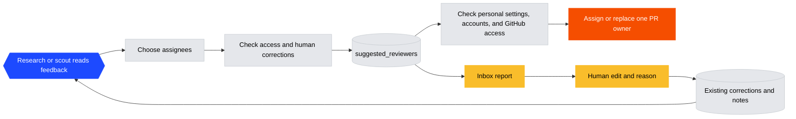

# Report completion and late PR attachments

A report completes after all linked implementation PRs are closed or merged.
At least one merged PR resolves the report; otherwise all closed PRs suppress it.

PR-driven resolutions emit `signal_report_status_changed` with `resolution_reason=pr_merged`, including when attaching an already-merged PR completes a report. `dismissal_reason` remains reserved for feedback supplied with the transition. Outcome queries should prefer `resolution_reason` and fall back to `dismissal_reason`; a missing reason alone does not imply that no PR merged.

PR-driven dismissals emit `dismissal_cause=pr_closed_without_merge` when all linked implementation PRs are closed without a merge. This also covers reconciliation after attaching an already-closed PR. Dismissal queries should prefer `dismissal_cause` and fall back to `dismissal_reason`, which remains the caller's feedback. The cause identifies automatic reconciliation, not who closed the PR or why they closed it.

A person can resolve a report by recording a manual implementation or a useful finding that needs no action. Feedback from the state API, Slack, PR closures, report merges, refunds, and plan rollups saves its verdict so the activity log distinguishes resolutions from dismissals even after later state changes. Feedback predating recorded verdicts uses a neutral activity label.
The `no_action_needed` reason requires a resolved state. It leaves the report resolved, cancels its open follow-up checks, and is excluded from fixed outcomes in inbox ranking. Manual resolution closes an open implementation PR; the resulting GitHub close event preserves the resolved report status.

Monitoring means implementation is complete and outcome verification is pending. Resolved means the report is finished and runs no follow-up checks. This includes stored Monitoring reports whose effective status becomes Resolved when the flag is disabled or unavailable. The organization-level `signals-report-monitoring` gate requires explicit enablement, including in local development, and treats missing definitions or evaluation failures as disabled.

A Monitoring period begins with an explicit, timezone-aware implementation-complete timestamp supplied by the server. Merge-driven entry can use the linked PR's recorded `merged_at`, even when its webhook arrives later. The lifecycle never substitutes receipt time for a missing implementation timestamp. Repeated entry preserves the original period; archive and restore preserve it too. Reopening implementation clears the start so a later implementation creates a new period. Resolving after verification keeps the implementation timestamp for history.

The backend `complete_implementation` service records a durable attempt and freezes this report's pending or active, unexpired check IDs and authored-definition versions in the same transaction as Monitoring entry. Kind, approval, missing configuration, and missing or zero soak do not remove a check from this selection. Stale checks receive expiry records before selection. No applicable checks, or a disabled Monitoring flag, resolve directly without a verification attempt. Carried-over checks lose their earlier evidence and dispatch claims while keeping their remaining runs. Duplicate completion and archive/restore retain the snapshot; reopening creates a new attempt when implementation completes again. The single and bulk state APIs share this service. PR-merge handlers still resolve directly.

Monitoring keeps the researched report available for verification and new matching signals, without starting another implementation. Enabled responses expose the server-owned start time, and implementation work is done while the report itself remains unfinished. A Monitoring child keeps its parent plan open, and child rollups cannot finish a Monitoring parent. The single and bulk state APIs accept the Monitoring target. Start monitoring appears after follow-up checks load and at least one exists; the service decides whether any remain applicable when the request runs. Existing Monitoring reports can be finished manually, reopened, or archived. Manual completion records caller attribution and explicitly states that automatic verification and an evidence amendment were not performed. PR merges continue to resolve reports.

Disabled organizations treat stored Monitoring reports as Resolved across reads, filters, counts, sorting, actions, recurrence handling, work state, plan rollups, and background checks. Responses omit the Monitoring start field and the inbox offers no Monitoring controls. Monitoring entry is refused. Restoring a report archived from Monitoring returns it to Resolved while disabled. Reads preserve the stored status.

Background check processing discovers rollout decisions only for Monitoring reports with candidate checks and reuses them through each coordinator tick, including pending-check arming. Arming still rechecks the report's stored status under its row lock. Reopened-check batches and briefing details share one decision per team. Plan rollups reuse one decision across their child statuses and ancestor walk.

PR merges still resolve reports. A plan already in Monitoring waits for verification even after its steps close. Entering Monitoring with the rollout enabled arms existing, unexpired pending checks from the recorded implementation-complete timestamp. Archive pauses active checks; restoring Monitoring re-arms them from the same period. A delayed callback cannot arm checks after reopening, archiving, or entering a newer period. Coordinator ticks retry missed arming from the stored Monitoring start, including after a failed flag lookup, and preserve armed Monitoring checks. Their execution and result handling are not enabled by this arming change. If the rollout is disabled, existing Resolved check behavior applies to stored Monitoring reports; pending checks begin at the next coordinator tick, without using the Monitoring start as a measurement anchor. Expired checks stay expired. Monitoring entry, check execution, and automatic completion ship separately.

Attaching a new open, draft, or unknown PR to a resolved or Monitoring report returns it to ready.
The shared PR-linking service applies this rule to task outputs and agent attachments.
An existing attachment retry does not reopen a report, and importing legacy assignments preserves its status.
Suppressed reports remain suppressed when another PR is attached.
A report merged into another report cannot be restored, resolved, or marked Monitoring from the archive; act on the surviving report instead.

A report that is `part_of` another report is a step in a plan, and the plan completes from its steps.
When every live step of a plan is closed, the plan takes their verdict: resolved if at least one step resolved, suppressed if they all were.
A plan with any step still open is left alone, and a deleted step counts neither way.
Reopening a step does not reopen a completed plan.
Deleting a step also checks the plan again.
A plan that becomes ready checks its own steps, in case they closed while the plan was still in research.
The check locks each plan before it reads and updates its state.
It continues through an already closed plan to check that plan's parent.
An archived step never undoes a resolved plan.
The roll-up runs on the step's own status change, so a merged PR, a manual resolve, a bulk state change, and an MCP state write all reach it.
A `part_of` link written on a step that already closed runs the check as well, because that write changes no status.
It continues up a plan of plans, and skips a plan that is waiting on a replacement.
It also skips a plan that carries its own open, draft, or unknown PR, because that plan's own work decides its status.

## Manual implementation-completion integration

Manual entry calls `complete_implementation` from `SignalReportViewSet._transition_report_state`, shared by single and bulk writes, after the report is locked and refund and merge-survivor restrictions have passed. The service receives the literal `team_id`, `report_id`, server-owned `monitoring_started_at`, caller `attribution`, `actor_user`, and `close_pr_on_resolve=True`. The outer report lock uses `select_for_update(no_key=True)` so concurrent check activity can write its report foreign key. Both APIs refresh the caller's report after the service saves its separately loaded instance and return the resulting status.

The service records stale expiries before selecting this report's pending or active, unexpired checks, independently of kind and approval. Historical terminal checks, standalone metrics, and related reports' checks do not qualify. No applicable checks resolve directly without a verified-success claim. Applicable checks enter Monitoring with the current attempt's durable membership and version snapshot. Missing Monitoring configuration or soak blocks verification; zero soak is valid. Carried-over active checks require fresh evidence.

Archive and restore preserve the attempt and original start, including expiry recovery and saved interim observations. Reopening implementation clears the period; completing implementation again creates a fresh attempt. Disabled or unavailable evaluations refuse new manual entry and use the existing Resolved fallback. Final evaluation, automatic completion, amendments, and PR-merge entry remain separate work.

## Follow-up checks

Scout and research guidance asks for a verified live observation metric when a central quantitative claim comes from events.
A count can justify a metric without a chart or a change over time.
The metric must match the finding's filters, population, exclusions, window, and aggregation.
When no useful supported metric can measure that claim, the summary states the specific limitation in one short sentence.
Qualitative findings can omit metrics.

Observation metrics support HogQL filters that compare direct event fields or event properties with literal values.
Boolean operations, arithmetic, and literal lists are supported; other function calls and subqueries remain unreadable.
Report reads, research selection, and snapshot refresh use the same filter check.
Snapshot refresh still requires access to both the live query and the shared measurement.
A viewer with a property grant can read the live query while the team's default property restrictions keep the shared snapshot hidden.

Research writes measurable outcome goals as `metric_threshold` report checks and investigative goals as `agent` checks. A metric check stores a bounded live query, baseline, comparison, and soak window; the query and display format are copied from its report metric when it names one. Checks execute only during enabled Monitoring. The coordinator records interim metric observations within each check's soak window; final metric and authored agent verification remain separate work. Resolving a report stops execution, including recurrence checks. Historical results remain readable. New metric checks validate count, rate, duration, baseline, and threshold values using the same rules as report metrics; existing configurations remain readable. A later research pass reviews every open check, preserves unchanged checks and their approvals, replaces changed checks, and retires omitted checks. A failed verification turn leaves existing checks alone. Verification can revise only Expected impact; other summary sections and their chart links must remain intact. The full replacement schedule, including its soak and measurement window, must finish before the 90-day horizon. The Follow-up checks sidebar shows schedules and results for both kinds. The Expected impact section uses the same metric checks to show goals and charts, behind the person-level `signals-expected-impact` display flag. A person can mark those measurements "Looks good" as a quality signal; approval does not control scheduling or execution. The "Suggest different metrics" action starts a discussion that can atomically replace relevant open metric checks while preserving unrelated checks. A failed replacement leaves the original running, and a successful replacement starts unapproved. Report observation metrics remain separate from these forward-looking checks.

Reports awaiting human input retain their generated checks for a later Monitoring period. Outside Monitoring, open checks display as paused in the Follow-up checks sidebar. Expected impact retains proposed or approved measurement labels before Monitoring, and shows paused checks on resolved or archived reports, including when the rollout is disabled. Stored schedules do not advertise future runs or active scouts. Historical verdicts and legacy schedule fields remain readable; remaining-run counts do not authorize post-resolution execution. Metric replacements require access to the query they schedule and preserve the remaining recurring runs and soak duration, including zero minutes. Replacement cannot override the soak. Creation and replacement share full schedule validation against the 90-day horizon. A replacement rejects a check moved by a concurrent report merge; reload the report and retry on the survivor. Units cannot contain null characters or unpaired Unicode surrogates. The Expected impact section shows finished verdicts and refreshes after agent tasks change checks.

The `inbox-report-checks-replace` MCP tool requires `task:write` and `query:read`. Query-specific event, action, and cohort permissions still apply. The `signals-report-checks-replace` rollout flag hides the tool unless enabled. Keep it disabled until the replacement API is deployed in every region. This gate is separate from the Expected impact display flag.

Approval advances the check's update timestamp so older list responses cannot undo it on screen. Retries preserve the original approval and timestamp. Research captures the open checks' versions before starting. If any check changes before its result is stored, that pass leaves the checks alone. A subsequent pass that sees the current checks can revise or retire them, including approved checks. Older activity results without this snapshot preserve person-selected and approved checks.

Custom HogQL aggregations are parsed before a metric or check is authored. Invalid syntax returns a validation error; a rejected replacement keeps the original check and its activity history intact.

Protected research runs require analytics access before a person can resume or warm a successor. The successor’s bound sandbox can read the verified source history through authenticated log routes, but cannot modify the source run.

## Monitoring metric definitions

The report detail action is **Start monitoring**, with the tooltip “PostHog watches to make sure the fix works”. It is hidden until follow-up checks have loaded and when none are set. The implementation-completion service remains responsible for selecting applicable checks and deciding whether entry creates a Monitoring attempt or resolves directly.

**Resolve** on a Monitoring report resolves it manually and cancels its remaining pending and active follow-up checks in the same transaction. Historical terminal checks and other reports' checks are preserved. Results already in flight cannot revive canceled checks. Its reasons are **Verified manually**, **No action needed**, **Was already fixed before this report**, and **Something else…**. The `verified_manually` reason is separate from `fixed_outside_posthog`, requires an enabled Monitoring period, and is preserved with caller attribution. A separate attributed log entry records that automatic verification and an evidence amendment were not performed, preserving the full 4,000-character limit for the user's feedback note.

Open checks on Monitoring reports expose a server-derived `monitoring_timing` field when `signals-report-monitoring` is enabled. The field separates a scheduled or due interim measurement from the end of that check's soak window, and identifies paused, archived, unarmed, expired, or incomplete timing. It is omitted for other checks and when the flag is disabled or unavailable. Timing reads do not arm checks, change their schedules, or decide outcomes.

The Follow-up checks rail and Expected impact details show the next interim measurement separately from the check's observation-window end. A closed window reads as awaiting verification, without advertising its deadline as another run. Interim measurements do not spend remaining verification runs. Agent checks and metric checks without a Monitoring definition remain paused during Monitoring. Final evaluation and automatic report completion remain separate work.

Open report details refresh check timing every minute and reload checks immediately when the report status changes, so resolution or archiving replaces cached Monitoring timing before polling stops.

Research should make every effort to complete `config.monitoring` for each metric check using the research evidence. If required facts remain unknown, explain what is missing in the rationale instead of inventing values. The definition records the target's `reference_period_minutes`, an explicit `threshold_scaling` policy, and `baseline_period_minutes` when a baseline is supplied. These reference periods are independent of the soak, which defines the Monitoring window, and of the run interval and safety expiry. No existing check receives an inferred definition.

The definition describes a measurement from Monitoring start through the observation time. A `linear` target scales by elapsed minutes divided by reference minutes and requires a single additive event count or property sum without a formula. Session-level sums are excluded because a session can contribute to more than one chart bucket. A `fixed` target keeps its bound as the observation period grows, including for percentages, averages, distinct counts, or explicitly fixed custom targets. Rolling weekly and monthly active-user queries are refused because their lookback overrides the Monitoring bounds; use a distinct user count instead. Display format alone never selects the policy. The baseline retains its own measured period and is not presented as an observation from Monitoring.

Expected impact keeps the activity chart visible and collapses the target period, scaling policy, baseline, and check timing under measurement details. Dynamic chart boundaries refresh at minute intervals so repeated views can reuse cached results. Bucket granularity follows the full displayed range and stays within the 1,000-point budget. The chart preserves date-range filters and spans one reference period on each side of Monitoring start, or now before Monitoring starts, extending through now if necessary. Start and now markers separate the surrounding activity from future dates, whose values remain empty. Compatible charts show target reference lines: additive linear targets scale to a full chart bucket, and fixed rates or property averages/quantiles retain their level. Fixed totals, distinct counts, unknown aggregations, linear calendar intervals longer than a day, and linear day buckets with unequal daylight-saving durations receive no reference line. These references do not impose per-bucket pass/fail rules. This read-time chart does not evaluate the Monitoring target or save a check result. The stored bounded query and whole-window comparison remain available for later final verification. Final Monitoring outcomes remain separate work.

During Monitoring, checks with an explicit Monitoring definition sample at their configured run interval, or every 24 hours when none is set. The first observation is due one interval after Monitoring starts. Interim observations run only before Monitoring start plus the check's `soak_minutes`. The full trailing query window does not delay them. Interim queries explicitly use the offline ClickHouse workload; interactive metric refreshes retain their default workload. The next due time is capped at that soak deadline, but this PR does not execute a final check or conclude a report there. A missing or zero soak, or a soak no longer than the sampling interval, produces no interim observations. Each query pins both bounds to Monitoring start and one captured observation cutoff, preserving the population filters. Pinned ranges include partial periods so their bounds match the scaled target. Linear comparisons scale both bounds by elapsed time divided by the reference period, without rounding; fixed comparisons stay unchanged.

Each completed attempt appends a protected `check_observation` log entry with its exact bounds, soak deadline, display format, unit, effective comparison, value, and match result, or a sanitized query error. The log labels it as an interim measurement, shows whether the goal is on track, and displays time remaining when the measurement was taken. It does not assign a terminal outcome. Observations do not spend `runs_remaining`, change the report status, or emit recurrence signals. The next sample is due one interval after the cutoff; missed intervals do not create catch-up runs. Restoring Monitoring schedules from the latest attempt in that period, preserving a failed attempt's error streak and six-hour retry across suppression. Re-enabling the flag restores the measurement origin, the next attempt from the latest run, and the expiry from the original Monitoring start. This repair precedes the expiry sweep so a fallback expiry cannot shorten or extend the Monitoring horizon. A check that cannot fit its source queries into the remaining coordinator budget stays due without an observation or an error-budget change. Query failures retain the existing six-hour retry and consecutive-error limit, and the 90-day check horizon still applies. Writes reject a changed check, Monitoring period, report state, or flag, and duplicate workers cannot save the same attempt twice. Expiry sweeps and schedule repairs retain their check-row concurrency guards after database lock waits, so they cannot overwrite a concurrent cancellation, expiry extension, or saved observation.

With Monitoring disabled, observations disappear from the artefact API and counts. No Resolved executor runs. The coordinator also leaves disabled or unavailable Monitoring periods dormant. Observation values require the same query permissions as terminal check results. The inbox follows all artefact pages within the current project before deriving task runs, reviewers, and activity so observations cannot displace older report state. Polling waits for an in-flight paginated load to finish. With the Monitoring flag enabled, scouts see metric checks with an explicit definition as scheduled or due inside their Monitoring window; agent checks and metric checks without a definition remain paused pending final verification support. The soak deadline bounds interim execution; no final verdict, reopening, or follow-up report is added here.

Disabling Monitoring stops execution without starting a post-resolution schedule or recalculating a recurring deadline. Re-enabling restores the original Monitoring horizon for active checks and leaves terminal checks unchanged. Pending checks arm only during enabled Monitoring, using the original implementation-complete timestamp. Queued legacy check-triggered scout activities skip before starting agent work, and already-running legacy scouts cannot record a result through the check-result tool. Scout check lists mark these checks paused and do not advertise them as waiting on a run.

With `signals-report-metrics` enabled, research gathers short-window baselines before verification and prefers metric-based follow-up checks. It aims for practical 70-80% confidence in improvement, without claiming a calculated confidence score. Observed volume, recurrence, ingestion delay, and deployment timing justify the shortest useful query and wait. Frequent or high-volume checks can use 4-8 hours, allowing for several hours of deployment delay before the fix reaches users. Around 24 hours or several days require the corresponding activity or rollout evidence. Agent checks remain available when interpretation or unsupported measurements prevent a useful metric check. Missing activity is not success. These prompt preferences do not change execution, schema defaults, or final outcomes.

The server refuses new Monitoring definitions when `signals-report-monitoring` is disabled or unavailable and omits the definition from check responses. Stored definitions remain intact. Research carries its definition-visibility decision into reconciliation, so flag recovery during a run does not replace an unchanged check or reset its approval and schedule. Existing definitions, charts, check schedules, and Resolved outcomes otherwise follow their current behavior.

Enabled research can author `run_interval_minutes` for a metric check with a Monitoring definition. The interval must be at least six hours and strictly shorter than the check's observation window. A new check without an interval defaults to a quarter of that window, bounded to six hours through one day. A 24-hour window therefore stores a six-hour cadence, allowing interim measurements at hours 6, 12, and 18 when interim execution is available. Windows of six hours or less retain their evidence-backed duration and have no interim samples. Cadence is independent of query bucket size and the target reference period. Omitted intervals preserve existing checks' schedules; explicit cadence revisions replace the check and clear approval. Revised windows must still accommodate inherited intervals. This authoring policy does not change existing null-interval checks, execution, or final outcomes.

### Evidence qualification contract

`report_check_evidence.qualify_metric_evidence` is a pure contract for future final Monitoring evaluators. It has no production callers and changes neither scheduling nor interim observations. Qualification is independent of the target comparison: sufficient evidence can demonstrate a failed expectation, while a matching value with insufficient evidence cannot establish success.

The input `MetricEvidence` carries explicit aggregation semantics, a measured value, and optional activity or denominator counts. Every measurement has an `EvidenceScope` naming the team, relevant population, and the check's existing fixed window. Supporting counts used for qualification must match all three. For property sums, relevant activity counts valid property contributions. A trusted source adapter establishes the population key and relevance; an arbitrary metric label does not. This module neither derives relevance from query text nor executes queries.

| Source                                           | Sufficient evidence                                                                                           | Unqualified evidence                                                                                                                 |
| ------------------------------------------------ | ------------------------------------------------------------------------------------------------------------- | ------------------------------------------------------------------------------------------------------------------------------------ |
| Raw event/action count or supported property sum | A positive total supplies its own evidence. A zero total qualifies with any positive relevant activity count. | Missing or zero activity cannot qualify a zero total. Negative sums remain unsupported pending source policy.                        |
| Rate                                             | The actual eligible-opportunity denominator meets an explicitly supplied positive minimum.                    | Missing, zero, or below-minimum denominator; missing minimum policy. Activity does not substitute for the denominator.               |
| Average                                          | The count of valid contributing property values meets an explicitly supplied positive minimum.                | Missing, zero, or below-minimum contributing count; missing minimum policy. Total event volume does not substitute for valid values. |
| Other aggregation or agent evidence              | Requires a separate supported adapter/policy.                                                                 | A scalar, formatting, or interim match cannot establish support.                                                                     |

`EvidenceQualification` returns `status` (`sufficient`, `insufficient`, `unsupported`, or `errored`) and a machine-readable `reason`. Missing measurements, supporting-count scope mismatches, and empty windows remain insufficient. Query errors return `errored/query_error`; malformed numeric inputs raise `ValueError` rather than becoming evidence. No qualification result is a passed or failed check verdict.

No interim samples are required. A short, nonempty window can qualify from its final measurement. Historical baselines and interim observations are not inputs. There is no universal denominator minimum, confidence claim, ingestion-lag allowance, or deployment-readiness rule.

Final evaluator integration must enforce the organization-level `signals-report-monitoring` gate and its fail-closed Resolved fallback. Source adapters must validate aggregation semantics, preserve the population and fixed window, collect required supporting counts, and establish data readiness. Supported property sums exclude formulas and session-level aggregations. Arbitrary formulas, distinct counts, and quantiles need their own adapter/policy. `MetricMeasurement` supplies neither activity counts nor denominators, and report-metric `minimum_data_points`/`eligibility_query` fields are not inferred as check policy. Final evaluators must bind evidence to the current attempt/check version, compare only sufficient measurements, and separately handle insufficient evidence, unsupported measurements, and query errors. Scheduling, retries, persistence, and report transitions remain outside this contract.

## Inbox value summary

The `signals-inbox-value-summary` flag shows project-wide counts above the web
inbox in both layouts. It is disabled by default. The rolling seven-day window
uses GitHub merge time and includes only PRs verified as output from Self-driving
implementation tasks. Manual attachments and research or discussion tasks do not
count. Personal inbox filters do not change the totals.

The people count deduplicates human GitHub IDs across mergers and non-dismissed
approvals submitted before merge. Approvals can predate the seven-day window.
Bots do not count. A missing participant snapshot leaves the people count unknown,
not zero. The response includes the merged PR links and the GitHub logins stored in
the participant snapshot. GitHub reads run in a background task; opening the inbox
only reads the database.

The panel stays hidden when there are no qualifying merges. Dismissal lasts seven
days and is stored per user and project in that browser. On return, the client
refreshes a result older than five minutes. Before rollout, apply the migrations,
run `backfill_inbox_summary --team-id <id>` in bounded batches, and check the counts
against the linked GitHub PRs. The flag does not enable this backfill itself.

## Follow-up measurement timing

Reopening implementation clears the measurement anchor so a later Monitoring period starts fresh. Archiving parks active checks; restoring the same enabled Monitoring period preserves its original start and retry history. Delayed arming callbacks validate the current Monitoring period and never arm a Resolved report. Interim queries recheck the current report and flag before measuring, and saved observations reject stale report states or periods.

New metric checks validate numeric goals and baselines against their metric kind, format, unit, and query. Existing check configurations remain readable.

## Repository selection

The shared repository selection prompt asks the agent to check the sources in the supplied context before choosing a repository.
For information from a private repository or another explicitly private source, it prefers a relevant private candidate and returns no repository if none is suitable or its visibility cannot be confirmed.
Each candidate carries a private, public, or unknown label from the cached GitHub repository list, so the agent does not query GitHub for visibility.
This is prompt guidance, not an enforced access control, and it does not validate repositories selected outside the agent.

## Reviewer notifications

With `signals-research-reviewer-selection` enabled, the research agent chooses report recipients in relevance order.
Ownership files, CODEOWNERS, code history, report findings, and human corrections supply evidence for that choice.
They cannot replace it with an ownership-first or commit-count selection.
Research first reads recent human corrections from the project profile, which is available on every plan.
It also reads relevant notes, older activity logs when available, and `reviewer:` scratchpad entries.
Corrections apply only to the affected area. Research does not save its own choices as reviewer memory.
Research and scouts check each candidate against the affected behavior or entity.
For code reports, they inspect specific ownership rules and substantive implementation or review work.
Broad directory activity, commit counts, mechanical changes, and team roster order alone do not establish responsibility.
Each reason names the affected behavior and cites its source. Responsibility and review expertise are distinct reasons to include someone.
Recipients are ordered by relevance, with at most three. Agents can return fewer recipients or none when evidence is insufficient.

A missing, malformed, or entirely ineligible decision retains valid existing recipients and records a failed selection.
An explicit empty decision clears automatic recipients while preserving pins and confirmed lists.
The artefact write path rechecks project access before saving; if all proposed candidates have become ineligible, it retains valid existing recipients.
Report recipients need project access, but do not need GitHub accounts.
Scout and custom-agent reports also preserve the agent's selected order through the existing artefact path.
The saved list drives both the Inbox index and notification recipients; no later ownership selector reranks it.

With research selection disabled, research uses the legacy ownership-and-commit selector.
That rollback does not release corrections or bypass the artefact rules.
The legacy resolver also remains an independent task-runner permission check; selecting a report recipient does not authorize a task.

The pipeline skips a reviewer row when the accepted content is unchanged.
Human corrections retain precedence.
A real selection change after the first Slack notification can still leave that notification out of date.
Automatic reviewer changes do not send additional Slack notifications.

During the internal trial, check correction relevance and assignment quality in report samples.
Use `after_inbox_notification` on `signals_suggested_reviewers_resolved` to inspect pipeline changes after notification.
Use `runner_source=team_fallback` on `signals_autostart_steering_attached` and `skip_reason=no_runner` on `signals_autostart_skipped` to inspect task outcomes.
Compare report state, not raw event totals: skipped unchanged writes reduce the event count.
Keep the selection flag disabled until the trial confirms suitable assignments and expected autostart behavior.

When a project member adds a reviewer, the report shows "Added by" and that member's name as the reason above the reviewer. The name comes from the authenticated author of the artefact that added the reviewer, not from the editable reason. If the author is unavailable, the report shows the generic "Added by teammate" badge instead.

Slack notifications for a ready report include only reviewers who have access to the report's project when delivery starts.
The same access rule applies when a reviewer is added later.
If no suggested reviewer has access, the ready report still goes to the configured team channel without reviewer mentions.
The notification activity retries transient ClickHouse reads before it claims the report for delivery.

When an implementation pull request has one assignee, the worker requests that person's review, even when another person or team request exists.
This makes the owner's work visible in both GitHub assignment and review-request lists.
Without a single owner, it requests the highest-ranked eligible report reviewer only when no person or team request exists.
Each attempt requests at most one person. It never removes existing requests.
The worker skips the author, pending recipients, completed reviewers, and people whose review request was removed.
Incomplete review or removal history prevents a new request.
Personal assignment settings control ownership; they do not disable review requests.

## Assignment decisions

All reviewer producers use `SignalReportArtefact.append_status()` (directly or through `append()`).
It applies `ReviewerRules` in the same transaction as the existing reviewer write, under the report lock.
The latest `suggested_reviewers` artefact remains the recipient list; `SignalReportSuggestedReviewer` remains its derived index.
Both use `(created_at, id)` to select the latest row.
There is no separate assignment table, operation ledger, or writer service.

### Assignment feedback loop

The product goal is for human feedback to improve the next relevant assignment, including when another research or scout producer makes it.
The shared write rules protect corrections on the current report. Existing notes, activity, and reviewer memory provide evidence for later selections.
Research reads recent corrections. Eligible reviewer edits also send notes to the scouts that touched the report or hold the affected routing memory.
The notes include members without GitHub accounts, identified by their PostHog user UUID.
Repeat delivery is suppressed only for the same report and the latest action for that identity.
A correction on another report, or a reversal, remains separate evidence.
Scouts search relevant notes across producers before selection, through `scout-notes-list` without a `skill_name` filter.
Research uses the same searchable notes. Both can inspect the source report and use the shared `reviewer:` memory.
Forwarding is best effort; permissions, retrieval, and agent judgment can each limit its effect.
Saving feedback alone does not establish that the next selection uses it.

The first milestone is to correct an assignment, explain the intended ownership, and run selection on a new, related report through another producer.
Confirm that the agent uses the feedback and explains its effect, while an unrelated case stays unaffected.
The original report must retain the correction. Repeat in both research-to-scout and scout-to-research directions, including members without GitHub accounts.
Each correction should work through existing controls and steering tools, without a code change or separate edits to every scout.
Selection guidance and scoped memory should remain inspectable and tunable; access and correction protection remain enforced in code.

A current-report correction is binding. On another report, it is scoped evidence with its source, date, and reason where available.
Self-removal alone does not establish an ownership change or a global exclusion.
Agents must not turn their own repeated selections into ownership evidence.

Compare selection before and after prompt changes with the same saved inputs and model.
The invented cases in `products/signals/backend/report_generation/fixtures/reviewer_selection_cases.json` cover specific ownership, team members, weak evidence, multiple roles, and scoped corrections.
The cases with and without feedback differ only in the available correction. An unrelated correction must not change the selection.
Check both the selected people and the sources cited in their reasons. Do not expose expected results to the model.
A comparison with supplied evidence tests selection judgment, not whether an agent can find that evidence through tools.
Live report samples must check retrieval and recipient suitability separately.

The complete-loop trial remains pending. Measure feedback availability before selection, retrieval, use, the applied result, and repeated assignment errors.
Distinguish unavailable feedback from feedback the agent considered but did not apply. Recipient review supplies the suitability judgment.
Existing notes do not guarantee an immediate rerun. Triggered reassessment remains separate work.
The [feedback-loop milestone](https://github.com/PostHog/posthog/issues/121777) tracks the trial and any missing links before broader identity, team, preference, or reassessment work.

### Human corrections

An add pins that person. A removal excludes that person.
Agents can still change people the user did not edit.
Adding an excluded person reverses that exclusion; removing a pinned person reverses that pin.
Only an explicit API `confirm` action protects the complete list, including an empty list.
The existing Inbox controls only add or remove people; they have no confirmation control.
Removing the last person does not confirm an empty list.
A person can still edit a confirmed list; agents cannot.
Current project access always applies, including to pins and confirmed lists.
A reviewer edit is not a work claim or permission to execute a task.

The same artefact table stores `reviewer_corrections`, with pins, exclusions, confirmation, and a history-review marker.
Corrections and membership are saved atomically with the existing actor and process attribution.
The first protected reviewer write recovers old corrections from reviewer deltas matched to activity records, under the report lock.
It saves the result once. Reads use saved corrections; before recovery, they mark reports with old human edits as needing review.
During rollout, automatic task start and PR assignment wait for that recovery.
A human-authored snapshot alone does not prove approval of the complete list.
Incomplete history stops automatic changes until a person confirms the current list through the API.

### Write contract

Automatic callers read `reviewer_assignment.state` from the report detail response before selection.
This is the only API response that includes correction state.
The web app does not need it for targeted add/remove requests.
Send both `reviewers_id` and `corrections_id` as `expected_reviewers`.
The write rejects an old state under the report lock.
These IDs cover assignment state, not changes to research evidence.

Human add/remove requests name only the people changed.
They apply to current membership so unrelated concurrent edits survive.
Replacement and confirmation require the state the person saw.
Read the reviewer artefact named by that state when preparing either operation.
Clients can send explicit `targets` with an add/remove action while retaining a full `content` list for older servers.
Protected reports reject full replacements without state; older Desktop/mobile clients must update before rollout.

Automatic results distinguish `selected`, `no_suitable_owner`, and `lookup_failed`.
Generated clients omit `reviewer_outcome` unless the caller supplies it; the backend treats an omitted outcome as `selected` only while processing reviewer state.
This keeps unrelated report edits compatible while the MCP server and API deploy separately.
A deliberate empty result clears automatic recipients but retains pins and confirmed lists.
Failed lookup or wholly invalid selection retains valid current recipients.
Accepted recipients must be active members with project access.
An unchanged retry creates no reviewer row or delivery work. A retry with old state can return a conflict.
Research changes to explanations or display names alone also create no reviewer row or delivery work.
Generic artefact PATCH and DELETE cannot change reviewer history, and clients cannot write correction records directly.
If stored reviewer data is invalid, a person can replace the list with matching state, even with the writer flag off.
The repair keeps the old rows and existing corrections. It does not confirm the list or clear the history-review marker.

### Shared report and PR assignment

With `signals-research-reviewer-selection` and `signals-assignment-writer` enabled, the saved report assignment supplies candidates for one PR owner.
`signals-assignment-side-effects` must allow delivery. The legacy DRI flag does not change this rule.

The worker maps selected project members to their current personal GitHub accounts and checks repository assignability.
Each attempt checks at most ten eligible candidates, in the saved order.
It assigns the first eligible person whose **Assign me on GitHub** setting is on, then stops.
A missing settings row, a missing GitHub account, or lost access skips that person. The worker can choose the next saved recipient, but nobody outside the report.
If no saved recipient qualifies, the PR remains unassigned.
The personal setting does not remove anyone from the report. Claims and owning teams do not change the selected list or its order.
The report remains the source of the assignment. Logs record unavailable accounts, permission failures, and GitHub delivery failures.

The worker rechecks the report state, personal settings, account links, project access, GitHub state, and delivery controls before assigning.
Queued work and retries use the current personal setting.
Each successful automatic assignment records its owner and origin. A later reviewer edit, claim, or verified PR refresh can reassess that owner.
The worker replaces owners only when GitHub's current assignees exactly match its latest record; extra assignees, manual removal, and unknown-origin assignments remain authoritative.
It adds the replacement before removing the previous automatic owner and stops if GitHub reports a concurrent assignee change.
If no report recipient qualifies, it clears only its recorded automatic assignment. A failed eligibility lookup leaves the assignment unchanged.
Incomplete human-edit history blocks automatic assignment.
The legacy DRI path also respects report exclusions and rechecks human choices before assignment.
Claimants and suggested reviewers must be active project members to receive assignments or review requests.

GitHub's final read and write are not atomic, so a small external race remains.

There is no separate PR model call, evidence collector, or decision cache. The internal `pr_owner_assignment` artefact stores delivery provenance and is not writable through the generic API.
The existing task permission checks remain separate. Report assignment does not authorize an agent to run under that person's account.
GitHub review requests still use the current report list, subject to the existing request policy.

The first loop trial uses one correction with a reason, a new related report, and an unrelated control case.
Inspect the existing research trace and selection reason, then check the saved report list and PR assignment.
Confirm that feedback changes the relevant choice and leaves the unrelated case unchanged.
Confirm that selected people with the GitHub setting off remain on the report but receive no automatic GitHub assignment.
The live trial remains pending; automated delivery tests do not establish research selection quality.

### Identity and organization changes

`resolve_reviewers.py` maps linked PostHog and GitHub identities in both directions. The existing `scout-members-list` tool
exposes project members and known GitHub accounts to agents. Personal GitHub integrations and GitHub OAuth provide identity links;
some existing lookup paths also use the GitHub App installer identity. Report recipients can use PostHog user UUIDs without GitHub accounts.

The PR worker uses current personal GitHub integrations and OAuth links. Before assigning a linked account, it verifies the stable GitHub user ID against the repository collaborator record.
The provenance record stores the link source, verification time, and a 30-day expiry. An expired proof is refreshed on the next reassessment trigger.
It does not use the team installer identity as a personal link or discover new accounts. Similar names alone do not prove an identity.

Access loss removes an ineligible report recipient on the next protected reviewer write. A team move with access retained changes selection evidence;
it does not cancel a human pin. No general process currently finds and reassesses all old reports after organization changes.
Such a process remains future work and must use the same correction rules. Existing manual GitHub choices remain authoritative.

### Rollout and rollback

| Control                           | Allows                                                                                                                           |
| --------------------------------- | -------------------------------------------------------------------------------------------------------------------------------- |
| `signals-assignment-writer`       | Reviewer corrections and state checks on existing writes.                                                                        |
| `signals-assignment-side-effects` | Existing Slack delivery, automatic task start, GitHub assignment, review requests, and ready-state changes for enrolled reports. |

Both flags support organization targeting and require explicit enablement.
The existing `signals-research-reviewer-selection` flag controls research selection and, with the writer enabled, shared report and PR assignment.
PR delivery also requires the side-effect flag, including before a report enters the writer.
Disabling research selection restores the legacy PR policies. Saved report corrections remain protected.
They use local evaluation, so a report lock never waits for the flag service.
Missing flag definitions keep the new behavior disabled.
Enable the writer with side effects disabled to test real assignment changes without external delivery or task start.
This changes the real Inbox list and index; it is not a shadow write.
Local activity records, scoped correction notes, and existing measurements remain active.
A corrections artefact marks enrollment, so delivery remains gated after writer rollback and for queued work.
Disable side effects and the writer to stop a trial. Automatic replacement stops on enrolled reports; human corrections still work.
Reports that never enrolled keep their existing behavior.
A flag change cannot retract a sent message or stop an external call that already passed its check.
After-commit scheduling is best effort. Suppressed actions are not queued for later delivery.

Before rollout, test self-removal, self-addition, concurrent edits, explicit empty confirmation, stale results, retries, access loss, and failed selection.
Also test the assignment feedback loop above. Preserving a correction does not establish that later selections improve.
The [system design](https://github.com/PostHog/posthog/issues/120572) describes selection, later roles, and delivery work.

## Report links

Only scouts and the signals pipeline create and manage typed, directed report links.
Scouts attach them through the `links` list on `scout-edit-report`.
Public callers can read `report_link` artefacts, but cannot create, edit, or delete them through the artefact API.
Typed links cannot yet be removed through a supported operation.
[Issue #102776](https://github.com/PostHog/posthog/issues/102776) tracks the unlink API and MCP tool.
The Implement button overrides an automatic start check; it does not remove a link or change plan membership.
Links must name a different live report in the same project and cannot form a cycle among links of the same kind.

Research reads a report's outgoing `follow_up_of`, `depends_on`, and `part_of` links and starts from the linked reports' findings and pull requests.
A linked report must have an explicit safe verdict in its latest safety judgment.
Research uses the latest finding for each signal and removes repeated links.
It loads at most ten distinct relationships it can use and limits the rendered context to 12,000 characters.
All linked fields are escaped and marked as untrusted evidence.
A follow-up can refer to a manual fix or a regression; it must not invent a missing pull request.

Three link gates hold back automatic implementation, and each one records why on the report:

- A report that duplicates another one does not start its own work when any report on that duplicate chain is resolved or already carries a pull request.
- A report that depends on another one does not start until that dependency carries a pull request.
- A report that other reports are `part_of` never starts its own work, because its steps do the work.

Link readers use the writer database so a new link takes effect without replica delay.
The implementation path checks the gates again under the report lock before it creates a task.
The gates apply to automatic implementation only.
Pressing Implement in the inbox starts a run whatever the links say.
Nothing re-evaluates a held-back report when its dependency's pull request opens, so it starts on the report's next pipeline evaluation or by hand.

## Recurrence after a fixed verdict

A report dismissed as `already_fixed`, `fixed_outside_posthog`, or `pr_merged` can create a new report when the issue returns.
The pipeline records the new report's parent with a typed `recurrence_of` report link.
A report created because a follow-up check failed on a resolved report also gets a typed `follow_up_of` link to that report, carrying the verdict as the link's reason.
Generic `related_to` links do not control signal assignment.
Later signals follow the recurrence chain, even if an older parent is restored.
Matching selects the current successor before the specificity check, so the check uses its signals and title.
Traversal passes through deleted intermediate reports without assigning signals to them.
A successor dismissed for a preference reason keeps absorbing signals, including signals that match an older parent.
Repeated fixed feedback does not create another successor.
A new dismissal without feedback clears the fixed claim from an earlier dismissal cycle.
Automatic suppression after an unmerged PR closes also records an empty dismissal.
The state API rejects fixed reasons with `potential`; use `suppressed` or `resolved` for a fixed claim.

This change does not recover historical signals automatically.
Older dismissal records cannot reliably identify the active dismissal cycle.
Historical recovery needs a verified transition history before it can create new reports.
Research context excludes parent reports whose latest safety judgment rejects their content.
New reports do not copy the title or summary from these unsafe parents.
Legacy `related_to` links supply context only for resolved parents. Fixed-dismissed parents require a typed recurrence link.

The state API also accepts resolution from `failed`.
The web inbox offers Resolve for failed reports.
The Needs decision section includes failed reports, even without an actionability judgment.
Its `needs_decision` API view also includes actionable ready or pending-input reports without an implementation PR.
Triage warns before a verdict closes an open implementation PR.
New failed reports consume a daily inbox slot when they first become visible.
Existing failed reports without a visibility timestamp remain historical backlog; they do not consume the rollout day's slots.
The desktop eligibility change must ship separately after this backend transition is deployed.
A suppressed report can resolve if its prior status was `ready`, `pending_input`, `failed`, or `resolved`.

## Scout revisions

Scout edits increment the content revision count only when the title or summary changes. Notes, evidence, routing updates, and unchanged text do not spend a revision. The edit response always includes the report's running revision total.

The revision and corroboration counters are nullable, with no database or model default. Reads treat `NULL` as zero, so existing reports and reports created by older workers need no backfill. The migration adds nullable columns without rewriting rows or validating a `NOT NULL` constraint. PostgreSQL still needs a brief exclusive table lock to add the columns.

A scout can request a replacement when its rewrite changes the fix. The server binds that decision to verified automated predecessor PRs and the exact research pass and content revision. It starts at most one replacement per version, within the scout revision cap, and stops automatic closure if another edit changes the report while the replacement runs. Free-form scout notes always remain individual activity entries. Only notes explicitly marked `corroboration_only` count towards the four-confirmation cap; later confirmations increase the collapsed count shown by both the web and desktop inboxes.

Autostart binds task content to the report title, summary, research pass, and scout revision captured before external lookups. It checks that snapshot under the report lock before stamping a version as implemented, and retries from current content if the report changed.

Supersession verifies predecessors only for a real rewrite within the revision cap. Missing or stale verification rejects the edit before commit so the same request can be retried. GitHub calls happen outside the report lock.

An accepted scout replacement decision commits a protected `implementation_dispatch` artefact with the edit. A Celery worker resumes repository preparation, retains the editing scout's owner exclusion, and rechecks the exact decision before creating a task. Technical failures retry with exponential backoff from one minute to fifteen minutes. A five-minute sweep recovers lost queue messages and expired worker leases in bounded pages. The dispatch state records pending, processing, retrying, blocked, started, or canceled work; it is available through the existing artefact API. A policy block waits for a new edit or research trigger, rather than starting automatically when a setting or quota changes.

Only the first four content revisions can request a scout replacement, including revisions that did not request one. An over-cap request preserves the rewrite and records the revision-limit reason without claiming that the old fix is still correct. Reports under active research cannot accept a supersede claim. The current revision count is read inside the edit transaction, so a failed read cannot report a failed edit after committing a note or evidence.

## Verification plans

After research completes, actionable reports can include a `Verification plan` note for the implementation agent.
This final request is optional: if generation or note conversion fails, research still completes without the note.
The findings, actionability, priority, title, and summary remain available.
Core research failures and cancellation still fail the run and trigger session cleanup.

Verification proposals can name `existing_check_id` to revise an open check while preserving its remaining recurrence. An unchanged rounded `soak_hours` preserves the original minute precision; an explicitly changed wait replaces it. Equivalent default-valued config fields do not reset approval. Invalid stored configs do not prevent a valid proposal from replacing them. Presentation receives current checks as untrusted evidence, and verification can align the final Expected impact prose with its proposed metric goals.

Research traces that contain existing metric-check context require the same analytics permissions as the check query and baseline, including for resumed runs, Max task tools, trace analysis, task summaries, and run details. A sandbox token’s exception covers only the run on which the server records its token ID; task-wide reads and other runs still require analytics access. Checks without a stored query contribute neither a query marker nor an unproven baseline to the research trace. Authorized readers retain summaries and run details; direct storage links remain withheld. Query provenance is private server-owned run state inherited on resume, so ordinary task reads do not scan ancestors. Legacy checks inherit missing display formats only from a report metric with the same stored query. When a suggestion task finishes, the selected report refreshes its prose as well as its checks.

Metric suggestions are available only when `signals-report-checks-replace` enables the replacement tool.

The note names proposed follow-up checks without claiming they were scheduled. The Follow-up checks sidebar shows the stored checks. If any optional check spec is malformed, research keeps valid verification prose and skips check reconciliation, preserving existing checks. An explicitly empty, valid check list still retires omitted checks. Legacy activity payloads preserve approved, person-authored, and nonpending checks. Referenced checks inherit their existing wait when the proposal omits it. Verification’s revised summary is saved only after its check reconciliation succeeds, so a skipped or invalid proposal cannot change Expected impact prose independently of the stored checks.

The plan separates `Confirm the current state` guidance from `Confirm the outcome` guidance.
Each section says what evidence to collect, which result supports a conclusion, and which result is inconclusive.
The guidance can use a query, test, log search, replay, code review, or manual check, and does not prescribe a resolution.
Report retrieval directs any agent to the work log, where verification guidance applies regardless of how the agent started.
The agent checks that the note matches the current findings and confirms the current state before it starts work.
It confirms the outcome after the chosen resolution.
If current evidence shows the issue is gone, it records that result and stops; if no note applies, it verifies the issue from the report's evidence.
Missing data, failed checks, and inconclusive results do not establish that the issue is fixed.

## Opening a report task

The web report's Runs section lists linked tasks newest first, regardless of their purpose, using each task's first association with the report. Repository-selection tasks remain hidden.

When a report has a linked task run, the View task button opens it in the PostHog AI sidebar.
The button fits its label, including when it appears below the Solution section.
