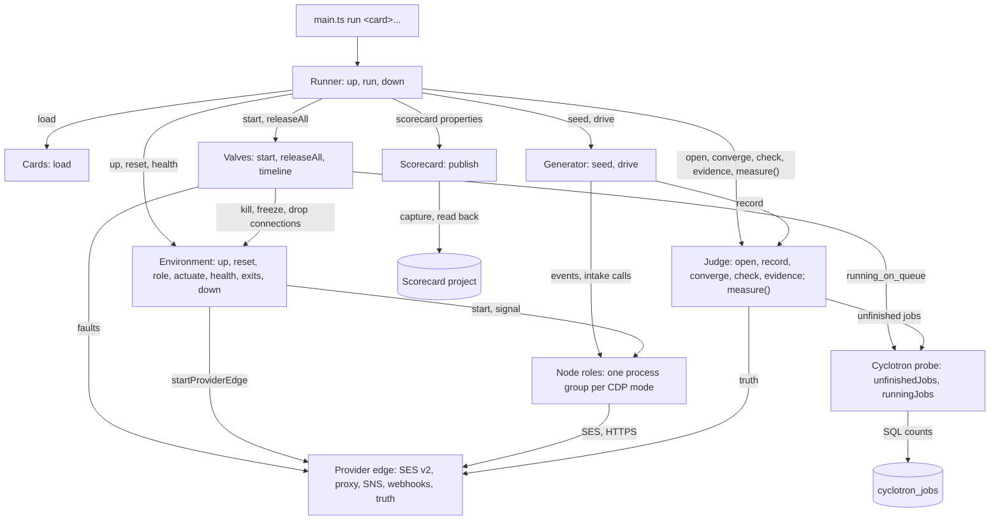
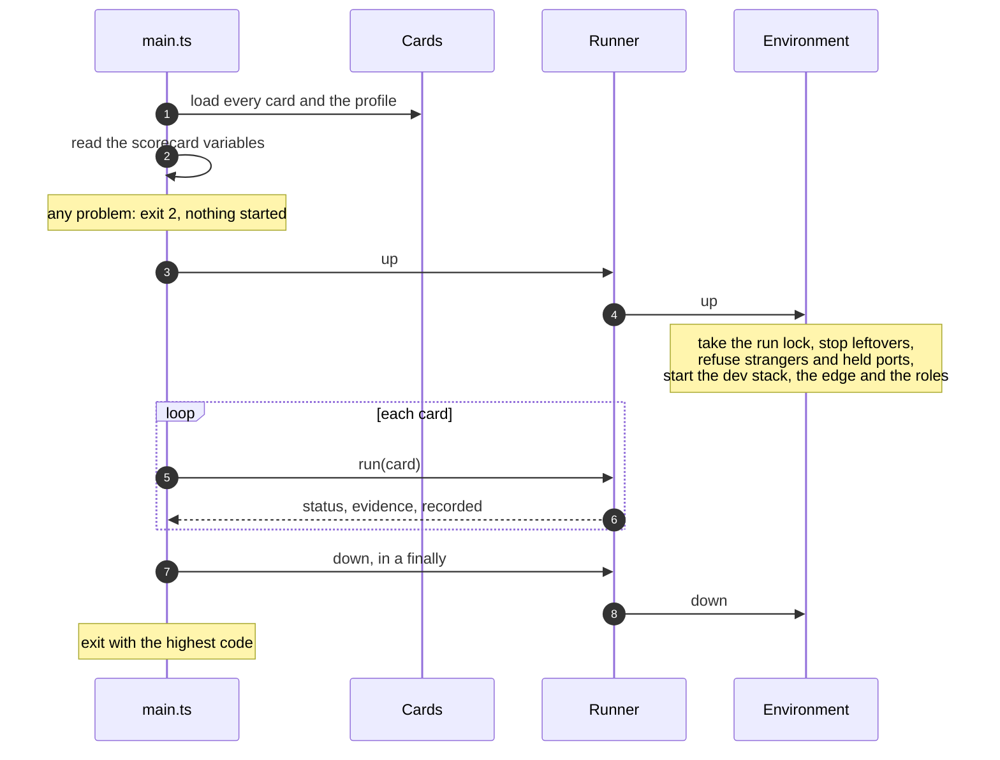
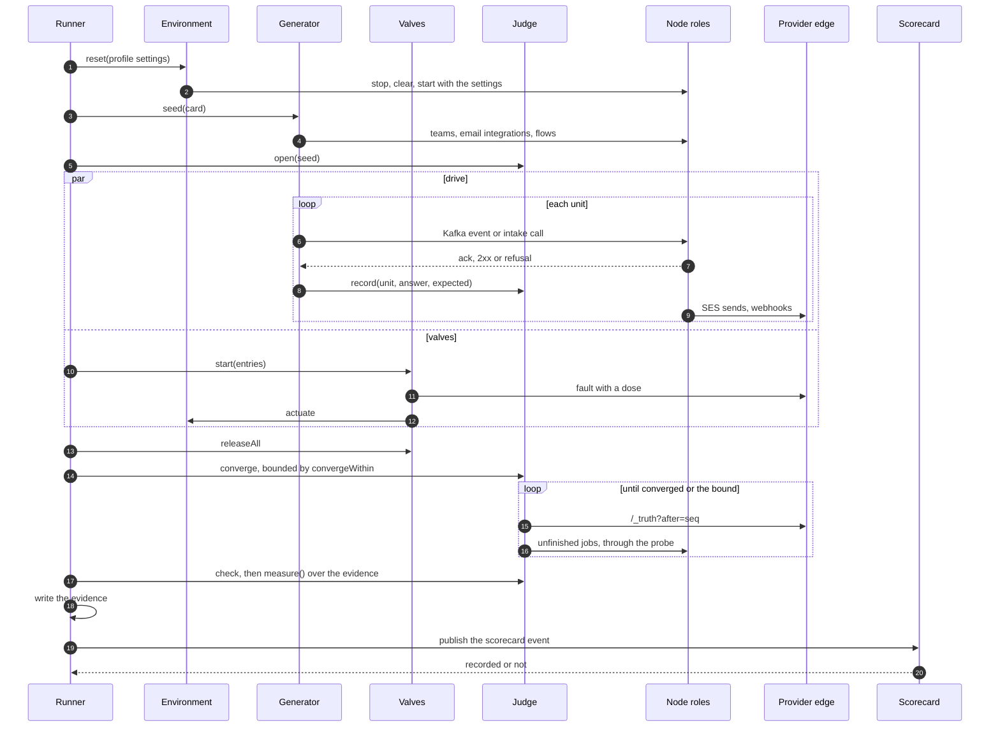
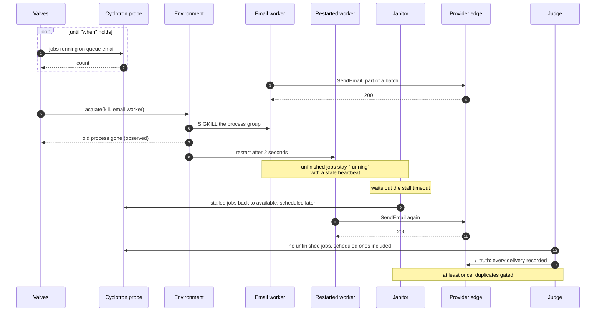
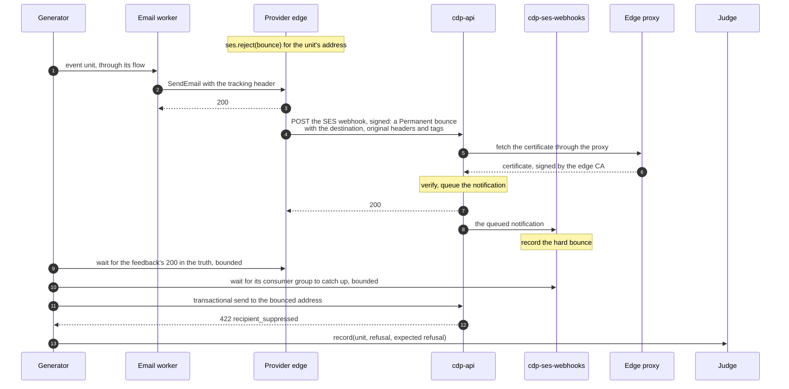
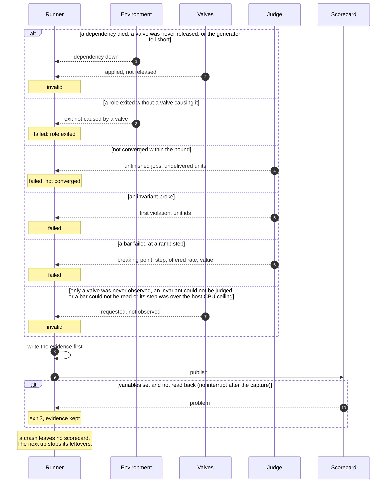

# Workflows scenario runner

The scenario runner tests the Workflows and CDP delivery path end to end, under failure and under load.
It starts the real Node roles, drives traffic through production's intakes, breaks the stack on purpose with named valves, and judges the outcome against what the providers actually received.
Each run ends in one scorecard, so runs compare across commits.

This document covers how to run a card, the runner's modules and seams, the call path of one run, the contract at each seam, the scorecard schema, and how to provision the project that stores scorecards.
The code lives in `nodejs/tests/scenarios/`.
Where this document and that code disagree, the code is right and this document needs a fix.

## Run a card

On a worktree box with the `nodejs` package installed:

```bash
pnpm --dir nodejs exec tsx tests/scenarios/main.ts run smoke
```

- A card is an id, resolved to `nodejs/tests/scenarios/cards/<id>.yaml`, or a path to a YAML file.
- Several cards run one after the other on one stack: `main.ts run <card> <card>...`. Every card must load before any runs.
- `--profile <file>` runs the cards with a profile from outside the repository instead of the shipped `synthetic` profile. It keeps its own `name`, which the scorecard records as `profile_name`; the profile hash tells it from the shipped one.
- `--pair` runs each card twice on one stack: first a control, the same card, seed, profile and offered load with its valves removed and without the checks that need a fault, such as `bounced_suppressed`, then the card itself. The control's `card_hash` is the hash of the card it ran. `--pair` takes only cards that apply valves and judge `no_loss`, on the local target, and not on a run host, so it refuses a card with `pg.failover`, which runs only there. Both scorecards carry the `pair_` properties of the scorecard schema, so a fault that lost a message reads apart from a load this setup did not pass. The attribution reads:
  - `fault` when the control passed and the faulted run failed `no_loss`.
  - `open` when the control failed, so the faulted run's result is not put down to the fault. A failed control reads `open` before any of the faulted run's checks below.
  - `unjudged` when the control or the faulted run did not judge `no_loss` or is `invalid`, its evidence or its saved scorecard could not be written, the faulted run did not run, applied no valve, or a valve was not observed, or the control did not offer every unit it targeted, since equal totals can hide a different traffic mix.
  - `none` when the control passed and the faulted run held `no_loss` with its faults observed.
  - A scorecard that cannot be saved turns its run `invalid`. The runner then reads the pair again, rewrites the other run's saved scorecard once, and publishes that reading on both scorecards. When that rewrite fails too, the other run turns `invalid` and its saved file keeps the first reading.
  - A message the control accepted and lost still fails the control's own `no_loss`. The pair records what each run offered and drained, and never states a capacity: that comes only from a separate fault-free sweep with an explicit pass criterion.
- `--target dev` runs a card from `cards/dev/` against the dev deployment at `https://app.dev.posthog.dev`, the only host its offers and dev reads go to. Offers go to capture v1 there, one event per request, and the runner reads the receipts back through the query API. It needs `DEV_TARGET_OFFERS_TEAM_ID`, `DEV_TARGET_OFFERS_TOKEN`, `DEV_TARGET_WORKFLOW_ID`, `DEV_TARGET_RECEIPTS_TEAM_ID`, `DEV_TARGET_MONTHLY_RUNS`, the workflow runs the offers organization may use in a month, and `DEV_TARGET_KEY_FILE`, a file only its owner can read that holds a personal API key. A dev card runs only `capture_webhook` traffic, at most 10 units a second, 2,000 units, and a 10-minute drive, with no parked flows, and allows at least 5 minutes to converge, because receipts take minutes to become queryable. The loader refuses anything else before the first send.
  - The workflow triggers on `scenario_offer` events in the offers project. Its webhook captures one `scenario_receipt` event per offer into the receipts project, carrying the offer's `run_id` and `unit_id` properties.
  - The key reads the offers project, its workflow and the workflow's metrics, and runs queries in the receipts project. Before the first offer, the runner checks that the workflow exists and that `DEV_TARGET_OFFERS_TOKEN` is the offers project's token, so offers cannot land in another project.
  - Before the first offer, the runner reads the workflow's runs this month. It calls the run `invalid` when dev quota limited any of them, or when 2,000 more runs could pass `DEV_TARGET_MONTHLY_RUNS`. It counts this workflow only, so the offers organization runs no other workflow.
  - The offers project is on UTC, and the workflow has one exit action, no action with `on_error: abort`, and `exit_only_at_end`, so every run it triggers ends at that exit. A run counts as unfinished until then. The runner refuses to start while runs from the past hour are unfinished.
  - The runner stops offering at 2,000 units, whatever the card asks for. Capture's answer for each event is the intake's answer: a `drop` or a refused request counts against `refused_at_intake`.
  - `cards/dev/` holds `dev-smoke`, eleven offers at one per second, and `dev-ramp`, which ramps through 1, 2, 4 and 8 offers a second for 2 minutes each with `stopOnBreak`. Dev numbers say how this run went on dev; they are no measure of what production can take.
  - On a `stopOnBreak` dev card, the live judge of each step but the last also halts the drive when dev quota limited a run of the workflow, or when more runs are unfinished than the step offers in a minute. `ramp_broke_by` is then `target`. The halt keeps load off dev and is no bar: the last step is not checked, since the drive ends with it. The unfinished count is approximate, because the trigger and exit counts are read separately and a run can cross the window's start or be canceled; the 2,000-unit budget and the 10 units a second cap bound what it misses.
  - A dev scorecard has no `topology_hash`, since the runner reads no processes there.

For each card the runner prints its status and reason, its evidence directory, and whether the scorecard was recorded.

| Exit code | Meaning                                                                                                                          |
| --------- | -------------------------------------------------------------------------------------------------------------------------------- |
| 0         | `passed`                                                                                                                         |
| 1         | `failed`: an invariant broke, or the stack did not converge                                                                      |
| 2         | `invalid`: the run could not judge, or a card, the profile or the scorecard variables did not load                               |
| 3         | The scorecard variables are set and the scorecard was not read back. A run interrupted after the capture keeps its status's code |

With several cards the exit code is the highest of their codes.

**The runner owns the box's dev databases.**
Roles run against the dev `posthog` and `cyclotron_node` databases, and every reset deletes every unfinished job in `cyclotron_jobs`.
Do not run cards on a box whose dev stack holds work you want to keep.

**Evidence** stays on the box, under `$XDG_CACHE_HOME/posthog-scenarios/<run id>/` (`~/.cache` when the variable is unset), outside the repository:

| File              | Holds                                                                                                          |
| ----------------- | -------------------------------------------------------------------------------------------------------------- |
| `journal.json`    | Every unit the generator offered, the intake's answer, and what it expects                                     |
| `truth.json`      | Every request the provider edge took or answered, and its answer; a refused ambiguous request leaves none      |
| `writer-cpu.json` | Each read of the Aurora writer's CPU for a writer CPU bar: its window, and a point a minute or why it has none |
| `logs/<role>.log` | Each role's log lines from this run                                                                            |
| `scorecard.json`  | The run's verdict and its scorecard event, written before the runner publishes it                              |
| `live.jsonl`      | The run's phases, probe samples and valve timeline, appended every second                                      |
| `topology.json`   | The processes, consumer groups, databases and hosts the run's roles used                                       |

Each role also appends to one log across runs, `posthog-scenarios/<role>.log`.

The runner touches `live.jsonl` every second until it writes the run's `end` record, and stops when the run ends on any other path, so a file that stops changing without an `end` record marks a run that died.

Before the drive, the runner reads the topology again until every part a valve targets and every consumer group its roles run shows in it and two reads agree, for up to 30 seconds. A target that never shows makes the run invalid. A topology still changing at the deadline does not, because pooled sessions keep moving between roles on the cloud host, and the run records the last read. Databases come from the sessions each role holds open under its scenario session name.

### Run a card in the cloud

`cyclotron-failover-under-load`, `cyclotron-scale` and `cyclotron-breaking-point` get a full verdict only on a run host: a per-run cloud stack with its own Aurora cluster, a pooler, and one host that runs the card. A local run of one of them leaves part of the card unjudged, as the **Locally** line below says.
A controller on a person's machine starts the run and ends it:

```bash
pnpm --dir nodejs exec tsx tests/scenarios/cloud/main.ts run <cloud profile> <card id>
pnpm --dir nodejs exec tsx tests/scenarios/cloud/main.ts cleanup <cloud profile> <run id>
```

- **Who runs it:** a person with write access to the dev AWS account, on a machine with the `aws` CLI and the `nodejs` package installed. Not a worktree box.
- **Before the first run:** the dev baseline infrastructure is applied, and the cloud profile names a measured runner profile kept outside this repository.
- **Run host disk:** the host launches from the baseline's launch template, which sets its root disk and requires IMDSv2. The profile's `baseline` names that template by `hostLaunchTemplateId` and a version number in `hostLaunchTemplateVersion`, and `hostRootVolumeGb` repeats the template's root disk size, which prices the disk.
- **Which card:** a card id under `tests/scenarios/cards`, committed at the run's commit, because the host runs the cards of that commit. The controller reads the card at that commit and loads it with the runner profile before it leases anything, so a card that is missing there or does not load costs nothing. The run manifest names the card, and the host reads it from there.
- **What a run does:** the controller admits the run against its cost cap and leases it for a fixed time. It creates the run stack, prepares the database, starts the card on the run host and waits for it. Then it tears the stack down and publishes the scorecard.
- **Run id:** a fresh UUID, or the value of `SCENARIO_RUN_ID` in the controller's environment, so a caller can know the id before the run starts. The caller gives a lowercase UUID v8, the version for ids a caller derives itself, one per run. The harness mints v4 ids for its own runs, local and cloud, so a given id never names one of them, and its scorecard never replaces theirs. Any other value refuses the run before the lease writes anything. A given id's lease writes `manifest.json` first, create-only, so a second lease on that id refuses and leaves the first run as it was. A lease that fails deletes only the expiry schedules it created, so a lease of the same id against another evidence bucket, which finds the schedule names taken, leaves the first run's schedules in place.
- **If the controller dies:** schedules registered before the first billable resource delete the stack. `cleanup` tears down a run by hand.
- **Order of the first runs:** EU `current` first, as calibration: a run whose load is not admitted reports the baseline rates to tune the profile. Then US `current`, then both `historical-stress` profiles.
- **Each run:** one profile, one lease, one cap.
- **Evidence:** the host uploads its evidence with a checksum manifest to the run's prefix in the evidence bucket.
- **Reader idle limit:** `readerAcu.idleMax` in the cloud profile is the highest ACU at which the reader still counts as idle. The controller refuses to run under a value below `readerAcu.min`, because no reader could pass it, and refuses a failover card under a value at or above `readerAcu.max`, because every reader would pass it. It still cleans up with that profile. The field is optional, so a profile without it still loads and runs other cards, but the controller refuses a failover card before it leases anything. The lease copies it into the run manifest as `readerIdleMaxAcu`, and `readerAcu.min` as `readerMinAcu`, and the host's `pg.failover` valve reads both from there.
- **Live log:** while the card runs, the host copies the run's `live.jsonl` to `live.jsonl` under the run's prefix, whole lines only, waiting 5 seconds between copies, and once more when the card ends. That last copy can land after the run is marked done, and teardown can cut it short, so the run's evidence is the complete log. A failed copy never fails the run, and each copy has a time limit. `SCENARIO_LIVE_COPY=off` in the host's environment turns the copy off, and the run behaves as it did before the copy existed.
- **Reader capacity:** a card with a `pg.failover` valve is judged on the reader's capacity around the failover request, T0. Only the 5 minutes right before T0 are judged. The run is `invalid` when the average of one of them is above `readerAcu.idleMax`, when its maximum or its average is under `readerAcu.min`, or its average is above its maximum, since a running reader cannot report either, when it has a maximum above the limit but no average, so nothing shows it stayed under the limit, when CloudWatch has no capacity at all for one of them, or when the minute right before T0 has no maximum. A maximum above the limit with an average under it is a short burst and passes. The scorecard's `acu_pre_t0_above_idle` lists every minute before T0 whose maximum or average was above the limit, and `acu_pre_t0_max` keeps the highest maximum before T0. Any cloud run, failover or not, ends `invalid` when CloudWatch's capacity answer is malformed, because its capacity read fails. The run controller and the `pg.failover` valve read that answer through one check: every series asked for comes back once with a `Complete` status and no `NextToken`, with one finite value of at least 0 per timestamp, and every timestamp is an ISO time on the read's one-minute period, inside the window it asked for, in ascending order. Both reads go through the AWS CLI, which follows `NextToken` itself and merges the pages, so the check sees the whole series; its `NextToken` refusal covers an answer that still carries one. The failover is measured onto the reader as it sits, not onto a reader at its minimum: the scorecard's `reader_acu_at_t0` is the reader's maximum ACU in the last full minute before the minute of T0, and the controller prints it. It is `null` when the run has no T0, when CloudWatch has no maximum for that minute, or when the capacity read failed, which the controller prints as such. Other cards skip that judgment, and the reader's capacity still prices the run.
- **Enhanced Monitoring:** the stack monitors the writer every second and the reader at the production setting, so the failover card measures the reader as production runs it. The profile's optional `readerMonitoringIntervalSeconds` sets another reader interval: 1, 5, 10, 15, 30 or 60 seconds. The admission estimate prices each instance's monitoring logs at its interval.
  An older controller rejects a profile that sets `readerMonitoringIntervalSeconds`, so remove the field from the profile before you clean up a stack with an older controller.
- **Locally:** the failover card is `invalid` at its valve and the scale card at its CPU bar, because only a run host carries the run manifest. The local stack has no Aurora writer, so `writer_cpu_under` is not judged there. A local ramp still runs through its steps on its other bars and checks. It is `failed` when one of them breaks and `invalid` when all of them hold, and its status reason names the bar that was not judged.

## Glossary

| Term              | Meaning                                                                                                                                                                                                                                             |
| ----------------- | --------------------------------------------------------------------------------------------------------------------------------------------------------------------------------------------------------------------------------------------------- |
| **Card**          | One versioned scenario: seed state, traffic, a valve schedule, the invariants that fail the run and the measurements it records. A YAML file.                                                                                                       |
| **Profile**       | The traffic rates and role settings a card runs with. The repository ships an invented `synthetic` profile; a measured profile is kept outside the repository and passed by path.                                                                   |
| **Traffic kind**  | One named way to offer units, such as `event_email`. It owns the flow it seeds and the deliveries it expects for each unit, so cards never list flows or expectations.                                                                              |
| **Generator**     | The runner's traffic driver. It seeds teams and flows and offers units through production's intakes.                                                                                                                                                |
| **Unit**          | One piece of work the generator offered: an event produced to Kafka, or one intake API call. Its id is `<run id>-<n>`, so a late delivery from another run never matches.                                                                           |
| **Delivery**      | One message a unit should cause, keyed by unit and action: one email or one webhook call.                                                                                                                                                           |
| **Valve**         | One named, dosed failure, such as `role.kill` or `ses.throttle`.                                                                                                                                                                                    |
| **Provider edge** | One HTTP server that stands in for every external provider: the SES API, a forward proxy, the SNS certificate host and a webhook receiver. It records what it received as the **truth**.                                                            |
| **Journal**       | The Judge's record of every unit: the intake's answer and the deliveries, skips or refusal it expects.                                                                                                                                              |
| **Converged**     | No job for the card's teams is unfinished in the hogflow and email queues, retries scheduled for later included, and every expected delivery has at least one record in the truth. Whether each delivery ended the right way is for the invariants. |
| **Invariant**     | A check that fails the run.                                                                                                                                                                                                                         |
| **Measurement**   | A recorded number. It never fails a run.                                                                                                                                                                                                            |
| **Status**        | `passed`; `failed`, an invariant broke; `invalid`, the run could not judge. Whether the scorecard was stored is reported separately.                                                                                                                |
| **Scorecard**     | One run's stored result: status, provenance and scalar results, written as one event. Evidence stays on the box.                                                                                                                                    |
| **Marker**        | The `SCENARIO_RUNNER` variable in the environment of every role the runner starts. It finds a crashed run's leftovers and tells the runner's roles from strangers.                                                                                  |
| **Stranger**      | A CDP process or a member of the events consumer group that this runner did not start.                                                                                                                                                              |
| **Target**        | Where a run executes: `local`, a worktree box, now; `cloud`, a prod-shaped slice in a cloud environment, later.                                                                                                                                     |

## Context

The runner reaches the stack only through seams that exist today, so it changes no production code:

- Every role boots by `PLUGIN_SERVER_MODE`, one process per mode, each on its own `HTTP_SERVER_PORT`.
- SES goes to `SES_ENDPOINT`, which the SES client in `email.service.ts` is built from.
- Every other provider, the SNS certificate fetch included, goes through `fetch` in `nodejs/src/common/utils/request.ts`, which sends every request through `HTTPS_PROXY` when `EXTERNAL_REQUEST_PROXY_TEAMS` is unset. Roles trust the edge's certificate authority through `NODE_EXTRA_CA_CERTS`.

**The clock is real.**
Every card declares `clock: real`.
Cards that advance delays, time windows, schedules and Cyclotron's due predicates need a scheduling clock, the first production change the runner will need (see [Follow-ups](#follow-ups)).

The runner is TypeScript inside the `nodejs` package and reuses the CDP test fixtures, such as `FixtureHogFlowBuilder` and `insertHogFlow`.
It borrows the personhog test harness's conventions: a journal, bounded convergence, failure injection as data, and known defects as gates.

## Modules and seams



Cards say what a run does, the Generator and Valves do it, the Judge decides, and the Scorecard keeps the result.
The Environment holds everything that differs between a local box and a cloud slice, and the provider edge runs the same in both places, so a card never knows where it runs.

| Module              | Seam                                                                                            | Owns                                                                                                                                                                               |
| ------------------- | ----------------------------------------------------------------------------------------------- | ---------------------------------------------------------------------------------------------------------------------------------------------------------------------------------- |
| **Runner**          | `up`, `run(card)`, `down`                                                                       | The run lifecycle: reset, seed, drive with valves alongside, converge, judge, write evidence, publish. Watching dependency health and role exits during the run. The status.       |
| **Cards**           | `load`                                                                                          | The YAML schema (zod), the checks across a card and its profile, profiles, and the card and profile hashes.                                                                        |
| **Environment**     | `up`, `reset`, `edgeUrl`, `role`, `actuate`, `dependencyHealth`, `exits`, `groupLag`, `down`    | Starting the stack for one target, leftovers and strangers, applying profile settings, every actuation, restarting killed roles, dependency health, and recording role exits.      |
| **Provider edge**   | `startProviderEdge`, `hold`, and HTTP: SES v2, CONNECT proxy, `/_faults`, `/_truth`, `/_health` | Faking providers, applying dosed faults, emitting signed SNS feedback, and the append-only truth.                                                                                  |
| **Valves**          | `start`, `releaseAll`, `timeline`                                                               | The valve definitions, scheduling by `at` or `when`, translating each valve into an Environment action, and the timeline of requested, applied, observed and released.             |
| **Generator**       | `seed`, `drive`                                                                                 | The traffic kinds: seeding teams, email integrations and flows, sampling the profile, offering units, and recording each unit with the Judge.                                      |
| **Judge**           | `open`, `record`, `converge`, `check`, `evidence`, and the `measure()` function                 | The journal, convergence, and the invariant and measurement definitions.                                                                                                           |
| **Run target**      | `open(card, runId)`, which returns the run's `truth`, `probe`, `seed` and `offers`              | Where a run's load goes and where its evidence comes from: the local stack, or the dev deployment, where offers go to capture and the truth is the receipts the query API returns. |
| **Cyclotron probe** | `unfinishedJobs`, `runningJobs`                                                                 | Two SQL counts against `cyclotron_jobs`. They reach past Cyclotron's seam on purpose, and the probe is the only place that does.                                                   |
| **Scorecard**       | `scorecardOf`, `publish`                                                                        | The scorecard properties, the provenance they carry, and capturing the event and reading it back.                                                                                  |

**One definition per name.**
Each valve, traffic kind, invariant and measurement is one definition that holds its name, its parameter schema and its implementation, in Valves, Generator and Judge.
`load` checks a card's names and parameters against those definitions, so there is no separate list of names to keep in sync.

### Where the code lives

```text
nodejs/tests/scenarios/
  main.ts          the CLI: run <card>... [--profile <file>] [--target local|dev] [--pair]
  runner/          Runner, status rules and exit codes
  cards/           *.yaml cards, schema.ts, load.ts, definitions.ts
  profiles/        synthetic.yaml, invented numbers only
  environment/     the local Environment: stack, roles, supervisor, processes
  provider-edge/   startProviderEdge(), used by the runner and by Jest
  generator/       traffic kinds, seed and drive
  valves/          valve definitions and scheduling
  judge/           journal, convergence, invariants, measurements
  probe/           the Cyclotron probe
  scorecard/       properties, provenance, capture and read back
  store/           the run store: one HTTP service over Postgres that keeps every run
```

The CLI runs with `tsx`, as `pnpm --dir nodejs exec tsx tests/scenarios/main.ts`; there is no package script.
`nodejs/src/cdp/_tests/fake-ses.ts` is a thin adapter over `startProviderEdge`, so the email service's Jest suites and the runner share one SES implementation.
Nothing in the runner runs in production.

## First slice

The first slice is local only, on real time.

- **Roles.** `cdp-processed-events`, `cdp-cyclotron-worker-hogflow`, `cdp-cyclotron-worker-email`, `cdp-api`, `cdp-cyclotron-v2-janitor`, `cdp-ses-webhooks`, `cdp-intake-transactional-email`, `cdp-intake-workflow-webhook`. Every card runs against all eight. `cdp-ses-webhooks` runs cdp-api's SES webhook consumer, which records SES feedback.
- **Intake.** The roles run the production intake path: cdp-api answers every team's transactional sends once the intake topic acks them, and the transactional email intake consumer inserts them into the job queue. The workflow webhook intake consumer runs too, but no traffic kind sends an inbound webhook to a workflow yet, so it reads nothing. The environment creates the intake topics and their dead-letter topic, including any a profile names, before the roles start. A send counts as accepted on that answer, and loss and duplicates are judged at the provider edge. A card converges only once the intake consumers have read every record on their topics. A profile cannot move the intake topics, run a second intake replica, or turn on the dead-letter drain, because convergence reads only the intake groups' lag, over one partition per topic. A test fails when a CDP plugin server mode has neither a role nor a reason in `MODES_WITHOUT_A_ROLE`.
- **Traffic.** Events into event-triggered flows with email and webhook steps, and transactional email sends. Every job lives in the hogflow and email queues of `cyclotron_jobs`: a flow's webhook step runs inside the hogflow worker and retries by rescheduling its own row. The flows read the recipient from event properties, so the slice seeds no persons.
- **Valves.** `role.kill`, `role.freeze`, `pg.drop_connections`, `ses.reject`, `ses.throttle`, `dest.status`.
- **SES feedback.** cdp-api verifies SES feedback and queues it, and the `cdp-ses-webhooks` consumer records it. The runner changes no setting to shorten that path.
- **Origin.** `local-agent` only.

### Traffic kinds

| Kind                  | Intake                                                                                                                                                                                                                                                                                           | Flow                                                                                      | Expected per unit                                                     |
| --------------------- | ------------------------------------------------------------------------------------------------------------------------------------------------------------------------------------------------------------------------------------------------------------------------------------------------ | ----------------------------------------------------------------------------------------- | --------------------------------------------------------------------- |
| `event_email`         | An event on the events topic, with the recipient in `properties.email`                                                                                                                                                                                                                           | Event trigger, then an email step                                                         | One email delivery                                                    |
| `event_webhook`       | An event on the events topic                                                                                                                                                                                                                                                                     | Event trigger, then a webhook step to `https://hooks.example.com/u/<unit id>/<action id>` | One webhook delivery                                                  |
| `transactional_email` | cdp-api's template route `/transactional_email`, with `{ to, distinct_id, variables, idempotency_key }` and a JWT the generator mints per team and flow. The unit id is the key, so a 5xx answer is retried with it, with a backoff from 0.5 to 5 seconds, until 60 seconds after the first send | API trigger, then an email step reading `properties.to`                                   | One email delivery                                                    |
| `bounce_followup`     | An event on the events topic, with the recipient in `properties.email`. Once the send is accepted, a follow-up: wait for cdp-api's 200 to the bounce feedback in the truth and for zero lag on the `cdp-ses-webhooks` consumer group, then a template-route send to that address                 | Event trigger, then an email step; the follow-up goes through the transactional flow      | One email delivery; the follow-up refused with `recipient_suppressed` |

### First cards

Each card is drawn from a failure class on the delivery path.
`smoke` ships with the runner; each other card lands with the valves and traffic kinds it uses, and only cards in `cards/` can run.

| Card                               | Traffic                                               | Valves                                                                                                                                                                                                   | Invariants                                                                                           | Failure class                                                 |
| ---------------------------------- | ----------------------------------------------------- | -------------------------------------------------------------------------------------------------------------------------------------------------------------------------------------------------------- | ---------------------------------------------------------------------------------------------------- | ------------------------------------------------------------- |
| `smoke`                            | `event_email`, `event_webhook`, `transactional_email` | none                                                                                                                                                                                                     | `at_least_once`, `duplicate_sends` (gate 0), `refused_at_intake` (gate 0)                            | Baseline: proves the judging loop                             |
| `email-worker-killed`              | `event_email`, `transactional_email`                  | `role.kill` on the email worker, `when` 1 job runs on `email`                                                                                                                                            | `at_least_once`, `duplicate_sends` (gate 0), `refused_at_intake`                                     | A worker dying mid-batch                                      |
| `email-worker-killed-after-accept` | `event_email`, `transactional_email`                  | `role.kill` on the email worker, `when` SES took a send, before the worker hears the answer                                                                                                              | `at_least_once`, `duplicate_sends` (gate 0), `refused_at_intake`, `no_loss`                          | A worker dying between the provider's accept and its answer   |
| `hogflow-worker-frozen`            | `event_email`, `event_webhook`                        | `role.freeze` on the hogflow worker for 60 seconds, `when` 1 job runs on `hogflow`                                                                                                                       | `at_least_once`, `duplicate_sends` (gate 0), `refused_at_intake`                                     | A frozen pod losing sends                                     |
| `pg-connections-dropped`           | `event_email`, `event_webhook`                        | `pg.drop_connections` share 1, swept every 100 ms for 60 seconds from 10 seconds, in a 90-second drive                                                                                                   | `at_least_once`, `duplicate_sends` (gate 0), `refused_at_intake`                                     | A dropped Postgres connection stranding jobs                  |
| `destination-errors`               | `event_webhook`                                       | `dest.status` 503 share 0.5, then 429 share 0.5, then 400 count 5, each for 10 seconds, 21 seconds apart                                                                                                 | `at_least_once`, `duplicate_sends` (gate 0), `refused_at_intake`                                     | Destination 429 and 503 retry storms                          |
| `ses-throttled`                    | `event_email`, `transactional_email`                  | `ses.throttle` 1 per second for 60 seconds                                                                                                                                                               | `at_least_once`, `duplicate_sends` (gate 0), `refused_at_intake`                                     | SES throttling                                                |
| `ses-bounce-suppresses`            | `bounce_followup`                                     | `ses.reject` with type `bounce` on every send, for 2 minutes                                                                                                                                             | `at_least_once`, `duplicate_sends` (gate 0), `refused_at_intake`, `bounced_suppressed`               | Dropped SES feedback, so no suppression                       |
| `ses-ambiguous-send`               | `event_email`, `event_webhook`                        | `ses.ambiguous` and `dest.ambiguous`, each accepted on at most 3 requests from 5 seconds and refused on at most 3 from 15 seconds, for 5 seconds each; a client that retries can spend all 3 on one send | `at_least_once`, `duplicate_sends` (gate 0), `refused_at_intake`, `no_loss`                          | A provider's answer lost, after or before it took the request |
| `cyclotron-failover-under-load`    | `event_email`, `event_webhook`, `transactional_email` | `pg.failover` on `cyclotron` at 15 minutes for 30 minutes, in a 75-minute drive                                                                                                                          | `at_least_once`, `duplicate_sends` (gate 0), `refused_at_intake`, `resident_backlog_intact`          | A Cyclotron writer failover under load                        |
| `cyclotron-scale`                  | `event_email`, `event_webhook`, `transactional_email` | none; the rates ramp through 1x, 2x and 5x, then hold 10x for 30 minutes, with the bars `writer_cpu_under` 70% and `pickup_p99_under` 5 seconds                                                          | `at_least_once`, `duplicate_sends` (gate 0), `refused_at_intake`, `resident_backlog_intact`          | Cyclotron falling behind at 10x load                          |
| `cyclotron-breaking-point`         | `event_email`, `event_webhook`, `transactional_email` | none; 80 teams, and the rates ramp through 10x, 20x, 40x, 80x, 160x, 240x and 320x for 2 minutes each and stop only at a hard failure, with the same bars as `cyclotron-scale`                           | `at_least_once`, `duplicate_sends` (gate 0), `refused_at_intake` (gate 0), `resident_backlog_intact` | The load at which Cyclotron first breaks                      |

A `cyclotron-breaking-point` run that holds every step through 320x ends as a ceiling at 320x, which is a valid result and not a failure of the card.
The event pipeline rate limits each workflow (`CDP_RATE_LIMITER_REFILL_RATE`, 100 runs a second by default) and drops the runs over it, so one workflow carrying a ramp's top step would measure that limit and not Cyclotron. Every seeded team runs one workflow per traffic kind, and units pick their team at random, so a kind's load splits over `setup.teams` workflows, as traffic from many customers does. The loader refuses a card whose event or capture traffic would send any workflow more than 80% of the limit at its top step, reading the limit from the profile's settings or the server default, because the card may load on a machine other than the run host. The roles drop an inherited limit from the run host's environment, so they run with the limit the loader checked. The loader names the team count that would fit. It also refuses an event kind listed twice, because each listing seeds its own workflow and every unit would run twice. Transactional sends are not rate limited by workflow.
Every email worker takes a token from one shared SES bucket (`CDP_SES_RATE_LIMIT_REFILL_PER_SECOND`, 100 a second by default) for each job it dequeues, so a ramp could measure that bucket and not the email queue. For a card that sends email on a profile with a `load` block, the loader refuses a top step whose email claim target, scaled and raised by the load tolerance, passes 50% of the refill, and names the refill that fits. It also refuses a `CDP_SES_RATE_LIMIT_CAPACITY` under one consumer batch for each email replica. Each replica claims tokens for every row it sees, so on a shallow queue one job can cost up to one token per replica. The check leaves that worst case out, because no run measures it. A `load` block on a card that sends email must name `claimsPerSecond.email`. A profile without a `load` block names no email claim rate, so the loader does not check it. The roles drop an inherited `CDP_SES_RATE_LIMIT_REFILL_PER_SECOND`, `CDP_SES_RATE_LIMIT_CAPACITY` and `CONSUMER_BATCH_SIZE` from the run host's environment, so they run with the values the loader checked; set them in the profile instead.
On `cyclotron-breaking-point`, a refusal over the `refused_at_intake` gate or a harness limit at step N halts the drive by the end of step N+1, and step N+2 never starts before step N is judged. A broken bar places the break at step N but the drive goes on. Lost and duplicated deliveries are judged after convergence and recorded per step, and only a step that lost more than 5% of its deliveries ends the ramp there.

## Call paths

### One invocation



### One run of a card



During drive and convergence the Runner polls `Environment.dependencyHealth()` every 5 seconds.
A failed check runs again at once.
A dependency that fails on a confirming check gets a confirming check of its own, even when the run is stopping and even after it recovered, up to two confirmations per poll and none after a loss.
The probes run in a child process of the runner, so a drive that saturates the runner's event loop does not time them out.
The runner sends the child its targets over IPC, so no connection string shows on the child's command line.
When the child exits, or answers no check within 30 seconds, that check fails and the next check starts a fresh child.
A child that the run host has no file descriptor to start fails the check with that limit, not with a lost dependency.
The provider edge runs in the runner, and its probe is a `GET /_health` that must answer 200, over a connection the child keeps alive between checks.
So a runner too busy to answer that request makes the edge unheard, not gone.
A dependency went away when both checks failed and neither the run host nor the runner's event loop explains it.
A check that ran out its 2-second timeout while the loop was busy for half or more of the check is unheard, because a host that busy can starve the probe process too.
A check that failed because the run host ran out of local ports or file descriptors is a harness limit that names the resource, not a lost dependency.
That check keeps the host's 20 largest groups of TCP sockets by state and peer in `probes.json`, since whatever held the ports is gone once the run ends.
An error that carries a refusal, reset or unknown-host code, an HTTP status or a Postgres server error is an answer, however late the busy loop delivered it.
An untyped error past the budget, such as ioredis's `Connection is closed.`, is not: on a busy loop it reads as unheard, with its error kept in `probes.json`.
The dependency is unheard only when both of its checks were unheard.
A dependency that answers the second check recovered.
`probes.json` keeps one entry for each confirmed failed check: the dependency, its kind, the time of its first failed check, the reason from the check that supports its kind, and the busier check's share of loop time.
It reads `Environment.exits()` from `Judge.open` on, to tell an exit a valve caused from an unexplained one.
`Valves.releaseAll` also runs in a `finally`, so no valve outlives its card.

### An email worker killed mid-batch



The janitor puts a stalled job back as `available` with a future `scheduled` time, so convergence waits for every unfinished job, not only the due ones.

### SES feedback: a bounce reaches suppression



The first send goes through the event path, so cdp-api has never looked the address up, and its suppression cache keeps misses per process.
cdp-api answers 200 once the feedback is queued, before anything records it, so the follow-up waits until the `cdp-ses-webhooks` consumer group has caught up; the follow-up's refusal is what proves the suppression was written.
Suppression needs the signed tracking code, which only the `X-PostHog-Tracking-Code` header carries, and touches only the recipients in `mail.destination`, so the edge copies both from the send into the feedback.

### How a run gets its status



## Local and cloud

|                | Local (first slice)                                                                                                                            | Cloud slice (later)                                                                                                  |
| -------------- | ---------------------------------------------------------------------------------------------------------------------------------------------- | -------------------------------------------------------------------------------------------------------------------- |
| Who runs it    | Agents, on a worktree box                                                                                                                      | People, by hand                                                                                                      |
| Infrastructure | The dev stack's `workflows` intent without the `nodejs` unit: Postgres, Kafka (Redpanda), Redis, ClickHouse, PersonHog, Django and its workers | A per-run namespace rendered from production's chart values at slice size, with its own Cyclotron database and Kafka |
| Node roles     | One child process group per CDP mode, in place of the dev stack's combined `nodejs` process                                                    | One deployment per mode, as in production                                                                            |
| Actuation      | `SIGKILL`, and `SIGSTOP` and `SIGCONT`, on a role's process group; `pg_terminate_backend` on role connections                                  | Pod kills, freezes and network faults through the cloud's failure tooling                                            |
| Provider edge  | Inside the runner process, on port 4566                                                                                                        | The same server as its own process, in a pod                                                                         |
| Profile        | `synthetic` by default; a measured profile by `--profile <file>`                                                                               | A measured profile                                                                                                   |
| Measurements   | Each role's `/_metrics`, process CPU and memory included, and latency from the journal                                                         | The same metrics; alert rules checked against a test Alertmanager                                                    |

Cards, Valves, the Generator, the Judge and the Scorecard are the same code on both targets.
Only the Environment has two implementations, and only it knows how a role is found and how it is broken.

## Contracts

The card format and the scorecard event are the external contracts: other people and tools read them, so they change only with a schema version.
The other interfaces are internal seams; each module keeps the responsibilities in the module table.

### Cards

The schema is `Card` in `cards/schema.ts`.
A card names its profile, its seed, the number of teams to seed, its traffic kinds and their duration, its valve entries, `convergeWithin`, its invariants and measurements, and its gates.
`drive.minOffered` is the share of target units that must count as offered for the run to judge, 0.9 by default.
`drive.ramp` splits the drive into steps, each with a `scale` that multiplies every traffic kind's profile rate and a `for`; the steps add up to `drive.for`, and each scales higher than the one before.
Each step starts and ends at a fixed offset from the drive's start, so a stalled generator cannot move a later step past the drive's end.
A card without a ramp drives at 1x throughout.
`bars` lists pass bars that every ramp step must stay under:

- `writer_cpu_under` with `percent`: the highest CloudWatch `CPUUtilization` minute of the run cluster's writer. Only whole minutes inside a step count, and every one of them needs a reading. After the run converges, the read waits up to 5 minutes for CloudWatch to publish the drive's last whole minute, a read in flight included, and stops at once when the run is interrupted. It reads only on a run host. On a run host, a missing or unreadable minute ends a ramp at a harness limit.
- `pickup_p99_under` with `seconds` and `queues`: the p99 of `cdp_cyclotron_job_lateness_seconds` on each named queue, from the worker scrapes. A p99 beyond the histogram's largest bucket breaks a bar at or under that bucket and leaves a higher bar unread, and a named queue with no pickup in a step reads as the step's length, or as no lateness on a card that stops on a break when the intake accepted no unit in that step, and the last step also counts pickups after the drive ends. Each named queue's worker must answer its scrapes: one that is never scraped, or whose scrapes stop for more than 15 seconds, leaves the step unread. A scrape interval that straddles a step boundary counts in both steps, so late pickups at a step's end break that step rather than hide in the next step's larger volume.

The first step where a bar fails is the bar's breaking point, and the run fails. A bar that cannot be read in a step makes the run `invalid`.
A ramped card is admitted on its first step, at the profile's own rates.
When the profile sets `host.cpuCeiling`, each step is also checked against it before its bars are read.
A step whose run host was busy at or over the ceiling is not judged, and neither is any later step, because a saturated run host starves the roles it runs.
A step with fewer than two host CPU samples inside it is not judged either, and each step reads only the samples inside it.
A breaking point from an earlier step still stands.

`drive.stopOnBreak: true` makes a ramp of two or more steps record where the system breaks rather than a pass or fail at one load.
It stops the ramp only on a hard failure, which `ramp_stop` names:

- `intake_refused`: refusals went over the `refused_at_intake` gate.
- `step_loss`: a step lost more than 5% of the deliveries its accepted units expected.
- `backlog_undrained`: jobs stayed unfinished past `convergeWithin`.
- `harness_limit`: the harness could not drive or read a step, as below.

A broken bar, a lost or duplicated delivery under that limit, and any other failed invariant do not stop the ramp: the run records them and drives to its last step.
Only `intake_refused` and `harness_limit` cut the drive short.
`step_loss` and `backlog_undrained` are judged after convergence, because a running drive cannot tell a lost unit from a late one.

- The generator offers no unit of a step after the step's end. A unit it could not offer in time still counts as due, so a stalled generator shows as a shortfall rather than as load in the next step. A card without `stopOnBreak` keeps one schedule: a unit that fell due during a stall is offered late, up to the drive's end.
- The generator moves to the next step at the planned boundary while the verdict of the step before is in. When it is not, the generator keeps driving the current step at its own rate until that verdict is in, so a hard failure at step N halts the drive by the end of step N+1, and step N+2 never starts before step N is judged. The stretched step keeps its real start and end, and `ramp_steps` says it waited. Later steps start that much later and keep their planned length.
- After each step but the last, once 15 seconds of scrapes past its end are in, the runner judges the step's bars over the step, while the generator drives the next step. A broken bar is kept for the verdict and placed at the step that broke, and the drive goes on. The first step's admission is checked first, over the window the first step actually ran, against the profile's load targets times the first step's scale, because a profile measures its targets at 1x, so a ramp that fails its admission stops no later than the second step. The final judge checks the admission over the same window. A live judge that fails stops the drive as a `run_host` harness limit. A stop does not cancel the judgment of a step that already ended: the run converges from the drive's end, the runner then waits for that judgment, and then judges the invariants on the delivery records it pulls. A delivery that missed the convergence deadline but arrived before that pull counts as delivered: the run still fails convergence, but no step is named for that delivery. The lowest step that broke or could not be read is where the drive stopped.
- The final judge keeps each live break, and keeps a live pass for a step unless its own read breaks it, so a final read that fails after the drive does not undo a verdict the live judge already reached.
- A refusal at intake over the card's `refused_at_intake` gate stops the drive inside its step, without waiting for the step to end.
- An event counts as offered in its step once Kafka acknowledged it by the step's end, or by the stop when the drive stopped early, however late the generator's last timer ran. The live judge counts a transactional unit once it was sent, and the final count once cdp-api answered. A broken bar and the ramp report the step's rate from the same count, whether the live or the final judge read the break.
- A step whose generator offered fewer than `minOffered` of its units, or had none to offer, or whose bar could not be read, stops the drive as a harness limit, except a last step that a stop ended before its planned length: `ramp_broke_by` names the `generator` that could not offer the step, or the `run_host` that could not read it.
- A step in which the runner's event loop lagged more than 250 ms at p99 stops the drive as a harness limit with `ramp_broke_by` `runner`. The runner process also hosts the provider edge, so a busy loop answers webhooks late, slows the workers that wait on them, and would otherwise read as a product break. Host CPU cannot show it, because one saturated core leaves the host mostly idle. Each step in the scorecard's `units.steps` records the lag as `loopLagP99Ms` and the runner's own CPU time as `runnerCpuMs`.
- The units already in flight are still journaled, and the run converges and is judged as usual. Steps after the stop are not driven and not judged.
- Invariants are judged after convergence. A `refused_at_intake` count over its gate breaks at the step that offered the unit that took it over. Units offered at the same moment are ordered by step.
- Each step records the deliveries its accepted units expected, how many were lost, how many the provider accepted, and how many of those it accepted more than once, with a loss rate over the expected deliveries and a duplicate rate over the accepted ones. A step whose loss rate is over 5% breaks there as `step_loss`. Smaller losses and duplicates over their gate fail the run with a status reason that gives the counts, the rate and the steps, such as `the ramp ran to its last step, but lost 1 of 60 deliveries (1.67%): 1 in the 10x step`. A delivery still unrecorded at the convergence deadline while no job is unfinished counts as lost. While a job stays unfinished, an unrecorded delivery may only be late, so the steps record no losses and, without an earlier hard failure, the ramp stops as `backlog_undrained`.
- The run's breaking point is the earliest break across bars, gates, invariants and harness limits, and the scale before it is the last sustained scale. Within one step, a lagging runner comes first, since its busy loop also makes the generator offer short, then a generator shortfall, then a bar, then a gate or invariant, then a metric the run host could not read or a halt the dev target called.
- A refusal count over its gate whose crossing unit falls in no step leaves no sustained scale, also beside a break in a step, because it could have failed at any scale.
- A first step that fails its admission is a harness limit at that step, with no sustained scale, because no scale was measured against the profile.
- A drive that ends partway through a step, such as an interrupted one, is a harness limit at that step, never a ceiling, and that limit outranks a bar the run host could not read in the step.
- A run that broke is `failed`, a run that held through its last step is `passed`, and a run that stopped at a harness limit with nothing broken is `invalid`. The ramp judges the bars, the invariants a unit crossed and the offered share step by step, so its end sets the status, and a later step that fell short or could not be read does not make a run that broke earlier `invalid`. An invariant no unit crossed, such as `resident_backlog_intact`, still fails the run. The ramp owns the convergence too, so a unit that never delivered does not make a run that stopped at a harness limit `failed`. A run that held through every step but left a job unfinished past `convergeWithin` reaches no ceiling: `ramp_end` is `broke` with no scale, `ramp_broke_by` is `convergence`, and `ramp_stop` is `backlog_undrained`.

```yaml
id: email-worker-killed
version: 1
clock: real
profile: synthetic
seed: 2
setup:
  teams: 1
drive:
  for: 30s
  traffic:
    - name: event_email
    - name: transactional_email
valves:
  - valve: role.kill
    target: cdp-cyclotron-worker-email
    dose: {}
    when:
      name: running_on_queue
      params:
        queue: email
        atLeast: 1
    for: 1s
convergeWithin: 2m
invariants:
  - name: at_least_once
  - name: duplicate_sends
  - name: refused_at_intake
gates:
  duplicate_sends: 0
  refused_at_intake: 0
measure:
  - name: role_cpu_seconds
  - name: role_rss_max_bytes
  - name: delivery_latency_ms
```

A valve entry names a valve, its target (a role, `postgres`, `ses` or `hooks.example.com`), its dose, exactly one of `at` (an offset from the start of the drive) or `when`, and `for`.
`when` takes one predicate: `running_on_queue` with `queue` and `atLeast`, or `edge_accepted` with `channel: ses`.

`load` returns the card, the profile and their hashes, or throws one `CardError` that lists every problem at once.
It rejects:

- unknown valve, traffic kind, invariant, measurement and bar names, and parameters or doses that fail their definition's schema;
- a bar declared twice on a `stopOnBreak` card, because each live verdict is looked up by the bar's name;
- ramp steps that do not add up to `drive.for`, or a step that does not scale higher than the one before;
- a `stopOnBreak` card with valves, because its drive can stop before they are due;
- a `stopOnBreak` ramp with a step of `0ms`, because a held step repeats its own length;
- `bounced_suppressed` on a card with no `ses.reject` entry of type `bounce`, because only a hard bounce blocks transactional email;
- a card whose traffic is answered at its intake rather than on Kafka, such as `transactional_email`, without `refused_at_intake`, because such a unit counts as offered whatever its intake answered;
- an `edge_accepted` entry on any valve but `role.kill` on the email worker, because the held send is an email worker's;
- an `edge_accepted` entry under a profile that runs more than one email worker, because the valve stops replica 0 and another replica may own the held send;
- a profile setting no role or the load producer reads, and traffic rates that fail their kind's profile schema.

**Hashes.**
The profile hash is the SHA-256 of the profile serialized with sorted keys.
The card hash is the SHA-256 of the card without `gates` and the profile hash, serialized the same way.
Gates stay outside the card hash; anything else that changes what runs changes it.
`runner_version` leaves out the YAML files in `cards/` and `profiles/`, so a committed gate edit keeps the fingerprint and the card hash, and runs on either side of it compare.
An edit to a shipped profile keeps the fingerprint too, and changes the profile hash, which the card hash carries.
Every other committed edit under `nodejs/tests/scenarios/` outside `generator/`, `valves/` and `store/` still changes `runner_version`, a test file or the loader included.
The run store only records runs, so its edits leave `runner_version` alone; the calls that report to it live in `runner/` and `cloud/` and still count.

**Profiles.**
A profile has a `name`, per-traffic-kind rates under `traffic`, and role environment under `settings`.
Settings whose name starts with `KAFKA_PRODUCER_` configure the runner's load producer, which sends the generator's events to Kafka.
Every role gets every setting too, but no CDP role reads that prefix: the roles build their producers from `KAFKA_CDP_PRODUCER_*` and the per-producer config maps.
A scorecard records the profile's name and hash, never its numbers.

### Runner

```ts
// nodejs/tests/scenarios/runner/runner.ts
export interface Runner {
  up(signal: AbortSignal): Promise<void>
  run(loaded: LoadedCard, signal: AbortSignal): Promise<RunResult>
  runPair(loaded: LoadedCard, signal: AbortSignal): Promise<RunResult[]> // the control, then the faulted run
  down(): Promise<void>
}
```

- **Pairs.** `runPair` judges the control, then the faulted run, saves both scorecards, then publishes them, so each carries the other's run id. When the control is interrupted, or a restart is required after it, the faulted run does not run: the control's scorecard is published as `unjudged`, and the invocation exits 2.

- **Run id.** A fresh UUID per run, or the `runId` of the run manifest at `SCENARIO_RUN_MANIFEST` on a run host, which then runs one card.
- **One process per invocation.** The Environment is an in-memory object that supervises the role processes, so `up`, every `run` and `down` happen in the one `main.ts run` process. Runs on one stack are sequential.
- **Order.** `run` calls `reset`, `seed`, `Judge.open`, then `drive` and `Valves.start` together, `Valves.releaseAll`, `converge`, `check` and `measure`, writes the evidence, and publishes the scorecard.
- **A failed reset stops the environment.** Later cards of the same invocation are skipped; run the command again.
- **Seeding is bounded.** `seed` runs on its own Postgres pool with a 5-second statement timeout and must finish within 60 seconds. When the bound passes or the run is interrupted, the runner destroys the pool's connections and requires a restart, as a write already sent may still land in the next card.
- **Status rules.**
  - `invalid` when a dependency the card did not break went away (Postgres, Kafka, Redis, the SES rate limiter's Valkey, PersonHog, the edge), the runner's event loop was too busy to hear one, a harness limit named at its step, the Cyclotron writer was interrupted without a valve, a valve was never observed, a valve was applied and never released or did not fail back, fewer than `minOffered` of the target units counted as offered, a traffic kind could not offer a unit it requires, the run was interrupted, or the evidence could not be written. The run could not judge, so each of these outranks a failed invariant, except a valve that was never observed. A refused failover request outranks each of them except an interrupted run, because it ends the drive early.
  - `failed` when the stack did not converge, any invariant failed, or a Node role exited without a valve causing it, even if every delivery later arrives.
    A role that exits with a code, not a signal, while a valve with `roleExitGraceMs` holds, or up to that grace after its release, counts as caused by it. A valve that names the roles it can restart counts only their exits. `pg.drop_connections` sets 5 seconds: a consumer that loses its connection mid-write exits on purpose, restarts and replays. `pg.failover` sets 5 seconds after the fail-back finished, for every role that writes to Cyclotron. The scorecard's `role_restarts` lists each exit a valve caused this way, with when the supervisor relaunched the role. A signal, or an exit code of 128 or more that reports one, such as a SIGKILL or an out-of-memory kill that `tsx` passes on as code 137, still fails the run, and so does any exit after a valve that failed to apply.
    An unexplained exit, a failed invariant or a stack that did not converge outranks a valve that was never observed: the run fails, and the reason also lists every unobserved valve.
    An exit no valve's grace covers, while another database valve, such as `pg.failover` on `cyclotron`, was applied, still fails the run, and its reason names that valve.
  - **Cyclotron interrupted without a valve.** The writer probe failing 5 times in a row, or once with a SQLSTATE of class `08` or `57P01`, in a write that ended before the first valve's intent or began after the drive and every release ended. When no valve applied, every write counts. A failure inside a valve's phases belongs to the valve and is measured, not judged. An isolated timeout is not an interruption.
  - **A failed read after the drive.** A truth read, or a poll of the unfinished jobs, that fails in `converge` or `check` does not stop the run, and the reason names it. When the last read of `converge` failed, `unfinished_jobs` is `null` and the missing deliveries are unknown, so neither fails the run, `at_least_once` and `bounced_suppressed` stay out of `invariants_failed`, and a run that fails on nothing else is `invalid`. A read that fails later leaves both as `converge` read them. The final read in `check` reads up to the head it takes first, tries each page up to three times with a 30-second bound, and stops when the run is stopped. It then reads again to a later head until a read adds none of this run's records, its pages show none past its head, and its last page is not a full page that ends at its head, at most three reads in all, so a resend the edge accepts during the read still counts. When the third read still adds some, `no_loss` is unjudged and names it. When it cannot finish, the reason names a harness limit at the record it reached. Within the 30 seconds between receipt queries on dev, every truth read of the judge fails again with the last query's error until a fresh query succeeds. The live log keeps showing the last records it read.
  - `passed` otherwise.
- **Exit code.** The status's code, or 3 when the scorecard variables are set and the scorecard was not read back. A run interrupted after the capture keeps the status's code. Evidence files that could not be written make the run `invalid`, exit 2.

### Environment

```ts
// nodejs/tests/scenarios/environment/environment.ts
export interface Environment {
  up(signal: AbortSignal): Promise<void>
  reset(settings: Profile['settings']): Promise<void>
  edgeUrl(): string
  role(name: Role): RoleHandle
  actuate(action: Action): Promise<Actuation>
  dependencyHealth(): Promise<{ healthy: boolean; down: { name: string; reason: string; unanswered: boolean }[] }>
  exits(): RoleExit[]
  groupLag(group: string): Promise<number>
  down(): Promise<void>
}

export type Action =
  | { kind: 'kill'; role: Role }
  | { kind: 'freeze'; role: Role }
  | { kind: 'pg.terminate'; share: number }
  | { kind: 'edge.fault'; rule: FaultRule }

export type RoleHandle = { name: Role; url: string; metricsUrl: string }
```

- **Role handles.** `role(name)` returns the role's base `url` and its `/_metrics` URL, which the runner's sampler scrapes.
- **`up` owns the stack.**
  - It takes a lock on its state directory, so one runner uses it at a time.
  - It stops the leftovers of a crashed invocation: processes whose marker names its state directory.
  - It refuses to start, exit 2, and names the command that stops each one, when a stranger runs: a CDP process without its marker, or another runner's roles. It also refuses while a port it needs is held, and while the events consumer group keeps a member it did not start.
  - When the dev stack is not up, it saves the stack's units in its state directory, the `workflows` intent and the units it leaves out, and generates a dev config from them with a bare `hogli dev:generate`, so no unit name reaches a command line. It starts the stack with `hogli up -d --custom <config>`, which leaves the box's saved settings alone, and gives the first start an hour to become ready, because a fresh host builds the Rust services first. It always waits with `hogli wait`, and a cancelled run stops that wait.
    - The `nodejs` unit is left out because, with no capability group set, it runs every CDP consumer, which would share the events consumer group and the job rows.
    - The frontend, the `ingestion` unit and the tunnel unit are left out because no card uses them. The cards produce their events straight to the CDP events topic, and `ingestion` would race the migrations of a fresh database.
  - It starts the edge and cdp-api, waits until the email and webhook templates exist in Postgres, syncing them with `hogli dev:sync-hog-templates` when they are missing, and then starts the other roles. Roles cache a missing template, so they must not start first.
- **`reset` is complete.** It runs before every card, so a failed or crashed run never poisons the next. In order:
  1. Stop every role: `SIGCONT` then `SIGTERM` to each process group, `SIGKILL` to what is left after 10 seconds. A role still running 2 seconds after `SIGKILL` fails the stop, naming its pid.
  2. Wait, for up to 45 seconds, until the roles' consumer groups have no members. A killed consumer stays a member until its session times out.
  3. Clear the edge's faults.
  4. Delete unfinished jobs from `cyclotron_jobs`.
  5. Clear the SES rate limiter's bucket.
  6. Move the roles' consumer groups, the events consumer's and the SES webhook consumer's, to the end of their topics with `rpk group seek <group> --to end --topics <topics> --allow-new-topics`. Without the topic list, a group that never committed is not moved.
  7. Start the roles with the profile's settings and wait for each role's `/_health`.

  Stopping first means no in-flight batch from an earlier run can recreate jobs after the clear.

- **Killed roles come back.** After any exit the Environment restarts the role after 2 seconds, as Kubernetes would, and records the exit, marked as caused by a valve or not.
- **Actuation.** Each action is observed within 10 seconds or not at all.
  - `kill` sends `SIGKILL` to the role's process group and is observed when the old process is gone.
  - `freeze` sends `SIGSTOP` and is observed when `/proc/<pid>/stat` shows state `T`.
  - `pg.terminate` runs `pg_terminate_backend` on the `share` of role backends, rounded up, on every Postgres server the role settings name with a `postgres://` or `postgresql://` URL, such as a read replica. Loopback names and the default port count as one server. It sweeps again every 100 milliseconds until release, so `for` is the length of the outage and few writes finish between sweeps. It is observed when a sweep terminated at least one backend. A sweep that fails after the first ends the outage, and the release reports the failure.
  - `edge.fault` holds a fault rule on the edge with `ProviderEdge.hold` and lifts it on release. It is observed when the edge first answered a request with it inside the 10-second window, and stops waiting when the hold ends.
- **Consumer lag.** `groupLag(group)` reads a consumer group's total lag with `rpk group describe`.
- **Connection drops spare the runner.** Every role starts with `PGAPPNAME=scenario-<role>`, which node-postgres uses for pools that set no `application_name`, Cyclotron's pools included. `pg.terminate` only terminates backends whose `application_name` is a role's mode or starts with `scenario-`; the runner's own connections use another name.
- **Dependency health.** `dependencyHealth` checks Postgres, Kafka, Redis, the SES rate limiter's Valkey and PersonHog, connects to the edge over TCP, and returns each failed check with its error and whether it ran out its timeout without a typed answer.
- **The roles' environment.** Every role starts from `src/index.ts` with `tsx` in development mode, as its own process group, with:
  - `PLUGIN_SERVER_MODE`, its own `HTTP_SERVER_PORT`, `PGAPPNAME`, and the marker;
  - `SES_ENDPOINT` at the edge, `SES_REGION`, and placeholder `AWS_ACCESS_KEY_ID` and `AWS_SECRET_ACCESS_KEY` with `AWS_PROFILE` unset, because the SES client takes its credentials from the SDK's default chain;
  - `HTTPS_PROXY` at the edge, `NODE_EXTRA_CA_CERTS` at the edge's certificate authority, and `EXTERNAL_REQUEST_PROXY_TEAMS` unset;
  - `PERSONHOG_ENABLED=true` and `PERSONHOG_ADDR`, without which no CDP role boots;
  - `ENCRYPTION_SALT_KEYS`, which the email worker needs to sign tracking codes, and `WORKFLOWS_TRANSACTIONAL_EMAIL_JWT_SECRET`, both shared with the runner;
  - the profile's settings.

### Provider edge

```ts
// nodejs/tests/scenarios/provider-edge/index.ts
export function startProviderEdge(options: {
  port: number
  configurationSets?: ConfigurationSets // validated as SES does, for the fake-ses adapter
  trackingKeys?: string // ENCRYPTION_SALT_KEYS, to read the action id from the tracking code
  caDir?: string // creates the CA and leaf certificates; without it the edge serves plain HTTP only
  region?: string // the SNS certificate's host is sns.<region>.amazonaws.com; us-east-1 when unset
  feedbackUrl?: string // cdp-api's SES webhook, where a bounce fault posts its feedback
}): Promise<ProviderEdge>
```

```text
POST   /_faults      { name, params, match?: { host? | recipient? }, dose?: { count } | { share }, for? }  -> 201 { id }, or 400 { problems }
DELETE /_faults/:id
DELETE /_faults      clears every fault
GET    /_truth?after=<seq>&limit=<n>   -> { records: TruthRecord[], next: number }, at most 1000 records a page
GET    /_truth/head  -> { head }, the last record's seq, 0 when empty
GET    /_health
```

```ts
export type TruthRecord = {
  seq: number // strictly increasing, never reused, survives fault clears
  at: string
  kind: 'ses.send' | 'ses.feedback' | 'webhook'
  unitId?: string // from the recipient or the webhook path
  actionId?: string // from the signed tracking code, or the webhook path
  flowId?: string // the sending flow, from the signed tracking code
  status: number // what the edge answered, or the 2xx it took before an ambiguous fault dropped the answer; for ses.feedback, what cdp-api answered the edge
  fault?: string // the fault that shaped the answer
  detail: Record<string, unknown>
}
```

- **Card faults.** `ses.reject` (type `bounce` or `rejected`), `ses.throttle` (`rate` per second, no dose; sends over the rate get SES's throttling error), `dest.status` (`code`), `ses.ambiguous` and `dest.ambiguous` (`accepted`). An ambiguous fault closes the connection without an answer. With `accepted: true` the edge first takes the request and records its 2xx in the truth, as a provider that accepted the request before the answer was lost; with `accepted: false` it records nothing. Only an accepted ambiguous send counts against a throttle. A dose is a count or a share of matching requests; `for` bounds it in time. A throttle answers before every other fault, whatever order they were added in, and every send it lets through counts against its rate, bounced sends included. The edge stamps the time each fault first answers a request on the fault that answered, whether that is the throttle or a fault behind it. The fake-ses adapter's own faults, such as a dropped connection, stay outside this vocabulary.
- **Correlation.** The generator puts the unit id where the delivery path carries it unchanged, so the edge parses ids and the Judge never parses payloads:
  - email: the recipient `<unit id>@www.example.com`. The domain has an address record, so the pre-send MX check lets it through. The edge reads the action id from the `X-PostHog-Tracking-Code` header with the tracking code signer and the roles' `ENCRYPTION_SALT_KEYS`;
  - webhooks: the path `/u/<unit id>/<action id>` on `hooks.example.com`, with the action id written into each seeded webhook step.
- **Feedback.** On a `bounce` the edge answers the send, then posts a signed SNS notification (signature version 1) to `feedbackUrl`: a `Permanent` bounce with the recipient in `bouncedRecipients`, carrying the original send's message id, destination, configuration set, tags and headers.
  - It posts for every send that names a configuration set, as SES publishes events only for those. For a send that names none it posts nothing and records an `ses.feedback` with status 0.
  - It refuses a bounce fault unless it has both a feedback URL and a `caDir` to sign with: `POST /_faults` answers 400 on `params.type`.
- **In-process holds.** `ProviderEdge.hold(rule)` adds a fault without HTTP, for the Environment's `edge.fault` action, and returns `observed`, `accepted` and `release`.
  - The fault list records `firstAppliedAt`, when the fault first answered a request.
  - `observed` polls until that time falls inside a 10-second window from its call (`answeredInWindow`), the window passes, or the hold's signal aborts, and then answers whether it did.
  - `accepted` polls with no window until the fault first answered or its signal aborts. `edge_accepted` waits on it.
  - `release` removes the fault and answers the requests it holds whose connection is still open. Removing a fault over HTTP, one or all, does the same.
- **Recipients.** A record's recipients are what the edge received: the addresses in an SES send's `to`, `cc` and `bcc`, kept in `detail.message`, or a webhook's host. `no_loss` counts accepted effects per unit, action and recipient from them.
- **Proxy and certificates.** With `caDir`, the edge creates its certificate authority and leaf certificates with the `openssl` CLI. Its CONNECT proxy terminates TLS for `hooks.example.com` and `sns.<region>.amazonaws.com`, where it serves its SNS signing certificate, and tunnels every other host unchanged. cdp-api only accepts a certificate URL on that host, so the edge serves it under the real name rather than the runner changing production code.

### Valves

```ts
// nodejs/tests/scenarios/valves/valves.ts
export type ValveContext = {
  environment: Pick<Environment, 'actuate'>
  probe: Pick<CyclotronProbe, 'runningJobs'>
  teams: number[]
  commits: () => readonly WriterSample[] // the writer probe's samples so far
}

export type ValveDefinition = Definition & {
  // Definition holds the name and the params schema
  target: z.ZodType<string>
  strandsRunningJobs: boolean // re-check `when` after apply
  roleExitGraceMs?: number // a role exit with a code while applied, or this long after release, is the valve's
  restarts?: readonly CdpRole[] // when set, only these roles' exits are the valve's
  journalsIntent?: true // the actuation records its own intent, right before its request
  apply(context: ValveContext, target: string, dose: unknown, holdMs: number): Promise<Actuation>
}

export interface Valves {
  start(entries: ValveEntry[], context: ValveContext): Promise<void> // schedules each entry; returns at once
  releaseAll(): Promise<void> // cancels pending entries, awaits in-flight ones, then releases; idempotent
  timeline(): ValveTimelineEntry[] // requested, applied, observed and released times, and any error
}
```

| Valve                 | Target              | Dose                                                  | Acts through              |
| --------------------- | ------------------- | ----------------------------------------------------- | ------------------------- |
| `role.kill`           | a role              | none                                                  | `actuate`, `kill`         |
| `role.freeze`         | a role              | none                                                  | `actuate`, `freeze`       |
| `pg.drop_connections` | `postgres`          | `share`                                               | `actuate`, `pg.terminate` |
| `pg.failover`         | `cyclotron`         | none                                                  | `actuate`, `rds.failover` |
| `dest.status`         | `hooks.example.com` | `code` from 400 to 599, with a `count` or a `share`   | `actuate`, `edge.fault`   |
| `ses.throttle`        | `ses`               | `rate` per second                                     | `actuate`, `edge.fault`   |
| `ses.reject`          | `ses`               | `type` `rejected` or `bounce`; `share`, 1 by default  | `actuate`, `edge.fault`   |
| `ses.ambiguous`       | `ses`               | `accepted` true or false, with a `count` or a `share` | `actuate`, `edge.fault`   |
| `dest.ambiguous`      | `hooks.example.com` | `accepted` true or false, with a `count` or a `share` | `actuate`, `edge.fault`   |

- **Scheduling.** `at` fires at an offset from the drive's start. `when` asks the probe once a second until `running_on_queue` holds; an entry whose predicate never holds before the drive ends is not observed. A `running_on_queue` entry whose valve strands running jobs, `role.kill` or `role.freeze`, asks again once observed, and an entry applied after its predicate stopped holding is not observed. `edge_accepted` holds the edge's answer to the next SES send, records the send as accepted in the truth, and applies the valve once the send is in; the edge answers the held send when the entry releases, unless its connection is gone.
- **Holds.** Every valve's `for` starts once `apply` returns, on one timer. The hold's signal aborts when that timer passes or the drive ends; observation waits on the same signal, and the valve releases once it aborts. So a `10s` hold lasts about 10 seconds however long observation took.
- **Observation.** Each entry must be observed within its valve's window, or the timeline records an error and the run is `invalid`, unless an unexplained exit, a failed invariant or a stack that did not converge already fails it. A broken harness never reads as a passing engine. An edge fault counts as observed only when the edge answered a request with it inside its 10-second window, so a hold shorter than the window ends observation sooner.
- **Release.** An applied entry that is never released makes the run `invalid`. An entry that was never applied has nothing to release.
- **`pg.failover`** runs only on a run host: the runner reads `SCENARIO_RUN_MANIFEST` once and hands it to the valve, which throws without it, so the run is `invalid`. It acts only on the manifest's run cluster, `scn-<run id>`, through the `aws` port.
  - **Preconditions.** The caller is in the manifest's account, the lease outlasts the hold plus twice the 5-minute observation deadline, one to settle and one to fail back, the cluster is `available`, carries `scenario-run=<run id>` and has exactly two members, the run's writer, still writing, and its reader, and the reader's capacity read passes. That read asks CloudWatch for the reader's one-minute `ServerlessDatabaseCapacity` averages over the last 10 complete minutes. The answer passes the check under **Reader capacity**, and every minute it returns is at or above the manifest's `readerMinAcu`. Its last five minutes are consecutive, and the newest ended at most 3 minutes ago. Each of them inside the 5 minutes before the minute of the check is at or under the manifest's `readerIdleMaxAcu`, the window the controller judges before T0. A manifest without `readerIdleMaxAcu` refuses and names `readerAcu.idleMax`, the cloud profile field it comes from. A manifest without `readerMinAcu` comes from a lease before the field, and refuses. The lease is checked last, right before the request, because the reads before it can take up to 5 minutes. A failed precondition throws before any request, so the timeline records no intent. So does a precondition read AWS has not answered when the valves release or 5 minutes pass.
  - **Apply.** It records `intentAt` right before one `failover-db-cluster` request to the reader, sent once with no retry, and sends none once the valves released. Observation runs from the intent, so a promotion counts while the answer to the request is still pending. A client error code is a refusal, and a refusal ends the drive at once: the run is `invalid`, with the refusal as its reason, whatever the judge finds. A server fault, a response lost in transit, or no answer by the valves' release or 5 minutes may have started the promotion, so it is observed, never resent.
  - **Observation.** Three instants, each in the entry's `observations`: the control plane shows the reader as writer (`cluster_writer`), the pooler's SQL session reaches the reader out of recovery (`sql_writer`), and the writer probe commits its first row on the reader (`first_probe_commit`). A commit that still lands on the old writer does not count. Each stage polls on its own, so a stalled cluster read never delays the other two. Each instant is stamped when the answer arrives, and one that arrives more than 5 minutes after the intent does not count. The card measures each as `seconds_to_<name>` from the intent.
  - **Release.** It first waits up to 5 minutes for the cluster to be `available`, so a promotion still in flight lands before it decides. When the promotion was not refused and the control plane never showed the reader as writer, it also waits for the writer to move, since the control plane can show the old writer for a while after it accepted the request; a writer that never moves is recorded as `releaseError`, because the request may still land. It never waits for the answer to the failover request. Then a fail-back to the original writer under the same load, unless it already writes, with its own `releaseIntentAt` and `releaseObservations`. The fail-back phase starts at `releaseIntentAt`, and its observation runs from there while the answer to its request is still pending. A cluster that never settles, or a fail-back that is refused or not observed, is recorded as `releaseError` and makes the run `invalid`. The run host gives a stopped card the full 10 minutes of settle and fail-back, plus 5 minutes for its scorecard and evidence, before systemd kills it.
- **Adding a valve** is one `ValveDefinition`. Cards name valves, never backends.

### Generator

```ts
// nodejs/tests/scenarios/generator/generator.ts
export function seed(loaded: LoadedCard, postgres: PostgresRouter, signal: AbortSignal): Promise<SeedState>
export function drive(
  loaded: LoadedCard,
  seeded: SeedState,
  journal: Pick<Judge, 'record'>,
  signal: AbortSignal,
  context: DriveContext
): Promise<{ targetUnits: number; offeredUnits: number }>
```

- **Seed.** Each card seeds its own teams, so checks scope by team, and one verified email integration per team, which every send needs. Each traffic kind builds its flow with `FixtureHogFlowBuilder`; `insertHogFlow` writes it, skipping Django's validation, so the seed compiles each step's inputs with `compileHog` as Django would. Email steps read the recipient from event properties, because the hogflow worker resolves the person again from storage, and a missing person does not stop the flow.
- **Intakes.** Events go to the topic the events consumer reads. Transactional sends go to cdp-api's template route, in turn to each cdp-api replica the profile starts. A retry goes to the next replica, as a load balancer would send it. The loader refuses a `role.kill` or `role.freeze` valve on cdp-api while the profile runs more than one, because the valve stops replica 0 only and the runner would keep sending to it.
- **Pacing.** Each traffic kind offers `ratePerSecond` units for the drive's duration, from its profile entry. Sampling uses the card's `seed`, so two runs of one card offer the same sequence of units.
- **No retries, except keyed transactional sends.** Every unit, its answer and its expected deliveries are recorded, refusals included. A call that gets no answer is recorded as a transport error. A transactional send that cdp-api answers with a 5xx is sent again with the same idempotency key, so cdp-api enqueues the unit at most once: a retry after a send it took returns that send. The unit is recorded once, with its final answer and its retries as `retries`. A retry still running when the last step ends does not move the drive's end: the measured phases close with that step, and the runner waits for the retry before the run converges. A run that stops ends a retry at its next wait.
- **Load.** `offeredUnits` counts every unit offered to a CDP role's intake, such as cdp-api, once however often it was retried, whatever it answered and whenever the answer arrived, and every event Kafka acknowledged by the drive's scheduled end. A refusal or transport error from a role is the engine's answer, which `refused_at_intake` judges. A failed or late Kafka produce does not count, because Kafka is a dependency. So a generator that falls behind, or a Kafka that refuses enough events, makes the run `invalid`.
- **Follow-ups.** `bounce_followup` sends a follow-up only after its unit was accepted. It waits up to 60 seconds for cdp-api's 200 to the bounce feedback in the edge's truth, then for `Environment.groupLag` of the `cdp-ses-webhooks` group to reach zero. It stops waiting at once when the edge took the unit's send without a fault, as it does for a send that reaches SES after the runner released its faults at the drive's end. When the feedback was refused, the send went through or the bound passes, the journal records why the follow-up was not sent.
- **Stopping.** When the drive stops, pending follow-ups send nothing, and the drive returns only after every follow-up it started has settled.

### Judge

```ts
// nodejs/tests/scenarios/judge/judge.ts
export interface Judge {
  open(seed: Pick<SeedState, 'teamIds'>): Promise<void>
  record(unit: JournalEntry): void // synchronous; never blocks the generator
  converge(withinMs: number, signal: AbortSignal): Promise<Convergence>
  check(
    invariants: Named[],
    gates: Record<string, number>,
    run: { janitorResets: number; unobserved: string[] } // unobserved: why each valve was not observed
  ): Promise<InvariantResult[]>
  evidence(): { journal: JournalEntry[]; truth: TruthRecord[]; fetchRetries: number } // journal.json and truth.json
}

export type InvariantResult = {
  name: string
  passed: boolean
  observed: number
  gate?: number
  violation?: string // the first violation
  unitIds: string[] // up to 5
  unjudged?: string // why the invariant could not judge this run
  missing?: string[] // up to 5 unit ids with too few effects, for no_loss
  extra?: string[] // up to 5 unit ids with too many effects, for no_loss
}

export type JournalEntry = {
  // ...
  expect: {
    deliveries: string[] // action ids; an action left out expects no effect, such as a send to a suppressed recipient
    dueAt?: number // epoch ms the unit's deliveries fall due, for work scheduled later
  }
}
```

- **Open** starts reading the truth at the edge's `/_truth/head`, so records from earlier cards never enter this card's evidence.
- **Converge** polls the truth and the probe until every expected delivery of every accepted unit has a record and no job for the card's teams is unfinished, or the bound passes. A check that finds both only after the bound still counts as not converged. Past the bound the Judge still runs the invariants.
  The truth `seq` and the time at which `converge` returns are the run's recovery horizon. Each poll reads the truth, then the job count, then the truth again, and converges only when no record of this run's units arrived during the count, so another run's sends do not hold it. So a send or a retried status that lands during a zero count is inside the horizon, and its retry gets its chance. An interrupted `converge` sets none, and so does one whose last read of the truth or the job count failed: `no_loss` is then unjudged and names the failed read. A job count of 0 read beside a failed truth read is reported as unknown, so the run is `invalid`, while a backlog still fails it. The job count covers every retry that has not happened yet: webhook steps reschedule their own hogflow row, and a throttled email reschedules until it is sent.
- **Invariants.**
  - `at_least_once`: every expected delivery has a 2xx in the truth, with two exceptions.
    - A fault answered its last attempt with a code the caller never retries: for webhooks, a 4xx or 5xx outside `RETRIABLE_STATUS_CODES` in `cdp-fetch.ts`, which the check imports so the two never drift; for SES, a 4xx whose error type is neither `TooManyRequestsException` nor `ThrottlingException`, which the edge records in the truth.
    - A webhook's faulted attempts reached the hogflow worker's `CDP_FETCH_RETRIES`, read from its settings as the worker reads it. The runner passes it to the Judge as `fetchRetries`.

    A retried SES code that answers every attempt still counts as missed.

  - `duplicate_sends`: 2xx answers per unit and action beyond one, at or under the jobs the janitor reset during the run plus `gates.duplicate_sends`. Rejected attempts are evidence, not duplicates.
    A lease queue replays a job whose holder stalled after its send landed, so each reset allows one resend. One unit can take more than one: a job can be reset again, and an email unit passes through a hogflow job and an email job.
    The runner reads the resets from the janitor's `cdp_cyclotron_v2_janitor_stalled` counter in the sampled metrics, summed over its replicas and restarts, and passes them to the Judge as `janitorResets`. The counter also counts jobs that stalled before they sent, so the bound is loose on a card that stalls many jobs; the scorecard's `janitor_resets` shows how loose.
  - `bounced_suppressed`: every unit whose send the `ses.reject` fault bounced has a follow-up that cdp-api refused with 422 `recipient_suppressed`. A follow-up that was not sent, was accepted, could not reach cdp-api or got another answer fails it, and so does a bounced unit with no follow-up.
    It also fails a unit whose follow-up was not sent though its send did not bounce. Two cases are let off: the fault refused the send outright, or the edge took the send without a fault after the run's last bounce, which needs a bounce earlier in the run.
  - `refused_at_intake`: refusals and transport errors the unit did not expect, at or under `gates.refused_at_intake`.
  - `no_loss`: exactly one accepted effect for each due, eligible unit, action and recipient at the recovery horizon. An accepted effect is a 2xx record in the truth. A missing effect counts only records at or before the horizon's `seq`, so a send that lands later never makes up for one. An extra effect counts every record `check` read, so a late duplicate still fails. It lists missing and extra effects apart, with up to 5 unit ids each, and `observed` counts both.
    - Each journal entry declares what it expects, and the check infers nothing from status codes. A unit the intake accepted expects one effect for each expected delivery, two when its follow-up was accepted too. Each flow may send once, so the two must come from two flows: a first flow that sends twice is extra, and the missing follow-up is missing. Every recipient must get the expected effects, not only one of them. A unit the intake refused with a status expects none. A unit whose intake could not be reached may have one or none, because the intake may have taken it before the reply was lost.
    - An action the entry leaves out of `expect.deliveries`, or a delivery whose `expect.dueAt` falls after the horizon, expects none. A fault that ends a flow, such as a status the caller never retries, still leaves that flow's effect missing, so a card that injects one does not list `no_loss` yet.
    - An effect beyond what a unit expects is extra. Unlike `duplicate_sends`, nothing is allowed for jobs the janitor reset, and the check takes no gate.
    - The check is unjudged, and the run `invalid` when nothing else failed, when the last truth read failed, the truth skips a `seq`, `converge` was interrupted, a valve was not observed, or the edge accepted a unit of this run that the journal never recorded. When the only cause is an unobserved valve, the status reason names the valve once.
    - When the Judge could not read the job count at the deadline, the runner drops `no_loss` with `at_least_once` and `bounced_suppressed`, since deliveries may still have been in flight.
    - No ramp card lists it yet. A ramp judges its losses step by step, and a `no_loss` failure would replace the ramp's break reason.

- **Measurements.** Each has a unit in its definition. Every measurement below but `step_claims_per_second` is better when lower; the definitions do not record that. The runner's sampler scrapes every role's `/_metrics` every 5 seconds from the drive's start to convergence, and `measure(measurements, evidence)` in `judge/measurements.ts` turns the samples and the Judge's evidence into values.
  - `role_cpu_seconds`, per role, seconds, lower is better: the sum of `process_cpu_seconds_total` increases, per process lifetime, so a killed role's restart does not reset it.
  - `role_rss_max_bytes`, per role, bytes, lower is better: the maximum of `process_resident_memory_bytes`.
  - `delivery_latency_ms`, `p50`, `p95` and `max`, milliseconds, lower is better: from the unit's offer to the edge's first 2xx record for each delivery.
  - `step_claims_per_second`, per queue and ramp step, jobs per second: the claim rate from `cdp_cyclotron_jobs_processed` in each step, keyed `<queue>_<scale>x`, such as `hogflow_10x`, from the samples inside the step, and incomplete when a replica has a scrape gap in it or restarts in it. Read it against the step's offered rate to see whether the workers kept up.

### Cyclotron probe

```ts
// nodejs/tests/scenarios/probe/cyclotron-probe.ts
export interface CyclotronProbe {
  unfinishedJobs(query: { teams: number[]; queues: ('hogflow' | 'email')[] }): Promise<number>
  runningJobs(query: { teams: number[]; queues: ('hogflow' | 'email')[] }): Promise<number>
}
```

These are the runner's only queries against `cyclotron_jobs`. `unfinishedJobs` counts jobs that are `available`, scheduled for later included, or `running`; `runningJobs` counts the `running` ones, for a valve's `when`.
When Cyclotron gains its own read of the same counts, that read replaces this module.

### Scorecard

Each run, `invalid` runs included, writes one event:

| Field         | Value                                                     |
| ------------- | --------------------------------------------------------- |
| `event`       | `scorecard`                                               |
| `distinct_id` | `scenario-runner`                                         |
| `uuid`        | The run id, a UUID, so a retried capture never duplicates |
| `timestamp`   | `ended_at`                                                |

The runner posts the event to `$SCENARIO_RUNS_HOST/i/v0/e/` with the project token.
It then queries the project with the read key for an event with that `run_id`, every 5 seconds for up to 120 seconds, and reports `recorded` only when the query returns it.
A 4xx answer other than 429 stops at once and names the variable to check.

**Variables are all or nothing.**

| Variable                      | Holds                                               |
| ----------------------------- | --------------------------------------------------- |
| `SCENARIO_RUNS_HOST`          | The PostHog host, such as `https://us.posthog.com`  |
| `SCENARIO_RUNS_PROJECT_ID`    | The scorecard project's id                          |
| `SCENARIO_RUNS_PROJECT_TOKEN` | The project token, for capture                      |
| `SCENARIO_RUNS_READ_KEY`      | A personal API key that can only query that project |

None set: the runner writes no event, reports `recorded: false` and exits by status.
All set: it writes and reads back, and exits 3 when either fails, unless the run was interrupted after the capture, which keeps the status's code.
Some set: a configuration error, exit 2, before anything starts.

#### Scorecard schema, version 1

Property names and meanings are fixed for `schema_version` 1.
A property is added without a version change; a rename, a removal or a change of meaning bumps it.
`null` means the run did not reach the point that sets the value, or the runner could not read it.

**Provenance**

| Property            | Type            | Meaning                                                                                                                                                                                                              |
| ------------------- | --------------- | -------------------------------------------------------------------------------------------------------------------------------------------------------------------------------------------------------------------- |
| `schema_version`    | number          | `1`                                                                                                                                                                                                                  |
| `run_id`            | string          | The run's UUID, also the event's `uuid`                                                                                                                                                                              |
| `card_id`           | string          | The card's `id`                                                                                                                                                                                                      |
| `card_version`      | number          | The card's `version`                                                                                                                                                                                                 |
| `card_hash`         | string          | SHA-256 of the card without `gates`, and the profile hash. The ramp steps are part of the card                                                                                                                       |
| `profile_name`      | string          | The profile's `name`                                                                                                                                                                                                 |
| `profile_hash`      | string          | SHA-256 of the profile                                                                                                                                                                                               |
| `topology_hash`     | string or null  | 12-hex SHA-256 prefix of the processes and consumer groups by adapter and role, and databases by adapter and name. `null` when the run stopped before it read the topology, or on a target with no processes to read |
| `head_sha`          | string or null  | The checkout's `HEAD` commit                                                                                                                                                                                         |
| `head_dirty`        | boolean or null | Whether the `nodejs` package has uncommitted changes                                                                                                                                                                 |
| `origin`            | string          | Who started the run: `local-agent`                                                                                                                                                                                   |
| `target`            | string          | Where it ran: `local` or `dev`                                                                                                                                                                                       |
| `adapters`          | string list     | The adapters the run drove: `workflows`                                                                                                                                                                              |
| `owners`            | string list     | The teams whose adapters ran; empty until adapters declare owners                                                                                                                                                    |
| `fingerprint`       | string or null  | SHA-256 of `target`, `host_cpu`, `host_memory_gb`, the three versions and `seed`. Runs compare only within one fingerprint and card hash. `null` when a version is unknown                                           |
| `host_cpu`          | string          | CPU model and count, as `<model> x <count>`                                                                                                                                                                          |
| `host_memory_gb`    | number          | Total memory, rounded to whole gigabytes                                                                                                                                                                             |
| `runner_version`    | string or null  | Git tree hash of `nodejs/tests/scenarios/` without `generator/`, `valves/`, `store/`, and the YAML files in `cards/` and `profiles/`; test files count                                                               |
| `generator_version` | string or null  | Git tree hash of `generator/`                                                                                                                                                                                        |
| `valves_version`    | string or null  | Git tree hash of `valves/`, or of the empty tree when it does not exist                                                                                                                                              |
| `seed`              | number          | The card's `seed`                                                                                                                                                                                                    |

The versions are tree hashes at `HEAD`, so nobody bumps them by hand; `head_dirty` flags local edits they do not cover.
A cloud run also publishes its environment, such as `writer_class`, `reader_acu_min`, `reader_acu_max`, `reader_monitoring_interval_seconds`, `host_class`, `engine_version` and `pooler_replicas`.
Its `fingerprint` hashes that environment with the pooler settings and the local fingerprint.
A failover run also publishes `reader_acu_idle_max`, and its fingerprint hashes it. A scale run leaves it out, so a profile that gains an idle limit keeps its scale fingerprints.
Cloud scorecards from before `reader_monitoring_interval_seconds` omit it, and they fingerprint apart from later runs at any interval, because the fingerprint now hashes the field.

**Verdict**

| Property            | Type            | Meaning                                                                                                                                                                                                                                                                                                   |
| ------------------- | --------------- | --------------------------------------------------------------------------------------------------------------------------------------------------------------------------------------------------------------------------------------------------------------------------------------------------------- |
| `status`            | string          | `passed`, `failed` or `invalid`                                                                                                                                                                                                                                                                           |
| `status_reason`     | string          | Why, in one line                                                                                                                                                                                                                                                                                          |
| `started_at`        | string          | ISO 8601 time the run started                                                                                                                                                                                                                                                                             |
| `ended_at`          | string          | ISO 8601 time the run ended, also the event's timestamp                                                                                                                                                                                                                                                   |
| `duration_s`        | number          | Seconds from start to end                                                                                                                                                                                                                                                                                 |
| `units_target`      | number or null  | Units the profile asked for                                                                                                                                                                                                                                                                               |
| `units_offered`     | number or null  | Units offered through role intake whatever and whenever they answered, one per unit however often it was retried, and events Kafka acknowledged by the drive's scheduled end                                                                                                                              |
| `send_retries`      | number or null  | Retries of transactional sends that cdp-api answered with a 5xx, summed over the journal, where each unit records its own as `retries`                                                                                                                                                                    |
| `converged`         | boolean or null | Whether the stack converged within `convergeWithin`                                                                                                                                                                                                                                                       |
| `unfinished_jobs`   | number or null  | Jobs still unfinished when convergence ended, or `null` when its last read failed                                                                                                                                                                                                                         |
| `janitor_resets`    | number or null  | Jobs the janitor reset while the run was sampled; `duplicate_sends` allows one resend for each, `null` when the run stopped first                                                                                                                                                                         |
| `valve_timeline`    | array           | One entry per valve: valve, target, and requested, applied, observed and released times, or an error                                                                                                                                                                                                      |
| `bars`              | array           | One entry per bar: its name, unit, `limit` (a number in that unit, absent from older scorecards) and whether it passed, with the breaking point (the step's scale and start, units offered per second with events counted once Kafka acknowledged them, the queue and the value) or why it was not judged |
| `evidence_dir`      | string          | The evidence directory on the box that ran the card                                                                                                                                                                                                                                                       |
| `invariants_failed` | string[]        | Names of the judged invariants that failed                                                                                                                                                                                                                                                                |

**Pair**, only on the scorecards of a `--pair` run:

| Property              | Type           | Meaning                                                                                                                                                                                                                                                                                                                                   |
| --------------------- | -------------- | ----------------------------------------------------------------------------------------------------------------------------------------------------------------------------------------------------------------------------------------------------------------------------------------------------------------------------------------- |
| `pair_role`           | string         | `control` or `faulted`                                                                                                                                                                                                                                                                                                                    |
| `pair_attribution`    | string         | `fault`, `open`, `unjudged` or `none`, the same on both scorecards                                                                                                                                                                                                                                                                        |
| `pair_reason`         | string         | Why, in one line                                                                                                                                                                                                                                                                                                                          |
| `pair_control_run_id` | string         | The control's run id                                                                                                                                                                                                                                                                                                                      |
| `pair_faulted_run_id` | string or null | The faulted run's id, `null` when it did not run                                                                                                                                                                                                                                                                                          |
| `pair_runs`           | array          | One entry per run that ran: role, run id, status and reason, `admissions`, the target and offered units, the queue over the drive (due jobs at the first sample, the peak, the growth between them, the oldest due job's peak age), seconds to converge, each valve's dose with its observed and released times, and the `no_loss` result |

**Ramp**, only on the scorecard of a card with `drive.stopOnBreak`. A card without it stores none of these properties. Each property is `null` when it has no value:

| Property                   | Type            | Meaning                                                                                                                                                                                                                                                                                                                                                                                                                                                                                                                                                                                                                                                                                                                                                                                                                                                                                                                                                                                             |
| -------------------------- | --------------- | --------------------------------------------------------------------------------------------------------------------------------------------------------------------------------------------------------------------------------------------------------------------------------------------------------------------------------------------------------------------------------------------------------------------------------------------------------------------------------------------------------------------------------------------------------------------------------------------------------------------------------------------------------------------------------------------------------------------------------------------------------------------------------------------------------------------------------------------------------------------------------------------------------------------------------------------------------------------------------------------------- |
| `ramp_steps`               | array or null   | One entry per step the drive ran: its `scale`, its real `started_at` and `ended_at`, `stretched`, why it ran past its planned end, or `null`, and `expected`, `lost`, `loss_rate`, `sent`, `duplicates`, `duplicate_rate`, `refused` and `refused_rate`, the share of the step's intake offers the intake refused; `lost` and `duplicates` are `null` on a card that does not judge them, `lost` is `null` while a job stays unfinished or the count went unread, and a rate is `null` when its count is `null` or it has nothing to divide by. Each entry also carries `bars`, one reading per bar the card judges: its `name`, `unit`, `limit`, `value`, the `key` it read (the queue for pickup), the `part` it read and `passed`; a bar the step could not judge has `value`, `key`, `part` and `passed` set to `null` and says why in `unjudged`. `on_time` is `true` when every bar held in the step, `false` when one broke and `null` when one went unjudged; older scorecards have neither |
| `ramp_end`                 | string or null  | `broke`, `ceiling` when every step held, or `harness_limit` when the harness could not drive or read a step                                                                                                                                                                                                                                                                                                                                                                                                                                                                                                                                                                                                                                                                                                                                                                                                                                                                                         |
| `ramp_sustained_scale`     | number or null  | The scale of the last step that held, `null` when the first step broke or a failure falls in no step                                                                                                                                                                                                                                                                                                                                                                                                                                                                                                                                                                                                                                                                                                                                                                                                                                                                                                |
| `ramp_broke_scale`         | number or null  | The scale of the step that broke                                                                                                                                                                                                                                                                                                                                                                                                                                                                                                                                                                                                                                                                                                                                                                                                                                                                                                                                                                    |
| `ramp_broke_offered_per_s` | number or null  | Units offered per second in the step that broke                                                                                                                                                                                                                                                                                                                                                                                                                                                                                                                                                                                                                                                                                                                                                                                                                                                                                                                                                     |
| `ramp_broke_by`            | string or null  | The bar, gate or invariant that broke, `convergence` for a run that did not converge, or `generator`, `runner`, `run_host` or `target` for a harness limit                                                                                                                                                                                                                                                                                                                                                                                                                                                                                                                                                                                                                                                                                                                                                                                                                                          |
| `ramp_broke_kind`          | string or null  | `bar`, `gate`, `invariant` or `harness`                                                                                                                                                                                                                                                                                                                                                                                                                                                                                                                                                                                                                                                                                                                                                                                                                                                                                                                                                             |
| `ramp_broke_part`          | string or null  | The part of the system the bar read, such as `db:cyclotron` or `role:<role>`; `null` for a whole-system invariant or gate                                                                                                                                                                                                                                                                                                                                                                                                                                                                                                                                                                                                                                                                                                                                                                                                                                                                           |
| `ramp_broke_at`            | string or null  | ISO 8601 start of the step that broke, or the bar's breaking point                                                                                                                                                                                                                                                                                                                                                                                                                                                                                                                                                                                                                                                                                                                                                                                                                                                                                                                                  |
| `ramp_end_reason`          | string or null  | Why the ramp ended, in one line                                                                                                                                                                                                                                                                                                                                                                                                                                                                                                                                                                                                                                                                                                                                                                                                                                                                                                                                                                     |
| `ramp_ran_to_end`          | boolean or null | Whether the drive ran every planned step to its planned length                                                                                                                                                                                                                                                                                                                                                                                                                                                                                                                                                                                                                                                                                                                                                                                                                                                                                                                                      |
| `ramp_stop`                | string or null  | The hard failure that ended the ramp: `intake_refused`, `step_loss`, `backlog_undrained` or `harness_limit`; `null` when there was none                                                                                                                                                                                                                                                                                                                                                                                                                                                                                                                                                                                                                                                                                                                                                                                                                                                             |
| `ramp_stop_scale`          | number or null  | The scale of the step the hard failure ended the ramp at, `null` for `backlog_undrained`                                                                                                                                                                                                                                                                                                                                                                                                                                                                                                                                                                                                                                                                                                                                                                                                                                                                                                            |
| `ramp_stop_reason`         | string or null  | The hard failure in one line                                                                                                                                                                                                                                                                                                                                                                                                                                                                                                                                                                                                                                                                                                                                                                                                                                                                                                                                                                        |

**Invariants**, one group per judged invariant, with `<name>` the invariant's name.
A run that stops before judging has no groups, so a missing group means not judged, never passed:

| Property                 | Type           | Meaning                                                                                                                                                   |
| ------------------------ | -------------- | --------------------------------------------------------------------------------------------------------------------------------------------------------- |
| `inv_<name>_passed`      | boolean        | Whether the invariant held                                                                                                                                |
| `inv_<name>_observed`    | number         | The count it checked, such as missed deliveries                                                                                                           |
| `inv_<name>_gate`        | number or null | The card's gate for it, `null` when the card sets none                                                                                                    |
| `inv_<name>_violation`   | string or null | The first violation seen, even when the count stays within the gate; `null` when none was seen. Read `_passed` for the verdict, unless `_unjudged` is set |
| `inv_<name>_ids`         | string[]       | Up to 5 unit ids that violated it                                                                                                                         |
| `inv_<name>_unjudged`    | string         | Why the invariant could not judge the run; absent when it judged. An unjudged invariant stays out of `invariants_failed`                                  |
| `inv_<name>_missing_ids` | string[]       | For `no_loss`, up to 5 unit ids with fewer accepted effects than expected                                                                                 |
| `inv_<name>_extra_ids`   | string[]       | For `no_loss`, up to 5 unit ids with more accepted effects than expected                                                                                  |

**Measurements** use the prefix `m_`: `m_<name>` for a single value, `m_<name>_<role>` per role, `m_<name>_<stat>` per statistic, such as `m_delivery_latency_ms_p95`, and `m_<name>_<queue>_<scale>x` per queue and ramp step, such as `m_step_claims_per_second_hogflow_10x`.
Hyphens in names and roles become underscores, so the CPU time of `cdp-api` is `m_role_cpu_seconds_cdp_api`.
The unit is in the measurement's definition and in the evidence.
A per-role value that may be short also carries `m_<name>_<role>_incomplete: true`. For `role_rss_max_bytes`, a scrape of that role was missed. For `role_cpu_seconds`, the role restarted, or a scrape after its last sample was missed.
A complete value has no `_incomplete` property, so compare a flagged value with care.

## Provisioning the scorecard project

Done once, by hand, by an organization admin.
The runner works without it and reports `recorded: false`.

1. Create a project for scorecards only, so its events never mix with product data.
2. Set the project's event retention to at least 24 months, then read the setting back to confirm it saved. Scorecards compare runs across months, so the store must outlive them.
3. Create a personal API key scoped to that project only, with only the `query:read` scope. The runner uses it only to read its scorecard back.
4. Put the four `SCENARIO_RUNS_*` variables in the environment of the box that runs cards. Keep the token and the key out of the repository and out of shell history.
5. Run `smoke` and check that it prints `scorecard: recorded`.

## Run store

The run store keeps every run, local or cloud, in one place.
The runners report to it, and the hosted viewer reads from it in a later change.
It is one Node HTTP service over Postgres, in `store/`, and it runs nowhere in production.
The scorecard event stays the durable record: everything in the store can be rebuilt from scorecard events and the evidence bucket.
The store names no product: a run lists the adapters it drove, and each series names its adapter, so a new adapter needs no store change.

**What a run stores**, keyed by `run_id`:

| Column                                                                           | Holds                                                                                                                                                                                                                               |
| -------------------------------------------------------------------------------- | ----------------------------------------------------------------------------------------------------------------------------------------------------------------------------------------------------------------------------------- |
| `scorecard`                                                                      | The scorecard properties as posted, schema version 1 or 2 as given, with the run id lowercased                                                                                                                                      |
| `adapters`                                                                       | The scorecard's `adapters`: the ids of the adapters the run drove, empty when it names none                                                                                                                                         |
| `owners`                                                                         | The scorecard's `owners`: the teams whose adapters ran, empty when it names none                                                                                                                                                    |
| `card_id`, `status`, `target`, `head_sha`, `card_hash`, `started_at`, `ended_at` | Copied from the scorecard, so lists filter and sort without reading the JSON                                                                                                                                                        |
| `evidence_dir`                                                                   | The scorecard's `evidence_dir`: a path on the box for a local run, an S3 prefix for a cloud run                                                                                                                                     |
| `host`                                                                           | The box that reported the run, when the report names it; `run-host` when the runner on a cloud run host reports the run itself; the controller's row names none                                                                     |
| `series`                                                                         | Named series for the viewer, each `{ adapter, name, unit, labels, points: [{ at, value }] }`; `labels` maps strings to strings, default `{}`, and keeps apart series that share a name, such as one per process; never raw evidence |
| `topology`                                                                       | The systems the run saw, when the report has them                                                                                                                                                                                   |
| `manifest`                                                                       | The run's merged adapter manifest, when the report has it, so an old run still draws after it changes                                                                                                                               |

**Routes**

| Route                   | Who can call it                                               | Does                                                                                                                                                                                                                               |
| ----------------------- | ------------------------------------------------------------- | ---------------------------------------------------------------------------------------------------------------------------------------------------------------------------------------------------------------------------------- |
| `POST /api/ingest/runs` | Anyone with the run token, as `Authorization: Bearer <token>` | Stores `{ scorecard, series?, topology?, manifest?, host? }`: `201` for a new run, `200` for a run it already had from the same `evidence_dir`, `409` for one from another. A wrong or missing token gets `401` and stores nothing |
| `GET /api/runs`         | Whoever reaches the host                                      | Lists runs newest first, without `scorecard`, `series`, `topology` and `manifest`. `?card_id=` and `?adapter=` filter, `?limit=` takes 1 to 500, default 100                                                                       |
| `GET /api/runs/<id>`    | Whoever reaches the host                                      | One run with its `scorecard`, `series`, `topology` and `manifest`, by its id in any letter case                                                                                                                                    |

A report for a run the store already has replaces its scorecard and the columns copied from it, `adapters` and `owners` included, and keeps the `series`, `topology`, `manifest` and `host` the new report leaves out or sends as `null`, so re-sending a scorecard never drops a series a backfill added. A report whose `evidence_dir` differs from the stored run's is refused with 409 and changes nothing, so a run reported from another evidence location never replaces a stored run.
The ingest route takes scorecards of schema version 1 or 2, and keeps the scorecard opaque past the columns above.
It accepts a gzipped body with `Content-Encoding: gzip`, and answers `413` to a body over 32 MiB, zipped or unzipped.

Ingest has its own path because the hosted app opens paths past its sign-in by path, for every method.
Only `/api/ingest/runs` is opened; the read routes stay behind the sign-in.
The store routes on the path as sent, so a path that starts with the ingest path and climbs out of it with `..` gets `404`.

**Run it locally**

```bash
DATABASE_URL=postgres://... SCENARIO_STORE_TOKEN=<a long random token> PORT=8080 HOST=127.0.0.1 \
  pnpm --dir nodejs exec tsx tests/scenarios/store/main.ts
```

It listens on `127.0.0.1` unless `HOST` names another address, such as `0.0.0.0` in a container.
It applies its schema before it opens the port, and refuses to start without `SCENARIO_STORE_TOKEN`.
The schema is a list of idempotent statements in `store/schema.ts` that runs on every start under an advisory lock.
Once a store runs somewhere, a change is a new statement at the end of the list, such as `ALTER TABLE runs ADD COLUMN IF NOT EXISTS`, never an edit to the `CREATE TABLE`, which an existing table skips.
Changes only add, because the old revision keeps serving while a new one starts.
On `SIGTERM` it stops taking connections and finishes the requests in flight before it exits.
It holds at most 5 database connections and stops any statement after 25 seconds.

**Report runs to it**

The local runner and the cloud controller post each run to the store after they publish its scorecard event, when `SCENARIO_STORE_URL` is set and `~/.config/posthog/scenario-runs/store-token` holds the run token.
They post the event's properties as the scorecard, and a local run adds the host name of its box.
The event and the store post are two independent writes from one payload, so the event stays the durable record when the store is down.
A failed report prints `store: <problem>`, or a warning from the cloud controller, and never changes the status or the exit code.
Without `SCENARIO_STORE_URL` the runner posts nothing and prints `store: not reported, SCENARIO_STORE_URL is not set`.

`publish` posts saved runs from the state directory, such as runs the store missed:

```bash
pnpm --dir nodejs exec tsx tests/scenarios/main.ts publish <run id or run directory>...
pnpm --dir nodejs exec tsx tests/scenarios/main.ts publish --all
```

It posts the scorecard event each run saved in its `scorecard.json`, and names `workflows` as the adapter of a run saved before runs named their adapters.
`--all` skips run directories without a scorecard.
It exits 3 when a run is not stored, and 2 when `SCENARIO_STORE_URL` is not set.

## Decisions

These seams are hard to reverse, surprising without context, or a real trade-off.

### One process per invocation

- **Decision.** `main.ts run <card>...` loads every card, then brings the stack up, runs each card, and brings it down in a `finally`, all in one process. There is no separate `up` or `down` command and no ready file.
- **Why.** The Environment supervises the role processes in memory: it restarts killed roles and records exits. A separate `run` process could not reach it without a control channel.
- **Cost.** Every invocation pays the stack's start-up; run several cards in one invocation to share it.

### Leftovers by marker, not by process id

- **Decision.** Every role starts with the marker in its environment, naming the runner's state directory, and runs as a detached process group. `up` scans `/proc/*/environ` and stops the groups that carry its own marker.
- **Why.** The marker sits on the live process, so a reused process id never causes a wrong kill, and the same scan finds strangers.
- **Cost.** `up` reads every process's environment, which works only where `/proc` does.

### The provider edge grows from `fake-ses.ts`

- **Decision.** The SES v2 handler moved into the provider edge, and `startFakeSes` became a thin adapter over `startProviderEdge` with its old interface. Its single fault became one entry in the edge's fault list, dosed at share 1.
- **Why.** One implementation and one fault model serve both the email service's Jest suites and the runner, and those suites prove the move broke nothing. A container fake would drop configuration-set, tag and header validation and emit no feedback.
- **Cost.** Two callers share one server's behavior; moving the Jest callers onto the edge directly is a later change.

### The edge runs inside the runner process

- **Decision.** `Environment.up` calls `startProviderEdge` in process on port 4566, as Jest's adapter does on a free port.
- **Why.** The local runner needs no second process to supervise; the HTTP contract is the same either way.
- **Cost.** The cloud slice needs the edge as its own process, which comes with the cloud image.

### SNS certificates from the edge, at the real host name

- **Decision.** The edge serves the SNS signing certificate at `sns.<region>.amazonaws.com` through its CONNECT proxy, and roles trust the edge's certificate authority through `NODE_EXTRA_CA_CERTS`.
- **Why.** cdp-api only accepts a certificate URL on that host, and the fetch already goes through `HTTPS_PROXY`. Overriding the host would be a production change, and unsigned feedback would skip the path production runs.
- **Cost.** Every external request from the roles goes through the proxy, which production does only for some teams.

### Public synthetic profile, private measured profile

- **Decision.** The repository ships an invented `synthetic` profile with the repository's default settings. A measured profile, with production's settings, is kept outside the repository and passed by path.
- **Why.** This repository is public, and a measured profile describes production.
- **Cost.** Capacity numbers mean something only with a measured profile. A measured profile can carry any name, so `profile_hash`, not the name, tells it from the shipped one.

### Queries past Cyclotron's seam, on purpose

- **Decision.** The Cyclotron probe reads `cyclotron_jobs` directly.
- **Why.** Adding the read to Cyclotron would be a production change.
- **Cost.** A schema change to `cyclotron_jobs` can break the probe; it is one module with one query.

### Restart the roles on every reset

- **Decision.** `reset` stops the roles before it clears jobs and moves offsets, then starts them again, for every card.
- **Why.** The events consumer queues jobs in a background task, and Kafka refuses to move offsets for a group with live members, so a reset with the roles running is not a clean boundary.
- **Cost.** Every card pays the roles' boot time before its drive. Measurements start after the roles report healthy, so boot time never enters them.

### Versions from git

- **Decision.** The runner, generator and valves versions are git tree hashes of their directories. The runner version leaves out only the card and profile YAML files, which the card hash and the profile hash cover.
- **Why.** Nobody has to bump a version by hand, and any change to the code that shapes a run changes the fingerprint.
- **Cost.** Uncommitted edits do not change a version; `head_dirty` flags those runs. A test-only edit changes a version too, so runs on either side of it do not compare.

### Evidence stays on the box

- **Decision.** Local runs keep their evidence in the cache directory and store only the scorecard event.
- **Why.** An agent debugging a local run reads the files on its own box; the event holds what compares across runs.
- **Cost.** Evidence of a box that is gone is gone. Evidence storage arrives with PR and cloud runs.

## Follow-ups

| Follow-up                                                                                                                                                                                                                                                                                        | Strength        | Why it waits                                                          |
| ------------------------------------------------------------------------------------------------------------------------------------------------------------------------------------------------------------------------------------------------------------------------------------------------ | --------------- | --------------------------------------------------------------------- |
| **The scheduling clock**: one clock passed through the hogflow action handlers and Cyclotron's config, with delay and time-window steps as functions of `now`, Django schedules and the rate-limit script taking `now` as an argument, and an advance barrier. Unlocks `clock: scheduled` cards. | Strong          | It is the first production change; the first slice runs on real time. |
| **Cyclotron owns "due"**: every due and wake predicate behind Cyclotron's seam, with one `now` parameter. Its read replaces the Cyclotron probe.                                                                                                                                                 | Strong          | The first change of the clock work.                                   |
| **A role registry**: one module owning mode, capabilities and boot, replacing the parallel lists in `config.ts`, `types.ts`, `capabilities.ts` and `server.ts`.                                                                                                                                  | Strong          | The runner only needs the modes that exist.                           |
| **The rest of the valve vocabulary**: `role.cpu`, `pg.latency` (Toxiproxy in front of Postgres), `ses.drop_connection`, `dest.latency`, and `deploy.roll` with a base code tree.                                                                                                                 | Needed          | No first-slice invariant needs them.                                  |
| **Hog function destinations** on the Kafka job queue, with the `cdp-cyclotron-worker` role, judged from the truth alone, because the probe cannot see that queue.                                                                                                                                | Needed          | First-slice traffic is Workflows only.                                |
| **Load cards**: a parked-job backlog seeded under separate backlog teams, and measurement bands from baseline runs.                                                                                                                                                                              | Needed          | No first-slice invariant reads them.                                  |
| **The cloud Environment** and the slice it runs against, with the `cloud-manual` origin and a standalone edge process.                                                                                                                                                                           | Needed          | Built after local cards prove the contract.                           |
| **Batch workflows and schedules**, with a person seed for audience resolution, and the scheduler and subscription-matcher roles.                                                                                                                                                                 | Needed          | Pulls ClickHouse persons into the seed.                               |
| **PR runs**: paired base and head runs on one box, the `pr` and `master` origins, and evidence storage.                                                                                                                                                                                          | Needed          | Where they execute is not decided.                                    |
| **Twilio, FCM and APNs fakes** in the provider edge.                                                                                                                                                                                                                                             | Worth exploring | The first cards exercise SES and webhooks.                            |
| **A `hogli` command** wrapping the scenario CLI.                                                                                                                                                                                                                                                 | Worth exploring | The `tsx` command is enough for agents now.                           |
