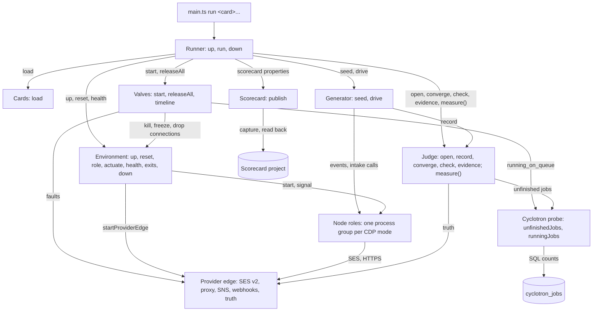
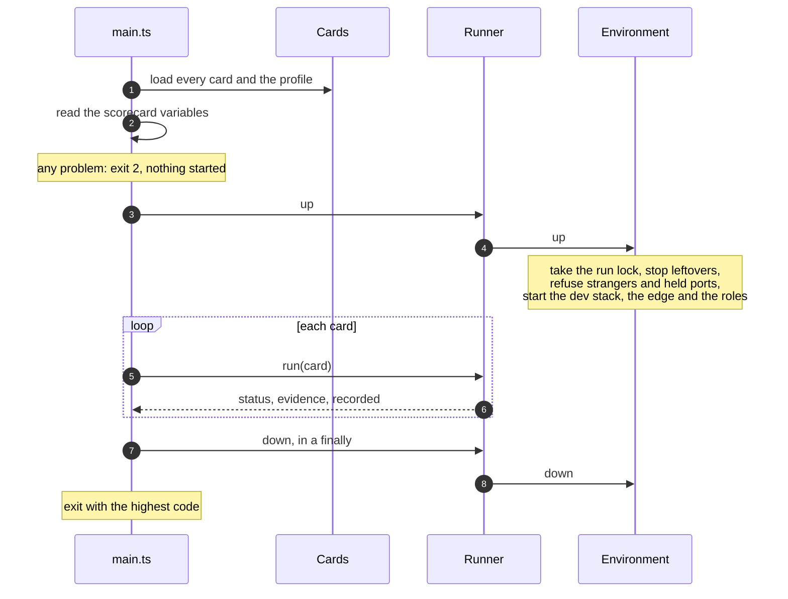
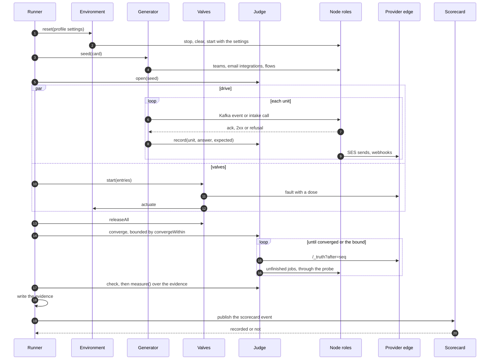
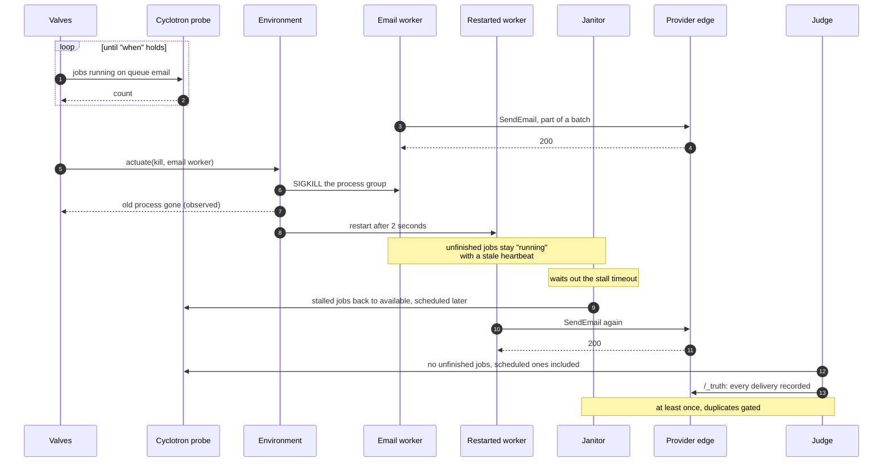
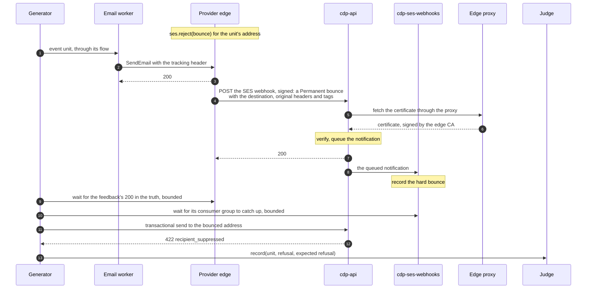
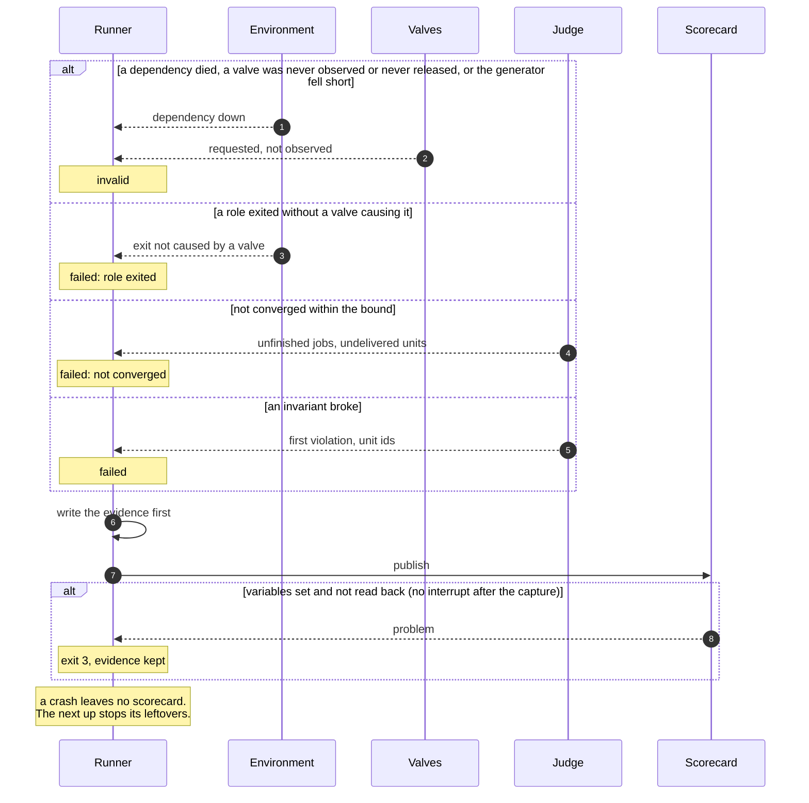

# Workflows scenario runner

The scenario runner tests the Workflows and CDP delivery path end to end, under failure and under load.
It starts the real Node roles, drives traffic through production's intakes, breaks the stack on purpose with named valves, and judges the outcome against what the providers actually received.
Each run ends in one scorecard, so runs compare across commits.

This document covers how to run a card, the runner's modules and seams, the call path of one run, the contract at each seam, the scorecard schema, and how to provision the project that stores scorecards.
The code lives in `nodejs/tests/scenarios/`.
Where this document and that code disagree, the code is right and this document needs a fix.

## Run a card

On a worktree box with the `nodejs` package installed:

```bash
pnpm --dir nodejs exec tsx tests/scenarios/main.ts run smoke
```

- A card is an id, resolved to `nodejs/tests/scenarios/cards/<id>.yaml`, or a path to a YAML file.
- Several cards run one after the other on one stack: `main.ts run <card> <card>...`. Every card must load before any runs.
- `--profile <file>` runs the cards with a profile from outside the repository instead of the shipped `synthetic` profile. It keeps its own `name`, which the scorecard records as `profile_name`; the profile hash tells it from the shipped one.

For each card the runner prints its status and reason, its evidence directory, and whether the scorecard was recorded.

| Exit code | Meaning                                                                                                                          |
| --------- | -------------------------------------------------------------------------------------------------------------------------------- |
| 0         | `passed`                                                                                                                         |
| 1         | `failed`: an invariant broke, or the stack did not converge                                                                      |
| 2         | `invalid`: the run could not judge, or a card, the profile or the scorecard variables did not load                               |
| 3         | The scorecard variables are set and the scorecard was not read back. A run interrupted after the capture keeps its status's code |

With several cards the exit code is the highest of their codes.

**The runner owns the box's dev databases.**
Roles run against the dev `posthog` and `cyclotron_node` databases, and every reset deletes every unfinished job in `cyclotron_jobs`.
Do not run cards on a box whose dev stack holds work you want to keep.

**Evidence** stays on the box, under `$XDG_CACHE_HOME/posthog-scenarios/<run id>/` (`~/.cache` when the variable is unset), outside the repository:

| File              | Holds                                                                             |
| ----------------- | --------------------------------------------------------------------------------- |
| `journal.json`    | Every unit the generator offered, the intake's answer, and what it expects        |
| `truth.json`      | Every request the provider edge received and how it answered                      |
| `logs/<role>.log` | Each role's log lines from this run                                               |
| `scorecard.json`  | The run's verdict and its scorecard event, written before the runner publishes it |

Each role also appends to one log across runs, `posthog-scenarios/<role>.log`.

## Glossary

| Term              | Meaning                                                                                                                                                                                                                                             |
| ----------------- | --------------------------------------------------------------------------------------------------------------------------------------------------------------------------------------------------------------------------------------------------- |
| **Card**          | One versioned scenario: seed state, traffic, a valve schedule, the invariants that fail the run and the measurements it records. A YAML file.                                                                                                       |
| **Profile**       | The traffic rates and role settings a card runs with. The repository ships an invented `synthetic` profile; a measured profile is kept outside the repository and passed by path.                                                                   |
| **Traffic kind**  | One named way to offer units, such as `event_email`. It owns the flow it seeds and the deliveries it expects for each unit, so cards never list flows or expectations.                                                                              |
| **Generator**     | The runner's traffic driver. It seeds teams and flows and offers units through production's intakes.                                                                                                                                                |
| **Unit**          | One piece of work the generator offered: an event produced to Kafka, or one intake API call. Its id is `<run id>-<n>`, so a late delivery from another run never matches.                                                                           |
| **Delivery**      | One message a unit should cause, keyed by unit and action: one email or one webhook call.                                                                                                                                                           |
| **Valve**         | One named, dosed failure, such as `role.kill` or `ses.throttle`.                                                                                                                                                                                    |
| **Provider edge** | One HTTP server that stands in for every external provider: the SES API, a forward proxy, the SNS certificate host and a webhook receiver. It records what it received as the **truth**.                                                            |
| **Journal**       | The Judge's record of every unit: the intake's answer and the deliveries or refusal it expects.                                                                                                                                                     |
| **Converged**     | No job for the card's teams is unfinished in the hogflow and email queues, retries scheduled for later included, and every expected delivery has at least one record in the truth. Whether each delivery ended the right way is for the invariants. |
| **Invariant**     | A check that fails the run.                                                                                                                                                                                                                         |
| **Measurement**   | A recorded number. It never fails a run.                                                                                                                                                                                                            |
| **Status**        | `passed`; `failed`, an invariant broke; `invalid`, the run could not judge. Whether the scorecard was stored is reported separately.                                                                                                                |
| **Scorecard**     | One run's stored result: status, provenance and scalar results, written as one event. Evidence stays on the box.                                                                                                                                    |
| **Marker**        | The `SCENARIO_RUNNER` variable in the environment of every role the runner starts. It finds a crashed run's leftovers and tells the runner's roles from strangers.                                                                                  |
| **Stranger**      | A CDP process or a member of the events consumer group that this runner did not start.                                                                                                                                                              |
| **Target**        | Where a run executes: `local`, a worktree box, now; `cloud`, a prod-shaped slice in a cloud environment, later.                                                                                                                                     |

## Context

The runner reaches the stack only through seams that exist today, so it changes no production code:

- Every role boots by `PLUGIN_SERVER_MODE`, one process per mode, each on its own `HTTP_SERVER_PORT`.
- SES goes to `SES_ENDPOINT`, which the SES client in `email.service.ts` is built from.
- Every other provider, the SNS certificate fetch included, goes through `fetch` in `nodejs/src/common/utils/request.ts`, which sends every request through `HTTPS_PROXY` when `EXTERNAL_REQUEST_PROXY_TEAMS` is unset. Roles trust the edge's certificate authority through `NODE_EXTRA_CA_CERTS`.

**The clock is real.**
Every card declares `clock: real`.
Cards that advance delays, time windows, schedules and Cyclotron's due predicates need a scheduling clock, the first production change the runner will need (see [Follow-ups](#follow-ups)).

The runner is TypeScript inside the `nodejs` package and reuses the CDP test fixtures, such as `FixtureHogFlowBuilder` and `insertHogFlow`.
It borrows the personhog test harness's conventions: a journal, bounded convergence, failure injection as data, and known defects as gates.

## Modules and seams



Cards say what a run does, the Generator and Valves do it, the Judge decides, and the Scorecard keeps the result.
The Environment holds everything that differs between a local box and a cloud slice, and the provider edge runs the same in both places, so a card never knows where it runs.

| Module              | Seam                                                                                            | Owns                                                                                                                                                                          |
| ------------------- | ----------------------------------------------------------------------------------------------- | ----------------------------------------------------------------------------------------------------------------------------------------------------------------------------- |
| **Runner**          | `up`, `run(card)`, `down`                                                                       | The run lifecycle: reset, seed, drive with valves alongside, converge, judge, write evidence, publish. Watching dependency health and role exits during the run. The status.  |
| **Cards**           | `load`                                                                                          | The YAML schema (zod), the checks across a card and its profile, profiles, and the card and profile hashes.                                                                   |
| **Environment**     | `up`, `reset`, `edgeUrl`, `role`, `actuate`, `dependencyHealth`, `exits`, `groupLag`, `down`    | Starting the stack for one target, leftovers and strangers, applying profile settings, every actuation, restarting killed roles, dependency health, and recording role exits. |
| **Provider edge**   | `startProviderEdge`, `hold`, and HTTP: SES v2, CONNECT proxy, `/_faults`, `/_truth`, `/_health` | Faking providers, applying dosed faults, emitting signed SNS feedback, and the append-only truth.                                                                             |
| **Valves**          | `start`, `releaseAll`, `timeline`                                                               | The valve definitions, scheduling by `at` or `when`, translating each valve into an Environment action, and the timeline of requested, applied, observed and released.        |
| **Generator**       | `seed`, `drive`                                                                                 | The traffic kinds: seeding teams, email integrations and flows, sampling the profile, offering units, and recording each unit with the Judge.                                 |
| **Judge**           | `open`, `record`, `converge`, `check`, `evidence`, and the `measure()` function                 | The journal, convergence, and the invariant and measurement definitions.                                                                                                      |
| **Cyclotron probe** | `unfinishedJobs`, `runningJobs`                                                                 | Two SQL counts against `cyclotron_jobs`. They reach past Cyclotron's seam on purpose, and the probe is the only place that does.                                              |
| **Scorecard**       | `scorecardOf`, `publish`                                                                        | The scorecard properties, the provenance they carry, and capturing the event and reading it back.                                                                             |

**One definition per name.**
Each valve, traffic kind, invariant and measurement is one definition that holds its name, its parameter schema and its implementation, in Valves, Generator and Judge.
`load` checks a card's names and parameters against those definitions, so there is no separate list of names to keep in sync.

### Where the code lives

```text
nodejs/tests/scenarios/
  main.ts          the CLI: run <card>... [--profile <file>]
  runner/          Runner, status rules and exit codes
  cards/           *.yaml cards, schema.ts, load.ts, definitions.ts
  profiles/        synthetic.yaml, invented numbers only
  environment/     the local Environment: stack, roles, supervisor, processes
  provider-edge/   startProviderEdge(), used by the runner and by Jest
  generator/       traffic kinds, seed and drive
  valves/          valve definitions and scheduling
  judge/           journal, convergence, invariants, measurements
  probe/           the Cyclotron probe
  scorecard/       properties, provenance, capture and read back
```

The CLI runs with `tsx`, as `pnpm --dir nodejs exec tsx tests/scenarios/main.ts`; there is no package script.
`nodejs/src/cdp/_tests/fake-ses.ts` is a thin adapter over `startProviderEdge`, so the email service's Jest suites and the runner share one SES implementation.
Nothing in the runner runs in production.

## First slice

The first slice is local only, on real time.

- **Roles.** `cdp-processed-events`, `cdp-cyclotron-worker-hogflow`, `cdp-cyclotron-worker-email`, `cdp-api`, `cdp-cyclotron-v2-janitor`, `cdp-ses-webhooks`. Every card runs against all six. `cdp-ses-webhooks` runs cdp-api's SES webhook consumer, which records SES feedback.
- **Traffic.** Events into event-triggered flows with email and webhook steps, and transactional email sends. Every job lives in the hogflow and email queues of `cyclotron_jobs`: a flow's webhook step runs inside the hogflow worker and retries by rescheduling its own row. The flows read the recipient from event properties, so the slice seeds no persons.
- **Valves.** `role.kill`, `role.freeze`, `pg.drop_connections`, `ses.reject`, `ses.throttle`, `dest.status`.
- **SES feedback.** cdp-api verifies SES feedback and queues it, and the `cdp-ses-webhooks` consumer records it. The runner changes no setting to shorten that path.
- **Origin.** `local-agent` only.

### Traffic kinds

| Kind                  | Intake                                                                                                                                                                                                                                                                           | Flow                                                                                      | Expected per unit                                                     |
| --------------------- | -------------------------------------------------------------------------------------------------------------------------------------------------------------------------------------------------------------------------------------------------------------------------------- | ----------------------------------------------------------------------------------------- | --------------------------------------------------------------------- |
| `event_email`         | An event on the events topic, with the recipient in `properties.email`                                                                                                                                                                                                           | Event trigger, then an email step                                                         | One email delivery                                                    |
| `event_webhook`       | An event on the events topic                                                                                                                                                                                                                                                     | Event trigger, then a webhook step to `https://hooks.example.com/u/<unit id>/<action id>` | One webhook delivery                                                  |
| `transactional_email` | cdp-api's template route `/transactional_email`, with `{ to, distinct_id, variables }` and a JWT the generator mints per team and flow                                                                                                                                           | API trigger, then an email step reading `properties.to`                                   | One email delivery                                                    |
| `bounce_followup`     | An event on the events topic, with the recipient in `properties.email`. Once the send is accepted, a follow-up: wait for cdp-api's 200 to the bounce feedback in the truth and for zero lag on the `cdp-ses-webhooks` consumer group, then a template-route send to that address | Event trigger, then an email step; the follow-up goes through the transactional flow      | One email delivery; the follow-up refused with `recipient_suppressed` |

### First cards

Each card is drawn from a failure class on the delivery path.
`smoke` ships with the runner; each other card lands with the valves and traffic kinds it uses, and only cards in `cards/` can run.

| Card                     | Traffic                                               | Valves                                                                                                   | Invariants                                                                             | Failure class                                |
| ------------------------ | ----------------------------------------------------- | -------------------------------------------------------------------------------------------------------- | -------------------------------------------------------------------------------------- | -------------------------------------------- |
| `smoke`                  | `event_email`, `event_webhook`, `transactional_email` | none                                                                                                     | `at_least_once`, `duplicate_sends` (gate 0), `refused_at_intake` (gate 0)              | Baseline: proves the judging loop            |
| `email-worker-killed`    | `event_email`, `transactional_email`                  | `role.kill` on the email worker, `when` 1 job runs on `email`                                            | `at_least_once`, `duplicate_sends` (gated), `refused_at_intake`                        | A worker dying mid-batch                     |
| `hogflow-worker-frozen`  | `event_email`, `event_webhook`                        | `role.freeze` on the hogflow worker for 60 seconds, `when` 1 job runs on `hogflow`                       | `at_least_once`, `duplicate_sends` (gated), `refused_at_intake`                        | A frozen pod losing sends                    |
| `pg-connections-dropped` | `event_email`, `event_webhook`                        | `pg.drop_connections` share 1 for 5 seconds, `when` 1 job runs on `hogflow`                              | `at_least_once`, `duplicate_sends` (gate 0), `refused_at_intake`                       | A dropped Postgres connection stranding jobs |
| `destination-errors`     | `event_webhook`                                       | `dest.status` 503 share 0.5, then 429 share 0.5, then 400 count 5, each for 10 seconds, 21 seconds apart | `at_least_once`, `duplicate_sends` (gate 0), `refused_at_intake`                       | Destination 429 and 503 retry storms         |
| `ses-throttled`          | `event_email`, `transactional_email`                  | `ses.throttle` 1 per second for 60 seconds                                                               | `at_least_once`, `duplicate_sends` (gate 0), `refused_at_intake`                       | SES throttling                               |
| `ses-bounce-suppresses`  | `bounce_followup`                                     | `ses.reject` with type `bounce` on every send, for 2 minutes                                             | `at_least_once`, `duplicate_sends` (gate 0), `refused_at_intake`, `bounced_suppressed` | Dropped SES feedback, so no suppression      |

## Call paths

### One invocation



### One run of a card



During drive and convergence the Runner polls `Environment.dependencyHealth()` every 5 seconds.
It reads `Environment.exits()` from `Judge.open` on, to tell an exit a valve caused from an unexplained one.
`Valves.releaseAll` also runs in a `finally`, so no valve outlives its card.

### An email worker killed mid-batch



The janitor puts a stalled job back as `available` with a future `scheduled` time, so convergence waits for every unfinished job, not only the due ones.
That is why `load` rejects a kill, freeze or connection-drop card whose `convergeWithin` cannot cover the janitor's stall recovery.

### SES feedback: a bounce reaches suppression



The first send goes through the event path, so cdp-api has never looked the address up, and its suppression cache keeps misses per process.
cdp-api answers 200 once the feedback is queued, before anything records it, so the follow-up waits until the `cdp-ses-webhooks` consumer group has caught up; the follow-up's refusal is what proves the suppression was written.
Suppression needs the signed tracking code, which only the `X-PostHog-Tracking-Code` header carries, and touches only the recipients in `mail.destination`, so the edge copies both from the send into the feedback.

### How a run gets its status



## Local and cloud

|                | Local (first slice)                                                                                                                            | Cloud slice (later)                                                                                                  |
| -------------- | ---------------------------------------------------------------------------------------------------------------------------------------------- | -------------------------------------------------------------------------------------------------------------------- |
| Who runs it    | Agents, on a worktree box                                                                                                                      | People, by hand                                                                                                      |
| Infrastructure | The dev stack's `workflows` intent without the `nodejs` unit: Postgres, Kafka (Redpanda), Redis, ClickHouse, PersonHog, Django and its workers | A per-run namespace rendered from production's chart values at slice size, with its own Cyclotron database and Kafka |
| Node roles     | One child process group per CDP mode, in place of the dev stack's combined `nodejs` process                                                    | One deployment per mode, as in production                                                                            |
| Actuation      | `SIGKILL`, and `SIGSTOP` and `SIGCONT`, on a role's process group; `pg_terminate_backend` on role connections                                  | Pod kills, freezes and network faults through the cloud's failure tooling                                            |
| Provider edge  | Inside the runner process, on port 4566                                                                                                        | The same server as its own process, in a pod                                                                         |
| Profile        | `synthetic` by default; a measured profile by `--profile <file>`                                                                               | A measured profile                                                                                                   |
| Measurements   | Each role's `/_metrics`, process CPU and memory included, and latency from the journal                                                         | The same metrics; alert rules checked against a test Alertmanager                                                    |

Cards, Valves, the Generator, the Judge and the Scorecard are the same code on both targets.
Only the Environment has two implementations, and only it knows how a role is found and how it is broken.

## Contracts

The card format and the scorecard event are the external contracts: other people and tools read them, so they change only with a schema version.
The other interfaces are internal seams; each module keeps the responsibilities in the module table.

### Cards

The schema is `Card` in `cards/schema.ts`.
A card names its profile, its seed, the number of teams to seed, its traffic kinds and their duration, its valve entries, `convergeWithin`, its invariants and measurements, and its gates.
`drive.minOffered` is the share of target units that must count as offered for the run to judge, 0.9 by default.

```yaml
id: email-worker-killed
version: 1
clock: real
profile: synthetic
seed: 2
setup:
  teams: 1
drive:
  for: 30s
  traffic:
    - name: event_email
    - name: transactional_email
valves:
  - valve: role.kill
    target: cdp-cyclotron-worker-email
    dose: {}
    when:
      name: running_on_queue
      params:
        queue: email
        atLeast: 1
    for: 1s
convergeWithin: 2m
invariants:
  - name: at_least_once
  - name: duplicate_sends
  - name: refused_at_intake
gates:
  duplicate_sends: 3
  refused_at_intake: 0
measure:
  - name: role_cpu_seconds
  - name: role_rss_max_bytes
  - name: delivery_latency_ms
```

A valve entry names a valve, its target (a role, `postgres`, `ses` or `hooks.example.com`), its dose, exactly one of `at` (an offset from the start of the drive) or `when`, and `for`.
`when` takes one predicate, `running_on_queue` with `queue` and `atLeast`.

`load` returns the card, the profile and their hashes, or throws one `CardError` that lists every problem at once.
It rejects:

- unknown valve, traffic kind, invariant and measurement names, and parameters or doses that fail their definition's schema;
- a `role.kill`, `role.freeze` or `pg.drop_connections` card whose `convergeWithin` does not exceed the janitor's stall timeout, its sweep interval, its first-retry spread and its backoff for repeated stalls, plus the role restart backoff, read from the profile settings or the repository defaults;
- a `pg.drop_connections` entry scheduled by `at`: the main pools close idle connections quickly, so it waits for running jobs with `when`;
- `bounced_suppressed` on a card with no `ses.reject` entry of type `bounce`, because only a hard bounce blocks transactional email;
- a card whose traffic is answered at its intake rather than on Kafka, such as `transactional_email`, without `refused_at_intake`, because such a unit counts as offered whatever its intake answered;
- a profile setting no role or the load producer reads, and traffic rates that fail their kind's profile schema.

**Hashes.**
The profile hash is the SHA-256 of the profile serialized with sorted keys.
The card hash is the SHA-256 of the card without `gates` and the profile hash, serialized the same way.
Gates stay outside the card hash; anything else that changes what runs changes it.
`runner_version` leaves out the YAML files in `cards/` and `profiles/`, so a committed gate edit keeps the fingerprint and the card hash, and runs on either side of it compare.
An edit to a shipped profile keeps the fingerprint too, and changes the profile hash, which the card hash carries.
Every other committed edit under `nodejs/tests/scenarios/` outside `generator/` and `valves/` still changes `runner_version`, a test file or the loader included.

**Profiles.**
A profile has a `name`, per-traffic-kind rates under `traffic`, and role environment under `settings`.
Settings whose name starts with `KAFKA_PRODUCER_` configure the runner's load producer, which sends the generator's events to Kafka.
Every role gets every setting too, but no CDP role reads that prefix: the roles build their producers from `KAFKA_CDP_PRODUCER_*` and the per-producer config maps.
A scorecard records the profile's name and hash, never its numbers.

### Runner

```ts
// nodejs/tests/scenarios/runner/runner.ts
export interface Runner {
  up(): Promise<void>
  run(loaded: LoadedCard, signal: AbortSignal): Promise<RunResult>
  down(): Promise<void>
}
```

- **One process per invocation.** The Environment is an in-memory object that supervises the role processes, so `up`, every `run` and `down` happen in the one `main.ts run` process. Runs on one stack are sequential.
- **Order.** `run` calls `reset`, `seed`, `Judge.open`, then `drive` and `Valves.start` together, `Valves.releaseAll`, `converge`, `check` and `measure`, writes the evidence, and publishes the scorecard.
- **A failed reset stops the environment.** Later cards of the same invocation are skipped; run the command again.
- **Seeding is bounded.** `seed` runs on its own Postgres pool with a 5-second statement timeout and must finish within 60 seconds. When the bound passes or the run is interrupted, the runner destroys the pool's connections and requires a restart, as a write already sent may still land in the next card.
- **Status rules.**
  - `invalid` when a dependency the card did not break went away (Postgres, Kafka, Redis, the SES rate limiter's Valkey, PersonHog, the edge), a valve was never observed, a valve was applied and never released, fewer than `minOffered` of the target units counted as offered, a traffic kind could not offer a unit it requires, the run was interrupted, or the evidence could not be written. The run could not judge, so this outranks a failed invariant.
  - `failed` when the stack did not converge, any invariant failed, or a Node role exited without a valve causing it, even if every delivery later arrives.
    An unexplained exit outranks a valve that was never observed: the run fails, and the reason also lists every unobserved valve.
    An exit while `pg.drop_connections` is applied still counts as unexplained; its reason names the drop.
  - `passed` otherwise.
- **Exit code.** The status's code, or 3 when the scorecard variables are set and the scorecard was not read back. A run interrupted after the capture keeps the status's code. Evidence files that could not be written make the run `invalid`, exit 2.

### Environment

```ts
// nodejs/tests/scenarios/environment/environment.ts
export interface Environment {
  up(): Promise<void>
  reset(settings: Profile['settings']): Promise<void>
  edgeUrl(): string
  role(name: Role): RoleHandle
  actuate(action: Action): Promise<Actuation>
  dependencyHealth(): Promise<{ healthy: boolean; down: string[] }>
  exits(): RoleExit[]
  groupLag(group: string): Promise<number>
  down(): Promise<void>
}

export type Action =
  | { kind: 'kill'; role: Role }
  | { kind: 'freeze'; role: Role }
  | { kind: 'pg.terminate'; share: number }
  | { kind: 'edge.fault'; rule: FaultRule }

export type RoleHandle = { name: Role; url: string; metricsUrl: string }
```

- **Role handles.** `role(name)` returns the role's base `url` and its `/_metrics` URL, which the runner's sampler scrapes.
- **`up` owns the stack.**
  - It takes a lock on its state directory, so one runner uses it at a time.
  - It stops the leftovers of a crashed invocation: processes whose marker names its state directory.
  - It refuses to start, exit 2, and names the command that stops each one, when a stranger runs: a CDP process without its marker, or another runner's roles. It also refuses while a port it needs is held, and while the events consumer group keeps a member it did not start.
  - When the dev stack is not up, it writes a dev config with `hogli dev:generate --with workflows --without nodejs` into its state directory and starts it with `hogli up -d --custom <config>`, which leaves the box's saved settings alone. It always waits with `hogli wait`. The `nodejs` unit is left out because, with no capability group set, it runs every CDP consumer, which would share the events consumer group and the job rows.
  - It starts the edge and cdp-api, waits until the email and webhook templates exist in Postgres, syncing them with `hogli dev:sync-hog-templates` when they are missing, and then starts the other roles. Roles cache a missing template, so they must not start first.
- **`reset` is complete.** It runs before every card, so a failed or crashed run never poisons the next. In order:
  1. Stop every role: `SIGCONT` then `SIGTERM` to each process group, `SIGKILL` to what is left after 10 seconds. A role still running 2 seconds after `SIGKILL` fails the stop, naming its pid.
  2. Wait, for up to 45 seconds, until the roles' consumer groups have no members. A killed consumer stays a member until its session times out.
  3. Clear the edge's faults.
  4. Delete unfinished jobs from `cyclotron_jobs`.
  5. Clear the SES rate limiter's bucket.
  6. Move the roles' consumer groups, the events consumer's and the SES webhook consumer's, to the end of their topics with `rpk group seek <group> --to end --topics <topics> --allow-new-topics`. Without the topic list, a group that never committed is not moved.
  7. Start the roles with the profile's settings and wait for each role's `/_health`.

  Stopping first means no in-flight batch from an earlier run can recreate jobs after the clear.

- **Killed roles come back.** After any exit the Environment restarts the role after 2 seconds, as Kubernetes would, and records the exit, marked as caused by a valve or not.
- **Actuation.** Each action is observed within 10 seconds or not at all.
  - `kill` sends `SIGKILL` to the role's process group and is observed when the old process is gone.
  - `freeze` sends `SIGSTOP` and is observed when `/proc/<pid>/stat` shows state `T`. Overlapping freezes of one role resume it only when the last of them releases.
  - `pg.terminate` runs `pg_terminate_backend` on the `share` of role backends, rounded up, on every Postgres server the role settings name with a `postgres://` or `postgresql://` URL, such as a read replica. Loopback names and the default port count as one server. It is observed when at least one backend was terminated.
  - `edge.fault` holds a fault rule on the edge with `ProviderEdge.hold` and lifts it on release. It is observed when the edge first answered a request with it inside the 10-second window, and stops waiting when the hold ends.
- **Consumer lag.** `groupLag(group)` reads a consumer group's total lag with `rpk group describe`.
- **Connection drops spare the runner.** Every role starts with `PGAPPNAME=scenario-<role>`, which node-postgres uses for pools that set no `application_name`, Cyclotron's pools included. `pg.terminate` only terminates backends whose `application_name` is a role's mode or starts with `scenario-`; the runner's own connections use another name.
- **Dependency health.** `dependencyHealth` checks Postgres, Kafka, Redis, the SES rate limiter's Valkey, PersonHog and the edge's `/_health`.
- **The roles' environment.** Every role starts from `src/index.ts` with `tsx` in development mode, as its own process group, with:
  - `PLUGIN_SERVER_MODE`, its own `HTTP_SERVER_PORT`, `PGAPPNAME`, and the marker;
  - `SES_ENDPOINT` at the edge, `SES_REGION`, and placeholder `AWS_ACCESS_KEY_ID` and `AWS_SECRET_ACCESS_KEY` with `AWS_PROFILE` unset, because the SES client takes its credentials from the SDK's default chain;
  - `HTTPS_PROXY` at the edge, `NODE_EXTRA_CA_CERTS` at the edge's certificate authority, and `EXTERNAL_REQUEST_PROXY_TEAMS` unset;
  - `PERSONHOG_ENABLED=true` and `PERSONHOG_ADDR`, without which no CDP role boots;
  - `ENCRYPTION_SALT_KEYS`, which the email worker needs to sign tracking codes, and `WORKFLOWS_TRANSACTIONAL_EMAIL_JWT_SECRET`, both shared with the runner;
  - the profile's settings.

### Provider edge

```ts
// nodejs/tests/scenarios/provider-edge/index.ts
export function startProviderEdge(options: {
  port: number
  configurationSets?: ConfigurationSets // validated as SES does, for the fake-ses adapter
  trackingKeys?: string // ENCRYPTION_SALT_KEYS, to read the action id from the tracking code
  caDir?: string // creates the CA and leaf certificates; without it the edge serves plain HTTP only
  region?: string // the SNS certificate's host is sns.<region>.amazonaws.com; us-east-1 when unset
  feedbackUrl?: string // cdp-api's SES webhook, where a bounce fault posts its feedback
}): Promise<ProviderEdge>
```

```text
POST   /_faults      { name, params, match?: { host? | recipient? }, dose?: { count } | { share }, for? }  -> 201 { id }, or 400 { problems }
DELETE /_faults/:id
DELETE /_faults      clears every fault
GET    /_truth?after=<seq>&limit=<n>   -> { records: TruthRecord[], next: number }, at most 1000 records a page
GET    /_truth/head  -> { head }, the last record's seq, 0 when empty
GET    /_health
```

```ts
export type TruthRecord = {
  seq: number // strictly increasing, never reused, survives fault clears
  at: string
  kind: 'ses.send' | 'ses.feedback' | 'webhook'
  unitId?: string // from the recipient or the webhook path
  actionId?: string // from the signed tracking code, or the webhook path
  status: number // what the edge answered; for ses.feedback, what cdp-api answered the edge
  fault?: string // the fault that shaped the answer
  detail: Record<string, unknown>
}
```

- **Card faults.** `ses.reject` (type `bounce` or `rejected`), `ses.throttle` (`rate` per second, no dose; sends over the rate get SES's throttling error) and `dest.status` (`code`). A dose is a count or a share of matching requests; `for` bounds it in time. A throttle answers before every other fault, whatever order they were added in, and every send it lets through counts against its rate, bounced sends included. The edge stamps the time each fault first answers a request on the fault that answered, whether that is the throttle or a fault behind it. The fake-ses adapter's own faults, such as a dropped connection, stay outside this vocabulary.
- **Correlation.** The generator puts the unit id where the delivery path carries it unchanged, so the edge parses ids and the Judge never parses payloads:
  - email: the recipient `<unit id>@www.example.com`. The domain has an address record, so the pre-send MX check lets it through. The edge reads the action id from the `X-PostHog-Tracking-Code` header with the tracking code signer and the roles' `ENCRYPTION_SALT_KEYS`;
  - webhooks: the path `/u/<unit id>/<action id>` on `hooks.example.com`, with the action id written into each seeded webhook step.
- **Feedback.** On a `bounce` the edge answers the send, then posts a signed SNS notification (signature version 1) to `feedbackUrl`: a `Permanent` bounce with the recipient in `bouncedRecipients`, carrying the original send's message id, destination, configuration set, tags and headers.
  - It posts for every send that names a configuration set, as SES publishes events only for those. For a send that names none it posts nothing and records an `ses.feedback` with status 0.
  - It refuses a bounce fault unless it has both a feedback URL and a `caDir` to sign with: `POST /_faults` answers 400 on `params.type`, and `hold` throws the same problem.
- **In-process holds.** `ProviderEdge.hold(rule)` adds a fault without HTTP, for the Environment's `edge.fault` action, and returns `observed` and `release`.
  - The fault list records `firstAppliedAt`, when the fault first answered a request.
  - `observed` polls until that time falls inside a 10-second window from its call (`answeredInWindow`), the window passes, or the hold's signal aborts, and then answers whether it did.
- **Proxy and certificates.** With `caDir`, the edge creates its certificate authority and leaf certificates with the `openssl` CLI. Its CONNECT proxy terminates TLS for `hooks.example.com` and `sns.<region>.amazonaws.com`, where it serves its SNS signing certificate, and tunnels every other host unchanged. cdp-api only accepts a certificate URL on that host, so the edge serves it under the real name rather than the runner changing production code.

### Valves

```ts
// nodejs/tests/scenarios/valves/valves.ts
export type ValveContext = {
  environment: Pick<Environment, 'actuate'>
  probe: Pick<CyclotronProbe, 'runningJobs'>
  teams: number[]
}

export type ValveDefinition = Definition & {
  // Definition holds the name and the params schema
  target: z.ZodType<string>
  strandsRunningJobs: boolean // re-check `when` after apply
  apply(context: ValveContext, target: string, dose: unknown): Promise<Actuation>
}

export interface Valves {
  start(entries: ValveEntry[], context: ValveContext): Promise<void> // schedules each entry; returns at once
  releaseAll(): Promise<void> // cancels pending entries, awaits in-flight ones, then releases; idempotent
  timeline(): ValveTimelineEntry[] // requested, applied, observed and released times, and any error
}
```

| Valve                 | Target              | Dose                                                 | Acts through              |
| --------------------- | ------------------- | ---------------------------------------------------- | ------------------------- |
| `role.kill`           | a role              | none                                                 | `actuate`, `kill`         |
| `role.freeze`         | a role              | none                                                 | `actuate`, `freeze`       |
| `pg.drop_connections` | `postgres`          | `share`                                              | `actuate`, `pg.terminate` |
| `dest.status`         | `hooks.example.com` | `code` from 400 to 599, with a `count` or a `share`  | `actuate`, `edge.fault`   |
| `ses.throttle`        | `ses`               | `rate` per second                                    | `actuate`, `edge.fault`   |
| `ses.reject`          | `ses`               | `type` `rejected` or `bounce`; `share`, 1 by default | `actuate`, `edge.fault`   |

- **Scheduling.** `at` fires at an offset from the drive's start. `when` asks the probe once a second until `running_on_queue` holds; an entry whose predicate never holds before the drive ends is not observed. A valve that strands running jobs, `role.kill` or `role.freeze`, asks again once observed, and an entry applied after its predicate stopped holding is not observed.
- **Holds.** Every valve's `for` starts once `apply` returns, on one timer. The hold's signal aborts when that timer passes or the drive ends; observation waits on the same signal, and the valve releases once it aborts. So a `10s` hold lasts about 10 seconds however long observation took.
- **Observation.** Each entry must be observed within its valve's window, or the timeline records an error and the run is `invalid`. A broken harness never reads as a passing engine. An edge fault counts as observed only when the edge answered a request with it inside its 10-second window, so a hold shorter than the window ends observation sooner.
- **Release.** An applied entry that is never released makes the run `invalid`. An entry that was never applied has nothing to release.
- **Adding a valve** is one `ValveDefinition`. Cards name valves, never backends.

### Generator

```ts
// nodejs/tests/scenarios/generator/generator.ts
export function seed(loaded: LoadedCard, postgres: PostgresRouter, signal: AbortSignal): Promise<SeedState>
export function drive(
  loaded: LoadedCard,
  seeded: SeedState,
  journal: Pick<Judge, 'record'>,
  signal: AbortSignal,
  context: DriveContext
): Promise<{ targetUnits: number; offeredUnits: number }>
```

- **Seed.** Each card seeds its own teams, so checks scope by team, and one verified email integration per team, which every send needs. Each traffic kind builds its flow with `FixtureHogFlowBuilder`; `insertHogFlow` writes it, skipping Django's validation, so the seed compiles each step's inputs with `compileHog` as Django would. Email steps read the recipient from event properties, because the hogflow worker resolves the person again from storage, and a missing person does not stop the flow.
- **Intakes.** Events go to the topic the events consumer reads. Transactional sends go to cdp-api's template route.
- **Pacing.** Each traffic kind offers `ratePerSecond` units for the drive's duration, from its profile entry. Sampling uses the card's `seed`, so two runs of one card offer the same sequence of units.
- **No retries.** Every call, its answer and its expected deliveries are recorded, refusals included. A call that gets no answer is recorded as a transport error.
- **Load.** `offeredUnits` counts every call to a CDP role's intake, such as cdp-api, whatever it answered and whenever the answer arrived, and every event Kafka acknowledged before the drive ended. A refusal or transport error from a role is the engine's answer, which `refused_at_intake` judges. A failed or late Kafka produce does not count, because Kafka is a dependency. So a generator that falls behind, or a Kafka that refuses enough events, makes the run `invalid`.
- **Follow-ups.** `bounce_followup` sends a follow-up only after its unit was accepted. It waits up to 60 seconds for cdp-api's 200 to the bounce feedback in the edge's truth, then for `Environment.groupLag` of the `cdp-ses-webhooks` group to reach zero. When the feedback was refused or the bound passes, the journal records why the follow-up was not sent, and `bounced_suppressed` fails that unit.
- **Stopping.** When the drive stops, pending follow-ups send nothing, and the drive returns only after every follow-up it started has settled.

### Judge

```ts
// nodejs/tests/scenarios/judge/judge.ts
export interface Judge {
  open(seed: Pick<SeedState, 'teamIds'>): Promise<void>
  record(unit: JournalEntry): void // synchronous; never blocks the generator
  converge(withinMs: number, signal: AbortSignal): Promise<Convergence>
  check(invariants: Named[], gates: Record<string, number>): Promise<InvariantResult[]>
  evidence(): { journal: JournalEntry[]; truth: TruthRecord[]; fetchRetries: number } // journal.json and truth.json
}

export type InvariantResult = {
  name: string
  passed: boolean
  observed: number
  gate?: number
  violation?: string // the first violation
  unitIds: string[] // up to 5
}
```

- **Open** starts reading the truth at the edge's `/_truth/head`, so records from earlier cards never enter this card's evidence.
- **Converge** polls the truth and the probe until every expected delivery of every accepted unit has a record and no job for the card's teams is unfinished, or the bound passes. A check that finds both only after the bound still counts as not converged. Past the bound the Judge still runs the invariants. The job count covers every retry that has not happened yet: webhook steps reschedule their own hogflow row, and a throttled email reschedules until it is sent.
- **Invariants.**
  - `at_least_once`: every expected delivery has a 2xx in the truth, with two exceptions.
    - A fault answered its last attempt with a code the caller never retries: for webhooks, a 4xx or 5xx outside `RETRIABLE_STATUS_CODES` in `cdp-fetch.ts`, which the check imports so the two never drift; for SES, a 4xx whose error type is neither `TooManyRequestsException` nor `ThrottlingException`, which the edge records in the truth.
    - A webhook's faulted attempts reached the hogflow worker's `CDP_FETCH_RETRIES`, read from its settings as the worker reads it. The runner passes it to the Judge as `fetchRetries`.

    A retried SES code that answers every attempt still counts as missed.

  - `duplicate_sends`: 2xx answers per unit and action beyond one, at or under `gates.duplicate_sends`. Rejected attempts are evidence, not duplicates.
  - `bounced_suppressed`: every unit whose send the `ses.reject` fault bounced has a follow-up that cdp-api refused with 422 `recipient_suppressed`. A follow-up that was not sent, was accepted, could not reach cdp-api or got another answer fails it, and so does a bounced unit with no follow-up.
  - `refused_at_intake`: refusals and transport errors the unit did not expect, at or under `gates.refused_at_intake`.

- **Measurements.** Each has a unit and a better direction in its definition. The runner's sampler scrapes every role's `/_metrics` every 5 seconds from the drive's start to convergence, and `measure(measurements, evidence)` in `judge/measurements.ts` turns the samples and the Judge's evidence into values.
  - `role_cpu_seconds`, per role, seconds, lower is better: the sum of `process_cpu_seconds_total` increases, per process lifetime, so a killed role's restart does not reset it.
  - `role_rss_max_bytes`, per role, bytes, lower is better: the maximum of `process_resident_memory_bytes`.
  - `delivery_latency_ms`, `p50`, `p95` and `max`, milliseconds, lower is better: from the unit's offer to the edge's first 2xx record for each delivery.

### Cyclotron probe

```ts
// nodejs/tests/scenarios/probe/cyclotron-probe.ts
export interface CyclotronProbe {
  unfinishedJobs(query: { teams: number[]; queues: ('hogflow' | 'email')[] }): Promise<number>
  runningJobs(query: { teams: number[]; queues: ('hogflow' | 'email')[] }): Promise<number>
}
```

These are the runner's only queries against `cyclotron_jobs`. `unfinishedJobs` counts jobs that are `available`, scheduled for later included, or `running`; `runningJobs` counts the `running` ones, for a valve's `when`.
When Cyclotron gains its own read of the same counts, that read replaces this module.

### Scorecard

Each run, `invalid` runs included, writes one event:

| Field         | Value                                                        |
| ------------- | ------------------------------------------------------------ |
| `event`       | `scorecard`                                                  |
| `distinct_id` | `scenario-runner`                                            |
| `uuid`        | The run id, a UUID v4, so a retried capture never duplicates |
| `timestamp`   | `ended_at`                                                   |

The runner posts the event to `$SCENARIO_RUNS_HOST/i/v0/e/` with the project token.
It then queries the project with the read key for an event with that `run_id`, every 5 seconds for up to 120 seconds, and reports `recorded` only when the query returns it.
A 4xx answer other than 429 stops at once and names the variable to check.

**Variables are all or nothing.**

| Variable                      | Holds                                               |
| ----------------------------- | --------------------------------------------------- |
| `SCENARIO_RUNS_HOST`          | The PostHog host, such as `https://us.posthog.com`  |
| `SCENARIO_RUNS_PROJECT_ID`    | The scorecard project's id                          |
| `SCENARIO_RUNS_PROJECT_TOKEN` | The project token, for capture                      |
| `SCENARIO_RUNS_READ_KEY`      | A personal API key that can only query that project |

None set: the runner writes no event, reports `recorded: false` and exits by status.
All set: it writes and reads back, and exits 3 when either fails, unless the run was interrupted after the capture, which keeps the status's code.
Some set: a configuration error, exit 2, before anything starts.

#### Scorecard schema, version 1

Property names and meanings are fixed for `schema_version` 1.
A property is added without a version change; a rename, a removal or a change of meaning bumps it.
`null` means the run did not reach the point that sets the value, or the runner could not read it.

**Provenance**

| Property            | Type            | Meaning                                                                                                                                                                    |
| ------------------- | --------------- | -------------------------------------------------------------------------------------------------------------------------------------------------------------------------- |
| `schema_version`    | number          | `1`                                                                                                                                                                        |
| `run_id`            | string          | The run's UUID, also the event's `uuid`                                                                                                                                    |
| `card_id`           | string          | The card's `id`                                                                                                                                                            |
| `card_version`      | number          | The card's `version`                                                                                                                                                       |
| `card_hash`         | string          | SHA-256 of the card without `gates`, and the profile hash                                                                                                                  |
| `profile_name`      | string          | The profile's `name`                                                                                                                                                       |
| `profile_hash`      | string          | SHA-256 of the profile                                                                                                                                                     |
| `head_sha`          | string or null  | The checkout's `HEAD` commit                                                                                                                                               |
| `head_dirty`        | boolean or null | Whether the `nodejs` package has uncommitted changes                                                                                                                       |
| `origin`            | string          | Who started the run: `local-agent`                                                                                                                                         |
| `target`            | string          | Where it ran: `local`                                                                                                                                                      |
| `fingerprint`       | string or null  | SHA-256 of `target`, `host_cpu`, `host_memory_gb`, the three versions and `seed`. Runs compare only within one fingerprint and card hash. `null` when a version is unknown |
| `host_cpu`          | string          | CPU model and count, as `<model> x <count>`                                                                                                                                |
| `host_memory_gb`    | number          | Total memory, rounded to whole gigabytes                                                                                                                                   |
| `runner_version`    | string or null  | Git tree hash of `nodejs/tests/scenarios/` without `generator/`, `valves/`, and the YAML files in `cards/` and `profiles/`; test files count                               |
| `generator_version` | string or null  | Git tree hash of `generator/`                                                                                                                                              |
| `valves_version`    | string or null  | Git tree hash of `valves/`, or of the empty tree when it does not exist                                                                                                    |
| `seed`              | number          | The card's `seed`                                                                                                                                                          |

The versions are tree hashes at `HEAD`, so nobody bumps them by hand; `head_dirty` flags local edits they do not cover.

**Verdict**

| Property            | Type            | Meaning                                                                                                     |
| ------------------- | --------------- | ----------------------------------------------------------------------------------------------------------- |
| `status`            | string          | `passed`, `failed` or `invalid`                                                                             |
| `status_reason`     | string          | Why, in one line                                                                                            |
| `started_at`        | string          | ISO 8601 time the run started                                                                               |
| `ended_at`          | string          | ISO 8601 time the run ended, also the event's timestamp                                                     |
| `duration_s`        | number          | Seconds from start to end                                                                                   |
| `units_target`      | number or null  | Units the profile asked for                                                                                 |
| `units_offered`     | number or null  | Role intake calls whatever and whenever they answered, and events Kafka acknowledged before the drive ended |
| `converged`         | boolean or null | Whether the stack converged within `convergeWithin`                                                         |
| `unfinished_jobs`   | number or null  | Jobs still unfinished when convergence ended                                                                |
| `valve_timeline`    | array           | One entry per valve: valve, target, and requested, applied, observed and released times, or an error        |
| `evidence_dir`      | string          | The evidence directory on the box that ran the card                                                         |
| `invariants_failed` | string[]        | Names of the judged invariants that failed                                                                  |

**Invariants**, one group per judged invariant, with `<name>` the invariant's name.
A run that stops before judging has no groups, so a missing group means not judged, never passed:

| Property               | Type           | Meaning                                                                                                                        |
| ---------------------- | -------------- | ------------------------------------------------------------------------------------------------------------------------------ |
| `inv_<name>_passed`    | boolean        | Whether the invariant held                                                                                                     |
| `inv_<name>_observed`  | number         | The count it checked, such as missed deliveries                                                                                |
| `inv_<name>_gate`      | number or null | The card's gate for it, `null` when the card sets none                                                                         |
| `inv_<name>_violation` | string or null | The first violation seen, even when the count stays within the gate; `null` when none was seen. Read `_passed` for the verdict |
| `inv_<name>_ids`       | string[]       | Up to 5 unit ids that violated it                                                                                              |

**Measurements** use the prefix `m_`: `m_<name>` for a single value, `m_<name>_<role>` per role, and `m_<name>_<stat>` per statistic, such as `m_delivery_latency_ms_p95`.
Hyphens in names and roles become underscores, so the CPU time of `cdp-api` is `m_role_cpu_seconds_cdp_api`.
The unit is in the measurement's definition and in the evidence.
A per-role value that may be short also carries `m_<name>_<role>_incomplete: true`. For `role_rss_max_bytes`, a scrape of that role was missed. For `role_cpu_seconds`, the role restarted, or a scrape after its last sample was missed.
A complete value has no `_incomplete` property, so compare a flagged value with care.

## Provisioning the scorecard project

Done once, by hand, by an organization admin.
The runner works without it and reports `recorded: false`.

1. Create a project for scorecards only, so its events never mix with product data.
2. Set the project's event retention to at least 24 months, then read the setting back to confirm it saved. Scorecards compare runs across months, so the store must outlive them.
3. Create a personal API key scoped to that project only, with only the `query:read` scope. The runner uses it only to read its scorecard back.
4. Put the four `SCENARIO_RUNS_*` variables in the environment of the box that runs cards. Keep the token and the key out of the repository and out of shell history.
5. Run `smoke` and check that it prints `scorecard: recorded`.

## Decisions

These seams are hard to reverse, surprising without context, or a real trade-off.

### One process per invocation

- **Decision.** `main.ts run <card>...` loads every card, then brings the stack up, runs each card, and brings it down in a `finally`, all in one process. There is no separate `up` or `down` command and no ready file.
- **Why.** The Environment supervises the role processes in memory: it restarts killed roles and records exits. A separate `run` process could not reach it without a control channel.
- **Cost.** Every invocation pays the stack's start-up; run several cards in one invocation to share it.

### Leftovers by marker, not by process id

- **Decision.** Every role starts with the marker in its environment, naming the runner's state directory, and runs as a detached process group. `up` scans `/proc/*/environ` and stops the groups that carry its own marker.
- **Why.** The marker sits on the live process, so a reused process id never causes a wrong kill, and the same scan finds strangers.
- **Cost.** `up` reads every process's environment, which works only where `/proc` does.

### The provider edge grows from `fake-ses.ts`

- **Decision.** The SES v2 handler moved into the provider edge, and `startFakeSes` became a thin adapter over `startProviderEdge` with its old interface. Its single fault became one entry in the edge's fault list, dosed at share 1.
- **Why.** One implementation and one fault model serve both the email service's Jest suites and the runner, and those suites prove the move broke nothing. A container fake would drop configuration-set, tag and header validation and emit no feedback.
- **Cost.** Two callers share one server's behavior; moving the Jest callers onto the edge directly is a later change.

### The edge runs inside the runner process

- **Decision.** `Environment.up` calls `startProviderEdge` in process on port 4566, as Jest's adapter does on a free port.
- **Why.** The local runner needs no second process to supervise; the HTTP contract is the same either way.
- **Cost.** The cloud slice needs the edge as its own process, which comes with the cloud image.

### SNS certificates from the edge, at the real host name

- **Decision.** The edge serves the SNS signing certificate at `sns.<region>.amazonaws.com` through its CONNECT proxy, and roles trust the edge's certificate authority through `NODE_EXTRA_CA_CERTS`.
- **Why.** cdp-api only accepts a certificate URL on that host, and the fetch already goes through `HTTPS_PROXY`. Overriding the host would be a production change, and unsigned feedback would skip the path production runs.
- **Cost.** Every external request from the roles goes through the proxy, which production does only for some teams.

### Public synthetic profile, private measured profile

- **Decision.** The repository ships an invented `synthetic` profile with the repository's default settings. A measured profile, with production's settings, is kept outside the repository and passed by path.
- **Why.** This repository is public, and a measured profile describes production.
- **Cost.** Capacity numbers mean something only with a measured profile. A measured profile can carry any name, so `profile_hash`, not the name, tells it from the shipped one.

### Queries past Cyclotron's seam, on purpose

- **Decision.** The Cyclotron probe reads `cyclotron_jobs` directly.
- **Why.** Adding the read to Cyclotron would be a production change.
- **Cost.** A schema change to `cyclotron_jobs` can break the probe; it is one module with one query.

### Restart the roles on every reset

- **Decision.** `reset` stops the roles before it clears jobs and moves offsets, then starts them again, for every card.
- **Why.** The events consumer queues jobs in a background task, and Kafka refuses to move offsets for a group with live members, so a reset with the roles running is not a clean boundary.
- **Cost.** Every card pays the roles' boot time before its drive. Measurements start after the roles report healthy, so boot time never enters them.

### Versions from git

- **Decision.** The runner, generator and valves versions are git tree hashes of their directories. The runner version leaves out only the card and profile YAML files, which the card hash and the profile hash cover.
- **Why.** Nobody has to bump a version by hand, and any change to the code that shapes a run changes the fingerprint.
- **Cost.** Uncommitted edits do not change a version; `head_dirty` flags those runs. A test-only edit changes a version too, so runs on either side of it do not compare.

### Evidence stays on the box

- **Decision.** Local runs keep their evidence in the cache directory and store only the scorecard event.
- **Why.** An agent debugging a local run reads the files on its own box; the event holds what compares across runs.
- **Cost.** Evidence of a box that is gone is gone. Evidence storage arrives with PR and cloud runs.

## Follow-ups

| Follow-up                                                                                                                                                                                                                                                                                        | Strength        | Why it waits                                                          |
| ------------------------------------------------------------------------------------------------------------------------------------------------------------------------------------------------------------------------------------------------------------------------------------------------ | --------------- | --------------------------------------------------------------------- |
| **The scheduling clock**: one clock passed through the hogflow action handlers and Cyclotron's config, with delay and time-window steps as functions of `now`, Django schedules and the rate-limit script taking `now` as an argument, and an advance barrier. Unlocks `clock: scheduled` cards. | Strong          | It is the first production change; the first slice runs on real time. |
| **Cyclotron owns "due"**: every due and wake predicate behind Cyclotron's seam, with one `now` parameter. Its read replaces the Cyclotron probe.                                                                                                                                                 | Strong          | The first change of the clock work.                                   |
| **A role registry**: one module owning mode, capabilities and boot, replacing the parallel lists in `config.ts`, `types.ts`, `capabilities.ts` and `server.ts`.                                                                                                                                  | Strong          | The runner only needs the modes that exist.                           |
| **The rest of the valve vocabulary**: `role.cpu`, `pg.latency` (Toxiproxy in front of Postgres), `ses.drop_connection`, `dest.latency`, and `deploy.roll` with a base code tree.                                                                                                                 | Needed          | No first-slice invariant needs them.                                  |
| **Hog function destinations** on the Kafka job queue, with the `cdp-cyclotron-worker` role, judged from the truth alone, because the probe cannot see that queue.                                                                                                                                | Needed          | First-slice traffic is Workflows only.                                |
| **Load cards**: a parked-job backlog seeded under separate backlog teams, and measurement bands from baseline runs.                                                                                                                                                                              | Needed          | No first-slice invariant reads them.                                  |
| **The cloud Environment** and the slice it runs against, with the `cloud-manual` origin and a standalone edge process.                                                                                                                                                                           | Needed          | Built after local cards prove the contract.                           |
| **Batch workflows and schedules**, with a person seed for audience resolution, and the scheduler and subscription-matcher roles.                                                                                                                                                                 | Needed          | Pulls ClickHouse persons into the seed.                               |
| **PR runs**: paired base and head runs on one box, the `pr` and `master` origins, and evidence storage.                                                                                                                                                                                          | Needed          | Where they execute is not decided.                                    |
| **Twilio, FCM and APNs fakes** in the provider edge.                                                                                                                                                                                                                                             | Worth exploring | The first cards exercise SES and webhooks.                            |
| **A `hogli` command** wrapping the scenario CLI.                                                                                                                                                                                                                                                 | Worth exploring | The `tsx` command is enough for agents now.                           |
