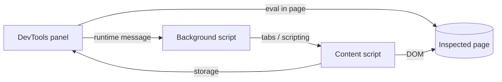

# Toolbar browser extension

The extension gives the toolbar tools to a page without the floating toolbar.
It has two surfaces:

- **Popup**: opens from the extension button for the active tab.
- **DevTools panel**: a "PostHog" tab in DevTools for the inspected tab.

Both surfaces show `popup.html`.
The page checks for the DevTools API (`chrome.devtools`) to bind to the inspected tab instead of the active tab.

## Build and install

Build both browser folders from `frontend/`:

```sh
pnpm build:toolbar-extension        # one build
pnpm watch:toolbar-extension        # rebuild on change
```

The build writes `dist/toolbar-extension/chrome/` and `dist/toolbar-extension/firefox/`.
Only `manifest.json` is different between them.

### Chrome (116 or later)

1. Open `chrome://extensions` and turn on **Developer mode**.
2. Click **Load unpacked** and select `frontend/dist/toolbar-extension/chrome`.
3. Pin the extension to use the popup.
4. Open DevTools on your site and select the **PostHog** tab. Close and open DevTools again after you install or reload the extension.

After a rebuild, click the reload icon on the extension card, then reopen the popup or DevTools.

### Firefox (128 or later)

1. Open `about:debugging#/runtime/this-firefox`.
2. Click **Load Temporary Add-on** and select `frontend/dist/toolbar-extension/firefox/manifest.json`.
3. Open DevTools on your site and select the **PostHog** tab.

Firefox removes a temporary add-on when it quits.
Firefox can leave Manifest V3 host permissions off after install.
If the popup asks for access to PostHog, turn on the PostHog hosts in `about:addons` > PostHog toolbar > **Permissions**.

## Permissions

| Permission                                                         | Why                                                                               |
| ------------------------------------------------------------------ | --------------------------------------------------------------------------------- |
| `activeTab`                                                        | Reads the tab URL and runs scripts in the tab after the user opens the popup.     |
| `scripting`                                                        | Injects the content script and runs flag overrides in the page.                   |
| `storage`                                                          | Saves the PostHog host and the selected element.                                  |
| `https://us.posthog.com/*`, `https://eu.posthog.com/*`             | Calls the PostHog API with your PostHog login on Cloud.                           |
| Optional `https://*/*`, `http://localhost/*`, `http://127.0.0.1/*` | Asked for at runtime for a self-hosted PostHog host, or for a site from DevTools. |

The DevTools panel adds no permission.

### Site access from DevTools

`activeTab` applies only to the popup.
DevTools doesn't grant it, so the panel can't inject the content script without access to the site.

| Tool                         | Needs site access from DevTools     |
| ---------------------------- | ----------------------------------- |
| Feature flag overrides       | No. DevTools runs them in the page. |
| Heatmap                      | Yes                                 |
| Select an element            | Yes                                 |
| Use inspected element (`$0`) | Yes                                 |

When the panel can't reach the site, it says so.
Give access in one of these ways:

- Open the popup on that tab once. `activeTab` then covers the tab until it loads a new page.
- Click **Allow on this site** in the panel, if the browser shows the prompt there.
- Set the site access of the extension to this site in the browser's extensions menu.

## How the DevTools panel works



- Firefox gives DevTools pages only the content script set of extension APIs, so the panel can't call `tabs` or `scripting` there.
  The panel sends content commands to the background script, which runs them in the inspected tab.
  The panel uses the same path in Chrome.
- `devtools.inspectedWindow.eval` reads the page URL and runs the flag overrides in the page's world.
- **Use inspected element** arms the content script for one event.
  Then the panel dispatches that event on `$0` from the page's world.
  The content script builds the action step from the element and stores it, as for an element picked on the page.
- **Create action** opens the new action page in PostHog with the selected element as its step.
- The panel follows the inspected tab when it loads a new page.

## Check the flows by hand

Use a site in the project's authorized URLs. Do these steps in Chrome and in Firefox.

1. Popup: open it on the site. Turn on the heatmap, select an element, and set a flag override.
2. DevTools without site access: open the **PostHog** tab and click **Use inspected element**. The panel says that it can't reach the site.
3. Give site access, select an element in the Elements panel, and click **Use inspected element**. The element shows a highlight on the page, and the panel shows its selector.
4. Click **Create action**. PostHog opens a new action with that selector.
5. Set a flag override from the panel and reload the page. The override stays.
6. Go to another page of the site. The panel shows the tools for the new page.
