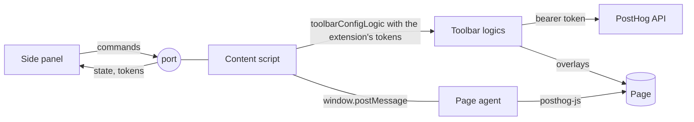

# Toolbar browser extension

The extension gives the toolbar tools to a page without the floating toolbar.
It opens from the extension button as a side panel in Chrome, and shows `panel.html`.
The panel follows the active tab of its window.

## Build and install

Build it from `frontend/`:

```sh
pnpm build:toolbar-extension        # one build
pnpm watch:toolbar-extension        # rebuild on change
```

The build writes `dist/toolbar-extension/chrome/`, and zips it into `dist/toolbar-extension/posthog-toolbar-chrome-<version>.zip` for the Chrome Web Store.

A pull request that changes the extension runs the "Toolbar extension" workflow.
Download the `toolbar-extension` artifact from the run to install that build without building it yourself.

The extension needs Chrome 116 or later.

1. Open `chrome://extensions` and turn on **Developer mode**.
2. Click **Load unpacked** and select `frontend/dist/toolbar-extension/chrome`, or the unzipped folder from the artifact.
3. Pin the extension, then click its button to open the side panel.

After a rebuild, click the reload icon on the extension card, then close and open the side panel.

## Permissions

| Permission                  | Why                                                                                                                                                                                                  |
| --------------------------- | ---------------------------------------------------------------------------------------------------------------------------------------------------------------------------------------------------- |
| `http://*/*`, `https://*/*` | The side panel reads the URL of the active tab and runs scripts in it when the user switches tabs. The same grant calls the PostHog API with your PostHog login, on Cloud and on a self-hosted host. |
| `scripting`                 | Injects the content script, and reads the page's posthog-js settings in the page's world.                                                                                                            |
| `storage`                   | Saves the PostHog host and the toolbar's OAuth tokens for each project.                                                                                                                              |
| `sidePanel`                 | Shows the side panel.                                                                                                                                                                                |

The manifest also lists `content.css` and its fonts in `web_accessible_resources`, because the content script links them into its shadow root on the page.

### Site access

Chrome lets the user take site access back from an extension.
When the extension can't reach the PostHog host, the panel asks for access to it.
When it can't reach the site, the panel asks the user to reload the page and try again.

## Data collection

The Chrome Web Store asks what data the extension sends, in the item's privacy tab.
Update the answers there when the extension starts to send new data.

| Category                   | What the extension sends                                                                                                                       | Where                     |
| -------------------------- | ---------------------------------------------------------------------------------------------------------------------------------------------- | ------------------------- |
| Authentication information | The PostHog session cookie, and the OAuth code, PKCE verifier and access and refresh tokens of the toolbar sign-in.                            | The user's PostHog host   |
| Web history                | The active tab's URL, when the panel connects the toolbar to a project and when it loads heatmap and web vitals data for the page.             | The user's PostHog host   |
| Website content            | Element selectors and text in a saved action, variant HTML in a saved experiment, and page screenshots in a saved heatmap or event screenshot. | The user's PostHog host   |
| User activity              | Usage events from the panel, such as the tools the user opens, with the user's PostHog distinct ID.                                            | PostHog's usage analytics |

The content script never sends usage events or logs, because it mounts the toolbar without `instrument`.

## Releases

The extension's version lives in `release/package.json`, which isn't an npm package. `release/CHANGELOG.md` lists what each version changed.
The "Release toolbar extension" workflow (`.github/workflows/release-toolbar-extension.yml`) bumps them from [Sampo](https://github.com/bruits/sampo) changesets and submits the build to the Chrome Web Store.

When a pull request changes what the extension does, add a changeset to it from `frontend/src/toolbar/extension/release/`:

```sh
sampo add --package npm/@posthog/toolbar-extension --bump patch --message "Describe the change for the changelog"
```

Use `minor` or `major` instead of `patch` when it fits, and commit the new file in `release/.sampo/changesets/`. Install the CLI with `cargo install sampo --locked`.

After the pull request merges, the workflow:

1. Posts in the client libraries approvals channel on Slack, and waits for a reviewer of the `Release toolbar extension` environment to approve the run. The Slack thread follows the release pull request.
2. Opens a release pull request that bumps `release/package.json`, adds the changesets to the changelog and deletes them.
3. Approves that pull request with the release app and sends it to the merge queue.

When the release pull request merges, the workflow runs again:

4. It builds the extension from the merge commit and checks that the manifest has the new version.
5. It uploads the zip to the Chrome Web Store and submits it for review. Chrome publishes it when the review passes.
6. It creates the `toolbar-extension/vX.Y.Z` GitHub release with the zip.
7. It replies in the Slack approval thread that the version went to the store. It finds the thread through a hidden marker in the release pull request body.

An approval whose changesets another run already released gets a "superseded" reply in its thread.

Changesets that land while a release is open go into the next release.
Never edit the version or the changelog by hand.
To retry a failed publish, run the workflow from `master` with the merge commit of the release pull request.
If the failed run already uploaded the zip, also check `skip_upload`, because the store doesn't take the same version twice.
Publishes run one at a time. A release that waits behind another is skipped when a newer one replaces it, because the newer version carries its changes.

### Setup

The workflow needs two GitHub environments:

- `Release toolbar extension`, with required reviewers. It approves each release, and the workflow refuses to release while it has none.
- `chrome-web-store`, limited to the `master` branch, with these variables:

| Variable                                      | Value                                                                                |
| --------------------------------------------- | ------------------------------------------------------------------------------------ |
| `CHROME_WEB_STORE_PUBLISHER_ID`               | The ID in **Publisher > Settings** of the Chrome Web Store developer dashboard       |
| `CHROME_WEB_STORE_ITEM_ID`                    | The extension's ID, in its store URL                                                 |
| `CHROME_WEB_STORE_SERVICE_ACCOUNT`            | The email of a Google Cloud service account                                          |
| `CHROME_WEB_STORE_WORKLOAD_IDENTITY_PROVIDER` | The workload identity provider that lets this repository act as that service account |

The service account needs no Google Cloud roles. Add its email in the **Account** section of the developer dashboard, which lets it manage the publisher's items.
The Chrome Web Store API must be on in its Google Cloud project.
The workload identity provider trusts GitHub's OIDC tokens, and should accept only `PostHog/posthog` in the `chrome-web-store` environment.
Grant that principal `roles/iam.workloadIdentityUser` on the service account.

## Store listing images

`store-listing/images/` holds the images of the Chrome Web Store listing: five 1280×800 screenshots, the 440×280 small promo tile and the 1400×560 marquee promo tile.
They are 24-bit PNGs without alpha, which is what the store accepts.

`store-listing/generate.mjs` makes them. Run it from `frontend/` after a build:

```sh
pnpm build:toolbar-extension
node src/toolbar/extension/store-listing/generate.mjs [path/to/unpacked/extension]
```

The path defaults to `dist/toolbar-extension/chrome`. Point it at the unzipped release build to show exactly what the store item ships.

The first screenshot is the marquee design at 1280×800.
Each of the other four shows the PostHog logo and a headline above a browser window, with a website on the left and the side panel on the right:

- The website comes from a capture of an invented site with the page tools running. The script downloads each capture from the `PostHog/pr-assets` repository and hides the old panel in it.
- The panel is a fresh render of the built `panel.html` with a fake `browser` API, like `ExtensionPanel.stories.tsx`. `store-listing/panelStates.mjs` holds the state of each tool, and it matches what the capture shows.

To change an image:

- **Headline, caption or order:** edit `SCREENSHOTS` in `generate.mjs`. The store shows the screenshots in the order you upload them, so keep the number in each file name.
- **Panel UI:** rebuild the extension and run the script again. A change to the state shape of a tool also needs an update in `panelStates.mjs`.
- **Tile color, tagline or hedgehog:** edit `TILE_COLOR`, `TILE_TAGLINE` or the `@posthog/brand` import in `generate.mjs`. The change applies to the first screenshot and both promo tiles.
- **Website side:** take a new capture with the extension on the site, upload it with `hogli pr:upload-image`, and replace the `capture` URL. A capture must be 1681×864 points at 2x, with a 44-point browser bar on top and the panel in the right 401 points.

Upload the new images to the store item by hand. The store doesn't take them from this folder.

## How the page tools work

The page tools run the floating toolbar's own logics in the content script, and draw its overlays in the content script's shadow root:

- `elementsLogic` for Inspect.
- `heatmapToolbarMenuLogic`, `heatmapDataLogic` and `heatmapCaptureLogic` for the heatmap.
- `actionsLogic` and `actionsTabLogic` for actions.
- `flagsToolbarLogic` and `flagComparisonLogic` for feature flags.
- `eventDebugMenuLogic` for the event debugger, and `webVitalsToolbarLogic` for web vitals.
- `screenshotUploadLogic` for screenshots for events.
- `experimentsLogic` and `experimentsTabLogic` for web experiments.

The panel shows their controls. It sends each command to the tool it belongs to, and gets their state back through a port.



- **Sign-in.** The panel calls PostHog with the PostHog session cookie for the checks it runs before the page tools.
  A session cookie sent from an extension page fails Django's CSRF origin check on writes, so the page tools use the toolbar's OAuth flow instead.
  When the panel first shows the tools for a project, it opens `/toolbar_oauth/authorize/` in a background tab with the page as the redirect.
  It reads the code from that tab's URL hash, closes the tab, and exchanges the code with its own PKCE verifier.
  The tokens are stored per PostHog host and project.
  If that fails, or the tokens expire again, the panel shows **Connect**, which runs the same flow in a tab the user can see.
- **Refresh.** The content script refreshes the tokens on a 401 like the floating toolbar does, and sends the new tokens to the panel to store.
- **Storage.** In extension mode `toolbarConfigLogic` doesn't read the page's URL hash or write the page's `localStorage`, so it leaves the floating toolbar's session on the page alone.
- **State.** Each tool's state is one memoized slice. The page posts only the slices that changed, at most every 100 ms, so a panel component re-renders only for its own tool.
- **posthog-js.** The content script can't reach the page's `window.posthog`, so the panel injects `page-agent.js` into the page's world with the content script.
  The content script asks the page agent for the page's posthog-js settings when the page tools start, and stands in for posthog-js with them.
  When a page loads posthog-js later, the page agent reports it, and the page tools start again with it.
  For flag overrides the page agent calls posthog-js and reports the flag state back. A change it doesn't answer fails after 5 seconds.
  The page agent also forwards each event posthog-js captures, for the event debugger and the web vitals of the page load, and reads the debug info.
- **Event debugger.** The debugger starts the first time the user opens it. The page keeps up to 5,000 events, like the floating toolbar.
  While the debugger is open, its slice carries the newest 200 rows the filters show, and the properties of the open event.
  The page agent sends the payload of `$snapshot` events only while the debugger shows them.
  **Export** downloads every filtered event from the page.
- **Forms.** The panel edits its own copy of the action and experiment forms, so typing doesn't wait for the page, and sends the form after a short pause.
  It sends a pending edit right away before any command that changes the form on the page, and takes the page's copy only when the page changed the form itself, for example when the user picks an element.
  The page counts the matches of the selectors the panel shows, and counts again when the page changes.
- **Experiments.** The page previews the open variant by changing its own DOM, and puts back the original HTML when the user closes the variant, leaves the experiment, saves it, or closes the tool, and when the page tools stop.
  An experiment selector must match in the document itself, because posthog-js applies web experiments with `document.querySelectorAll`, which doesn't look inside shadow roots.
- **Flag comparison.** The page captures itself with the flag off, then on or with each variant, and puts the overrides back.
  It sends the captures to the panel as JPEG data URLs in their own message, and refuses other flag changes until the comparison ends, since a second panel on the tab could send one.
  If the page unloads mid-comparison, the page agent puts the overrides back from the page's world, unless something else changed them during the comparison.
- **Injection.** The panel injects the content script on first use. The script answers a ping, so the panel doesn't inject it twice.
- **Navigation.** When a single-page app changes the URL, the port stays open and the page tools follow the new URL.
  A new document closes the port. The panel then connects again and turns the mode the user picked back on.
  The page tools stop 30 seconds after the last panel disconnects, so a quick reopen keeps their data.

## Check the flows by hand

Use a site in the project's authorized URLs.

1. Open the panel on the site. The panel connects the toolbar to the project: a tab opens and closes by itself.
2. Click the Inspect icon and hover an element. The panel shows its selector and actions. Click the element to keep it selected.
3. Click **Heatmap**. Check the clickmap counts, the heatmap canvas, the scroll depth type, **Filter to area**, **Load all**, and **Save to PostHog**.
4. Reload the page. The heatmap comes back.
5. In Inspect, select an element and click **Create action from this element**. Name the action, check the match count, and save it.
6. Click **Actions**, open an action, add an element with **Select Element**, and save.
7. Click **Flags**. Turn a flag on, pick a variant, save a payload, and turn a multivariate flag off. The page reacts to each change. Click **Clear overrides**.
8. Click the camera on a flag that changes the page. The panel shows the page before and after, and the overrides and payloads are the same as before. Compare a multivariate flag and switch variants. Reload the page during a comparison: the flag doesn't stay overridden. Compare on a page with an image from another site that doesn't send CORS headers: the comparison shows, without that image.
9. Open a page that doesn't load posthog-js as `window.posthog`. **Flags** says that it can't override flags there.
10. Switch to a tab with another site, then back. The panel shows the state of each tab.
11. Switch the project in the panel. The panel connects the toolbar to the new project.
12. Click **Events** and use the page. The events stream in. Open one, search, pause and resume, and export them.
13. Click **Web vitals**. The project's P90 metrics show, and the page load's metrics fill in as posthog-js reports them.
14. Click **More**. Check the debug info, open the current session recording, turn on **Hide PII on this page**, and add a screenshot to an event.
15. Click **Experiments** and open an experiment. Open a variant: the page shows it. Edit its HTML: the page changes as you type. Close the variant, then go back: the page shows its original state.
16. Create an experiment, pick an element for a transformation with **Select element**, edit it, and save it. Open a page whose snippet sets `disable_web_experiments`: **Experiments** shows a warning.
17. Switch the browser to dark mode. The panel follows it.
18. Open a new tab, or a site that isn't an authorized URL. The panel lists the project's authorized URLs. Click one: it opens in a new tab, and the panel stays open on it.
19. Open the PostHog app. The panel asks you to open your website, not to add the PostHog app to the authorized URLs.

## Future: Firefox

We might publish the extension on addons.mozilla.org (AMO) later. It is Chrome only for now, because AMO's review process blocks it:

- **Source upload.** AMO needs the source code of a bundled or minified add-on, as one archive of at most 200 MB.
  The whole repository is larger than that, so a release would need a trimmed archive that still builds the extension.
- **Identical rebuild.** AMO reviewers build the add-on from that archive and compare the result with the submitted file, and any difference fails the review.
  The extension build isn't reproducible across machines: the minified names in the shared chunks change with the absolute path of the source folder.
  A Firefox release has to be built from the source archive in a fixed folder, with instructions that pin the folder, Node and pnpm.

To bring Firefox back:

- [ ] Make the build output independent of the source folder path, or document a fixed build folder.
- [ ] Script a trimmed source archive under 200 MB, with build instructions, and check that it rebuilds the submitted zip byte for byte.
- [ ] Restore the Firefox manifest: `sidebar_action`, `background.scripts`, and `browser_specific_settings.gecko` with the add-on ID, `strict_min_version: '140.0'` and `data_collection_permissions`.
- [ ] Restore the `sidebarAction.toggle()` fallback in `openPanelFromToolbarButton`.
- [ ] Declare usage events as the optional `technicalAndInteraction` category, and send them only while the user allows it. Opt out again when the user revokes it.
- [ ] Add the Firefox folder and zip back to the build and the CI artifact.

`git log -S sidebar_action -- frontend/toolbar-config.mjs` finds the commits that had the Firefox build.
