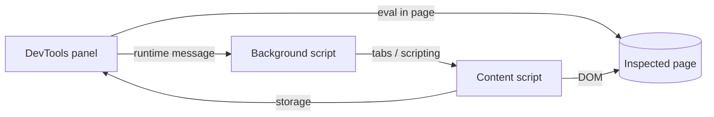

# Toolbar browser extension

The extension gives the toolbar tools to a page without the floating toolbar.
It has two surfaces:

- **Side panel**: opens from the extension button. Chrome shows it as a side panel and Firefox as a sidebar. It follows the active tab of its window.
- **DevTools panel**: a "PostHog" tab in DevTools for the inspected tab.

Both surfaces show `panel.html`.
The page checks for the DevTools API (`chrome.devtools`) to bind to the inspected tab instead of the active tab.

## Build and install

Build both browser folders from `frontend/`:

```sh
pnpm build:toolbar-extension        # one build
pnpm watch:toolbar-extension        # rebuild on change
```

The build writes `dist/toolbar-extension/chrome/` and `dist/toolbar-extension/firefox/`.
Only `manifest.json` is different between them.
It also zips each folder into `dist/toolbar-extension/posthog-toolbar-<browser>-<version>.zip`.

A pull request that changes the extension runs the "Toolbar extension" workflow.
Download the `toolbar-extension` artifact from the run to install that build without building it yourself.

### Chrome (116 or later)

1. Open `chrome://extensions` and turn on **Developer mode**.
2. Click **Load unpacked** and select `frontend/dist/toolbar-extension/chrome`, or the unzipped Chrome folder from the artifact.
3. Pin the extension, then click its button to open the side panel.
4. Open DevTools on your site and select the **PostHog** tab. Close and open DevTools again after you install or reload the extension.

After a rebuild, click the reload icon on the extension card, then close and open the side panel.

### Firefox (128 or later)

1. Open `about:debugging#/runtime/this-firefox`.
2. Click **Load Temporary Add-on** and select `frontend/dist/toolbar-extension/firefox/manifest.json`, or the Firefox zip from the artifact.
3. Click the extension button to open the sidebar.
4. Open DevTools on your site and select the **PostHog** tab.

Firefox removes a temporary add-on when it quits.
A permanent install needs an add-on signed by addons.mozilla.org.

## Permissions

| Permission                  | Why                                                                                                                                                                                                  |
| --------------------------- | ---------------------------------------------------------------------------------------------------------------------------------------------------------------------------------------------------- |
| `http://*/*`, `https://*/*` | The side panel reads the URL of the active tab and runs scripts in it when the user switches tabs. The same grant calls the PostHog API with your PostHog login, on Cloud and on a self-hosted host. |
| `scripting`                 | Injects the content script and runs flag overrides in the page.                                                                                                                                      |
| `storage`                   | Saves the PostHog host and the selected element.                                                                                                                                                     |
| `sidePanel` (Chrome)        | Shows the side panel.                                                                                                                                                                                |

The DevTools panel adds no permission.

### Site access

Both browsers let the user take site access back from an extension.
When the extension can't reach the PostHog host, the panel asks for access to it.
When the DevTools panel can't reach the site, it says so and offers **Allow on this site**, if the browser shows the prompt there.

## How the DevTools panel works



- Firefox gives DevTools pages only the content script set of extension APIs, so the panel can't call `tabs` or `scripting` there.
  The panel sends content commands to the background script, which runs them in the inspected tab.
  The panel uses the same path in Chrome.
- `devtools.inspectedWindow.eval` reads the page URL and runs the flag overrides in the page's world.
- **Use inspected element** arms the content script for one event.
  Then the panel dispatches that event on `$0` from the page's world.
  The content script builds the action step from the element and stores it, as for an element picked on the page.
- **Create action** opens the new action page in PostHog with the selected element as its step.
- The panel follows the inspected tab when it loads a new page.

## Check the flows by hand

Use a site in the project's authorized URLs. Do these steps in Chrome and in Firefox.

1. Side panel: open it on the site. Turn on the heatmap, select an element, and set a flag override.
2. Switch to a tab with another site, then back. The panel shows the state of each tab.
3. Open DevTools, select an element in the Elements panel, and click **Use inspected element** in the **PostHog** tab. The element shows a highlight on the page, and the panel shows its selector.
4. Click **Create action**. PostHog opens a new action with that selector.
5. Set a flag override from the panel and reload the page. The override stays.
6. Go to another page of the site. Both panels show the tools for the new page.
