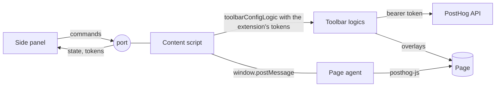

# Toolbar browser extension

The extension gives the toolbar tools to a page without the floating toolbar.
It opens from the extension button as a side panel in Chrome and as a sidebar in Firefox, and shows `panel.html`.
The panel follows the active tab of its window.

## Build and install

Build both browser folders from `frontend/`:

```sh
pnpm build:toolbar-extension        # one build
pnpm watch:toolbar-extension        # rebuild on change
```

The build writes `dist/toolbar-extension/chrome/` and `dist/toolbar-extension/firefox/`.
Only `manifest.json` is different between them.
It also zips each folder into `dist/toolbar-extension/posthog-toolbar-<browser>-<version>.zip`.

A pull request that changes the extension runs the "Toolbar extension" workflow.
Download the `toolbar-extension` artifact from the run to install that build without building it yourself.

### Chrome (116 or later)

1. Open `chrome://extensions` and turn on **Developer mode**.
2. Click **Load unpacked** and select `frontend/dist/toolbar-extension/chrome`, or the unzipped Chrome folder from the artifact.
3. Pin the extension, then click its button to open the side panel.

After a rebuild, click the reload icon on the extension card, then close and open the side panel.

### Firefox (140 or later)

1. Open `about:debugging#/runtime/this-firefox`.
2. Click **Load Temporary Add-on** and select `frontend/dist/toolbar-extension/firefox/manifest.json`, or the Firefox zip from the artifact.
3. Click the extension button to open the sidebar.

Firefox removes a temporary add-on when it quits.
A permanent install needs an add-on signed by addons.mozilla.org.

## Permissions

| Permission                  | Why                                                                                                                                                                                                  |
| --------------------------- | ---------------------------------------------------------------------------------------------------------------------------------------------------------------------------------------------------- |
| `http://*/*`, `https://*/*` | The side panel reads the URL of the active tab and runs scripts in it when the user switches tabs. The same grant calls the PostHog API with your PostHog login, on Cloud and on a self-hosted host. |
| `scripting`                 | Injects the content script, and reads the page's posthog-js settings in the page's world.                                                                                                            |
| `storage`                   | Saves the PostHog host and the toolbar's OAuth tokens for each project.                                                                                                                              |
| `sidePanel` (Chrome)        | Shows the side panel.                                                                                                                                                                                |

The manifest also lists `content.css` and its fonts in `web_accessible_resources`, because the content script links them into its shadow root on the page.

### Site access

Both browsers let the user take site access back from an extension.
When the extension can't reach the PostHog host, the panel asks for access to it.
When it can't reach the site, the panel asks the user to reload the page and try again.

## Data collection

Firefox shows the extension's data collection at install, from `data_collection_permissions` in the Firefox manifest (`buildToolbarExtensionManifest` in `frontend/toolbar-config.mjs`).
The Chrome Web Store asks for the same facts in the item's privacy tab.
Update both when the extension starts to send new data.

| Category                             | What the extension sends                                                                                                                       | Where                     |
| ------------------------------------ | ---------------------------------------------------------------------------------------------------------------------------------------------- | ------------------------- |
| `authenticationInfo` (required)      | The PostHog session cookie, and the OAuth code, PKCE verifier and access and refresh tokens of the toolbar sign-in.                            | The user's PostHog host   |
| `browsingActivity` (required)        | The active tab's URL, when the panel connects the toolbar to a project and when it loads heatmap and web vitals data for the page.             | The user's PostHog host   |
| `websiteContent` (required)          | Element selectors and text in a saved action, variant HTML in a saved experiment, and page screenshots in a saved heatmap or event screenshot. | The user's PostHog host   |
| `technicalAndInteraction` (optional) | Usage events from the panel, such as the tools the user opens, with the user's PostHog distinct ID.                                            | PostHog's usage analytics |

The panel sends usage events only when the user allows `technicalAndInteraction`.
Firefox lets the user change this in the add-on's settings, and the panel applies the change right away.
The content script never sends usage events or logs, because it mounts the toolbar without `instrument`.

## How the page tools work

The page tools run the floating toolbar's own logics in the content script, and draw its overlays in the content script's shadow root:

- `elementsLogic` for Inspect.
- `heatmapToolbarMenuLogic`, `heatmapDataLogic` and `heatmapCaptureLogic` for the heatmap.
- `actionsLogic` and `actionsTabLogic` for actions.
- `flagsToolbarLogic` for feature flags.
- `eventDebugMenuLogic` for the event debugger, and `webVitalsToolbarLogic` for web vitals.
- `screenshotUploadLogic` for screenshots for events.
- `experimentsLogic` and `experimentsTabLogic` for web experiments.

The panel shows their controls. It sends each command to the tool it belongs to, and gets their state back through a port.



- **Sign-in.** The panel calls PostHog with the PostHog session cookie for the checks it runs before the page tools.
  A session cookie sent from an extension page fails Django's CSRF origin check on writes, so the page tools use the toolbar's OAuth flow instead.
  When the panel first shows the tools for a project, it opens `/toolbar_oauth/authorize/` in a background tab with the page as the redirect.
  It reads the code from that tab's URL hash, closes the tab, and exchanges the code with its own PKCE verifier.
  The tokens are stored per PostHog host and project.
  If that fails, or the tokens expire again, the panel shows **Connect**, which runs the same flow in a tab the user can see.
- **Refresh.** The content script refreshes the tokens on a 401 like the floating toolbar does, and sends the new tokens to the panel to store.
- **Storage.** In extension mode `toolbarConfigLogic` doesn't read the page's URL hash or write the page's `localStorage`, so it leaves the floating toolbar's session on the page alone.
- **State.** Each tool's state is one memoized slice. The page posts only the slices that changed, at most every 100 ms, so a panel component re-renders only for its own tool.
- **posthog-js.** The content script can't reach the page's `window.posthog`, so the panel injects `page-agent.js` into the page's world with the content script.
  The content script asks the page agent for the page's posthog-js settings when the page tools start, and stands in for posthog-js with them.
  When a page loads posthog-js later, the page agent reports it, and the page tools start again with it.
  For flag overrides the page agent calls posthog-js and reports the flag state back. A change it doesn't answer fails after 5 seconds.
  The page agent also forwards each event posthog-js captures, for the event debugger and the web vitals of the page load, and reads the debug info.
- **Event debugger.** The debugger starts the first time the user opens it. The page keeps up to 5,000 events, like the floating toolbar.
  While the debugger is open, its slice carries the newest 200 rows the filters show, and the properties of the open event.
  The page agent sends the payload of `$snapshot` events only while the debugger shows them.
  **Export** downloads every filtered event from the page.
- **Forms.** The panel edits its own copy of the action and experiment forms, so typing doesn't wait for the page, and sends the form after a short pause.
  It sends a pending edit right away before any command that changes the form on the page, and takes the page's copy only when the page changed the form itself, for example when the user picks an element.
  The page counts the matches of the selectors the panel shows, and counts again when the page changes.
- **Experiments.** The page previews the open variant by changing its own DOM, and puts back the original HTML when the user closes the variant, leaves the experiment, saves it, or closes the tool, and when the page tools stop.
  An experiment selector must match in the document itself, because posthog-js applies web experiments with `document.querySelectorAll`, which doesn't look inside shadow roots.
- **Injection.** The panel injects the content script on first use. The script answers a ping, so the panel doesn't inject it twice.
- **Navigation.** When a single-page app changes the URL, the port stays open and the page tools follow the new URL.
  A new document closes the port. The panel then connects again and turns the mode the user picked back on.
  The page tools stop 30 seconds after the last panel disconnects, so a quick reopen keeps their data.

## Check the flows by hand

Use a site in the project's authorized URLs. Do these steps in Chrome and in Firefox.

1. Open the panel on the site. The panel connects the toolbar to the project: a tab opens and closes by itself.
2. Click the Inspect icon and hover an element. The panel shows its selector and actions. Click the element to keep it selected.
3. Click **Heatmap**. Check the clickmap counts, the heatmap canvas, the scroll depth type, **Filter to area**, **Load all**, and **Save to PostHog**.
4. Reload the page. The heatmap comes back.
5. In Inspect, select an element and click **Create action from this element**. Name the action, check the match count, and save it.
6. Click **Actions**, open an action, add an element with **Select Element**, and save.
7. Click **Flags**. Turn a flag on, pick a variant, save a payload, and turn a multivariate flag off. The page reacts to each change. Click **Clear overrides**.
8. Open a page that doesn't load posthog-js as `window.posthog`. **Flags** says that it can't override flags there.
9. Switch to a tab with another site, then back. The panel shows the state of each tab.
10. Switch the project in the panel. The panel connects the toolbar to the new project.
11. Click **Events** and use the page. The events stream in. Open one, search, pause and resume, and export them.
12. Click **Web vitals**. The project's P90 metrics show, and the page load's metrics fill in as posthog-js reports them.
13. Click **More**. Check the debug info, open the current session recording, turn on **Hide PII on this page**, and add a screenshot to an event.
14. Click **Experiments** and open an experiment. Open a variant: the page shows it. Edit its HTML: the page changes as you type. Close the variant, then go back: the page shows its original state.
15. Create an experiment, pick an element for a transformation with **Select element**, edit it, and save it. Open a page whose snippet sets `disable_web_experiments`: **Experiments** shows a warning.
16. Switch the browser to dark mode. The panel follows it.
