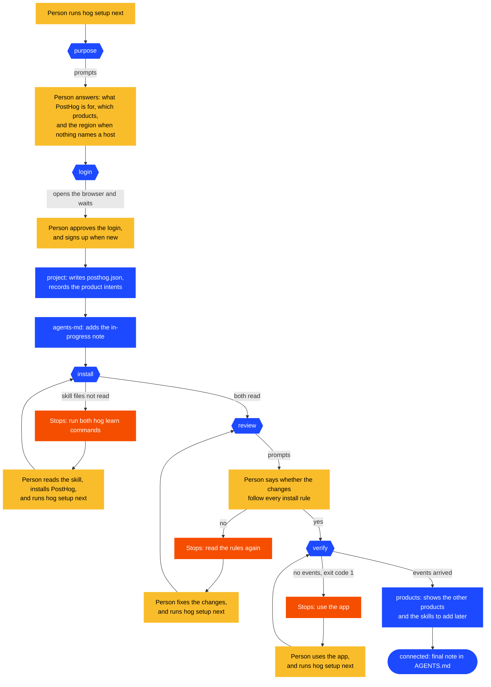
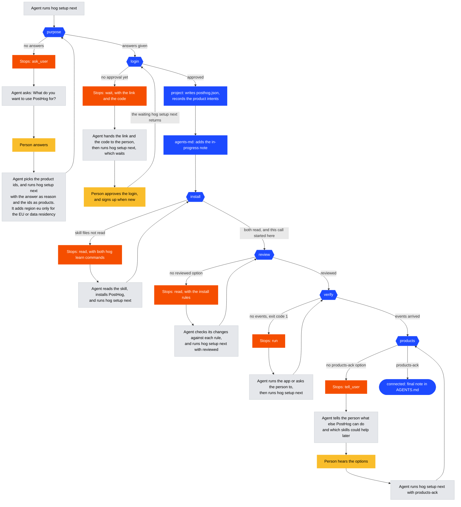

# `hog setup`

`run.ts` runs the steps in order, and each step lives in its own file under `steps/`.
A step is done, does its work, or stops with the next action: what the person or the agent does before the next `hog setup next`.
`hog setup` only describes the current step, and `hog setup next` keeps going until a step stops.

The rule for every step: an option counts as an answer as soon as it is given, and a prompt at a terminal asks only for the answers the options left out.
The install step has no option, so it ends only on a `hog setup next` that started on it, which means the agent always reads its instructions first.

| File              | Holds                                                                     |
| ----------------- | ------------------------------------------------------------------------- |
| `run.ts`          | The step order, the loop, and the summary of a connected folder           |
| `setup-run.ts`    | `SetupRun`, what one call knows: the folder, its login, the products      |
| `result.ts`       | The result types, which the agent reads as JSON                           |
| `state.ts`        | The state file each folder keeps in `~/.posthog/setup/`                   |
| `products.ts`     | The product table that `--products` picks from                            |
| `agents-md.ts`    | The note in `AGENTS.md` and `CLAUDE.md`                                   |
| `steps/<step>.ts` | One step each: `purpose`, `login`, `project`, `agents-md`, `install`, ... |

In the diagrams, blue is the CLI doing a step on its own, red is the CLI stopping with the next action, yellow is the person, and gray is the agent.

## A person at a terminal

## A person with an agent

The agent runs every command. The person answers one question, approves the login, and hears what else PostHog can do.

