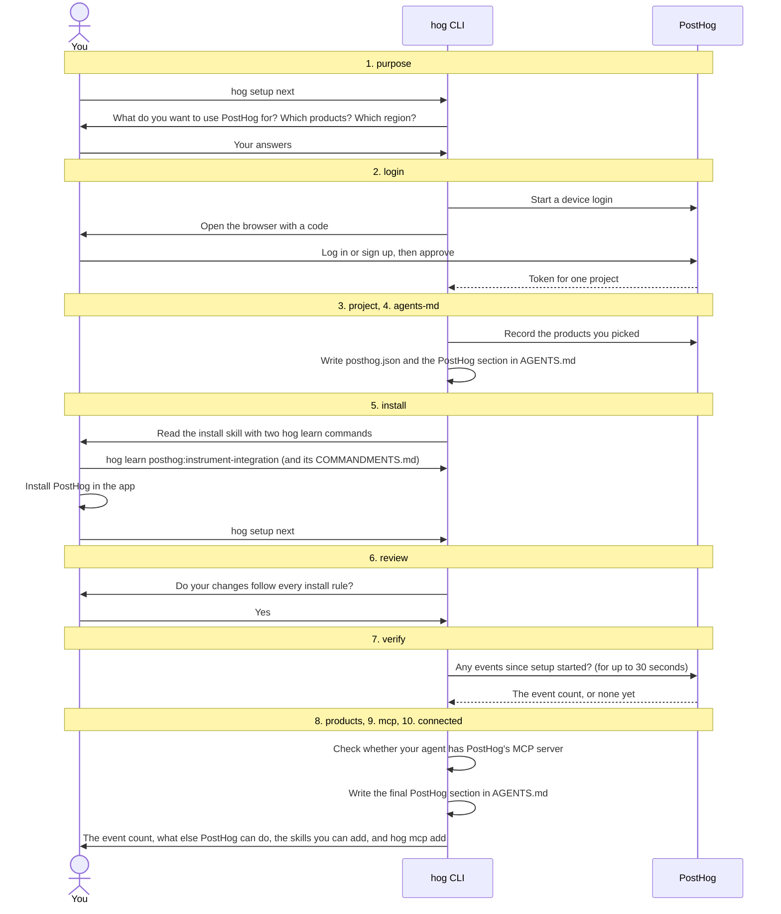
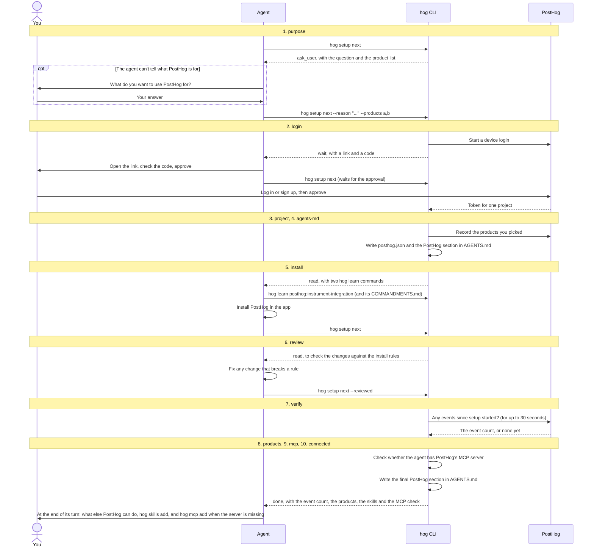

# `hog setup`

`run.ts` runs the steps in order. Each step has its own file under `steps/`, numbered in that order.
A step is either done, does its work, or stops with the next action: what you or the agent do before the next `hog setup next`.
`hog setup` only describes the current step, and `hog setup next` keeps going until a step stops.

The rule for every step: an option counts as an answer as soon as it is given, and a prompt at a terminal asks only for the answers the options left out.
The install step has no option, so it ends only on a `hog setup next` that started on it, which means the agent always reads its instructions first.

| File                   | Holds                                                                                         |
| ---------------------- | --------------------------------------------------------------------------------------------- |
| `run.ts`               | The step order, the loop, and the summary of a connected folder                               |
| `setup-run.ts`         | `SetupRun`, what one call knows: the folder, its login, the products                          |
| `result.ts`            | The result types, which the agent reads as JSON                                               |
| `state.ts`             | The state file each folder keeps in `~/.posthog/setup/`                                       |
| `products.ts`          | The product table that `--products` picks from                                                |
| `agents-md.ts`         | The PostHog section in `AGENTS.md` and `CLAUDE.md`                                            |
| `steps/<nn>-<step>.ts` | One step each, in the order of `STEP_IDS` in `state.ts`: `01-purpose.ts` to `10-connected.ts` |

The diagrams show who talks to whom in each step. The numbers match the files in `steps/`.

## You at a terminal

You run every command, and `hog` asks its questions as prompts.

## You with a coding agent

The agent runs every command. It asks you what PostHog is for only when it can't tell, you approve the login, and it tells you what else PostHog can do at the end of its turn.

