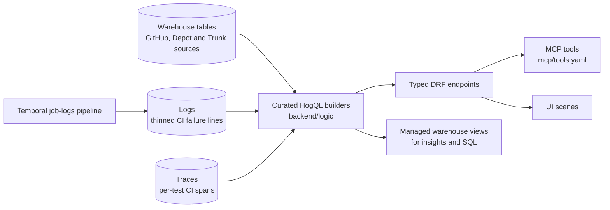

# Engineering analytics

Owner: team-devex. The engineering contract is [SPEC.md](./SPEC.md).

## What it is

Engineering analytics measures what happens to a pull request between open and production: CI, review, merge, and deploy.
It reads GitHub data the team already syncs into the data warehouse, plus CI failure logs and per-test CI spans.
Typed endpoints serve the results to the in-app UI and to MCP tools.

Engineers use the UI or an agent, and PostHog Desktop calls the same tools.

## The system

- The job-logs pipeline fetches the logs of failed jobs, and of jobs that passed only after a pytest retry.
- The Tests tab lists every test that Trunk quarantines, grouped by the team that owns the test file today.
- The flaky-test and broken-test queues are endpoints and MCP tools. The weekly Slack report (`.github/workflows/weekly-flaky-report.yml`) reads the flaky-test endpoint.

## Access and writes

- Every endpoint requires the `engineering-analytics` feature flag and the `engineering_analytics` API scope.
- `logic/sources.py` applies the requesting user's warehouse access to each source.
- A team enrolls when a user opens the product with a GitHub source connected. Background work runs only for enrolled teams.
- Three endpoints write. `enable` enrolls the team. `update_ci_signals_config` turns CI Signals on or off. `quarantine/request` opens a tracking issue and a pull request against the repository's `.test_quarantine.json`, through the team's GitHub App.
- `quarantine/request` has no UI and no MCP tool. Callers reach it through the API.

## CI Signals

The product turns CI conditions into [Signals](../signals) for PostHog Desktop to act on.
`logic/signals/detectors.py` defines three: a flaky check, a broken default branch, and a CI duration regression.
A team opts in to CI Signals separately from the product.

## The data boundary

| Question                                                                     | Source                                                      |
| ---------------------------------------------------------------------------- | ----------------------------------------------------------- |
| CI and job durations, queue time, cost, failure logs, flaky and broken tests | Warehouse, Logs and Traces                                  |
| Open to merge time (`open_to_merge_seconds`)                                 | `github_pull_requests` snapshot                             |
| Ready to merge time (`ready_to_merge_seconds`), draft and ready transitions  | `github_issue_events` (a bounded window that grows forward) |
| Approvals and review submissions                                             | `github_reviews`                                            |
| Deploys and DORA                                                             | `github_deployments` and `github_deployment_statuses`       |
| Quarantined tests                                                            | Trunk source                                                |
| Depot CI runs and jobs                                                       | Depot source (`depot_job_attempts`)                         |

The product needs `pull_requests` and `workflow_runs`. Every other table is optional, and a read returns no data for a table the team has not synced.

The pull request snapshot overwrites state on each update, so it cannot give the time of a transition.
Transition timing comes from the append-only tables: issue events, reviews and deployment statuses.
The DORA failure figures have no incident link, so they are deploy-status proxies with names that say so, such as `failed_deployment_share`.

## Locked decisions

Change a locked decision only in a separate pull request that gives a written reason.
The engineering decisions live in [SPEC.md](./SPEC.md) §6, Locked decisions.
The product decisions are these:

- The product serves the DevEx team's own use on `PostHog/posthog`, and PostHog Desktop's view of CI, review, merge and deploy.
- The goal is CI Signals that PostHog Desktop can act on. Ready-for-review to merge time is the headline metric.
- The unit of value is the open pull request. Draft and ready-for-review are separate phases.
- The UI and the MCP tools call one endpoint set.
- The product has no saved views and no stored filters.
- The product never ranks developers by delivery performance, and it has no leaderboard. SPEC §2 and §6 define what author pages, team pages and friction scores may show.
- The product is a model for other products in this repository. SPEC §1 states the design rules it must keep.
- An author is `Author{handle, display_name, avatar_url, is_bot}`. The product does not map an author to a PostHog user.
- The product does not ingest pull request lifecycle events. Transitions that no synced table records stay unmeasured.
