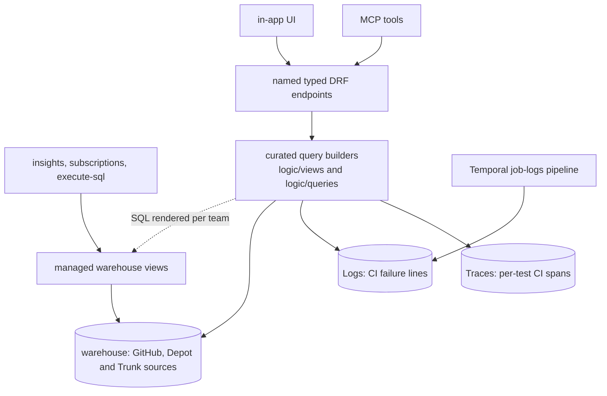

# engineering_analytics: engineering spec

Owner: team-devex.
Read [README.md](./README.md) first for the product picture.
This file is the engineering contract: the architecture rules, the locked decisions, and the constraints of each data source.

## 1. Purpose

The product answers questions about pull requests and CI through named, typed endpoints.
Each endpoint runs curated HogQL over the warehouse tables of the team's GitHub, Depot and Trunk sources, and over Logs and Traces.
The in-app UI and the MCP tools call the same endpoints.

Reads are the product.
Three endpoints write: `enable` enrolls the team, the CI Signals config update turns Signals on or off, and the test quarantine request files an issue and a pull request through the team's GitHub App.

CI Signals for PostHog Desktop are the goal (see the README).
Signal detection is defined once in `logic/` over the read layer, so the emitter and the endpoints share one definition.

### What must stay true

Three properties outrank any single feature. Reject a change that weakens one of them.

- The product never ranks engineers. It measures what the delivery pipeline costs people, and it has no leaderboard of output or speed (§2, §6).
- The code follows "A Philosophy of Software Design".
  - A module hides a decision behind a small interface. `logic/` holds each domain rule once, and callers never repeat it.
  - Complexity moves down into the builders. An endpoint, a tool or a component stays thin.
  - An interface makes the wrong call impossible where it can. Do not add a flag that a caller must pair with a second call.
  - A pass-through method, a duplicated rule or a rule that leaks into a consumer is a defect to fix, not a style note.
- The product is a model for other products in this repository, because the DevEx team owns both.
  - It is isolated: other code imports only `backend/facade/`, and `backend:contract-check` enforces that.
  - It follows every repository guide in `.agents/` and every skill that `AGENTS.md` at the root requires, with no local exemption.
  - When a repository rule and this product disagree, change the product, or change the rule in its own PR.

## 2. Non-goals

- The product never rates a developer's performance.
  - No read ranks, scores or lists people by output or delivery speed.
  - A read returns another author's delivery figures only when the caller named that author.
- Friction is not performance, so a read may score and order the friction that developers meet.
  - Friction covers red CI the author did not cause, re-runs that failed again, merge-queue kickouts, review waits and rework.
  - A friction figure is a mean per pull request, so shipping more or faster does not raise it.
  - Friction reads one fixed 30-day window of merged pull requests, whatever the date picker says.
  - `logic/friction.py` defines the friction inputs once.
- The author page is allowed. It shows one author's figures next to the same figures for the repository and for the author's team.
  - A team figure is always an aggregate and never a member's figure.
  - A team figure appears only when at least two other authors contribute a value to it. This is a noise floor and not a privacy floor.
- The product does not send real-time alerts about individual pull requests.
- The product does not replace GitHub's own UI.
- The product does not do static analysis of code quality.

## 3. Architecture

Every consumer composes one curated read layer.
The curated query builders hold all domain knowledge once.
The endpoints, the MCP tools and the UI are thin consumers above them.

Follow these rules when you add or change a capability.

- Define domain knowledge once, in `logic/`. An endpoint, a tool or the UI never re-derives bot detection, attribution joins, metric names or default exclusions.
- Never hardcode a warehouse table name. The user chooses the source prefix, so `logic/sources.py` resolves the tables per team and repository.
- Never add a table or view to the global HogQL database. The builders run as subqueries through `execute_hogql_query`, so other teams' queries never load this product.
- Serve every consumer from one endpoint set. A capability is a named endpoint that returns `facade/contracts.py` types, and the UI runs no HogQL of its own.
- Decide the endpoint's `mcp/tools.yaml` entry in the same PR that adds the endpoint.
- Update the matching skill in `skills/` when the tools change. The skills teach tool selection and carry the metric caveats.

## 4. Contract types

`backend/facade/contracts.py` defines every return type as a frozen `pydantic.dataclasses.dataclass`.
The module imports no Django models.
Every endpoint returns these contracts, and no endpoint returns untyped rows.

Field names carry the caveats.
`open_to_merge_seconds` is never called `cycle_time`.
Where a caveat changes how a caller must read a figure, the contract adds a typed `metric_quality` field.

## 5. Read layer, endpoints and warehouse views

### Curated read layer

`logic/views/` holds one `build_query()` builder per source table.
The query modules in `logic/queries/` embed those builders as subqueries through `_curated`.
Warehouse columns land as strings and Nullable JSON, so the builders parse and guard them.
`logic/views/source_schema.py` mirrors the landed types.

### Endpoints

The endpoint catalog is the `presentation/views/` package.
Every endpoint follows the same practices.

- A time window is `date_from` and `date_to`, each relative (`-30d`) or ISO 8601.
- A capped list that sits next to an aggregate reports `truncated` and `limit`, so a caller can see an undercount.
- A read over span data reports absolute counts and never rates. CI emits no span for most passing tests, so a rate has a biased denominator.
- Test evidence is counted per CI run, never per span or per run attempt. `run_evidence()` in `logic/queries/_test_spans.py` defines that grain for every span read.
- A CI setup break is not test evidence, so `run_evidence()` drops attempts whose failures spread across many jobs or teams.
- A test is `confirmed_flake` only with proof of recovery on the same commit. A failure without that proof is `suspected_regression`.
- A read over optional data degrades to a typed empty answer such as `has_membership_data: false`. It never returns a 500.
- `logic/reverts.py` recognizes a reverting pull request by its title, because GitHub records no link from a revert to the change it undid.
- The list reads cache a pull request's lifetime cost for 5 minutes, and CI status stays live.
  - The cache key carries a hash of the cost query, so a change to the query, the prices or the tables starts a new cache.
  - A cached value is served only when the reader's HogQL catalog grants every table that the query reads.
- A run or job lookup accepts `ci_engine`. An integer id that exists in both engines fails with a 400 until the caller names the engine.

### Exposed warehouse views

Each enrolled team gets managed views (`DataWarehouseSavedQuery` rows in the `engineering_analytics` managed viewset).
They let insights, subscriptions, other products and `execute-sql` query the curated CI data.

The team's managed viewset row is its opt-in.
The `enable` endpoint creates it when a user opens the product, and no background job creates it.
Every background job of this product runs only for enrolled teams, through `logic/enrollment.py`.

A team gets the views only when one GitHub source has both `workflow_runs` and `workflow_jobs` synced.
The three per-job views are not materialized.
Data modeling stores their rendered SQL per team and syncs it again after each load.

The three materialized views spend the team's warehouse compute.
They exist only for teams that the `engineering-analytics-friction` flag targets.
When the flag service gives no answer, the sync keeps the views that the team already has.

| View                                   | Grain                                             | Key or join rule                                     |
| -------------------------------------- | ------------------------------------------------- | ---------------------------------------------------- |
| `engineering_analytics_job_costs`      | One row per job attempt                           | Joins jobs to runs on `(ci_engine, run_id)`          |
| `engineering_analytics_ci_job_history` | One row per job attempt, with commit attribution  | Joins jobs to runs on `(ci_engine, run_id)`          |
| `engineering_analytics_ci_failures`    | One row per pytest `FAILED <nodeid>` line in Logs | Groups on `fingerprint`                              |
| `engineering_analytics_pr_friction`    | One row per pull request merged in 30 days        | Carries `source_id`                                  |
| `engineering_analytics_ci_runs`        | One row per run, stored                           | `(source_id, ci_engine, id)`                         |
| `engineering_analytics_ci_jobs`        | One row per job attempt, stored                   | `(source_id, ci_engine, native_job_id, run_attempt)` |

These rules hold for the per-job views.

- The jobs-to-runs join never includes `run_attempt`. The runs table keeps only the newest attempt's row, so an attempt match would blank attribution for every earlier attempt.
- A NULL cost is never shown as zero. `provider`, `completed_at` and `is_rerun_copy` say why the cost is NULL.
- `logic/cost.py` defines cost once and renders it to HogQL. The endpoint cost queries read the same rendered SELECT.
- `is_merge_queue` separates merge-queue gate spend, so no consumer matches a branch name.
- The column order of `ci_job_history` is a contract. Append columns and never reorder them.
- The views carry no scan floor. Bound `created_at`, and add a coarse `created_at_raw >= '<YYYY-MM-DD>'` floor, because only the raw column prunes the parquet scan.

These rules hold for the friction view.

- The view counts friction and does not score it. A read applies curves and weights, so a weight change needs no new materialization.
- `kickout_count` counts gate attempts where any workflow run failed. The source does not record which checks are required, so the count is an upper bound.
- The view unions every GitHub source of the team, and each row carries `source_id`. A product read filters on the one source that the caller may use.

These rules hold for the stored CI rows (`logic/views/ci_rows.py`, `logic/views/incremental_floor.py`, `logic/materialized_ci.py`).

- Data modeling updates the two views in place every 15 minutes. Each run reads the rows created since two days before the newest stored row.
- The two grains are joined at read time on `(ci_engine, run_id)`. A re-run changes the run row, so a stored joined row would go stale.
- `is_handoff_shell` is a flag on both stored grains, and the read that uses the stored rows filters on it (§6).
- Historical aggregates and cost reads use the stored rows only when both views are ready. Each view's newest build must be at most 30 minutes old and must match the current definition.
- The reader checks permission on the raw sources and on both views, then filters on source and repository. A failed check sends the read back to the raw tables.
- The stored rows serve a read only when its window starts at least nine days after the coverage start of the newest full build. An unbounded read uses the raw tables.
- Current CI status, single-run detail, single-PR detail and raw job steps always read the raw tables.

## 6. Locked decisions

These are the engineering decisions.
The product decisions are in README, under "Locked decisions".
Change a decision only in a separate PR with a written reason.

- CI is linked to a pull request by PR number, never by head SHA. The PR snapshot keeps only the current head, so a head-SHA join drops every earlier push.
  - `pr_number` is the first entry of the run's `pull_requests` association, and the `workflow_runs` builder defines it once.
  - Only entries whose `base.repo.id` equals the run's `repository.id` count. GitHub also lists pull requests from forks that share the head SHA.
  - `head_branch` is the fallback for runs without an association, such as fork runs. Branches are reused, so a branch-keyed read must be time-bounded.
  - Consumers read `pr_number` first and fall back to `commit_pr_number`.
- The first sanctioned exception is `commit_pr_number`, the only attribution that a default-branch push has.
  - It joins the run's `head_sha` to a merged pull request's `merge_commit_sha`, which GitHub writes once at merge.
  - The join is gated on `merged_at`, because an open pull request carries a throwaway test-merge SHA in the same column.
  - The lookup keeps one row per SHA, because a non-unique key would multiply run rows.
  - It falls back to the `(#NNNN)` suffix of the head commit message when the PR snapshot has no matching row.
- The second sanctioned exception is a merge-queue gate run, which takes its `pr_number` from its branch name.
  - The run's association names the throwaway pull request that the queue opened. The branch name is immutable and names exactly one pull request.
- Merge-queue gate branches are CI artifacts and not work. `logic/merge_queue.py` defines them once.
  - A gate branch has the Trunk shape (`trunk-merge/pr-<n>/<id>`) or the GitHub queue shape, and the queue's bot pushed it.
  - The `pull_requests` builder drops gate pull requests, because they carry no diff and never merge.
  - A failure on a gate branch that never reached the default branch classifies as `blocking_merge_queue`.
  - Every gate metric reads one per-PR attempt rollup, which folds bisection probes into their parent attempt.
- Cost uses a billed clock, because Depot bills from the first step and not from `started_at`.
  - `billed_elapsed` is `duration_seconds` minus `provisioning_seconds`, clamped at zero.
  - `duration_seconds` stays the wall-clock time that GitHub reports. Only the cost columns read the billed clock.
- A re-run copy is flagged and never filtered in the builders or the exposed views. GitHub lists an already-passed job again under each later attempt, but that job did not run again.
  - The `workflow_jobs` builder sets `is_rerun_copy` when the same `(run_id, name, started_at, completed_at)` exists at a lower `run_attempt`.
  - Each consumer decides. Cost and per-job aggregates drop copies, and red or green reads keep them.
  - The flag comes from a duplicate-key join and never a window function, which would sort the whole scan in memory.
  - A windowed read floors both scans. The floor sits one day back when the read filters the job's `created_at`, and seven days back when it filters the run's start.
  - The seven days keep the earlier attempts of a re-run, whose job rows were created before the run's newest start.
- A read with no floor is scoped by run. The per-PR cost, push history and per-run job reads have no date bound, because a pull request's CI can predate it.
  - Such a read first resolves the run ids it needs, then bounds every raw scan to them (`_curated.scoped_to_run`, `_curated.scoped_to_pr_history`, `pr_rollup_query`).
- A successful CI hand-off shell is suppressed in the read layer, unlike a re-run copy. A shell ran no tests, so it would read as a false green run.
  - `logic/views/depot_ci.py` defines the detection rule once. Failed and unsettled relays stay visible.
  - A Depot workflow is a shell when it succeeded and its `wait-for-handoff` job ran alone.
  - A GitHub run is a shell when the run, its hand-off job and its latest `Django Tests Pass` job all succeeded, and no synced job attempt failed.
  - The GitHub rule also needs a successful Depot workflow that accepted the hand-off for the same PR number and `head_sha`. Missing data leaves the run visible.
- Workflow pass rate uses verdicts. `success` passes, and `failure`, `timed_out`, `startup_failure` and `stale` fail.
  - Every other outcome stays in run volume and out of the rate. `_workflow_filters.py` owns the classification.
- A push is one authored head commit that reached CI. All of a pull request's runs for one head SHA form one push, even when every workflow was skipped.
  - Merge-queue gate runs do not count, because the queue created their head SHA.
  - The push time is the earliest run creation time, or the run start when the creation time is missing.
- CI Signals use immutable evidence.
  - A flaky check needs job rows that show a failed attempt and a later successful attempt of the same job.
  - A broken default branch needs GitHub's reported default branch, read from the PR snapshot. A repository with no PR rows is skipped, never guessed.
  - Each condition has a week-stable `source_id`, so the hourly sweep emits a standing condition once per week.
- Analytics reads use HogQL only, with no raw ClickHouse queries.
- The product has no Postgres database. A product config model would go on the main database as a team-scoped model.
- The product has no developer performance rankings (§2), and it allows a deliberate individual comparison under these rules.
  - Friction is the exception (§2). `author_friction` scores and orders the friction that authors meet.
  - A delivery read takes exactly one scope, defined in `logic/delivery_scope.py`: one author, one GitHub team or one pull request.
  - `delivery_comparison` sets one author's ready-to-merge medians next to each relevant team and the repository.
  - `logic/comparison_teams.py` picks those teams by one fixed rule: the teams the pull request in focus asked to review, else the team the author's pull requests asked most, else every team of the author.
  - The rule reads immutable `review_requested` events and never the PR snapshot, which drops a request once the team reviews. Teams are never pooled.
  - The author, friction and delivery reads have no MCP tool.
- A pull request timeline is replayed from immutable timestamps. `logic/pr_timeline.py` defines the replay and its state precedence once.
  - Every merge-queue state collapses into one span, because the warehouse keeps no queue history.
- Bot detection is `handle.endswith("[bot]") OR handle in KNOWN_BOT_HANDLES`. The `pull_requests` builder defines it once.
- Throughput and delivery reads exclude bots and drafts by default. The builders never strip them, because bot-impact analysis needs them.
- Time to merge is `open_to_merge_seconds`, which is `merged_at - created_at`. The name says that it combines draft and ready time.
  - `ready_to_merge_seconds` is `merged_at` minus the last observed `ready_for_review` event.
  - It falls back to `created_at` for a merged pull request that the issue events show was never a draft.
  - NULL means "not observed" and never zero.
- Flake ownership is stamped when CI emits the span, and the server never recomputes it. A test belongs to whoever owned it when it flaked.
  - The emitter stamps `test.owner_team` through `owners_yaml`. Unstamped spans aggregate as the team `unowned`.
- Quarantine debt ownership is resolved from the repository as it stands today. A quarantine outlives the CI spans that would name a team.
  - A failed read leaves the whole board `unowned` and reports it through `owners_resolved`.
- Team reads stay at team level. A join from author to team produces aggregates only, and a slug mismatch yields an empty series.
- The test-count denominator is a daily census event (`eng_analytics_test_census`) and is never derived from spans. Spans cover only some tests.
- The product has no provider abstraction until a second code host lands. GitHub specifics stay inside the builders, and the contract types stay above them.

## 7. Data sources

The GitHub source lands these warehouse tables.

- `github_pull_requests` is a snapshot of each pull request. It holds current state only, and an update overwrites earlier state.
- `github_workflow_runs` holds CI runs. A settled run never changes, but `status` and `conclusion` change until it settles.
  - `head_sha` is the webhook head SHA and never the ephemeral `refs/pull/N/merge` SHA.
  - The table keeps one row per run, so a re-run overwrites the earlier attempt.
- `github_workflow_jobs` holds one row per job attempt, with runner labels and timestamps. Cost and queue reads depend on it.
- `github_team_members` holds organization team membership, the key from author to team. It is optional.
- `github_reviews` holds submitted pull request reviews. It is optional.
- `github_issue_events` holds immutable issue and pull request events, such as draft and ready transitions and team review requests.
  - It is optional, and it covers a bounded recent window that grows forward from the first sync.
- `github_deployments` and `github_deployment_statuses` hold deploy requests and their status history. The DORA reads use them, and both are optional.

The Depot source lands `depot_job_attempts`, one row per Depot CI job attempt.

- Depot CI is its own engine, so its runs never reach the GitHub tables.
- `logic/views/depot_ci.py` reshapes the attempts into runs and jobs rows and unions them onto the GitHub tables.
- Each row carries `ci_engine` (`github_actions` or `depot_ci`) and the source's native ids. A join on an integer run id or job id must also match `ci_engine`.
- Depot numbers attempts per job, so the jobs builder flags the re-listed rows as `is_rerun_copy`.
- A run with no executed job attempt has no row, so the table cannot prove that the run list is complete.
- Depot's API reports no runner size, so every attempt is costed as the default `depot-ubuntu-24.04` sandbox.
- Curated cost leaves out suppressed hand-off and relay jobs, so it cannot reconcile an invoice. `depot_ci_usage` prices the raw attempts.
- The source is optional, and reads fall back to GitHub-only CI.

The Trunk source is optional and lands two snapshots.
The merge-queue table gives a pull request's current queue state, and the quarantined-tests table backs the quarantine debt board.

The product reads two other products.

- Logs holds the thinned CI failure lines that the job-logs pipeline emits (`service.name = github-ci-logs`). Each line carries `ci_engine`, `run_id` and `job_id`.
- Traces holds the per-test CI spans from the Backend pytest and Frontend Jest suites. Other test jobs emit no spans.

A run's `conclusion` settles through the `workflow_run` webhook, which can lag or miss a delivery.
The read layer reports `status` as it is and never implies a settled conclusion.

## 8. Reference reading

- `docs/published/handbook/engineering/ai/implementing-mcp-tools.md` covers MCP tool design.
- `products/architecture.md` covers folder structure and isolation rules.
