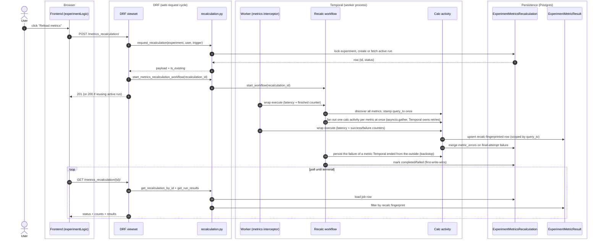
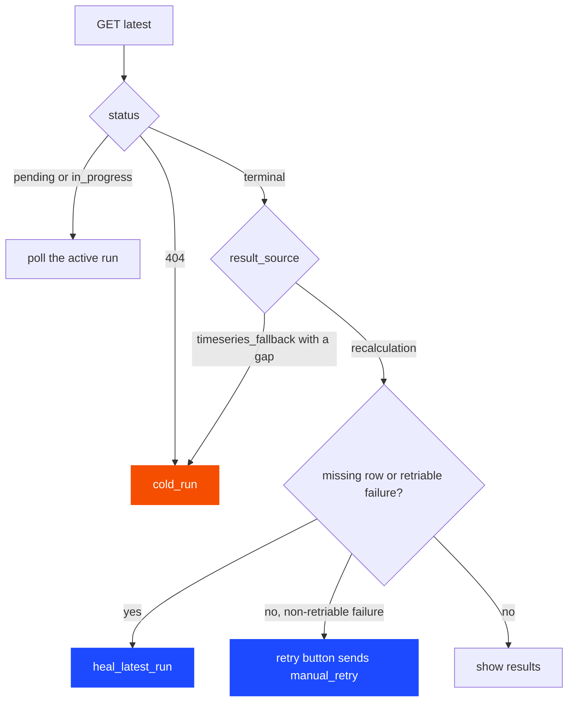

# Recalculation workflow architecture

This document describes the **recalculation workflow** for experiment metrics: what it does, how it's built, and why we made the design choices we made. For the daily timeseries family of workflows (the ones in `posthog/temporal/experiments/`), see that package's `README.md`.

## What it does

When a user opens an experiment and the cached results look stale, they click **Reload metrics**. The recalculation workflow takes a snapshot of all that experiment's metrics, runs them against ClickHouse in parallel, and stores the results so the UI can show the user a frozen "as of now" view of their experiment.

It's distinct from the daily timeseries workflows in two ways:

- **One experiment per run.** Triggered by the user, by experiment lifecycle events like launch/stop, or by the hourly scheduled recalculation for enabled teams. Every trigger starts the same per-experiment run; there is no sweep across experiments inside one workflow. See "Scheduled recalculation".
- **Snapshot per run.** Each click creates a new run with its own results, identifiable by `recalculation_id`. The timeseries family keeps one result per metric per daily window and updates it in place; we keep every run. (Two exceptions: a stopped experiment has a fixed window, and a `METRIC_CONFIG_CHANGE` run reuses the previous window, so those runs share result rows rather than each getting a distinct snapshot. See "Snapshot semantics for the user".)

## End-to-end flow

## Key design decisions

### One `query_to` for the whole run

Every metric in a single recalc shares one `query_to` timestamp, stamped by the workflow's start activity. Without this, two metrics calculated 90 seconds apart in the same run would have slightly different time windows, making them not directly comparable. The start activity stamps `query_to` exactly once under a first-write-wins guard (`UPDATE ... WHERE query_to IS NULL`), so even Temporal retries can't shift the window.

### Recalc fingerprint, not config fingerprint

Every result row is keyed by a `recalc_fp = sha256(config_fp + "recalculation")` (`_recalc_fingerprint` in `metric_calculation/results.py`). The config part is the calculation key that the daily timeseries workflows use too: `MetricCalculationConfig.calculation_key()` in `metric_calculation/config.py`. The calculation config holds everything the calculation reads, but key version 1 hashes only the effective metric definition, the start date, the stats method, the stored exposure criteria, maturity and the excluded variants. The salt is a fixed string, so the recalc fingerprint is deterministic per config, not per run.

This matters because the recalc workflow shares the `ExperimentMetricResult` table with the timeseries workflows. If we used the config fingerprint, every recalc would overwrite the cached daily timeseries row, wrecking the timeseries reads. The constant salt keeps the recalc family distinct from the timeseries family on the same table, so they never collide.

Runs of a **running** experiment are told apart by `query_to`, not by the fingerprint. Each run advances `query_to` toward "now", so it accumulates one row per run under the same fingerprint, one per window end. `MetricResultStore.for_run`, behind `get_run_results`, filters `fingerprint__in=(...) AND query_to=recalc.query_to`, so a read returns exactly the rows for that run's window.

A run never recomputes a completed result for the same config and window.
Before it queries, the calc activity looks for a `COMPLETED` row with the same recalc fingerprint and `query_to`.
If it finds one, it marks the metric succeeded and leaves the row as it is.
Otherwise it runs the query and upserts the result on `(experiment, metric_uuid, query_to)`, so a `FAILED` row at that window is updated in place.
`_REUSE_WINDOW_TRIGGERS` depends on this: a `METRIC_CONFIG_CHANGE` run reuses the previous window, so only new or changed metrics run a query.
A changed metric has a new fingerprint, so it recomputes, and the upsert replaces the previous run's row for that metric at the shared window.
The previous `recalculation_id` then reads the new result for that metric, the same as a stopped experiment after a config change (below).

**Stopped experiments never get per-run isolation.**
A stopped experiment has a fixed window: `_resolve_query_to` returns `end_date` for every run (`recalculation_logic.py`).
So every run of a stopped experiment uses the same `(experiment, metric_uuid, query_to)` row for a metric, and the rule above decides what a reload does:

- **Same config, completed row:** the reload skips the query and keeps the row. It never recomputes the fixed window, so late events and data warehouse corrections for that window do not reach the stored result.
- **Same config, failed row:** the reload recomputes the metric and updates the row in place.
- **Config or stats change:** the fingerprint changes, so no completed row matches and the reload recomputes. The unique key `(experiment, metric_uuid, query_to)` does not include the fingerprint, so the new result replaces the old row in place, fingerprint included.

The snapshot for such an experiment is the one row at `end_date` for the current config, not a distinct frozen copy per `recalculation_id`.

### No FK from results to the recalc row

`ExperimentMetricResult` has no foreign key pointing back to `ExperimentMetricsRecalculation`. The scoping key lives entirely in the fingerprint plus `query_to`. This avoided a migration on a shared table to add a nullable column, and makes the two workflow families uniform in how they write results.

The trade-off: reads have to recompute the fingerprint set to find a run's results (`MetricResultStore.for_run` walks each metric, recomputes its `config_fp`, applies the recalc salt, then `WHERE fingerprint IN (...) AND query_to = recalc.query_to`). If the experiment's `start_date` / `exposure_criteria` / stats config changes between the write and the read, the recomputed fingerprints don't match the on-disk ones, and results "disappear." Documented inline as the fingerprint-divergence hazard.

Every read and write of `ExperimentMetricResult` goes through `MetricResultStore` (`metric_calculation/results.py`), so the salt and the sync's copy window stay in one module.
The current result of a metric (`current_outcome`) is the completed row whose data ends last under the metric's current calculation key, salted or bare.
A row's data ends at the earlier of its `query_to` and its `completed_at`, because the backfill stamps the current day with the end of that day but holds data only up to the moment it ran.
The experiment-completed event reads it for the first primary metric in display order, inline or saved, and the setup context reads it for its outcomes.
A backfilled past window does not win over a newer window, a backfilled current day does not win over a later run of that day, and a row under an earlier configuration, for example from before a relaunch, does not count.
When several rows share `(experiment, metric_uuid, query_to)`, each query returns the row with the newest `completed_at`, then the highest id.
The unique constraint on that key allows only one row, so this order decides nothing until the constraint goes.
Every writer (the calc activity, the daily activities, the backfill and the timeseries sync) looks the row up on `(experiment, metric_uuid, query_to)` and stores its fingerprint as an updated field.
A row that holds the window under another fingerprint is therefore updated in place, so no write can fail on the unique constraint or create a second row for a window.
A daily write and a recalculation share a window only when an experiment stops while its daily run is in flight, so both use `end_date`.
A successful daily write then takes over the recalculation's row, and the next reload recomputes that metric.
A failed daily write leaves a completed row under another fingerprint in place, because it has no result to replace it with.
The calc activity's write keeps its lock order and its terminal-run guard (see [cancellation and result-write protection](../../../../docs/internal/experiment-metric-recalculation.md)).

### Counters are derived, not stored

`completed_metrics` and `failed_metrics` aren't columns on the recalc row. They're computed at read time from `ExperimentMetricResult` rows (`status=COMPLETED` for completed, `status=FAILED` plus discovery-step failures from `metric_errors` for failed). This eliminates a class of bug: when Temporal retries an activity, there's no counter to double-increment. The only thing that matters is whether the result row exists.

### Idempotency + concurrency at the API boundary

Two safeguards on the POST endpoint:

- **Idempotent reuse.** If an active recalc (pending or in-progress) exists for this experiment and is younger than 30 minutes, the POST returns it instead of creating a new one. Frontend can click Reload twice and get the same `recalculation_id`.
- **Per-experiment lock.** The service runs inside `transaction.atomic()` with `Experiment.objects.select_for_update()` to serialize concurrent POSTs. Without this, two simultaneous clicks would both see no active row, both reach `.create()`, and the second would hit the per-experiment unique constraint and return HTTP 500.
- **User refresh window.** A `manual` or `agent_mcp` POST within `MIN_USER_RECALCULATION_INTERVAL` (five minutes) after the latest completed run's `completed_at` gets a 429 with a `Retry-After` header (`RecalculationRateLimited`), so a client or an agent knows when the next run is allowed. The window measures from completion, not `query_to`, because a stopped experiment pins `query_to` to `end_date`. A failed latest run never anchors the window, and neither does a `timeseries_sync` run, which may lack metrics the daily workflow does not compute. System triggers (`cold_run`, `heal_latest_run`, `manual_retry`, config changes) are exempt. The `experiment-metric-recalculation-rate-limit` flag, targeted by organization, turns the window on; the backend evaluates it by organization id and the frontend reads the same flag to block the reload button. Local development (`DEBUG` on, outside tests) skips the window, and the frontend mirrors that through the `is_debug` preflight field.
- **Experiment age limit.** When the `experiment-recalculation-age-limit` flag is on for the organization, a POST for an experiment that started more than `RECALCULATION_MAX_EXPERIMENT_AGE` (180 days) ago starts no workflow, because a run scans every event from the start date to now. `request_recalculation` creates a rejected run instead: FAILED, `completed_at` set, a `recalculation_window_too_long` entry in `metric_errors` for every metric (step `request`, not retriable), and the `query_to` of the latest terminal run, so the `latest` read returns the rejection message together with the earlier results. The API answers 201, and the backend sends the `experiment recalculation rejected` event. The check runs after the idempotent reuse, so an active run is still returned, and after the stale cleanup, so a stale run is still failed and its workflow cancelled. The frontend never heals a gap in a rejected run, because every heal gets the same rejection. The admin panel calls `request_recalculation_without_age_limit`, so staff can still recalculate an old experiment. Scheduled runs never reach the limit, because their discovery selects only experiments younger than 60 days.

### Activity-aware staleness

The "still active" check uses different timestamps depending on the row's status: PENDING anchors on `created_at` (workflow never reached the start activity), IN_PROGRESS anchors on `started_at` (workflow began executing then stalled). Past the 30-minute threshold, the row is treated as dead, marked FAILED, and a fresh run is allowed.
The calc activity's total budget keeps a healthy run below that threshold; see "Per-metric time budget" below. This protects against the failure mode where a Temporal-connect failure leaves a PENDING row behind and the rollback UPDATE also fails: without this, the experiment would be permanently locked out of recalculations.

### Terminal-failure backstop

The workflow body is wrapped so any unhandled exception, or a finalize write that exhausts its own retries, still tries to mark the row terminal before the workflow fails (`_best_effort_mark_terminal`). This closes the gap where a run really finished but the finish write failed, leaving a non-terminal row that would otherwise report the wrong status until the staleness TTL reaps it. The backstop is gated on `workflow.patched("recalc-terminal-fail-on-error-2026-07")` so it does not break the replay of executions that started before it landed. If the backstop write also fails, the workflow re-raises rather than reporting success on a non-terminal row, and the staleness TTL is the last line of defense.

### Snapshot semantics for the user

The user doesn't see the cache. They see a specific run, identified by `recalculation_id`. If they bookmark the URL or share it, anyone who follows it reads that run's numbers at the run's `query_to`, independent of cache state. This is the fundamental difference from the timeseries family, which is essentially "what does the query engine say right now."

The snapshot is distinct per run only when the run has its own `query_to`.
A `METRIC_CONFIG_CHANGE` run on a running experiment reuses the previous run's window, so a changed metric replaces the previous run's row (see "Recalc fingerprint" above).
For a **stopped** experiment the window is fixed at `end_date`, so all runs share one result row per metric (see "Recalc fingerprint" above).
A same-config reload reuses that row, so an earlier `recalculation_id` keeps showing the same numbers, and those numbers never include data that arrived after the first completed computation.
After a config or stats change, the next run replaces the row, so an earlier `recalculation_id` then shows the new numbers.
Between the edit and that run, it shows no result for a metric whose fingerprint changed, because of the fingerprint-divergence hazard above.

### Triggers and the cold-start payload

A recalc row records what caused it, in `trigger` (`Trigger` on the model).
The set is more than a manual click.
User and frontend triggers: `MANUAL`, `MANUAL_RETRY`, `COLD_RUN`, `HEAL_LATEST_RUN`, `EXPERIMENT_CONFIG_CHANGE`, `METRIC_CONFIG_CHANGE`.
Server-side triggers: `AGENT_MCP` (set by the view from the client header), `TIMESERIES_SYNC` and `SCHEDULED` (written by their workflows).
Deprecated values stay for old rows: `STALE_REFRESH`, `AUTO_REFRESH`, `CONFIG_CHANGE`, `EXPERIMENT_LAUNCH`, `EXPERIMENT_STOP`, `EXPERIMENT_UPDATE`.
`RequestTrigger` is the subset a client may send on POST; the request serializer rejects the rest.
This lets the analytics and the UI tell a user click apart from an automatic heal.

The trigger decides the window.
`_resolve_query_to` reuses the latest terminal run's `query_to` for `METRIC_CONFIG_CHANGE`, `MANUAL_RETRY` and `HEAL_LATEST_RUN` (`_REUSE_WINDOW_TRIGGERS`), so the metrics that already have rows load from cache and only the missing or failed ones recompute.
Every other trigger advances the window to now, so every metric recomputes.
A window-reusing run keeps the current values on screen and shows a loading tag on the metrics it recomputes; a `cold_run` has nothing prior to keep.

#### What the frontend sends, by the state of `latest`

The frontend reads `GET /metrics_recalculation/latest` on page load and starts at most one run from it.
It never heals a pending or in-progress run; it polls that run instead.

| State of `latest`                                                     | Trigger                                        | Window   |
| --------------------------------------------------------------------- | ---------------------------------------------- | -------- |
| 404: no run and no timeseries point                                   | `cold_run`                                     | advances |
| Timeseries fallback with a gap (`result_source: timeseries_fallback`) | `cold_run`                                     | advances |
| Terminal run with a result row missing, and no error for that metric  | `heal_latest_run`                              | reuses   |
| Terminal run with a failed metric whose error is retriable            | `heal_latest_run`                              | reuses   |
| Terminal run with a failed metric whose error is not retriable        | nothing; the retry button sends `manual_retry` | reuses   |
| Refresh button                                                        | `manual`                                       | advances |
| Metric added or changed                                               | `metric_config_change`                         | reuses   |
| Experiment config changed                                             | `experiment_config_change`                     | advances |

A run that failed before discovery has no metrics and no anchored window.
The frontend treats it as a gap and sends `heal_latest_run`; `_resolve_query_to` skips a run without `query_to`, so it reuses the newest earlier window, or advances when there is none, as a `cold_run` would.
This is rare: Temporal retries the workflow before it reaches that state.

Red nodes advance the window; blue nodes reuse it.

#### Retriable failures

A metric's terminal failure lands in `metric_errors` as `{step, message, error_type, retriable, timestamp}`.
`error_type` is the same taxonomy as the `experiment metric error` event (`classify_experiment_query_error`).
`retriable` is the backend's own decision, not a frontend mapping of `error_type`: it is true when a transient error (`timeout`, `rate_limited`, `server_error`) used its final attempt, and false when the calc activity failed permanently (`validation_error`, `out_of_memory`, `byte_limit`, `insufficient_data`, a `ValueError`, or a discovery failure) or the request was rejected (`recalculation_window_too_long`).
A retriable failure reads as a gap, so the page load heals it; a non-retriable one waits for the user, because a new run with the same inputs fails the same way.
An entry without the flag predates it and counts as non-retriable, so an old run never heals in a loop.

#### The cold-start payload

`TIMESERIES_SYNC` is the one trigger no user or lifecycle event emits. The daily timeseries workflows write it as soon as each experiment's own metric activities finish: one completed row per experiment per daily run, with the run's timeseries points copied under the recalc fingerprint at a shared `query_to`, so the `latest` read serves fresh daily data without a recompute. The inline and saved metric workflows share that row: the first to finish creates it, the second adds the copies it lacks. See "Handing fresh points to the recalculation reader" in `posthog/temporal/experiments/README.md`.

`GET /metrics_recalculation/latest` returns a synthetic "completed" payload built from each metric's latest timeseries point (`build_timeseries_cold_start_payload`) when no real recalc run exists yet. This is the cold-start placeholder: the user sees the freshest cached timeseries values instead of a bare 404 on first open. Only points younger than `TIMESERIES_FALLBACK_MAX_AGE` (24 hours) count, so an older point reads as a gap and the frontend starts a `cold_run` for it; a fallback that covers every metric is accepted as is. The GET path never triggers a recompute itself; it only reads.

### Live query progress on the GET path

For an in-progress run, `get_live_query_progress` reads `system.processes` and `system.query_log` by client-query-id prefix to surface cumulative ClickHouse `rows_read` while the run executes. Nothing is stored: each metric query is tagged with a deterministic `client_query_id`, so the progress is reconstructable from ClickHouse alone. It is best-effort and decorative; a failure there returns null and never sinks the core status payload.

### Scheduled recalculation

`ScheduledExperimentRecalculationWorkflow` (`scheduled_recalculation_workflow.py`) runs on one hourly schedule at `:30`, after the daily timeseries schedule at `:00`. It is behind the `experiments-scheduled-recalculation` flag. Each firing starts ordinary recalculation runs with trigger `SCHEDULED`, through the same dispatch the API uses.

- **Discovery** (`find_scheduled_recalculation_candidates`) selects running experiments whose team recalculates at the current UTC hour (`experiment_recalculation_times`, default 02:00). It skips, before any ClickHouse query, a flag that serves nobody, no computable metric, an active or recent run, and an exposure back-off. Candidates come oldest scheduled run first, never-run first, so an experiment deferred one day starts first the next day.
- **Exposure gate.** `check_experiment_exposures` runs one cheap query per candidate and skips experiments below `MIN_TOTAL_EXPOSURES`.
- **Admission cap.** One experiment holds a slot of `MAX_CONCURRENT_EXPERIMENTS` from its exposure check until its run's workflow finishes (`wait_for_scheduled_recalculation`). A run fans out all its metrics, so the multiplier on ClickHouse load is the number of runs in flight, not the metrics per run. Without the wait, one team with many running experiments starts every run within minutes and exhausts the per-user concurrency limit of its ClickHouse user for every other workload on it.
- **Start window.** No run starts later than `RUN_START_WINDOW` after the firing. The deadline bounds the activity timeouts, and `start_scheduled_recalculation` checks it again before it creates the row, so a delayed retry cannot start a run late. Candidates left over are counted as `deferred`. The window plus the start budget plus `RUN_WAIT_TIMEOUT` (the staleness threshold) stays under the hourly interval, because the schedule's `SKIP` overlap policy would otherwise drop the next hour's teams. `test_last_run_ends_before_the_next_hourly_firing` keeps that sum below an hour.
- **Fail closed on unknown outcomes.** A start activity that fails, a dispatch that raised after Temporal may have accepted the run (`dispatch_uncertain`), or a wait that cannot observe the run each stop new admissions for the rest of the batch. The run may still be live, so releasing its slot could exceed the cap.
- **Replay safety.** The wait, the window and the stop are gated on `workflow.patched("scheduled-recalc-wait-for-runs-2026-10")`.

## Eviction

We don't currently delete old recalcs or their results. Power users compound rows fast: 50 clicks × 10 metrics × 90 days = 45k rows for one team. The plan is a bi-weekly Temporal Schedule that deletes both tables past a cutoff:

- `DELETE FROM ExperimentMetricResult WHERE experiment_id = X AND query_to < cutoff`
- `DELETE FROM ExperimentMetricsRecalculation WHERE experiment_id = X AND created_at < cutoff`

No fingerprint recompute needed: the table has `experiment_id` and timestamps directly, so eviction is trivial. The two deletes don't need to be transactional with each other; nothing reads results "through" the recalc row.

## Observability

Two parallel surfaces:

- **Prometheus / Grafana.** The worker-side interceptor (`recalculation_metrics.py`) emits per-activity and end-to-end latency histograms, success/failure counters per activity type, and a `workflow_finished{status}` counter. These power dashboards and alerts about worker health (latency p95, recalc success rate, infrastructure failure rate). The `status` attribute on `workflow_finished` uses the business-level outcome (any failed metric → `"failed"`), so a 9-of-10-failed run is correctly counted as a failure.
- **PostHog events.** Frontend captures a consolidated `experiment metric recalculation` event with a `status` property (`triggered` / `polled` / `completed` / `failed`) at each lifecycle moment. These power user-behavior dashboards (how often do users click Reload, what fraction of recalcs end in failure from the user's perspective). See `docs/superpowers/specs/2026-06-04-experiment-metric-recalculation-events.md`.

The split is intentional: Grafana tells you about the worker process, PostHog tells you about the user experience. Alerts can live in either depending on what's being monitored.

## Performance notes

- **Fan out all metrics at once, Temporal owns retries.** The workflow schedules one calc activity per metric in a single `asyncio.gather` (`recalculation_workflow.py`), with no concurrency of its own. The activity slots of the worker that runs the calc activity set the pacing. The per-org ClickHouse app-query limiter does not apply inside Temporal activities. Scheduling every metric up front also keeps the task-queue backlog honest for the autoscaler. The per-run fan-out is unbounded by design; the scheduled path bounds how many runs it starts at once instead (see "Scheduled recalculation"). The workflow runs on its own `experiments-recalculation-task-queue` (see `EXPERIMENTS_RECALCULATION_TASK_QUEUE`), served by a dedicated worker deployment, so recalc load can be scaled and throttled independently of the general-purpose worker. That deployment autoscales on backlog, so its slots (`MAX_CONCURRENT_ACTIVITIES` times the pod count) do not cap the number of concurrent queries. The activity task queue below does.

- **Activity task queue with a fixed cap.** A scheduled burst can send more concurrent queries than the ClickHouse default user allows, and the rejections then also hit other products that share that user. The calc activity is also registered on `experiments-recalculation-activity-task-queue` (`EXPERIMENTS_RECALCULATION_ACTIVITY_TASK_QUEUE`), with no workflows. A fixed worker with no autoscaling polls it in each region, so its pod count times its slot count is a hard cap on concurrent recalculation queries for the runs routed there. The workflow and its light Postgres activities stay on the main queue.

  Routing is per run. `start_metrics_recalculation_workflow` evaluates the `experiment-recalculation-activity-queue` flag for the run's organization, locally and without flag events, and stores the queue in the `activity_task_queue` workflow input. A flag error leaves the input empty. The workflow passes the input as `task_queue=` to the calc activity, gated on `workflow.patched("recalc-activity-task-queue-2026-10")`, and an empty input keeps the workflow's own queue. The workflow never reads the flag, so replay stays deterministic, and a flag change never moves a run in flight: Temporal retries an activity on the queue it was first scheduled on.

  Operating rules. Turn the flag on for an organization only after the activity worker polls the queue in that region, because a queue with no poller holds the calculations until `schedule_to_close` fails them. To roll back, turn the flag off, then remove the worker only after every recalculation workflow that started before the flag change has closed. A fixed wait is not enough: such a run keeps its queue choice and schedules its calculations only after discovery and the start step, which take up to about 20 minutes of attempts and have no limit on queue wait. The 20-minute calc budget (`METRIC_CALC_SCHEDULE_TO_CLOSE_TIMEOUT_SECONDS`) starts only then, and the workflow has no execution timeout.

  Retries live in Temporal's `RetryPolicy` on the calc activity, not in the workflow. The policy is exponential: `initial_interval=5s`, `backoff_coefficient=2.0`, `maximum_interval=60s`, `maximum_attempts=MAX_METRIC_ATTEMPTS` (currently 8). So a metric backs off 5s, 10s, 20s, 40s, 60s, 60s, 60s across its retries, then the eighth attempt is final. `asyncio.gather(..., return_exceptions=True)` lets healthy metrics finish while a failing one retries; a retrying metric never blocks the others, because each activity retries on its own worker slot rather than holding a shared queue slot.

  A permanent failure fails fast rather than burning the retry budget. `NON_RETRYABLE_ERROR_TYPES` (`out_of_memory`, `byte_limit`, `validation_error`, `recalculation_window_too_long`) plus `ValueError` are raised non-retryable, so the metric is terminal on the first trip. A different bucket, the cluster at-capacity error (`ClickHouseAtCapacity`, from `TOO_MANY_SIMULTANEOUS_QUERIES` or `CANNOT_SCHEDULE_TASK`) and `ConcurrencyLimitExceeded`, is retried after a random delay between 2 and 5 minutes (`CONCURRENCY_LIMIT_RETRY_DELAY_MIN_SECONDS` and `CONCURRENCY_LIMIT_RETRY_DELAY_MAX_SECONDS`) via `ApplicationError(next_retry_delay=...)`, out-of-band from the exponential schedule, because that error means "come back later", not "this query is wrong". The random delay spreads out metrics that bounced in the same burst, so their retries do not arrive together and hit the same saturated cluster again.

  Two error classes have a lower attempt cap than `MAX_METRIC_ATTEMPTS`, because their retries rarely succeed and each one costs ClickHouse capacity: capacity errors stop at `CAPACITY_MAX_METRIC_ATTEMPTS` (3) and the `timeout` class at `TIMEOUT_MAX_METRIC_ATTEMPTS` (2). The activity compares the attempt number with the cap of the error it just got. At the cap it persists the failure with `retriable=True` and raises non-retryable, so Temporal stops early without a change to the workflow's `RetryPolicy`. A user retry can recover the metric later.

- **`is_final_attempt` is derived inside the activity.** Because Temporal now owns retries, the activity reads its own attempt count from `activity.info().attempt` and compares it against `MAX_METRIC_ATTEMPTS` (the same constant the workflow's `RetryPolicy` is built from, so both sides agree on which attempt is last). The activity persists a transient failure (FAILED row + `metric_errors`) only on the final attempt (or at the error class cap above), so a metric still being retried stays in its loading/dim state on the frontend instead of flashing an error that may yet resolve. Non-final transient state is tracked separately in the `metric_retries` column for the UI.

- **Per-metric time budget.** The calc activity call sets `schedule_to_close_timeout` to `METRIC_CALC_SCHEDULE_TO_CLOSE_TIMEOUT_SECONDS` (20 minutes). It covers all attempts of one metric, the retry delays between them, and the time each attempt waits in the task queue. Without it, one metric could use 8 attempts of 300s plus backoff, which is more than the 30-minute staleness threshold, and a slow but healthy run could be marked stale while it still ran.
  The IN_PROGRESS phase is this budget, the failure backstop below (120s `schedule_to_close_timeout`, queue wait included), and the finish step (3 attempts of 90s), about 26 minutes in the worst case. `test_in_progress_phase_ends_before_the_staleness_ttl` keeps that sum below `_STALE_RECALC_THRESHOLD`.
  With the budget, a metric with slow attempts can stop before `MAX_METRIC_ATTEMPTS`.

- **Failure backstop for metrics Temporal ends from the outside.** The activity can persist its own failure only when an attempt runs to the end. Temporal ends a metric without that in three cases: the budget has no room for the next retry, the last attempt passes `start_to_close_timeout`, or the last attempt misses its heartbeats (a dead worker). The workflow detects these from the activity error (a `TIMEOUT` retry state or a timeout cause) and runs `record_metric_out_of_time_failure` for each such metric. That activity writes the FAILED row, a `metric_errors` entry with `error_type="timeout"` and `retriable=True`, and the terminal `experiment metric error` event. It does nothing when the metric already has a `metric_errors` entry from its final attempt. It also keeps a COMPLETED row, because a last attempt can write its result and then die before it reports success. The check and both failure writes run under the result store's run-write locks. If the killed attempt's thread still finishes later, its result write removes the timeout entry from `metric_errors`, so the frontend shows the result. The new commands are gated on `workflow.patched("recalc-persist-out-of-time-metrics-2026-10")`, so executions that started before the gate replay without them.

- **Per-org fairness.** Each calc activity is dispatched with `priority=Priority(fairness_key=inputs.fairness_key)`, where the key is the org id. Under backlog, Temporal round-robins across orgs so one org's large recalc does not starve another's. It is a no-op on namespaces without fairness support.

- **In-query execution guard.** The calc activity sets ClickHouse `max_execution_time=270s` (`METRIC_CALC_MAX_EXECUTION_TIME_SECONDS`), deliberately below the 300s activity timeout. A slow query then fails inside the activity with a typed ClickHouse timeout error, so the FAILED result row and the terminal event still get written, instead of Temporal killing the attempt from the outside and losing all of that.

- **5-minute per-attempt budget.** `start_to_close_timeout=timedelta(minutes=5)` limits the attempt in Temporal, but cannot stop the synchronous calculation thread.
  Local activity cancellation kills the ClickHouse query and waits for that thread with a bounded cleanup deadline.
- **Heartbeat.** The calc activity heartbeats through `Heartbeater` every `METRIC_CALC_HEARTBEAT_TIMEOUT_SECONDS / 4` (15s) while the thread runs, and the call sets a 60s `heartbeat_timeout`.
  Temporal delivers a cancellation only in a heartbeat response, so a workflow cancel or a server-side timeout now reaches the running attempt and starts the cleanup above.
  A dead worker misses its heartbeats, so Temporal retries the metric after 60s instead of after the full 300s attempt.
  See [cancellation and result-write protection](../../../../docs/internal/experiment-metric-recalculation.md) for the locking contract and cleanup limits.
- **Calc queries run on the offline ClickHouse nodes.** The calc activity builds its `ExperimentQueryRunner` with `workload=Workload.ONLINE`. That workload uses `CLICKHOUSE_HOST`, and the recalculation worker deployments set `CLICKHOUSE_HOST` to the offline host. So the queries reach the offline replicas, not the replicas that serve interactive product traffic. The activity task queue above caps how many of them run at once.

  The workload stays set explicitly rather than left to the default. The base `QueryRunner` default is `Workload.DEFAULT`, which follows the process default (Celery pins every task to offline process-wide, and API-key traffic is forced offline). Passing `Workload.ONLINE` keeps the routing the same however the activity is invoked, and the worker's host setting decides where it goes.

  Without the flag below, the queries run as the `default` user. The calc tags them with the cache-warming feature, so `sync_execute` asks for the `cache_warmup` user. The recalculation workers do not wire that user, so `get_clickhouse_creds` falls back to the pod's `default` user, and the queries count against its per-node limit on concurrent queries, which other products share.

  The `experiment-recalculation-clickhouse-user` flag, targeted by organization, moves the queries to the dedicated `experiments` user (`ClickHouseUser.EXPERIMENTS`), which has its own per-node limit. The calc activity evaluates the flag on each attempt, locally and without flag events, and sets `ch_user` in the `tags_context` around the runner. Every query in that context that names no user takes it, the precompute inserts too. The tag wins over the cache-warming fallback. A flag error keeps the `default` routing. Some queries keep their own user: the HogQL metadata lookups name theirs, the query kill on cancellation uses the pod's user, and the live-progress read on the GET path runs as `app`.

  Operating rules:
  - Deploy order, per region: the ClickHouse user and its token grant for both worker identities, then the token mount with `CLICKHOUSE_EXPERIMENTS_USER` and `CLICKHOUSE_EXPERIMENTS_PASSWORD_FILE` on both worker deployments, then this code, then the flag for one organization at a time. A query sent as a user the cluster does not know fails, so the flag goes on only after the first two steps are live.
  - Verify with the `user` column of `system.query_log` for the organization's recalculation queries, not with the flag state. A worker without `CLICKHOUSE_EXPERIMENTS_USER` or `CLICKHOUSE_EXPERIMENTS_PASSWORD_FILE` falls back to `default` with no error. A worker with both variables set but no file at that path still sends `experiments`, with an empty password, so its queries fail authentication and the activity retries them.
  - To roll back, turn the flag off. The next attempt of each metric uses the `default` routing, with no deploy and no workflow change.

- **No saved-metric snapshot.** Each calc activity that processes a saved/shared metric re-queries the M2M through-model to resolve the metric definition. For a 5–10 metric experiment this is fine; for larger experiments the per-call query starts to add up. Tracked as a deferred optimization (snapshot resolved metric dicts on the recalc row at discovery time).

## What this doc doesn't cover

- The legacy timeseries family of workflows (`posthog/temporal/experiments/`, three workflows). See that package's `README.md`.
- The Temporal SDK basics. See `posthog/temporal/README.md`.
- Frontend polling and rendering in depth. The kea logic has landed (`experimentMetricsLogic.ts`, with `RecalculationStatus.tsx` for rendering); this doc covers only the backend contract it polls. See the "GET path" decisions above and the poll loop in that logic.
- Eviction implementation. The plan above is design intent; the actual workflow is a separate PR.
