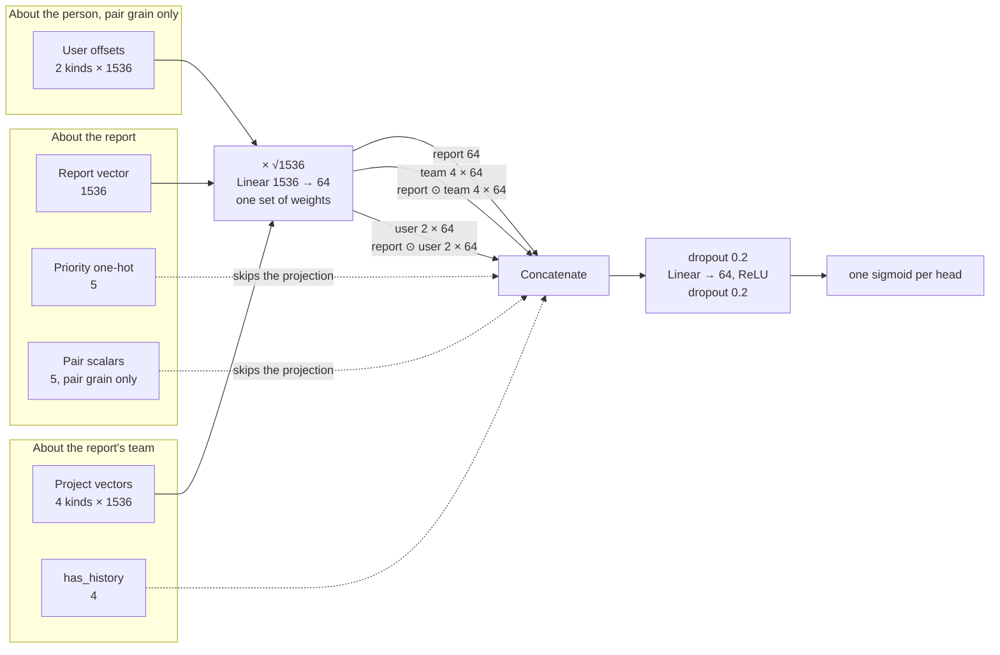

# Inbox ranking network architecture

This file describes what the multi-head network (`multihead/network.py`) sees, for every family that uses it: the report-grain `nn` families and the pair-grain user-history experiments.
The [README](README.md) describes the dags that build these inputs and how to operate them.
Update this file in the same PR as a change to an input, a width or a feature set.

## The network



Every vector, from the report, the team or the person, goes through the same `Linear(1536 → 64)` projection.
So the element-wise products compare vectors in one learned space: report ⊙ team says "this report looks like what the team engaged with", and report ⊙ user offset says "this report looks like what this person reads more than the team does".
Scalar columns skip the projection and go straight into the trunk input.

## Inputs

### The report

| Input         | Width | What it is                                                                                                                                                                       |
| ------------- | ----- | -------------------------------------------------------------------------------------------------------------------------------------------------------------------------------- |
| Report vector | 1536  | The report's title and summary through `text-embedding-3-small` (`title_summary_v1`), from the snapshot of the report's birth day. The vectors are unit length.                  |
| Priority      | 5     | One column per level in `PRIORITY_LEVELS` (P0 to P4). A missing or unknown priority leaves all five at zero. Only `report_embeddings_priority` and the sets built on it read it. |

### The team: project vectors

Each team has four vectors, each the plain mean of report vectors (`project_vectors()` in `dataset/project_vectors.py`).
Only human inbox app engagement counts, so MCP reads and agent actions never reach a vector.
A project is a team, not an organization.

| Kind      | Mean of                                                            | Limit |
| --------- | ------------------------------------------------------------------ | ----- |
| `typical` | every report vector of the team                                    | none  |
| `open`    | the reports anyone on the team opened, newest first                | 50    |
| `action`  | the reports anyone on the team acted on through a UI intent action | 50    |
| `dismiss` | the reports anyone on the team dismissed from the UI               | 50    |

Each kind also sends `has_history`: 1 when the kind holds at least `MIN_PROJECT_HISTORY_REPORTS` (5) reports, else 0 with an all-zero vector.
The network gets each projected team vector, its product with the projected report, and the flag.

### The person: pair grain only

`user_vectors()` in `dataset/project_vectors.py` builds two vectors per (organization, person), each the plain mean of report vectors:

| Kind      | Mean of                                                                              | Limit |
| --------- | ------------------------------------------------------------------------------------ | ----- |
| `open`    | the reports the person viewed (`first_viewed_at`), newest first                      | 20    |
| `dismiss` | the reports the person dismissed from the UI (`first_ui_dismissed_at`), newest first | 20    |

The network does not read these vectors as they are.
`user_offsets()` in `products/signals/backend/ranking/features.py` subtracts the team's project vector of the same kind:

```text
user_offset[open]    = user_open_vector    − team_open_vector
user_offset[dismiss] = user_dismiss_vector − team_dismiss_vector
```

An offset is zero when the person has no report of the kind or the team's kind has no history.
A person who reads what their team reads gets a small offset.
The network gets each projected offset and its product with the projected report.

Five pair scalars ride in the `report` input after the priority columns (`PairUserHistoryFeatureSet`):

| Column                      | Value                                                    | In `nn_pair_base_v1` |
| --------------------------- | -------------------------------------------------------- | -------------------- |
| `user_open_log_reports`     | `log1p` of the reports in the person's `open` vector     | 0                    |
| `user_dismiss_log_reports`  | `log1p` of the reports in the person's `dismiss` vector  | 0                    |
| `user_days_since_last_view` | days since the person's last view, capped at 90, over 90 | 0                    |
| `has_user_history`          | 1 when the person has any usable history                 | 0                    |
| `is_suggested_reviewer`     | 1 when the person is a suggested reviewer of the report  | kept                 |

## Widths at the trunk

| Block                           | `nn_v3` | `nn_with_prio_v2` | `nn_pair_base_v1` and `nn_pair_user_v1` |
| ------------------------------- | ------: | ----------------: | --------------------------------------: |
| Projected report                |      64 |                64 |                                      64 |
| Priority                        |         |                 5 |                                       5 |
| Pair scalars                    |         |                   |                                       5 |
| Projected team vectors (4 × 64) |     256 |               256 |                                     256 |
| Report ⊙ team (4 × 64)          |     256 |               256 |                                     256 |
| Team `has_history`              |       4 |                 4 |                                       4 |
| Projected user offsets (2 × 64) |         |                   |                                     128 |
| Report ⊙ user offset (2 × 64)   |         |                   |                                     128 |
| **Trunk input**                 | **580** |           **585** |                                 **846** |

The trunk is `Linear(→ 64)` with ReLU, with dropout 0.2 before and after it (`NetworkConfig`).
The report families have the heads `open`, `action` and `fixed`; the pair families have `open` and `action`.

## The pair contrast

`nn_pair_base_v1` and `nn_pair_user_v1` have the same input shape, the same pairs and the same seeds.
The base holds every user offset and every pair scalar at zero, except `is_suggested_reviewer`.
So `nn_pair_user_v1` against `nn_pair_base_v1` measures the person's history alone: the change to pair grain and the reviewer flag are in both arms.
Both are also graded against `nn_with_prio_v2`, which scores at report grain.

## Rules every input follows

- **Point in time.** A report born on day B reads team and personal vectors as of the start of B, so the report, the reports born with it, later engagement and later embeddings stay out. See the point-in-time contract under [Project vectors](README.md#project-vectors).
- **One organization.** A person's history counts only reports of teams in the same organization.
- **Cold start.** A person without history reads zero offsets and `has_user_history` 0, and gets a finite score from the same network. There is no separate fallback rule.
- **Consent.** Every input reads only teams in `training_consent_team_ids()`. See [Training consent](README.md#training-consent).

## Things to know before changing an input

- **The means are not re-normalized.** Report vectors are unit length, but a mean of vectors that point different ways is shorter. So a person or team with focused engagement gets a longer vector than one with scattered engagement. The only scaling is `INPUT_SCALE` (√1536), the same for every vector.
- **The products use the offset, not the raw user vector.** The network also sees the team vectors, so it can add an offset back to its team vector, but the report ⊙ user product is computed on the offset.
- **The projection is shared.** A new vector input that goes through `projection` lands in the same space as the report. A new scalar belongs in the feature set's columns, which skip the projection.
- **The ONNX graph is the serving contract.** `export_onnx()` names the inputs `report`, `project`, `has_history` and, for a pair network, `user`. A change to an input's shape changes the graph that the scoring sweep loads.
- **Activity summary vectors are not an input yet.** `inbox_activity_summary_vectors` is archived for a later family.
