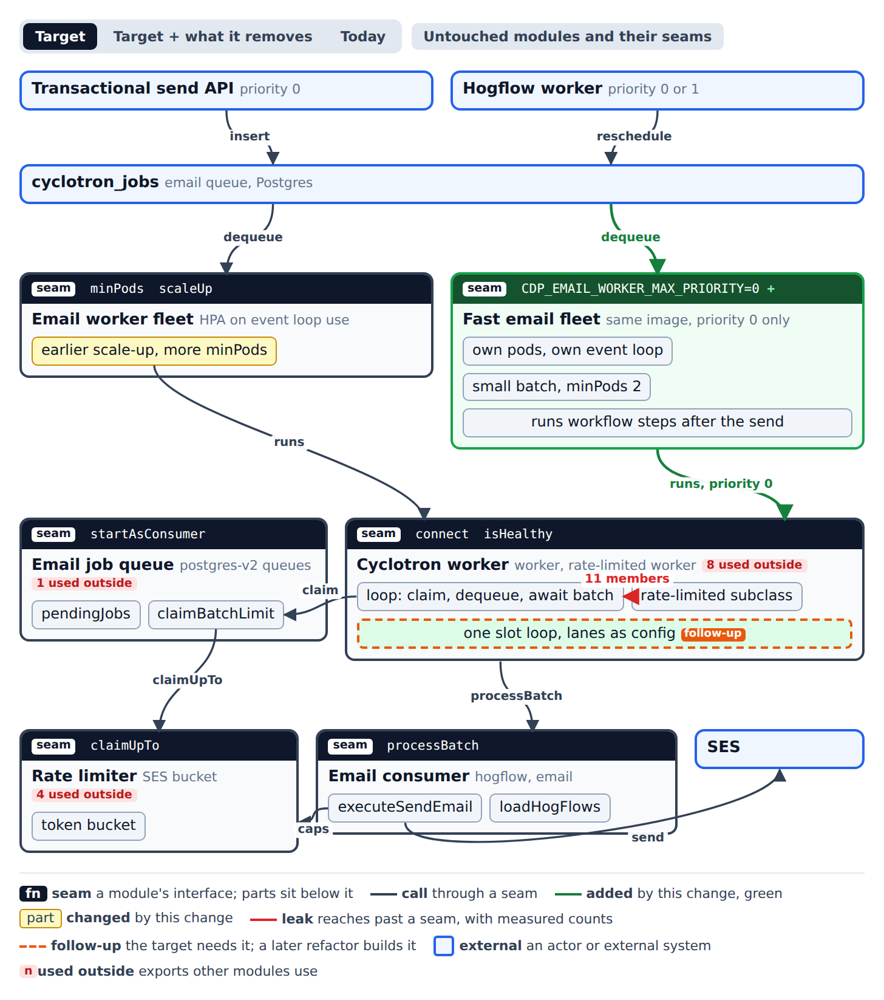

# Prototype: protect transactional email sends from email worker batch time

Throwaway. This branch is never merged. Only the decision moves on, into the spec.

## Question

The email worker polls, claims SES tokens, dequeues a batch, and awaits the whole batch before it polls again (`nodejs/src/cdp/services/cyclotron-v2/worker-rate-limited.ts`, `runConsumerLoop`).
A transactional (`priority = 0`) job that becomes due while a batch runs waits for the rest of that batch.
How should transactional sends be protected from that wait?

## Decision

A separate fast email fleet: a second deployment of the email worker, same image and server mode, that dequeues only `priority = 0` from the same `cyclotron_jobs` email queue.



Interactive page: `modules.html` (Target, Today, untouched modules).

- The main fleet keeps dequeuing priority 0 first, so a down fast fleet falls back to today's behavior.
- Both fleets claim SES tokens through the one `claimBatchLimit` hook. The token design changes the hook body, not its callers.
- The main fleet gets earlier scale-up and a higher `minPods` in the same stack.
- The fast fleet runs a workflow's next steps after the send, as the main fleet does.

## Call paths

- `fast-fleet.mmd`: a transactional send while the main fleet is busy.
- `fast-fleet-down.mmd`: the fast fleet is down.

## Contract

```ts
// nodejs/src/cdp/config.ts
type CdpConfig = {
  /** Highest job priority the email worker dequeues. Unset means every priority. `0` makes a fast fleet. */
  CDP_EMAIL_WORKER_MAX_PRIORITY: number | null
}

// nodejs/src/cdp/services/cyclotron-v2/types.ts
type CyclotronV2WorkerConfig = {
  /** Adds `AND priority <= maxPriority` to `countWork`, `dequeueJobs` and `fairDequeueJobs`. */
  maxPriority?: number
}
```

Invariants:

- One row goes to one worker: every dequeue uses `FOR UPDATE SKIP LOCKED`, across both fleets.
- Every dequeue passes `getBatchLimit` first, so both fleets together stay under the SES bucket.
- `countWork` applies the same priority filter as the dequeue, so the fast fleet never claims tokens for bulk rows it will not take.
- With `maxPriority` unset the worker behaves exactly as today.

Error modes:

- Fast fleet down: the main fleet serves priority 0 first at its next poll. The janitor returns rows the fast fleet held after the stall timeout. A send already handed to SES before the crash can repeat (the existing duplicate risk, owned by the duplicate-send audit).
- Fast fleet down for 5 minutes: an alert fires on zero available pods.

Performance:

- The priority filter is a range on the leading column of `idx_cyclotron_jobs_email_priority_fair_dequeue (priority, dequeue_seq, scheduled)`.
- Idle cost: each fast pod runs one `countWork` per poll delay through the cyclotron pooler.
- Fast batches are small (about 20), so a fast row waits at most one short batch.

## Follow-ups

- One lane-aware worker with a slot loop (N rows in flight, lanes as config) that replaces the rate-limited subclasses. Strong.
- In-flight job ownership (`pendingJobs`) moves from the queue into the worker. Worth exploring.
- One admission seam (claim and refund) shared by the worker and the send path. Worth exploring.
- One email fair-order module that owns `dequeue_seq` assignment and ordering. Speculative.
- Merge the email consumer into the hogflow consumer with a queue parameter. Speculative.
