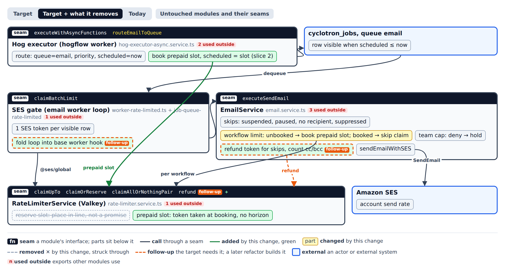
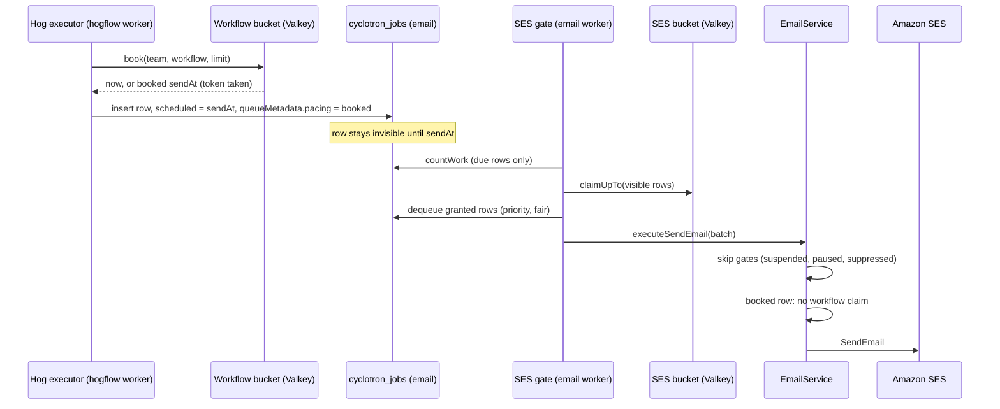
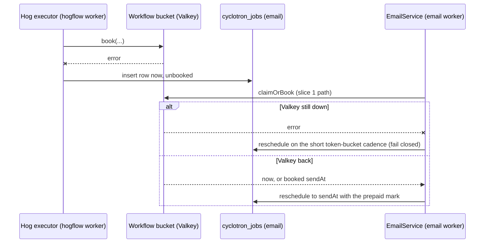

# Prepaid pacing slots for workflow email

Throwaway design capture on a prototype branch. It becomes the interface section of the spec that follows.

## Question

How should email queue rows that will not send stop spending SES tokens and email worker batch time, and how do we cut repeat parks?

## Answer

A per-workflow rate limit denial books a **prepaid slot**: the limiter takes the token when it hands out the slot, so the slot is the caller's and the wake does not claim again.
The row is scheduled at its slot and is dequeued once, when it is due to send.
Slice 1 does the booking inside the email worker (a row parks at most once).
Slice 2 moves the booking to routing (`routeEmailToQueue` on the hogflow worker), so a paced row never reaches an email worker batch before its slot.
The global SES claim stays at dequeue, sized to visible rows.



Open [modules.html](modules.html) for the Target, Target + what it removes, and Today views, and the untouched modules.
`modules-round1.json` is the first round's page with the rejected alternatives (refund only, claim at the SES call).

## Decisions

- The SES claim stays at dequeue. It keeps the account rate bound and the priority-first dequeue that protects the fast lane.
- A prepaid slot replaces the reservation that is "a place in line, not a promise". The deny path takes the token and returns the slot.
- No horizon: every denied row gets a real slot, however far out. A limit change applies to new sends only, and the run log says when each email is scheduled. The bucket's key TTL must outlive its furthest booking.
- A booked row carries a prepaid mark in `queueMetadata`, the way `teamCapped` is carried. The mark survives SES throttle and SES gate retries, so a retry never claims the workflow bucket again.
- When the limiter fails at routing, the row is enqueued now, unbooked. The email worker keeps today's claim path for unbooked rows, which fails closed (waits, never drops).
- A booking lost to a crash between book and insert costs one slot of pacing, never a send. A booked row that is later suppressed or paused is skipped at send time and wastes only its slot.
- The batch-time protection of fast-lane sends is a separate design. This change only takes paced rows out of batches; it does not change priority or fair-dequeue order.

## Call paths

Main write path (slice 2):



Failure path: the limiter's Valkey errors at routing.



## Contracts

```ts
// RateLimiterService: replaces claimOrReserve for the workflow bucket.
// GCRA-style: the bucket stores its next free time. A grant or a booking advances it by one
// refill interval per token, so slots are handed out in call order, one interval apart.
//
// Invariants:
// - A booked slot is the caller's. Nothing else can take its token.
// - Grants plus bookings never exceed capacity + refillPerSecond * elapsed.
// - The key TTL is at least (sendAt - now) plus the idle TTL, so a far booking does not expire.
// Error modes: Valkey error or invalid script result -> { kind: 'unavailable' }. Never throws.
// Performance: one Lua call, O(1). Same Valkey and pool as today.
type Booking = { kind: 'now' } | { kind: 'booked'; sendAt: Date } | { kind: 'unavailable' }
claimOrBook(req: { key: string; capacity: number; refillPerSecond: number }): Promise<Booking>

// queueMetadata on the email job.
// 'booked' means the workflow token is already taken. Carried through every reschedule of the
// same send (SES throttle, SES gate delay). Cleared when the send leaves the email step.
type EmailPacingMark = { pacing?: 'booked' }

// WorkflowEmailPacing: the one place that turns a workflow's limit into a schedule.
// Called by routeEmailToQueue (slice 2) and by EmailService for unbooked rows (slice 1).
// Callers know only the returned schedule. Bucket keys, capacity and refill stay inside.
// 'unavailable' at routing -> enqueue now, unbooked. 'unavailable' in EmailService -> short reschedule.
schedule(send: { teamId: number; workflowId: string; limit: WorkflowEmailRateLimit }): Promise<Booking>
```

## Follow-ups

- **Team sending cap books the same way** (Strong). After PostHog/posthog#128506 and PostHog/posthog#129163 land, it uses the same booking API.
- **Fold `worker-rate-limited.ts` into the base worker as a pre-dequeue hook** (Strong). It copies the base poll loop and uses 13 of its protected symbols.
- **Refund the SES token for skips, and count cc/bcc** (Worth exploring). Settles through `queueInvocationResults` in the rate-limited queue. Needs a `refund` Lua op clamped to capacity.
- **Typed send outcome** (Worth exploring). `sent | skipped | parked | held | throttled` replaces the `teamCapped` flag and the `finished` plus `queueScheduledAt` inference. The refund follow-up needs it.
- **`EmailAdmission` module** (bold, Strong). One module decides send, skip, park or hold before any I/O. It absorbs pacing, priority and the skip gates, and leaves `EmailService` only delivering. Booking at routing is its first piece.
- Not asked in the rounds: move the decoding of `retryAfterMs` and `reserved` into the limiter (Speculative); split routing from fetch execution in `hog-executor-async.service.ts` (Worth exploring).

## ADR

### Paced email books a prepaid slot, with no horizon

**Status:** accepted for the spec.

**Context.** The per-workflow email limit reserved a slot without taking its token, so the wake claimed again. A late or out-of-order wake was denied and went to the back. Rows past a one-hour horizon got no slot at all and claimed again every hour. Every denial cost a dequeue, a batch slot, the pre-send lookups and a global SES token.

**Decision.** A denial books a slot and takes its token at booking time, however far out. The row is scheduled at the slot and carries a prepaid mark through retries. Slice 2 books at routing, so the row never reaches an email worker batch early.

**Consequences.** A paced row is dequeued once and spends one SES token. A limit raised later does not speed up rows already booked; it applies to new sends. Valkey key TTLs must cover the furthest booking. A failed booking falls back to today's claim path.

**Alternatives rejected.** Refund only: fixes tokens but keeps the repeat parks and their batch time. Claim at the SES call: exact count, but with an empty bucket, dequeued rows wait inside the batch or reschedule. Keeping the horizon: limit changes apply sooner, but big audiences churn every hour.

The prepaid mark and the routing fallback miss the ADR bar: they are cheap to change and follow from the decision above.
