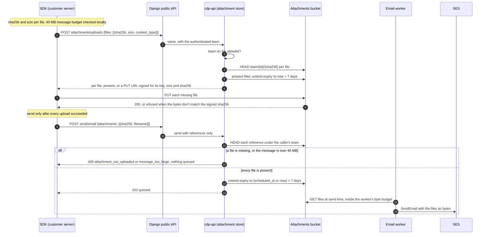

# Code-send attachments through object storage

This is a throwaway prototype branch, so it never merges. It captures the architecture that the spec and implementation work start from.

## Question

How should the files attached to a transactional email sent from code travel and live, so that:

- no file sits in the job database or crosses the send request;
- no team can ever reach another team's files;
- a message can carry up to the 40 MB that SES accepts?

## Result

Files never cross the send request.
The SDK asks for an upload slot for each file and PUTs the bytes straight to a dedicated bucket.
The key is built by the server from the caller's team and the file's SHA-256.
The send carries only the hashes.
cdp-api refuses the send synchronously unless every file is present under the caller's team, so no email is ever queued without its files.
Django and cdp-api never hold file bytes. Only the email worker reads them, at send time, because SES takes attachments as bytes only.

The side table `cyclotron_email_attachments` and the 512 KiB inline path are removed and dropped first. Sends with attachments are refused today, so nothing reaches the table (#130952).

## What it replaces

| Today                                                                     | After                                                                                              |
| ------------------------------------------------------------------------- | -------------------------------------------------------------------------------------------------- |
| Base64 `content` inline in the send request, 10 files and 512 KiB decoded | `attachments: [{sha256, filename, content_type?, content_id?}]`, after an upload step              |
| Bytes in `cyclotron_email_attachments` in the job database                | Objects in a dedicated bucket, `<prefix>/team/<team_id>/<sha256>`                                  |
| Delete after the final outcome, plus a janitor sweep after 7 days         | Expiry by an expiry stamp on each object, carried out by lifecycle rules. No delete and no sweeper |
| Django and cdp-api parse, decode and copy every file                      | Neither sees file bytes                                                                            |

## Main path



## Decisions

Each line records a fork that was decided in the prototype rounds.

1. **Upload, then send.** A send with files takes two calls. The SDK uploads every missing file and sends only once all uploads have succeeded, never in parallel with them. The server refuses a send whose files are missing, so the guarantee holds for callers without an SDK too.
2. **Keys from the content.** The key is `<prefix>/team/<team_id>/<sha256>`, built only by cdp-api from the authenticated team. Each PUT URL is signed for that key, the exact `Content-Length` and `x-amz-checksum-sha256`, and expires after 15 minutes. The bytes at a key can never change, and a retry or a later send of the same file uploads nothing. The file name is per send, not per object. No table records uploads: the bucket is the record.
3. **Expiry only moves later.** Every call that uses a hash extends the file's expiry stamp to the later of the current stamp and what the call needs. That covers the upload request, the send, and moving a scheduled send. A transactional send needs now + 7 days, and a scheduled send needs `scheduled_at` + 7 days. Moving a scheduled send earlier extends nothing. Nothing deletes a file after a send.
4. **The stamp lives on the object.** Two tags carry it. `expires-at` is an ISO date, readable during an incident. `expire-days` is the number of days from the object's creation to that date, rounded up. One lifecycle rule per `expire-days` value from 7 to 44, so 38 rules, deletes the object that many days after creation. A stamp beyond creation + 44 days first copies the object onto itself, which resets creation. Every writer reads the tags back once and writes again if a concurrent call replaced its date with an earlier one.
5. **Isolation.** The bucket is dedicated, unversioned, Block Public Access, and refuses requests without TLS. Only CDP's role may read or write it, and no presigned GET is ever issued. It is encrypted with SSE-KMS under a key used only by this bucket, which only CDP's role can decrypt with. A file under another team's prefix is answered exactly like a missing one. There is no key per team: the role must decrypt for every team in order to send, so per-team keys would not stop the leak that matters, an application bug reading the wrong team's file. The team in the key path does stop it.
6. **cdp-api owns the store.** cdp-api checks the allowlist, HEADs files, signs URLs and extends expiry. The email worker loads files. Django is the public facade for both routes: shape validation, error mapping and measurement. It has no object-storage grant.
7. **One gate.** One cdp-api env allowlist (`*` for everyone) decides per team whether it may upload and send files. A team that isn't on the list gets `field_not_accepted` on both routes.
8. **The limit is the SES message.** At most 10 files, at most 30 MB per file, and an estimated final message of at most 40 MB. SES and Resend both cap the base64-encoded message at 40 MB.
9. **A byte budget in the worker.** The email worker caps the attachment bytes it holds at once. A send that would go over is rescheduled, not failed. SES v2 takes attachments only as `RawContent` bytes, in the pinned SDK and in the latest one, so the worker must download every file.
10. **Every refusal is synchronous.** Every attachment refusal answers with a code, a reason and a fix, and is never acknowledged with a 202.
11. **Measurement first.** `transactional email api send` carries `attachment_count` and `attachment_bytes` on every outcome, refusals included. The upload route captures the requested count and bytes, and how many files were already present.
12. **Switch off and fix forward.** The empty allowlist turns the feature off. Faults are fixed forward. There is no rollback procedure.

## Contracts

### Public API (Django)

```text
POST /api/environments/{project_id}/messaging/attachments/uploads/
Authorization: Bearer <project secret API key with the email send scope>

{ "files": [ { "sha256": "<64 hex>", "size": 123456, "content_type": "application/pdf" } ] }   // 1 to 10 files

200 { "files": [
  { "sha256": "...", "status": "present", "expires_at": "2026-11-15T10:00:00Z" },
  { "sha256": "...", "status": "upload", "url": "https://...", "method": "PUT",
    "headers": { "Content-Length": "123456", "x-amz-checksum-sha256": "<base64>" },
    "url_expires_at": "2026-11-08T10:15:00Z" }
] }
```

The send route keeps its URL and body, and `attachments` changes shape:

```text
POST /api/environments/{project_id}/messaging/send/email/
{ ..., "attachments": [ { "sha256": "<64 hex>", "filename": "invoice.pdf",
                          "content_type": "application/pdf", "content_id": "logo" } ] }   // at most 10
```

The inline `content` field is removed before any SDK ships it. No released SDK version has an attachments field.

### Refusals

Django keeps its `{type, code, detail, attr}` errors with a reason and a fix per code. All of these are synchronous.

| Code                                                                         | Status                     | When                                                                                            | Who decides                                                    |
| ---------------------------------------------------------------------------- | -------------------------- | ----------------------------------------------------------------------------------------------- | -------------------------------------------------------------- |
| `field_not_accepted`                                                         | 400                        | The team isn't on the allowlist (either route)                                                  | cdp-api                                                        |
| `too_many_attachments`                                                       | 400                        | More than 10 files                                                                              | Django                                                         |
| `file_too_large`                                                             | 400                        | A file over 30 MB                                                                               | Django (upload route)                                          |
| `message_too_large`                                                          | 400                        | The estimated final message is over 40 MB                                                       | SDK first, then Django on the upload route and cdp-api at send |
| `attachment_not_uploaded`                                                    | 400, `attr` names the hash | A referenced file is missing under the caller's team, or its size or checksum differs           | cdp-api                                                        |
| `blocked_file_type`, `unsafe_filename`, `not_mime_type`, `unsafe_content_id` | 400                        | As today, now checked on the reference's metadata                                               | Django, then cdp-api                                           |
| `content_too_large`                                                          | 400                        | The body is over Django's 20 MiB request cap. This replaces today's 500                         | Django                                                         |
| `delivery_unavailable`                                                       | 503                        | Object storage didn't answer while checking or extending files. The idempotency key is released | cdp-api                                                        |

After a 202, some failures cannot be refused up front. They end as a failed email in the email's events: a recipient inbox that refuses a large message SES accepted (many consumer inboxes take 20 to 25 MB), or a file that fails to load at send time.

The message estimate is `sum(ceil(size / 3) * 4 * 78 / 76)` for the files (base64 with line breaks), plus the UTF-8 bytes of both bodies, plus a fixed 64 KiB for headers and MIME parts. It must be at most 40,000,000.

### Django to cdp-api

Internal and authenticated with the scoped JWT, like the send route:

```text
POST /api/projects/{team_id}/transactional_email/attachments/uploads                  same body and answer as the public route
POST /api/projects/{team_id}/hog_flows/{id}/transactional_email/send                 send.attachments = references, as above
```

The queued job state carries only metadata: `{sha256, filename, content_type, content_id, size}` per file.

### The attachment store (Node)

```ts
type Sha256Hex = string // 64 lowercase hex characters

interface AttachmentRef {
  sha256: Sha256Hex
  filename: string
  contentType?: string
  contentId?: string
}

interface UploadRequest {
  sha256: Sha256Hex
  size: number
  contentType?: string
}

type UploadSlot =
  | { sha256: Sha256Hex; status: 'present'; expiresAt: Date }
  | {
      sha256: Sha256Hex
      status: 'upload'
      url: string
      headers: Record<string, string>
      urlExpiresAt: Date
    }

type Accepted = { files: (AttachmentRef & { size: number })[] }
type Refused = { refusal: 'attachment_not_uploaded'; sha256: Sha256Hex }

interface AttachmentStore {
  /** HEADs each file, extends present files to now + 7 days, and signs a PUT for each missing one. */
  prepareUploads(teamId: number, files: UploadRequest[], now: Date): Promise<UploadSlot[]>

  /** HEADs each reference under teamId and extends every file to `needsUntil`. */
  acceptForSend(teamId: number, refs: AttachmentRef[], needsUntil: Date): Promise<Accepted | Refused>

  /** Moves a scheduled send's files to `needsUntil`. Never moves a stamp earlier. */
  extend(teamId: number, sha256s: Sha256Hex[], needsUntil: Date): Promise<void>

  /** Loads the files for the worker. Throws AttachmentsUnavailable or AttachmentsMissing. */
  load(teamId: number, files: Accepted['files']): Promise<{ ref: AttachmentRef; bytes: Uint8Array }[]>
}
```

**Invariants**

- Only the store builds object keys, always from the `teamId` the caller authenticated as. A hash never selects a team.
- The bytes at a key never change: every PUT URL is signed with the file's size and SHA-256.
- An expiry stamp only moves later. `needsUntil` is `max(now, scheduled_at) + 7 days`.
- No presigned GET exists anywhere.

**Error modes**

- Object storage is unavailable during `prepareUploads`, `acceptForSend` or `extend`: 503 `delivery_unavailable`, and nothing is queued.
- A file is missing, or its size differs, at accept: `attachment_not_uploaded`.
- A file is missing at load: a failed email that is not retried (#129892).
- Object storage is unavailable at load: the send is retried within the job's retry budget.

**Performance**

- An upload request makes at most 10 HEADs plus signing, which is local and makes no network call.
- A send makes at most 10 HEADs, plus tag reads and writes only for files whose stamp moves, all in parallel.
- A self-copy is a server-side copy, made only when a file's stamp would pass creation + 44 days.
- The worker holds up to about 30 MB of files for one send, which is why it has a byte budget.

## Deploy order

Each reader is live before its writer, and a mixed rollout only ever refuses synchronously.

1. **Measurement** (Django): the usage-event properties and the `content_too_large` fix. It depends on nothing else.
2. **Side table out** (Node, then a migration): count the rows in both regions. Then remove the side table's writer, reader, janitor, consumer delete, gauges and the 512 KiB code. Drop the table only after that code is gone in both regions.
3. **Infra:** the bucket per region, its KMS key, the 38 lifecycle rules, CDP's grant and the CDP env settings. Prove each piece on dev before prod.
4. **Node:** the store, the upload route, send verification, expiry updates, the scheduled-send move, and the worker's load with its byte budget. Nothing is live while the allowlist is empty.
5. **Django:** the public upload route and the new `attachments` shape. Merge only after step 4 is deployed in both regions.
6. **Opening:** the allowlist adds our own team, then widens in stages to `*`. Then the eight SDK PRs and the docs ship, once customers can use the feature.

**Mixed pods.** An older cdp-api refuses the new reference shape with `field_not_accepted`. An older Django sends no references. The allowlist only changes after every pod runs the new image.

**Switch-off.** Empty the allowlist. Every send with files is then refused synchronously, while queued sends still load their files. Fix forward from there.

## To prove in the spec

- Local SeaweedFS refuses a PUT whose body doesn't match the signed `x-amz-checksum-sha256`. If it doesn't, the local path checks the checksum after upload.
- Tag-filtered lifecycle rules delete on schedule in both regions' S3. Local SeaweedFS only needs the tags written.
- A cross-team test: team A uploads, and team B sends that hash and gets `attachment_not_uploaded`.
- The worker's byte budget under a burst of 40 MB sends.

## Follow-ups

- **Side fix:** Node's extension blocklist doesn't strip a trailing dot, so `a.exe.` passes it while Django refuses it.
- **Worth exploring:** one shared source for the attachment rules that Django and Node both check.
- **Not now:** making cdp-api the only validator. Django keeps the reasons and the measurement.
- **Not now:** 40 MB parity on the inline path. The upload path replaces it.
