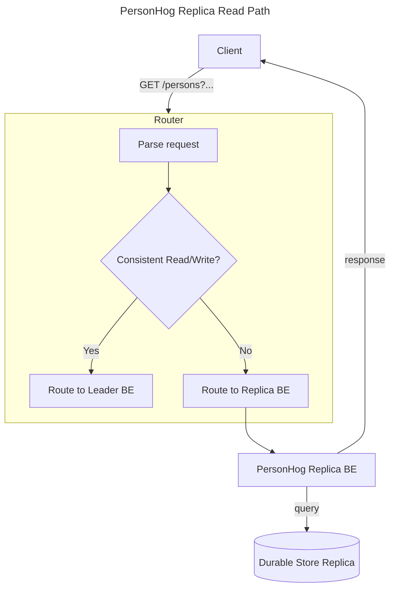

### personhog-replica cluster

### Requirements

- provides an API contract for eventual person reads, strong reads to non-persons tables, writes to non-persons tables
- provides a cheap, quickly scalable, operationally simple request path for simple data access patterns
- gRPC service

### Person deletes

`DeletePersons` tombstones person and distinct-id rows, and rejects `DELETE_PERSONS_MODE_HARD` with `INVALID_ARGUMENT`.
A hard delete would leave the live ClickHouse rows above a re-created person's version 0.
A tombstone keeps the rows with `is_deleted = true`, the version bumped by one, and person properties scrubbed, and the response reports the versions written so the caller can publish ClickHouse tombstones at exactly those versions.
The row's version counter survives, so a later create on the same key revives it above its own ClickHouse tombstone instead of restarting at version 0.
The tombstone cleanup drain (`DeleteTombstonedPersons`) removes the rows later, once their ClickHouse history is gone.
`DeletePersonsBatchForTeam` always hard-deletes, tombstoned rows included: it serves team teardown, where no sweep would ever clean the tombstones up.

### Query tags

Every statement carries `/* service='personhog-replica', operation='<name>' */` in front, the SQLCommenter shape both pganalyze and pgcollector parse, so load and latency can be cut by code path.
Compile-time checked queries write the tag at the start of the SQL literal; statements built at runtime wrap their SQL in `personhog_common::query_tag!("<name>", sql)`.
The operation is the storage method's name:

- When a method picks one of several statements, the base case keeps the name and the others add what differs, for example `get_distinct_ids_for_person_cursor`.
- When a method runs several statements in sequence, each one adds its step, for example `split_person_lock_distinct_ids`.
- A `SET` statement is named after its setting, for example `lock_timeout`.

A unit test in `src/storage/postgres/mod.rs` fails when a `.sqlx` entry lacks the tag.
See `rust/pgcollector/docs/query-tags.md` for the key vocabulary.

### Known Implementation Details

