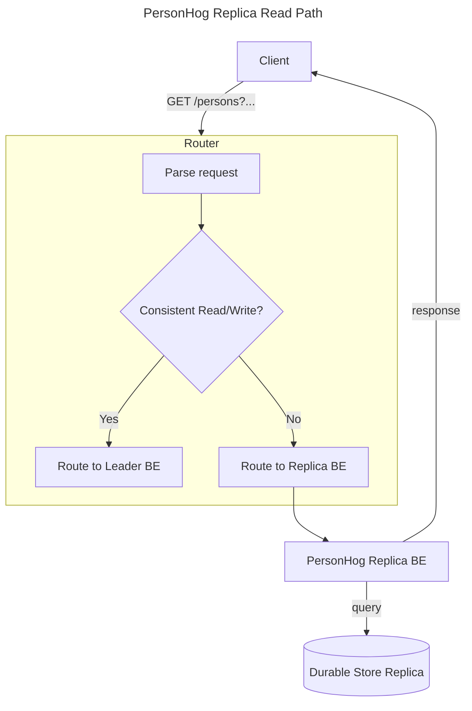

### personhog-replica cluster

### Requirements

- provides an API contract for eventual person reads, strong reads to non-persons tables, writes to non-persons tables
- provides a cheap, quickly scalable, operationally simple request path for simple data access patterns
- gRPC service

### Person deletes

`DeletePersons` tombstones person and distinct-id rows, and rejects `DELETE_PERSONS_MODE_HARD` with `INVALID_ARGUMENT`.
A hard delete would leave the live ClickHouse rows above a re-created person's version 0.
A tombstone keeps the rows with `is_deleted = true`, the version bumped by one, and person properties scrubbed, and the response reports the versions written so the caller can publish ClickHouse tombstones at exactly those versions.
The row's version counter survives, so a later create on the same key revives it above its own ClickHouse tombstone instead of restarting at version 0.
The tombstone cleanup drain (`DeleteTombstonedPersons`) removes the rows later, once their ClickHouse history is gone.
`DeletePersonsBatchForTeam` always hard-deletes, tombstoned rows included: it serves team teardown, where no sweep would ever clean the tombstones up.

### SlateDB properties

With `PROPERTY_SOURCE=slatedb`, person rows still come from Postgres and their properties from SlateDB (`PROPERTY_STORE_*`, see [personhog-property-store](../personhog-property-store/README.md)). Reads serve whatever version SlateDB holds, so properties can trail the row by up to a reader poll, or a memtable flush when readers skip the WAL. A person whose row is above version 0 but has no SlateDB record is not served: the RPC fails `UNAVAILABLE`, batch RPCs included, rather than returning empty properties. A delete marker at or above the row's version reads as not found. A record behind the row whose `created_at` is earlier than the row's belongs to a previous incarnation of the id: a revival resets `created_at` and starts the person empty, so the read serves `{}`, as it does once the delete marker arrives. `PROPERTY_READ_CONCURRENCY` (default 64) bounds the SlateDB reads in flight across requests, and a batch reads each person once however many of its keys resolve to that person. At startup the replica reads the writer's registered shard layout from etcd (`ETCD_ENDPOINTS`, `ETCD_PREFIX`) and refuses to start when nothing is registered or its own `PROPERTY_STORE_SHARDS` or location differs.

| Metric | Type | Description |
|--------|------|-------------|
| `personhog_replica_slatedb_property_reads_total{outcome}` | counter | Person reads by how SlateDB answered: `served`; `behind` (an older version served); `stub` (a version 0 row with no record, served empty); `revived` (a delete marker below the row, served empty); `previous_incarnation` (a record behind the row from before its `created_at`, served empty); `deleted` (read as not found); `merged_since` (a record behind a row whose `created_at` a merge lowered, which cannot be tied to the live incarnation), `missing`, `timeout`, `unavailable`, `undecodable` and `data` fail the RPC `UNAVAILABLE`, and `data` is logged as an error |
| `personhog_replica_slatedb_property_read_ms` | histogram | One SlateDB property read |

### Known Implementation Details

